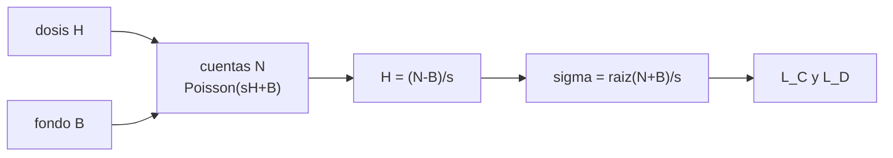

# B105-C07 — Dosimetría personal

<!-- nav:top -->
[🏠 Programa](../../../../README.md) · [📚 Bloque B105](../../../tronco-comun/B105-medicina-y-biologia-espacial.md) · [← Anterior: B105-C06 — Radiación ionizante y exposición](../B105-C06-radiacion-ionizante-y-exposicion/CLASE.md) · [Siguiente: B105-C08 — Sueño y ritmos circadianos →](../B105-C08-sueno-y-ritmos-circadianos/CLASE.md)
<!-- /nav -->

## 1. Ubicación, nivel y alcance

Clase 7 del bloque B105. Nivel N3. Un dosímetro personal convierte cuentas en una dosis; esas cuentas siguen una estadística de Poisson con un fondo que hay que restar. Aquí calculas la incertidumbre de la dosis estimada, los límites crítico y de detección y la calibración por mínimos cuadrados, con datos **sintéticos**. Parte de las magnitudes de [B105-C06](../B105-C06-radiacion-ionizante-y-exposicion/CLASE.md).

## 2. Por qué esta clase existe

Un número de dosis sin su incertidumbre no es utilizable: cerca del fondo, el dosímetro no distingue una dosis pequeña de cero. La decisión central: **¿desde qué dosis se puede afirmar que el dosímetro vio algo y con qué incertidumbre se informa?**

## 3. Lo que podrás hacer al terminar

1. Estimar `H = (N − B)/s` y su incertidumbre poissoniana.
2. Calcular los límites crítico `L_C` y de detección `L_D` en cuentas y en mSv.
3. Comprobar por simulación la cobertura del intervalo y la tasa de falsas alarmas.
4. Calibrar la sensibilidad por mínimos cuadrados con dosis de referencia.
5. Combinar la incertidumbre estadística con una de calibración.
6. Rotular los datos como sintéticos y las fórmulas de Currie como no consultadas.

La evidencia es la **ficha de dosímetro con su incertidumbre** del ejercicio 12 (sección 20).

## 4. Con qué llegas y cómo comprobarlo

1. ¿Qué es una distribución de Poisson?
2. ¿Qué es el fondo?
3. ¿Qué es la sensibilidad `s`?
4. ¿Qué es un intervalo de confianza?
5. ¿Qué es un dato sintético?

<details>
<summary>Ver respuestas</summary>

1. La de los conteos de eventos independientes; varianza igual a la media. 2. Las cuentas que aparecen sin dosis de interés. 3. Las cuentas por unidad de dosis (cuentas/mSv). 4. Un rango que cubre el valor verdadero con una frecuencia dada. 5. Un dato generado para el ejemplo, no medido.
</details>

Con cuatro o cinco aciertos, sigue; si no, repasa los prerrequisitos.

## 5. Un caso de contexto y casos de referencia

Un dosímetro **sintético** con `s = 200 cuentas/mSv` y fondo `B = 50` mide `N = 250` cuentas: `H = (250 − 50)/200 = 1,00 mSv` con `σ = √(250 + 50)/200 = 0,087 mSv`. Con 20.000 repeticiones por dosis verdadera, el intervalo de 95 % cubre el valor verdadero en 0,949–0,950 de los casos. Los límites son `L_C = 16,4` cuentas (0,082 mSv) y `L_D = 35,6` cuentas (0,178 mSv): con `H = 0` la simulación da 0,0484 de falsas alarmas y con `H = L_D/s` detecta 0,950. Es el **ejemplo conductor**: todo es **sintético**; no es la respuesta de ningún dosímetro real.

## 6. Vocabulario

El **conteo** `N ~ Poisson(sH + B)`. El **estimador** `Ĥ = (N − B̂)/s`. El **límite crítico** `L_C` es el umbral que da 5 % de falsas alarmas con dosis nula; el **límite de detección** `L_D` es la dosis verdadera detectada con 95 % de probabilidad (formas de Currie, recordadas por el autor y no consultadas aquí). La **calibración** estima `s` con dosis de referencia.

## 7. Modelo mental



*Descripción textual:* la dosis y el fondo generan cuentas poissonianas; se estima la dosis restando el fondo, se calcula su incertidumbre y se fijan los límites de decisión y de detección.

Analogía: oír una conversación en una sala con ruido; solo se distingue la voz si supera el murmullo en cierto margen. Límite: el ruido del dosímetro real tiene otras fuentes además de Poisson.

## 8. La explicación, paso a paso

### 8.1 Estimador e incertidumbre

`Ĥ = (N − B̂)/s` y `σ_H ≈ √(N + B̂)/s`. Con `H = 0` la desviación es 0,050 mSv; con `H = 10`, 0,230; con `H = 50`, 0,501. La incertidumbre absoluta crece con `√H`; la relativa decrece.

### 8.2 Cobertura

En 20.000 repeticiones por dosis, el intervalo `Ĥ ± 1,96 σ_H` cubre el valor verdadero entre 0,949 y 0,950 de los casos: la aproximación gaussiana funciona con estos conteos.

### 8.3 Límites de decisión y de detección

`L_C = 1,645√(2B) = 16,4` cuentas y `L_D = 2,71 + 4,65√B = 35,6` cuentas, es decir 0,082 y 0,178 mSv. Simulación: falsas alarmas 0,0484 y detección 0,950.

### 8.4 Calibración

Con seis dosis de referencia (1, 2, 5, 10, 20 y 50 mSv) y conteos sintéticos, `ŝ = Σ H y/Σ H² = 197,04` cuentas/mSv (verdad 200). Un error del 1,5 % en `s` produce un error proporcional en `H`: la incertidumbre de calibración se suma a la estadística.

## 9. Magnitudes, símbolos y unidades

| Símbolo | Qué es | Unidad | Valor / nota |
|---|---|---|---|
| `s` | sensibilidad | cuentas/mSv | 200 (sintética) |
| `B` | fondo | cuentas | 50 |
| `N` | cuentas medidas | cuentas | 250 (ejemplo) |
| `H` | dosis equivalente estimada | mSv | 1,00 |
| `σ_H` | incertidumbre estándar | mSv | 0,087 |
| `L_C`, `L_D` | límites crítico y de detección | cuentas | 16,4; 35,6 |

## 10. Convenciones y referencias

Conteos por periodo de uso; fondo medido en un dosímetro de control; intervalo de 95 % con `k = 1,96`. Datos sintéticos con semilla 105. Tolerancias del laboratorio: `L_C = 16,45 ± 0,01`; `L_D = 35,6 ± 0,1`; falsas alarmas = 0,05 ± 0,01; detección = 0,95 ± 0,02; `ŝ` dentro de 5 de 200. Numpy 2.4.4, Python 3.12.9.

## 11. De dónde sale lo que afirmamos

| ID | Fuente | Localizador | Respalda | Estado |
|---|---|---|---|---|
| — | Relaciones físicas, fisiológicas y estadísticas estándar usadas en el laboratorio | — | las verifica el laboratorio | No consultada en una fuente concreta (las verifica el laboratorio) |

Límites: no se consultó ninguna fuente específica para esta clase: las fórmulas de Currie y la estadística de Poisson las verifica el laboratorio por simulación; no se consultaron normas de dosimetría personal (ICRP, ISO, IEC).

## 12. Cómo ver el resultado

Descripción: la tabla de la salida por dosis verdadera (media, DE, sigma formal y cobertura) y los límites. Equivalente textual: la cobertura es 0,95 y `L_D` vale 0,178 mSv.

## 13. Ejemplo trabajado: dosis e incertidumbre de una lectura

**Paso 1 · Neto.** `N − B = 250 − 50 = 200` cuentas.

**Paso 2 · Dosis.** `200/200 = 1,00 mSv`.

**Paso 3 · Incertidumbre.** `√(250+50)/200 = 0,0866 mSv`.

**Paso 4 · Informe.** `1,00 ± 0,17 mSv` (95 %, `k = 1,96`).

## 14. Distintas formas de describir el problema

**Por cuentas:** `N`. **Por dosis:** `H`. **Por incertidumbre:** `σ_H`. **Por decisión:** `L_C`. **Por detección:** `L_D`. **Por calibración:** `ŝ`.

## 15. Práctica guiada

**Ejercicio 1 · con los pasos indicados.** Calcula `H` y `σ_H` para `N = 250`, `B = 50`, `s = 200`. *Pasos:* `(N−B)/s` y `√(N+B)/s`.

<details><summary>Solución comentada</summary>

`1,00 mSv` y `0,087 mSv`.
</details>

**Ejercicio 2 · con una pista.** Calcula `L_C` para `B = 50`. *Pista:* `1,645√(2B)`.

<details><summary>Solución comentada</summary>

`16,45` cuentas.
</details>

**Ejercicio 3 · casi autónomo.** Calcula `L_D` para `B = 50`.

<details><summary>Solución comentada</summary>

`2,71 + 4,65·7,071 = 35,6` cuentas.
</details>

## 16. Práctica autónoma, transferencia e integrador

**Ejercicio 4 · autónomo.** ¿Cuál es la incertidumbre relativa de `H = 0,5 mSv` con `σ = 0,071`?

<details><summary>Solución comentada</summary>

`14 %`.
</details>

**Ejercicio 5 · autónomo.** ¿Qué `L_D` en mSv hay con `B = 200`?

<details><summary>Solución comentada</summary>

`2,71 + 4,65·14,14 = 68,5` cuentas = 0,343 mSv.
</details>

**Ejercicio 6 · autónomo.** ¿Por qué crece `σ_H` con la dosis pero la incertidumbre relativa disminuye?

<details><summary>Solución comentada</summary>

Porque `σ ∝ √N` mientras que `H ∝ N`: el cociente cae como `1/√N`.
</details>

**Ejercicio 7 · autónomo.** Un error de calibración de 3 % en `s` sobre 10 mSv da 0,3 mSv. Combínalo con la estadística (0,23 mSv).

<details><summary>Solución comentada</summary>

`√(0,23² + 0,30²) = 0,38 mSv`.
</details>

**Ejercicio 8 · autónomo.** Calcula `ŝ` con dosis 1, 2, 3 mSv y respuestas netas 210, 390, 610.

<details><summary>Solución comentada</summary>

`(210 + 780 + 1830)/14 = 201,4` cuentas/mSv.
</details>

**Ejercicio 9 · transferencia.** Un dosímetro lleva 180 días y registra una dosis de 135 mSv: ¿cuánto vale `σ_H` relativa?

<details><summary>Solución comentada</summary>

`N = 27.050`; `√(27.100)/200 = 0,82 mSv`; relativa `0,6 %`.
</details>

**Ejercicio 10 · transferencia.** La aproximación gaussiana falla con `B = 2`. ¿Por qué?

<details><summary>Solución comentada</summary>

Con conteos de 0 a 5 la distribución de Poisson es asimétrica y discreta; hay que usar intervalos exactos o simulación.
</details>

**Ejercicio 11 · transferencia.** ¿Por qué conviene un dosímetro de control para medir el fondo?

<details><summary>Solución comentada</summary>

Para restar el fondo de ese lote y periodo, con su incertidumbre, en lugar de suponerlo constante.
</details>

**Ejercicio 12 · integrador.** Elabora tu *ficha de dosímetro con su incertidumbre*: modelo, estimador, tabla de incertidumbre, límites de decisión y detección, calibración y lista de qué es sintético.

<details><summary>Solución comentada</summary>

Secciones 8.1–8.4 y la salida del laboratorio.
</details>

## 17. Laboratorio: incertidumbre y límite de detección de un dosímetro por conteo

El script [dosimetro.py](dosimetro.py) simula 20.000 repeticiones por dosis verdadera, comprueba la cobertura del intervalo, los límites de Currie por simulación y una calibración (**comprueba** `L_C` y `L_D`, la tasa de falsas alarmas de 0,05, la detección de 0,95 y la calibración dentro de 5 cuentas/mSv).

**Datos:** todo **sintético** (semilla 105); las fórmulas de Currie no se consultaron en la fuente. **Predice antes de ejecutar:** ¿Qué cobertura esperas del intervalo de 95 %? (Cerca de 0,95.) **Ejecución del 2026-11-10 (Python 3.12.9):**

```text
Python 3.12.9; numpy 2.4.4
DATOS SINTETICOS (semilla 105): sensibilidad 200 cuentas/mSv, fondo 50 cuentas; formulas de Currie no consultadas en la fuente
Estimacion de H con 20000 repeticiones por dosis verdadera:
  H =   0.0 mSv: media   0.000, DE  0.050 mSv, sigma formal media  0.050; cobertura 95 % = 0.950
  H =   0.1 mSv: media   0.100, DE  0.055 mSv, sigma formal media  0.055; cobertura 95 % = 0.949
  H =   0.5 mSv: media   0.499, DE  0.070 mSv, sigma formal media  0.071; cobertura 95 % = 0.950
  H =   2.0 mSv: media   2.000, DE  0.112 mSv, sigma formal media  0.112; cobertura 95 % = 0.949
  H =  10.0 mSv: media  10.002, DE  0.230 mSv, sigma formal media  0.229; cobertura 95 % = 0.950
  H =  50.0 mSv: media  49.997, DE  0.501 mSv, sigma formal media  0.502; cobertura 95 % = 0.949
Currie: L_C = 16.4 cuentas = 0.082 mSv; L_D = 35.6 cuentas = 0.178 mSv
Simulacion: falsas alarmas con H = 0 y umbral L_C = 0.0484 (objetivo 0.05); deteccion con H = L_D/s = 0.950 (objetivo 0.95)
Calibracion con 6 dosis de referencia: s estimada = 197.04 cuentas/mSv (verdad 200)
Pruebas superadas.
```

```bash
python programa/clases/B105/B105-C07-dosimetria-personal/dosimetro.py
```

**Límites:** solo ruido de Poisson, sensibilidad constante, sin dependencia de la energía ni del ángulo, sin desvanecimiento ni deriva; no valida ningún dosímetro real.

## 18. Errores frecuentes y cómo corregirlos

**Informar `H` sin su incertidumbre.** Da `Ĥ ± kσ` (ejemplo 13).

**Restar el fondo sin incertidumbre.** El fondo también es Poisson (8.1).

**Declarar «hay dosis» con `N − B` menor que `L_C`.** Por debajo del límite crítico no se decide (8.3).

**Confundir `L_C` con `L_D`.** `L_C` es el umbral de decisión; `L_D`, la dosis detectable.

## 19. Cómo sabrás que vas bien

Tras la sección 8: ¿informas una lectura con su incertidumbre? Si dudas, repasa el ejemplo 13. Tras el laboratorio: ¿qué comprueba? (ver la sección 17).

## 20. Qué entregas y cómo se evalúa

El producto es tu **ficha de dosímetro con su incertidumbre** (ejercicio 12).

| Criterio | Inicial | En desarrollo | Logrado | Destacado |
|---|---|---|---|---|
| Conceptos | Confunde las magnitudes | Parciales | Explica `H`, `σ_H`, `L_C` y `L_D` | Explica la combinación de incertidumbres |
| Cálculo | Sin unidades | Con errores | Calcula con unidades y tolerancias | Calcula casos nuevos |
| Numérico | Sin comprobar | Un caso | Compara con la verdad del generador | Interpreta la sensibilidad |
| Fuentes | Sin fuente | Sin fecha | Cita solo lo consultado, con fecha | Rotula lo sintético y lo no consultado |
| Límites | No los nombra | Uno | Tres | Discute qué falta del modelo |

**Condiciones críticas (no se compensan con promedio):** rotular los datos como sintéticos; no presentar un resultado simulado como observado; no dar consejo médico ni operativo; citar solo lo consultado.

## 21. Ética, seguridad y límites

Clase **educativa**: no es consejo médico, no sustituye la formación, la licencia ni la supervisión de profesionales, y no contiene dosis, tratamientos ni procedimientos para aplicar a una persona real. La dosimetría real sigue procedimientos acreditados y la interpretación de una dosis corresponde a profesionales de protección radiológica. Accesibilidad: tablas equivalentes a las gráficas, fórmulas en texto, ejercicios sin conexión.

## 22. Para cerrar y seguir

Con `s = 200` y `B = 50`, la dosis detectable es 0,178 mSv y la lectura de 1,00 mSv se informa como 1,00 ± 0,17 mSv. Queda una pregunta: ¿cómo se alinea el cuerpo con la luz y el sueño?

**Glosario español–inglés.** dosímetro · *dosimeter*; límite de detección · *detection limit*; fondo · *background*; calibración · *calibration*.

**Continuidad.** [B105-C08](../B105-C08-sueno-y-ritmos-circadianos/CLASE.md) estudia el sueño y los ritmos circadianos.

**Referencias:** ver sección 11.

<!-- nav:bottom -->
---

[← Anterior: B105-C06 — Radiación ionizante y exposición](../B105-C06-radiacion-ionizante-y-exposicion/CLASE.md) · [📚 Bloque B105](../../../tronco-comun/B105-medicina-y-biologia-espacial.md) · [Siguiente: B105-C08 — Sueño y ritmos circadianos →](../B105-C08-sueno-y-ritmos-circadianos/CLASE.md)
<!-- /nav -->
