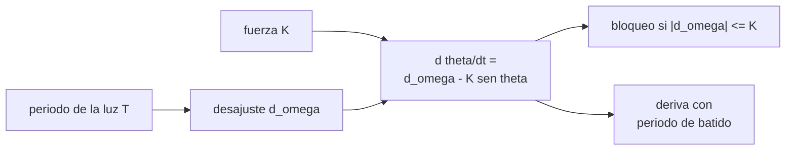

# B105-C08 — Sueño y ritmos circadianos

<!-- nav:top -->
[🏠 Programa](../../../../README.md) · [📚 Bloque B105](../../../tronco-comun/B105-medicina-y-biologia-espacial.md) · [← Anterior: B105-C07 — Dosimetría personal](../B105-C07-dosimetria-personal/CLASE.md) · [Siguiente: B105-C09 — Salud mental en aislamiento →](../B105-C09-salud-mental-en-aislamiento/CLASE.md)
<!-- /nav -->

## 1. Ubicación, nivel y alcance

Clase 8 del bloque B105. Nivel N3. El reloj circadiano es un oscilador interno de periodo cercano a 24 h que se sincroniza con el ciclo de luz. Aquí lo modelas con la ecuación de Adler (solo la fase), calculas el intervalo de arrastre, la deriva fuera de él y qué ocurre con un ciclo orbital de unos 90 minutos. La conexión con el estrés y la hormona del cortisol está en [B105-C22](../B105-C22-sistema-neuroendocrino-y-respuesta-al-estres-en-vuelo/CLASE.md).

## 2. Por qué esta clase existe

En órbita hay unos 16 amaneceres al día: la luz externa no sirve de reloj. La decisión central: **¿qué ciclo de luz puede sincronizar a un reloj de periodo 24,2 h con una fuerza de arrastre dada y cuánto tarda en realinearse tras un salto?**

## 3. Lo que podrás hacer al terminar

1. Plantear `dθ/dt = Δω − K sen θ` y reconocer el arrastre como un bloqueo de fase.
2. Calcular el intervalo de periodos de luz que arrastran y compararlo con la simulación.
3. Calcular el periodo de batido de la deriva fuera del intervalo.
4. Calcular los amaneceres por día de una órbita baja y por qué no arrastran.
5. Estimar el tiempo de realineamiento tras un salto de fase.
6. Rotular el modelo como didáctico y no dar recomendaciones de sueño o de horarios.

La evidencia es la **ficha circadiana con el horario de luz** del ejercicio 12 (sección 20).

## 4. Con qué llegas y cómo comprobarlo

1. ¿Qué es el periodo de un oscilador?
2. ¿Qué es el arrastre?
3. ¿Qué es una ecuación diferencial de primer orden?
4. ¿Qué es la integración de Euler?
5. ¿Qué es un dato sintético?

<details>
<summary>Ver respuestas</summary>

1. El tiempo de un ciclo; frecuencia angular `2π/T`. 2. La sincronización del oscilador con una señal periódica externa. 3. Una relación entre una variable y su derivada. 4. Avanzar con `x ← x + dt·f(x)`. 5. Un dato generado para el ejemplo, no medido.
</details>

Con cuatro o cinco aciertos, sigue; si no, repasa los prerrequisitos.

## 5. Un caso de contexto y casos de referencia

Un reloj de periodo intrínseco 24,2 h con fuerza de arrastre `K = 0,01 rad/h` (ambos **ilustrativos**) se sincroniza con ciclos de luz de periodo entre 23,30 y 25,17 h. Con 24 h y 25 h queda arrastrado; con 22 h, 23 h, 26 h y 28 h deriva (por ejemplo, con 26 h el periodo de batido es 420,7 h). Una órbita de 92,7 min (valor de orden de magnitud, no consultado) da 15,53 amaneceres/día y `|Δω| = 3,81 rad/h ≫ K`: sin arrastre. Tras un salto de 6 h el reloj se realinea en 206 h (8,6 días). Es el **ejemplo conductor**: todo es **sintético/ilustrativo**.

## 6. Vocabulario

La **fase** `θ` es la diferencia entre reloj y luz. El **desajuste** `Δω = 2π/τ − 2π/T`. La **fuerza de arrastre** `K` mide cuánto corrige la luz. El **bloqueo de fase** ocurre si `|Δω| ≤ K` y `θ* = arcsen(Δω/K)`. El **periodo de batido** fuera del intervalo es `2π/√(Δω² − K²)`. El **salto de fase** es un cambio brusco del horario.

## 7. Modelo mental



*Descripción textual:* el periodo de la luz fija el desajuste con el reloj; la ecuación de Adler lo compara con la fuerza de arrastre y da bloqueo de fase o deriva con un periodo de batido.

Analogía: dos péndulos acoplados débilmente se sincronizan si sus periodos son parecidos. Límite: el reloj real responde a la luz según su fase (curva de respuesta), no con un seno fijo.

## 8. La explicación, paso a paso

### 8.1 Intervalo de arrastre

`|Δω| ≤ K` da `2π/(2π/τ + K) ≤ T ≤ 2π/(2π/τ − K)`: de 23,30 h a 25,17 h (1,87 h de ancho). Con 24,2 h, `Δω = 0` y `θ* = 0`.

### 8.2 Simulación

Con Euler (`dt = 0,05 h`, 2.000 h) la deriva final es 0 para 24, 24,2 y 25 h (arrastrado) y distinta de cero para 20, 22, 23, 26 y 28 h. El periodo de batido es 117,2 h (20 h), 262,2 (22), 687,6 (23), 420,7 (26) y 186,0 (28).

### 8.3 Con un ciclo orbital

Con `T = 1,545 h` hay 15,53 amaneceres por día y `|Δω| = 3,81 rad/h`, 381 veces `K`: el reloj no se sincroniza con ese ciclo. La luz del hábitat se programa con un ciclo de 24 h aproximado (un tema de diseño, no una recomendación).

### 8.4 Realineamiento

Con salto de 6 h (90°) y `T = 24 h`, `|θ| < 0,05 rad` tras 206 h (8,6 días). Con `K` mayor el realineamiento es más rápido; con `K = 0,10` el intervalo se ensancha de 17,5 a 39,4 h.

## 9. Magnitudes, símbolos y unidades

| Símbolo | Qué es | Unidad | Valor / nota |
|---|---|---|---|
| `τ` | periodo intrínseco | h | 24,2 (ilustrativo) |
| `T` | periodo de la luz | h | 20 a 28; 1,545 (órbita) |
| `Δω` | desajuste | rad/h | 0 a 0,05 |
| `K` | fuerza de arrastre | rad/h | 0,01 (ilustrativa) |
| `θ` | diferencia de fase | rad | salto de 6 h = 1,571 |

## 10. Convenciones y referencias

Fase en radianes (24 h = 2π). Euler con `dt = 0,05 h`; criterio de bloqueo: variación de `θ` en la última hora menor que 0,001 rad/h. Datos sintéticos/ilustrativos; no hay mediciones. Tolerancias: intervalo analítico 23,30 y 25,17 ± 0,05 h; arrastre en 24, 24,2 y 25 h; `|Δω|` orbital > 10 `K`. Numpy 2.4.4, Python 3.12.9.

## 11. De dónde sale lo que afirmamos

| ID | Fuente | Localizador | Respalda | Estado |
|---|---|---|---|---|
| — | Relaciones físicas, fisiológicas y estadísticas estándar usadas en el laboratorio | — | las verifica el laboratorio | No consultada en una fuente concreta (las verifica el laboratorio) |

Límites: no se consultó literatura de cronobiología ni mediciones en vuelo; `τ`, `K` y el periodo orbital son valores de enseñanza; el modelo ignora la dependencia de fase de la respuesta a la luz, la intensidad y el espectro.

## 12. Cómo ver el resultado

Descripción: la tabla de la salida por periodo de luz (desajuste, deriva, resultado y batido). Equivalente textual: solo arrastran periodos de 23,3 a 25,2 h con este `K`.

## 13. Ejemplo trabajado: intervalo de arrastre y desajuste

**Paso 1 · Frecuencia intrínseca.** `2π/24,2 = 0,2596 rad/h`.

**Paso 2 · Con `T = 25 h`.** `2π/25 = 0,2513`; `Δω = 0,0083`.

**Paso 3 · Comparación.** `0,0083 ≤ 0,01`: arrastra.

**Paso 4 · Fase de bloqueo.** `θ* = arcsen(0,83) = 56°`, es decir 3,7 h de retraso.

## 14. Distintas formas de describir el problema

**Por periodo:** `T`. **Por frecuencia:** `2π/T`. **Por fase:** `θ`. **Por desajuste:** `Δω` frente a `K`. **Por batido:** periodo de deriva. **Por tabla:** resultado por `T`.

## 15. Práctica guiada

**Ejercicio 1 · con los pasos indicados.** Calcula `Δω` para `T = 24 h` y `τ = 24,2 h`. *Pasos:* `2π(1/24,2 − 1/24)`.

<details><summary>Solución comentada</summary>

`−0,0022 rad/h`.
</details>

**Ejercicio 2 · con una pista.** ¿Cuántos amaneceres por día da una órbita de 1,545 h? *Pista:* `24/T`.

<details><summary>Solución comentada</summary>

`15,53`.
</details>

**Ejercicio 3 · casi autónomo.** ¿Cuántos grados son 6 h de desfase?

<details><summary>Solución comentada</summary>

`6/24·360 = 90°` (1,571 rad).
</details>

## 16. Práctica autónoma, transferencia e integrador

**Ejercicio 4 · autónomo.** ¿Cuál es el periodo de batido con `T = 26 h`?

<details><summary>Solución comentada</summary>

`2π/√(0,0180² − 0,01²) = 420,7 h` (17,5 días).
</details>

**Ejercicio 5 · autónomo.** ¿Cuál es el ancho del intervalo de arrastre?

<details><summary>Solución comentada</summary>

`25,17 − 23,30 = 1,87 h`.
</details>

**Ejercicio 6 · autónomo.** ¿Por qué un ciclo de 1,5 h no arrastra a un reloj de 24,2 h?

<details><summary>Solución comentada</summary>

Porque `|Δω| = 3,81 ≫ K`: la fuerza de arrastre no alcanza a compensar un desajuste tan grande.
</details>

**Ejercicio 7 · autónomo.** ¿Cuál es la fase de bloqueo con `T = 25 h` y a cuántas horas equivale?

<details><summary>Solución comentada</summary>

`θ* = arcsen(0,0083/0,01) = 0,98 rad = 3,7 h`.
</details>

**Ejercicio 8 · autónomo.** ¿Cuánto tarda el realineamiento tras 6 h de salto con `K = 0,01`?

<details><summary>Solución comentada</summary>

206 h (8,6 días) según el laboratorio.
</details>

**Ejercicio 9 · transferencia.** Con `K = 0,10`, ¿cuál es el intervalo de arrastre?

<details><summary>Solución comentada</summary>

`T = 17,5` a `39,4 h`.
</details>

**Ejercicio 10 · transferencia.** Un sol de Marte dura unas 24,65 h (valor de enseñanza, no consultado). ¿Arrastra con `K = 0,01`?

<details><summary>Solución comentada</summary>

`Δω = 2π(1/24,2 − 1/24,65) = 0,0047 < 0,01`: sí arrastra.
</details>

**Ejercicio 11 · transferencia.** Con `K` desconocida, ¿cómo estimarías `K` a partir de dos periodos límite observados?

<details><summary>Solución comentada</summary>

`K = |2π/τ − 2π/T_lim|`; con `T_lim = 25,17` y `τ = 24,2`: `0,0100`.
</details>

**Ejercicio 12 · integrador.** Elabora tu *ficha circadiana con el horario de luz*: ecuación, intervalo de arrastre, tabla por periodo, caso orbital, tiempo de realineamiento y lista de qué es ilustrativo.

<details><summary>Solución comentada</summary>

Secciones 8.1–8.4 y la salida del laboratorio.
</details>

## 17. Laboratorio: oscilador circadiano arrastrado por luz

El script [circadiano.py](circadiano.py) integra la ecuación de Adler para ocho periodos de luz, compara con el intervalo analítico y calcula el caso orbital y el realineamiento (**comprueba** el arrastre en 24; 24,2 y 25 h, la deriva en los demás, el intervalo analítico y `|Δω|` orbital > 10 `K`).

**Datos:** todo **sintético/ilustrativo**; el periodo orbital es de orden de magnitud y no se consultó. **Predice antes de ejecutar:** ¿Qué pasa con un ciclo de luz de 1,5 h? (No arrastra.) **Ejecución del 2026-11-10 (Python 3.12.9):**

```text
Python 3.12.9; numpy 2.4.4
DATOS SINTETICOS/ILUSTRATIVOS: tau = 24.2 h y K = 0.01 rad/h; sin mediciones
Intervalo de arrastre analitico: T de 23.30 h a 25.17 h (|d_omega| <= K)
T de la luz [h]   |d_omega| [rad/h]   deriva final [rad/h]   resultado   periodo de batido analitico [h]
    20.0            0.0545              0.05960            deriva         117.2
    22.0            0.0260              0.01937            deriva         262.2
    23.0            0.0135              0.02023            deriva         687.6
    24.0            0.0022              0.00000            arrastrado   -
    24.2            0.0000              0.00000            arrastrado   -
    25.0            0.0083              0.00000            arrastrado   -
    26.0            0.0180              0.02295            deriva         420.7
    28.0            0.0352              0.03967            deriva         186.0
Ciclo orbital: 15.53 amaneceres/dia (T = 1.545 h); |d_omega| = 3.81 rad/h >> K = 0.01: no hay arrastre
Desfase de 6 h entre el reloj y la luz = 1.571 rad = 90 grados
Tras un salto de fase de 6 h con T = 24 h, el reloj se realinea (|theta| < 0.05 rad) en 206 h = 8.6 dias
Pruebas superadas.
```

```bash
python programa/clases/B105/B105-C08-sueno-y-ritmos-circadianos/circadiano.py
```

**Límites:** modelo de fase único, sin curva de respuesta a la luz, sin intensidad ni espectro, sin sueño homeostático; no recomienda horarios ni iluminación.

## 18. Errores frecuentes y cómo corregirlos

**Creer que cualquier ciclo de luz sincroniza.** Solo los del intervalo (8.1).

**Confundir el periodo con la frecuencia.** Usa `2π/T`.

**Tomar `K` como medida.** Es ilustrativa.

**Dar recomendaciones de sueño a partir del modelo.** Es solo didáctico.

## 19. Cómo sabrás que vas bien

Tras la sección 8: ¿decides si un ciclo arrastra? Si dudas, repasa el ejemplo 13. Tras el laboratorio: ¿qué comprueba? (ver la sección 17).

## 20. Qué entregas y cómo se evalúa

El producto es tu **ficha circadiana con el horario de luz** (ejercicio 12).

| Criterio | Inicial | En desarrollo | Logrado | Destacado |
|---|---|---|---|---|
| Conceptos | Confunde las magnitudes | Parciales | Explica `Δω`, `K` y el bloqueo | Explica los límites de un modelo de solo fase |
| Cálculo | Sin unidades | Con errores | Calcula con unidades y tolerancias | Calcula casos nuevos |
| Numérico | Sin comprobar | Un caso | Compara con la verdad del generador | Interpreta la sensibilidad |
| Fuentes | Sin fuente | Sin fecha | Cita solo lo consultado, con fecha | Rotula lo sintético y lo no consultado |
| Límites | No los nombra | Uno | Tres | Discute qué falta del modelo |

**Condiciones críticas (no se compensan con promedio):** rotular los datos como sintéticos; no presentar un resultado simulado como observado; no dar consejo médico ni operativo; citar solo lo consultado.

## 21. Ética, seguridad y límites

Clase **educativa**: no es consejo médico, no sustituye la formación, la licencia ni la supervisión de profesionales, y no contiene dosis, tratamientos ni procedimientos para aplicar a una persona real. No hay aquí recomendaciones de sueño ni de iluminación; la salud del sueño de una persona real la valoran profesionales. Accesibilidad: tablas equivalentes a las gráficas, fórmulas en texto, ejercicios sin conexión.

## 22. Para cerrar y seguir

Con `K = 0,01 rad/h` solo arrastran periodos de 23,30 a 25,17 h; el ciclo orbital de 1,5 h no. Queda una pregunta: ¿cómo se vigila la salud mental cuando el aislamiento dura meses?

**Glosario español–inglés.** ritmo circadiano · *circadian rhythm*; arrastre · *entrainment*; fase · *phase*; batido · *beat*.

**Continuidad.** [B105-C09](../B105-C09-salud-mental-en-aislamiento/CLASE.md) estudia la salud mental en aislamiento.

**Referencias:** ver sección 11.

<!-- nav:bottom -->
---

[← Anterior: B105-C07 — Dosimetría personal](../B105-C07-dosimetria-personal/CLASE.md) · [📚 Bloque B105](../../../tronco-comun/B105-medicina-y-biologia-espacial.md) · [Siguiente: B105-C09 — Salud mental en aislamiento →](../B105-C09-salud-mental-en-aislamiento/CLASE.md)
<!-- /nav -->
