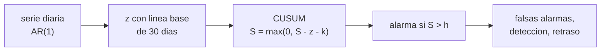

# B105-C09 — Salud mental en aislamiento

<!-- nav:top -->
[🏠 Programa](../../../../README.md) · [📚 Bloque B105](../../../tronco-comun/B105-medicina-y-biologia-espacial.md) · [← Anterior: B105-C08 — Sueño y ritmos circadianos](../B105-C08-sueno-y-ritmos-circadianos/CLASE.md) · [Siguiente: B105-C10 — Respuesta inmune →](../B105-C10-respuesta-inmune/CLASE.md)
<!-- /nav -->

## 1. Ubicación, nivel y alcance

Clase 9 del bloque B105. Nivel N3. El aislamiento prolongado exige vigilar el bienestar de la tripulación sin saturarla de falsas alarmas. Aquí tratas un seguimiento diario de una escala de ánimo **sintética** como un problema de detección de cambios con la suma acumulada (CUSUM) y mides el compromiso entre falsas alarmas y retraso. No es una herramienta de evaluación psicológica; la psicometría se estudia en [B105-C27](../B105-C27-instrumentos-validados-y-psicometria-en-investigacion/CLASE.md).

## 2. Por qué esta clase existe

Un umbral bajo detecta pronto pero alarma de más; uno alto alarma poco pero tarda. Con una tripulación pequeña, las falsas alarmas se acumulan. La decisión central: **¿qué umbral equilibra el retraso de detección y la tasa de falsas alarmas, y qué probabilidad hay de al menos una falsa alarma en la tripulación?**

## 3. Lo que podrás hacer al terminar

1. Construir una serie AR(1) y una línea base personal con media y desviación.
2. Calcular el CUSUM unilateral y el momento de la primera alarma.
3. Medir tasa de falsas alarmas, detecciones y retraso mediano por umbral.
4. Calcular la probabilidad de al menos una falsa alarma en una tripulación.
5. Explicar por qué una línea base corta infla las falsas alarmas.
6. Rotular el ejercicio como sintético y no como evaluación psicológica.

La evidencia es la **ficha de seguimiento con su tasa de falsas alarmas** del ejercicio 12 (sección 20).

## 4. Con qué llegas y cómo comprobarlo

1. ¿Qué es una puntuación z?
2. ¿Qué es un proceso AR(1)?
3. ¿Qué es una falsa alarma?
4. ¿Qué es la sensibilidad de detección?
5. ¿Qué es un dato sintético?

<details>
<summary>Ver respuestas</summary>

1. El valor menos la media, dividido por la desviación estándar. 2. Uno donde cada valor depende del anterior: `x_t = φ x_{t−1} + e_t`. 3. Una alarma cuando no hay cambio. 4. La fracción de cambios reales que se detectan. 5. Un dato generado para el ejemplo, no medido.
</details>

Con cuatro o cinco aciertos, sigue; si no, repasa los prerrequisitos.

## 5. Un caso de contexto y casos de referencia

Una serie **sintética** AR(1) (`φ = 0,4`) de 180 días, con línea base de los 30 primeros días y un salto de −1 DE desde el día 90. Con una ventana de vigilancia de 90 días y umbral `h = 4`, el CUSUM detecta el 99,7 % de los cambios con un retraso mediano de 6 días, pero da falsas alarmas en el 64,8 % de las series sin cambio (± 1,3 %); con `h = 8`, 28,1 % y 12 días. Para 6 personas, la probabilidad de al menos una falsa alarma con `h = 4` es 0,998. Es el **ejemplo conductor**: todo es **sintético**; no se usó ninguna escala real.

## 6. Vocabulario

La **línea base personal** es la media y la desviación de los primeros días. La **puntuación z** estandariza la serie. El **CUSUM** inferior es `S_t = máx(0, S_{t−1} − z_t − k)` con alarma si `S_t > h` (`k = 0,5`). La **tasa de falsas alarmas** es la fracción de series sin cambio que alarman. El **retraso** es el tiempo hasta la primera alarma tras el cambio. La **autocorrelación** AR(1) mide la dependencia entre días consecutivos.

## 7. Modelo mental



*Descripción textual:* la serie se estandariza con una línea base personal, el CUSUM acumula las desviaciones bajas y emite una alarma al superar `h`; se mide el compromiso entre falsas alarmas, detección y retraso.

Analogía: un termostato con histéresis; si reacciona a todo, enciende sin necesidad, si reacciona poco, tarda. Límite: aquí lo que se vigila es una escala y no una persona; una alarma no es un diagnóstico.

## 8. La explicación, paso a paso

### 8.1 La serie y la línea base

`x_t = 0,4 x_{t−1} + e_t` con varianza estacionaria 1. La línea base es la media y la DE de los 30 primeros días de cada serie; el error de esa estimación afecta a todas las `z` posteriores.

### 8.2 El CUSUM

`S_t = máx(0, S_{t−1} − z_t − k)`, `k = 0,5`, iniciado en 0 al comienzo de la ventana de vigilancia (día 90). Con `z = −1,5` cada día, `S` sube 1,0 por día y supera `h = 4` al quinto día.

### 8.3 Compromiso por umbral

| `h` | Falsas alarmas (90 d, sin cambio) | Detecciones (con cambio) | Retraso mediano (días) |
|---|---|---|---|
| 3 | 0,790 | 0,999 | 4 |
| 4 | 0,648 | 0,997 | 6 |
| 5 | 0,522 | 0,992 | 7 |
| 6 | 0,425 | 0,988 | 9 |
| 8 | 0,281 | 0,977 | 12 |

Subir `h` baja las falsas alarmas y alarga el retraso. Las falsas alarmas son altas porque la línea base de 30 días es ruidosa y la serie está autocorrelacionada.

### 8.4 Una tripulación

Con `h = 4`, la falsa alarma es 0,648 ± 0,013 (95 %, 5.000 series). Con 6 personas, `1 − (1 − 0,648)⁶ = 0,998`: casi seguro que alguien alarma sin cambio real. Un buen diseño usa una línea base larga, umbrales mayores o confirmación.

## 9. Magnitudes, símbolos y unidades

| Símbolo | Qué es | Unidad | Valor / nota |
|---|---|---|---|
| `φ` | autocorrelación | — | 0,4 (sintética) |
| `z` | puntuación estandarizada | — | media 0, DE 1 |
| `k` | holgura del CUSUM | DE | 0,5 |
| `h` | umbral de alarma | DE | 3 a 8 |
| `S` | suma acumulada | DE | ≥ 0 |
| FA | tasa de falsas alarmas | fracción | 0,648 (`h = 4`) |

## 10. Convenciones y referencias

Escala en puntuaciones z (sin unidades); ventana de vigilancia de 90 días tras 90 días de serie; salto de −1 DE. Datos sintéticos con semilla 105 (5.000 series por escenario). Tolerancias del laboratorio: falsas alarmas decrecientes con `h`; detección con `h = 4` mayor que 0,5. Numpy 2.4.4, Python 3.12.9.

## 11. De dónde sale lo que afirmamos

| ID | Fuente | Localizador | Respalda | Estado |
|---|---|---|---|---|
| 1 | NASA, «Human Research Program», resumen de la página por WebFetch | https://www.nasa.gov/hrp/ (consultada el 2026-11-10) | el programa tiene un elemento de factores humanos y desempeño conductual que aborda la salud mental en misiones futuras | Consultada (resumen de la página; cualitativa) |
| — | CUSUM, AR(1) y estadística descriptiva | — | los verifica el laboratorio | No consultados en una fuente concreta (los verifica el laboratorio) |

Límites: no se consultó literatura de salud mental en aislamiento ni escalas validadas; el modelo AR(1), el salto y los umbrales son didácticos; no se consultó la NASA sobre salud conductual más allá de saber que su Human Research Program tiene un elemento de factores humanos y desempeño conductual (página consultada el 2026-11-10).

## 12. Cómo ver el resultado

Descripción: la tabla de 8.3. Equivalente textual: más umbral, menos falsas alarmas y más retraso; con 6 personas una alarma falsa es casi segura con `h = 4`.

## 13. Ejemplo trabajado: un paso del CUSUM

**Paso 1 · z.** Valor 4, media 6, DE 2: `z = −1`.

**Paso 2 · Paso del CUSUM.** `S` previo 0,8; `S = máx(0, 0,8 − (−1) − 0,5) = 1,3`.

**Paso 3 · Umbral.** `1,3 < 4`: sin alarma.

**Paso 4 · Persistencia.** Tres días más de `z = −1` suman `+0,5` por día: `1,3 → 1,8 → 2,3 → 2,8`.

## 14. Distintas formas de describir el problema

**Por serie:** `x_t`. **Por z:** estandarización. **Por suma:** `S_t`. **Por umbral:** `h`. **Por compromiso:** tabla de 8.3. **Por tripulación:** `1 − (1 − p)^n`.

## 15. Práctica guiada

**Ejercicio 1 · con los pasos indicados.** Calcula `z` para `x = 4`, `μ = 6`, `σ = 2`. *Pasos:* `(x − μ)/σ`.

<details><summary>Solución comentada</summary>

`−1`.
</details>

**Ejercicio 2 · con una pista.** Con `S = 0,8`, `z = −1,2`, `k = 0,5`, ¿cuál es el nuevo `S`? *Pista:* `máx(0, S − z − k)`.

<details><summary>Solución comentada</summary>

`0,8 + 1,2 − 0,5 = 1,5`.
</details>

**Ejercicio 3 · casi autónomo.** Si `z = −1,5` cada día, ¿en qué día supera `S` el umbral 4?

<details><summary>Solución comentada</summary>

`S` sube 1,0 por día: 5.º día (`S = 5 > 4`).
</details>

## 16. Práctica autónoma, transferencia e integrador

**Ejercicio 4 · autónomo.** Con falsas alarmas 0,648 por persona, ¿cuál es la probabilidad de al menos una en 6?

<details><summary>Solución comentada</summary>

`1 − 0,352⁶ = 0,998`.
</details>

**Ejercicio 5 · autónomo.** Con `h = 8`, ¿cuánto bajan las falsas alarmas respecto de `h = 4`?

<details><summary>Solución comentada</summary>

`(0,648 − 0,281)/0,648 = 56,6 %`.
</details>

**Ejercicio 6 · autónomo.** ¿Por qué una línea base de 30 días infla las falsas alarmas?

<details><summary>Solución comentada</summary>

Porque media y DE estimadas con 30 puntos autocorrelacionados tienen error, y todas las `z` posteriores heredan ese sesgo.
</details>

**Ejercicio 7 · autónomo.** Si el 5 % de las series tuviera un cambio real (sensibilidad 0,997, falsas alarmas 0,648), ¿qué fracción de las alarmas sería verdadera?

<details><summary>Solución comentada</summary>

`0,05·0,997/(0,05·0,997 + 0,95·0,648) = 0,075`: el 7,5 %.
</details>

**Ejercicio 8 · autónomo.** ¿Qué compromiso ves entre `h = 3` y `h = 8` en retraso y falsas alarmas?

<details><summary>Solución comentada</summary>

Retraso 4 → 12 días y falsas alarmas 0,790 → 0,281.
</details>

**Ejercicio 9 · transferencia.** Se usa un CUSUM bilateral (inferior y superior). ¿Cómo cambia la tasa de falsas alarmas?

<details><summary>Solución comentada</summary>

Aproximadamente se duplica (cota de la unión: hasta `2·p`), porque hay dos oportunidades de alarma.
</details>

**Ejercicio 10 · transferencia.** ¿Por qué una alarma del CUSUM no es un diagnóstico?

<details><summary>Solución comentada</summary>

Porque indica un cambio estadístico en una serie, no su causa ni un estado clínico; requiere evaluación profesional.
</details>

**Ejercicio 11 · transferencia.** ¿Cómo se reduciría la tasa de falsas alarmas sin perder demasiada sensibilidad?

<details><summary>Solución comentada</summary>

Con una línea base más larga, confirmación por una segunda medida o alarma tras días consecutivos sobre el umbral.
</details>

**Ejercicio 12 · integrador.** Elabora tu *ficha de seguimiento con su tasa de falsas alarmas*: serie, línea base, CUSUM, tabla por umbral, riesgo de falsa alarma de tripulación y lista de qué es sintético.

<details><summary>Solución comentada</summary>

Secciones 8.1–8.4 y la salida del laboratorio.
</details>

## 17. Laboratorio: detección de cambios en un seguimiento de ánimo

El script [aislamiento.py](aislamiento.py) simula 5.000 series sintéticas con y sin cambio, aplica el CUSUM con cinco umbrales y calcula falsas alarmas, detecciones y retraso (**comprueba** que las falsas alarmas decrecen con el umbral, que la detección no crece con el umbral y que con `h = 4` supera 0,5).

**Datos:** todo **sintético** (semilla 105); no hay escalas reales ni datos de personas. **Predice antes de ejecutar:** ¿Qué le pasa al retraso al subir el umbral? (Aumenta.) **Ejecución del 2026-11-10 (Python 3.12.9):**

```text
Python 3.12.9; numpy 2.4.4
DATOS SINTETICOS (semilla 105): AR(1) con phi = 0.4; salto de -1 DE desde el dia 90 en la serie con cambio; sin escalas reales
umbral h | falsas alarmas en 90 d de vigilancia (sin cambio) | detecciones (con cambio) | retraso mediano [dias]
   3.0   |        0.790                           |   0.999               |     4.0
   4.0   |        0.648                           |   0.997               |     6.0
   5.0   |        0.522                           |   0.992               |     7.0
   6.0   |        0.425                           |   0.988               |     9.0
   8.0   |        0.281                           |   0.977               |    12.0
Con h = 4: falsas alarmas (90 d) = 0.648 +- 0.013 (95 %, n = 5000 series)
Con una tripulacion de 6 personas, P(al menos una falsa alarma en la mision) con h = 4 = 0.998
Pruebas superadas.
```

```bash
python programa/clases/B105/B105-C09-salud-mental-en-aislamiento/aislamiento.py
```

**Límites:** AR(1) simple, un solo cambio de nivel, línea base sin deriva, sin estacionalidad (por ejemplo, efectos por fase de la misión); no es una evaluación psicológica ni predice comportamiento.

## 18. Errores frecuentes y cómo corregirlos

**Tomar una alarma como diagnóstico.** Es un cambio estadístico (ejercicio 10).

**Olvidar las falsas alarmas en tripulaciones.** Calcula `1 − (1 − p)^n` (8.4).

**Usar una línea base muy corta.** Inflan las falsas alarmas (8.3).

**Presentar la serie sintética como datos de personas.** Se rotula (sección 10).

## 19. Cómo sabrás que vas bien

Tras la sección 8: ¿calculas falsas alarmas y retraso por umbral? Si dudas, repasa el ejemplo 13. Tras el laboratorio: ¿qué comprueba? (ver la sección 17).

## 20. Qué entregas y cómo se evalúa

El producto es tu **ficha de seguimiento con su tasa de falsas alarmas** (ejercicio 12).

| Criterio | Inicial | En desarrollo | Logrado | Destacado |
|---|---|---|---|---|
| Conceptos | Confunde las magnitudes | Parciales | Explica CUSUM, `h` y retraso | Explica el efecto de la línea base y la tripulación |
| Cálculo | Sin unidades | Con errores | Calcula con unidades y tolerancias | Calcula casos nuevos |
| Numérico | Sin comprobar | Un caso | Compara con la verdad del generador | Interpreta la sensibilidad |
| Fuentes | Sin fuente | Sin fecha | Cita solo lo consultado, con fecha | Rotula lo sintético y lo no consultado |
| Límites | No los nombra | Uno | Tres | Discute qué falta del modelo |

**Condiciones críticas (no se compensan con promedio):** rotular los datos como sintéticos; no presentar un resultado simulado como observado; no dar consejo médico ni operativo; citar solo lo consultado.

## 21. Ética, seguridad y límites

Clase **educativa**: no es consejo médico, no sustituye la formación, la licencia ni la supervisión de profesionales, y no contiene dosis, tratamientos ni procedimientos para aplicar a una persona real. Seguir a personas exige consentimiento, confidencialidad y profesionales; esta clase solo ejercita estadística sobre datos sintéticos y no sustituye la atención psicológica ni psiquiátrica. Accesibilidad: tablas equivalentes a las gráficas, fórmulas en texto, ejercicios sin conexión.

## 22. Para cerrar y seguir

Con `h = 4`, el CUSUM detecta casi todos los cambios en 6 días, pero el 64,8 % de las series sin cambio alarma y en una tripulación de 6 es casi seguro que alguien alarme. Queda una pregunta: ¿cómo cambia la defensa del cuerpo en el vuelo?

**Glosario español–inglés.** línea base · *baseline*; falsa alarma · *false alarm*; suma acumulada · *cumulative sum*; autocorrelación · *autocorrelation*.

**Continuidad.** [B105-C10](../B105-C10-respuesta-inmune/CLASE.md) estudia la respuesta inmune.

**Referencias:** ver sección 11.

<!-- nav:bottom -->
---

[← Anterior: B105-C08 — Sueño y ritmos circadianos](../B105-C08-sueno-y-ritmos-circadianos/CLASE.md) · [📚 Bloque B105](../../../tronco-comun/B105-medicina-y-biologia-espacial.md) · [Siguiente: B105-C10 — Respuesta inmune →](../B105-C10-respuesta-inmune/CLASE.md)
<!-- /nav -->
