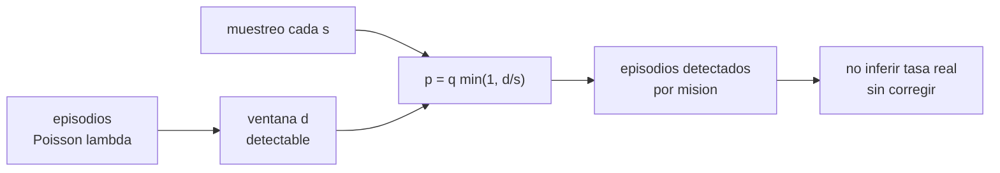

# B105-C10 — Respuesta inmune

<!-- nav:top -->
[🏠 Programa](../../../../README.md) · [📚 Bloque B105](../../../tronco-comun/B105-medicina-y-biologia-espacial.md) · [← Anterior: B105-C09 — Salud mental en aislamiento](../B105-C09-salud-mental-en-aislamiento/CLASE.md) · [Siguiente: B105-C11 — Microbioma en ambientes cerrados →](../B105-C11-microbioma-en-ambientes-cerrados/CLASE.md)
<!-- /nav -->

## 1. Ubicación, nivel y alcance

Clase 10 del bloque B105. Nivel N3. El sistema inmune puede cambiar durante el vuelo y los virus latentes pueden reactivarse; lo que se observa depende tanto del fenómeno como de **cuándo se toma la muestra**. Aquí trabajas el lado de la medición: un proceso de episodios, una ventana de detectabilidad y un muestreo periódico, con datos **sintéticos**. El microbioma se trata en [B105-C11](../B105-C11-microbioma-en-ambientes-cerrados/CLASE.md).

## 2. Por qué esta clase existe

Si un episodio dura 3 días y se muestrea cada semana, la mayoría pasa inadvertida: una tasa de detección baja no implica pocos episodios. La decisión central: **¿cada cuántos días hay que muestrear para detectar una fracción dada de los episodios y cuántos se perderán?**

## 3. Lo que podrás hacer al terminar

1. Modelar episodios de reactivación como un proceso de Poisson y calcular los esperados.
2. Calcular la probabilidad de detectar un episodio con muestreo periódico: `q·mín(1, d/s)`.
3. Comprobar la fórmula por simulación de misiones.
4. Calcular el intervalo máximo de muestreo para una fracción de detección objetivo.
5. Distinguir tasa de eventos de tasa de detección.
6. Rotular el modelo como sintético y no inferir el estado inmune de nadie.

La evidencia es la **ficha inmune con la probabilidad de detección** del ejercicio 12 (sección 20).

## 4. Con qué llegas y cómo comprobarlo

1. ¿Qué es un proceso de Poisson?
2. ¿Qué es la sensibilidad de un ensayo?
3. ¿Qué es una reactivación viral?
4. ¿Qué es un muestreo periódico?
5. ¿Qué es un dato sintético?

<details>
<summary>Ver respuestas</summary>

1. Eventos independientes en el tiempo con tasa constante. 2. La probabilidad de dar positivo si el analito está presente. 3. La reaparición de la actividad de un virus latente en el organismo. 4. Tomar una muestra cada intervalo fijo. 5. Un dato generado para el ejemplo, no medido.
</details>

Con cuatro o cinco aciertos, sigue; si no, repasa los prerrequisitos.

## 5. Un caso de contexto y casos de referencia

Una tripulación **sintética** de 6 personas durante 180 días con tasa de 0,02 episodios/persona-día (3,6 por persona; 21,6 en total) y ventana de detectabilidad de 3 días. Con muestreo cada 3 días o menos se detecta el 90 % (la sensibilidad del ensayo, `q = 0,90`); cada 7 días, el 38,6 % (simulado 38,5 %) y 8,3 episodios por misión; cada 30 días, el 9,1 %. Es el **ejemplo conductor**: tasas, ventana y sensibilidad son **ilustrativas**; no se consultó literatura de inmunología espacial.

## 6. Vocabulario

La **tasa** `λ` es episodios por persona-día. La **ventana** `d` es el tiempo durante el cual un episodio es detectable. El **intervalo de muestreo** `s` es el tiempo entre muestras. La **sensibilidad** `q` es la fracción de episodios detectables que el ensayo detecta. La **probabilidad de detección** es `p = q·mín(1, d/s)`. La **latencia** es el estado de un virus sin replicación activa.

## 7. Modelo mental



*Descripción textual:* los episodios ocurren al azar; solo son visibles durante una ventana; el muestreo periódico y la sensibilidad fijan la probabilidad de detección y, con ella, cuántos episodios se ven, que no son los que hubo.

Analogía: una cámara de vigilancia que toma una foto cada minuto; un evento de 10 segundos se ve el 17 % de las veces. Límite: los episodios reales tienen duración variable y se detectan con ensayos que tienen su propia curva de sensibilidad.

## 8. La explicación, paso a paso

### 8.1 Episodios esperados

`μ = λ·T·n = 0,02·180·6 = 21,6` episodios por misión; por persona, 3,6. La probabilidad de que una persona no tenga ninguno es `e^{−3,6} = 0,0273`.

### 8.2 Probabilidad de detección

Con fase de muestreo aleatoria, un episodio de duración `d` se ve si hay una muestra dentro de su ventana: probabilidad `mín(1, d/s)`. Con la sensibilidad, `p = q·mín(1, d/s)`: 0,900 para `s ≤ 3`; 0,386 para `s = 7`; 0,193 para `s = 14`; 0,090 para `s = 30`.

### 8.3 Simulación

La simulación de 20.000 misiones da fracciones de 0,901 (`s = 1`), 0,899 (3), 0,385 (7), 0,193 (14) y 0,091 (30), de acuerdo con la analítica. Episodios detectados por misión: 19,46 (`s = 1` y 3), 8,32 (7), 4,16 (14), 1,96 (30). La probabilidad de que no se detecte ninguno aun habiendo episodios es 0,016 con `s = 14` y 0,141 con `s = 30`.

### 8.4 Qué no se puede concluir

Con `s = 7` se pierden 61,5 % de los episodios: una tasa observada de 8,3 por misión corresponde a 21,6 reales. Sin corregir por muestreo, la tasa observada no estima la tasa real. El intervalo máximo para detectar al menos el 50 % es `d·q/0,5 = 5,4` días.

## 9. Magnitudes, símbolos y unidades

| Símbolo | Qué es | Unidad | Valor / nota |
|---|---|---|---|
| `λ` | tasa de episodios | 1/(persona·día) | 0,02 (sintética) |
| `d` | ventana de detectabilidad | días | 3 (sintética) |
| `s` | intervalo de muestreo | días | 1 a 30 |
| `q` | sensibilidad del ensayo | — | 0,90 (sintética) |
| `p` | probabilidad de detección | — | `q·mín(1, d/s)` |
| `μ` | episodios esperados | — | 21,6 |

## 10. Convenciones y referencias

Fase de muestreo uniforme al azar; episodios independientes; detección independiente entre episodios. Datos sintéticos con semilla 105 (20.000 misiones). Tolerancias del laboratorio: fracción detectada para `s = 1` = 0,90 ± 0,01 y para `s = 7` = 0,386 ± 0,02; decreciente con `s`. Numpy 2.4.4, Python 3.12.9.

## 11. De dónde sale lo que afirmamos

| ID | Fuente | Localizador | Respalda | Estado |
|---|---|---|---|---|
| — | Relaciones físicas, fisiológicas y estadísticas estándar usadas en el laboratorio | — | las verifica el laboratorio | No consultada en una fuente concreta (las verifica el laboratorio) |

Límites: no se consultó literatura de inmunología ni de reactivación viral en vuelo; todas las tasas y la ventana son didácticas; no se consultó ninguna cifra publicada de reactivación.

## 12. Cómo ver el resultado

Descripción: la tabla de la salida con la probabilidad analítica, la fracción simulada y los episodios detectados por intervalo. Equivalente textual: más intervalo, menos detección; con `s ≤ d` solo limita la sensibilidad.

## 13. Ejemplo trabajado: detección con muestreo semanal

**Paso 1 · Cobertura.** `d/s = 3/7 = 0,429`.

**Paso 2 · Con sensibilidad.** `p = 0,90·0,429 = 0,386`.

**Paso 3 · Detectados.** `21,6·0,386 = 8,3` episodios por misión.

**Paso 4 · Perdidos.** `21,6 − 8,3 = 13,3` (61,5 %).

## 14. Distintas formas de describir el problema

**Por tasa:** `λ`. **Por ventana:** `d`. **Por cobertura:** `d/s`. **Por detección:** `p`. **Por misión:** `μ p`. **Por tabla:** `s` frente a `p`.

## 15. Práctica guiada

**Ejercicio 1 · con los pasos indicados.** ¿Cuántos episodios por persona se esperan en 180 días con `λ = 0,02`? *Pasos:* `λ T`.

<details><summary>Solución comentada</summary>

`3,6`.
</details>

**Ejercicio 2 · con una pista.** ¿Qué probabilidad hay de no tener ningún episodio? *Pista:* `e^{−3,6}`.

<details><summary>Solución comentada</summary>

`0,0273`.
</details>

**Ejercicio 3 · casi autónomo.** Calcula `p` con `s = 7`, `d = 3`, `q = 0,90`.

<details><summary>Solución comentada</summary>

`0,386`.
</details>

## 16. Práctica autónoma, transferencia e integrador

**Ejercicio 4 · autónomo.** ¿Qué intervalo de muestreo da al menos 50 % de detección?

<details><summary>Solución comentada</summary>

`s = d·q/0,5 = 5,4` días.
</details>

**Ejercicio 5 · autónomo.** ¿Cuántos episodios se detectan por misión con `s = 14`?

<details><summary>Solución comentada</summary>

`21,6·0,193 = 4,16`.
</details>

**Ejercicio 6 · autónomo.** ¿Por qué `p` no sube de 0,90 aunque se muestree cada día?

<details><summary>Solución comentada</summary>

Porque con `s ≤ d` toda ventana contiene una muestra y solo limita la sensibilidad del ensayo.
</details>

**Ejercicio 7 · autónomo.** Con una ventana de 5 días y `s = 7`, ¿cuál es `p`?

<details><summary>Solución comentada</summary>

`0,90·5/7 = 0,643`.
</details>

**Ejercicio 8 · autónomo.** ¿Cuántos episodios esperaría una tripulación de 4 en 90 días?

<details><summary>Solución comentada</summary>

`0,02·90·4 = 7,2`.
</details>

**Ejercicio 9 · transferencia.** Se observan 8 episodios con `s = 7`. ¿Cuántos reales se estiman?

<details><summary>Solución comentada</summary>

`8/0,386 = 20,7` (con incertidumbre por el conteo, `√8 = 2,8` en el numerador).
</details>

**Ejercicio 10 · transferencia.** ¿Por qué una tasa de detección baja no implica un estado inmune sano?

<details><summary>Solución comentada</summary>

Porque depende del muestreo; sin corregir por `p` no se distingue «pocos episodios» de «pocas muestras».
</details>

**Ejercicio 11 · transferencia.** Los episodios de una tripulación tienden a agruparse por contagio. ¿Qué supuesto del modelo falla?

<details><summary>Solución comentada</summary>

La independencia de Poisson: aparece sobredispersión (varianza mayor que la media) y la probabilidad de cero episodios cambia.
</details>

**Ejercicio 12 · integrador.** Elabora tu *ficha inmune con la probabilidad de detección*: modelo, `μ`, tabla `s`→`p`, intervalo para 50 %, qué se pierde con muestreo semanal y lista de qué es sintético.

<details><summary>Solución comentada</summary>

Secciones 8.1–8.4 y la salida del laboratorio.
</details>

## 17. Laboratorio: reactivación viral y probabilidad de detección por muestreo

El script [inmune.py](inmune.py) simula 20.000 misiones con episodios de Poisson y muestreo periódico con cinco intervalos y compara con la probabilidad analítica (**comprueba** la fracción detectada con `s = 1` (0,90 ± 0,01), con `s = 7` (0,386 ± 0,02) y su decrecimiento con `s`).

**Datos:** todo **sintético** (semilla 105); tasas, ventana y sensibilidad **ilustrativas**. **Predice antes de ejecutar:** ¿Cuántos episodios se pierden con muestreo semanal? (Más de la mitad.) **Ejecución del 2026-11-10 (Python 3.12.9):**

```text
Python 3.12.9; numpy 2.4.4
DATOS SINTETICOS (semilla 105): lambda 0.02/dia, ventana 3 dias, sensibilidad 0.90; tripulacion de 6; mision de 180 dias; sin datos reales
Episodios esperados por mision = 21.60; por persona = 3.60; P(persona sin episodios) = 0.0273
intervalo s [d] | p analitica | fraccion detectada (sim.) | detectados por mision | P(ningun detectado | hubo episodios)
     1          |   0.900     |   0.901                  |   19.46                |   0.000
     3          |   0.900     |   0.899                  |   19.46                |   0.000
     7          |   0.386     |   0.385                  |    8.32                |   0.000
    14          |   0.193     |   0.193                  |    4.16                |   0.016
    30          |   0.090     |   0.091                  |    1.96                |   0.141
Con s = 7: se pierden en media 61.5 % de los episodios; con s = 1: 9.9 % (solo por la sensibilidad)
Intervalo maximo para detectar al menos el 50 % de los episodios = 5.4 dias (q min(1,d/s) = 0.5)
Pruebas superadas.
```

```bash
python programa/clases/B105/B105-C10-respuesta-inmune/inmune.py
```

**Límites:** ventana fija, episodios independientes, un solo ensayo, sin cinética viral ni respuesta inmune; no estima estado inmune de nadie.

## 18. Errores frecuentes y cómo corregirlos

**Confundir tasa observada y real.** Corrige por `p` (8.4).

**Suponer que más muestras siempre mejoran la detección.** Sin pasar de `s ≤ d` no mejora (8.2).

**Ignorar la sensibilidad del ensayo.** Limita `p` incluso con muestreo diario.

**Tomar estos números como inmunología real.** Son sintéticos (sección 10).

## 19. Cómo sabrás que vas bien

Tras la sección 8: ¿calculas `p` y los episodios detectados? Si dudas, repasa el ejemplo 13. Tras el laboratorio: ¿qué comprueba? (ver la sección 17).

## 20. Qué entregas y cómo se evalúa

El producto es tu **ficha inmune con la probabilidad de detección** (ejercicio 12).

| Criterio | Inicial | En desarrollo | Logrado | Destacado |
|---|---|---|---|---|
| Conceptos | Confunde las magnitudes | Parciales | Explica `λ`, `d`, `s` y `p` | Explica la corrección por muestreo |
| Cálculo | Sin unidades | Con errores | Calcula con unidades y tolerancias | Calcula casos nuevos |
| Numérico | Sin comprobar | Un caso | Compara con la verdad del generador | Interpreta la sensibilidad |
| Fuentes | Sin fuente | Sin fecha | Cita solo lo consultado, con fecha | Rotula lo sintético y lo no consultado |
| Límites | No los nombra | Uno | Tres | Discute qué falta del modelo |

**Condiciones críticas (no se compensan con promedio):** rotular los datos como sintéticos; no presentar un resultado simulado como observado; no dar consejo médico ni operativo; citar solo lo consultado.

## 21. Ética, seguridad y límites

Clase **educativa**: no es consejo médico, no sustituye la formación, la licencia ni la supervisión de profesionales, y no contiene dosis, tratamientos ni procedimientos para aplicar a una persona real. No se interpreta el estado inmune de nadie; el seguimiento inmunológico real exige consentimiento, protocolos y profesionales. Accesibilidad: tablas equivalentes a las gráficas, fórmulas en texto, ejercicios sin conexión.

## 22. Para cerrar y seguir

Con episodios de 3 días, el muestreo semanal detecta solo el 38,6 %; hace falta un intervalo de 5,4 días o menos para llegar al 50 %. Queda una pregunta: ¿qué comunidad de microbios vive con la tripulación?

**Glosario español–inglés.** reactivación · *reactivation*; ventana de detectabilidad · *detectability window*; sensibilidad · *sensitivity*; latencia · *latency*.

**Continuidad.** [B105-C11](../B105-C11-microbioma-en-ambientes-cerrados/CLASE.md) estudia el microbioma en ambientes cerrados.

**Referencias:** ver sección 11.

<!-- nav:bottom -->
---

[← Anterior: B105-C09 — Salud mental en aislamiento](../B105-C09-salud-mental-en-aislamiento/CLASE.md) · [📚 Bloque B105](../../../tronco-comun/B105-medicina-y-biologia-espacial.md) · [Siguiente: B105-C11 — Microbioma en ambientes cerrados →](../B105-C11-microbioma-en-ambientes-cerrados/CLASE.md)
<!-- /nav -->
