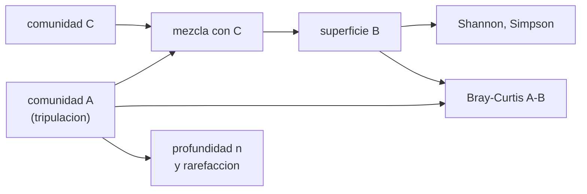

# B105-C11 — Microbioma en ambientes cerrados

<!-- nav:top -->
[🏠 Programa](../../../../README.md) · [📚 Bloque B105](../../../tronco-comun/B105-medicina-y-biologia-espacial.md) · [← Anterior: B105-C10 — Respuesta inmune](../B105-C10-respuesta-inmune/CLASE.md) · [Siguiente: B105-C12 — Nutrición espacial →](../B105-C12-nutricion-espacial/CLASE.md)
<!-- /nav -->

## 1. Ubicación, nivel y alcance

Clase 11 del bloque B105. Nivel N3. En un ambiente cerrado la tripulación y las superficies intercambian microorganismos. Aquí aprendes a describir una comunidad con índices de diversidad (Shannon, Simpson), a compararlas con la disimilitud de Bray–Curtis y a ver cómo la profundidad de secuenciación sesga lo que se mide, con comunidades **sintéticas**. Viene de [B105-C10](../B105-C10-respuesta-inmune/CLASE.md).

## 2. Por qué esta clase existe

Un índice de diversidad depende de la comunidad **y** de cuántas lecturas se obtuvieron. La decisión central: **¿qué profundidad de muestreo hace fiable un índice y cómo se cuantifica el parecido entre la piel de la tripulación y las superficies?**

## 3. Lo que podrás hacer al terminar

1. Calcular riqueza, Shannon y Simpson de una comunidad y sus valores máximos.
2. Calcular la disimilitud de Bray–Curtis entre dos comunidades.
3. Simular el efecto de la profundidad de secuenciación (rarefacción).
4. Mezclar comunidades y ver cómo disminuye la disimilitud.
5. Describir la pérdida de diversidad por dominancia creciente.
6. Rotular los datos como sintéticos y la composición como relativa.

La evidencia es la **ficha de microbioma con diversidad e incertidumbre** del ejercicio 12 (sección 20).

## 4. Con qué llegas y cómo comprobarlo

1. ¿Qué es una abundancia relativa?
2. ¿Qué es el logaritmo natural?
3. ¿Qué es una distribución multinomial?
4. ¿Qué es la riqueza?
5. ¿Qué es un dato sintético?

<details>
<summary>Ver respuestas</summary>

1. La fracción de lecturas de cada taxón (suma 1). 2. El inverso de la exponencial `e^x`. 3. La de los conteos de varias categorías en un muestreo con probabilidades dadas. 4. El número de taxones presentes. 5. Un dato generado para el ejemplo, no medido.
</details>

Con cuatro o cinco aciertos, sigue; si no, repasa los prerrequisitos.

## 5. Un caso de contexto y casos de referencia

Comunidades **sintéticas** de 40 taxones con abundancias log-normales (semilla 105). La comunidad A tiene Shannon 3,158 (máximo `ln 40 = 3,689`) y Simpson 0,940. Una superficie B recibe la fracción `m` de A y el resto de una comunidad propia C: con `m = 0` la disimilitud de Bray–Curtis es 0,645; con `m = 0,75`, 0,161. Con 50 lecturas se observan 20,9 de 40 taxones y Shannon 2,775 (verdad 3,158); con 10.000, 40,0 y 3,156. Es el **ejemplo conductor**: nada es una secuenciación real.

## 6. Vocabulario

La **riqueza** cuenta taxones. El **índice de Shannon** `H = −Σ p ln p` y el de **Simpson** `1 − Σ p²` miden diversidad. La **disimilitud de Bray–Curtis** `1 − 2Σ mín(p, q)/(Σp + Σq)` va de 0 a 1. La **profundidad** es el número de lecturas. La **rarefacción** submuestrea para comparar a igual profundidad. Los datos de secuenciación son **composicionales**: solo informan proporciones.

## 7. Modelo mental



*Descripción textual:* una superficie recibe una fracción de la comunidad de la tripulación; se calculan los índices de diversidad y la disimilitud, y se comprueba cómo la profundidad de muestreo altera lo medido.

Analogía: contar especies de aves en un parque; con pocas horas de observación se ven las comunes, y con muchas aparecen las raras. Límite: aquí las «observaciones» son lecturas de ADN y las abundancias son relativas, no absolutas.

## 8. La explicación, paso a paso

### 8.1 Índices

`H = −Σ p ln p` con máximo `ln S = 3,689` para 40 taxones; Simpson máximo `1 − 1/40 = 0,975`. La comunidad A (log-normal con σ = 1,2) tiene `H = 3,158` y evenness `H/ln S = 0,856`.

### 8.2 Mezcla y Bray–Curtis

B = `m·A + (1 − m)·C`. Bray–Curtis entre A y B baja con `m`: 0,645 (0), 0,484 (0,25), 0,323 (0,50), 0,161 (0,75). El Shannon de B sube hasta 3,351 con `m = 0,5`: mezclar dos comunidades aumenta la diversidad.

### 8.3 Profundidad y rarefacción

| Profundidad | Riqueza observada (de 40) | Shannon | DE |
|---|---|---|---|
| 50 | 20,9 | 2,775 | 0,129 |
| 200 | 33,0 | 3,056 | 0,067 |
| 1.000 | 38,9 | 3,141 | 0,031 |
| 10.000 | 40,0 | 3,156 | 0,010 |

Con pocas lecturas, la riqueza y Shannon se subestiman.

### 8.4 Pérdida de diversidad

Elevar las abundancias a `g` concentra la comunidad en pocos taxones: Shannon 3,158 (`g = 1`), 2,706 (1,5), 2,261 (2) y 1,510 (3); la disimilitud respecto de `g = 1` llega a 0,504.

## 9. Magnitudes, símbolos y unidades

| Símbolo | Qué es | Unidad | Valor / nota |
|---|---|---|---|
| `S` | número de taxones | — | 40 (sintético) |
| `p` | abundancia relativa | — | suma 1 |
| `H` | índice de Shannon | nats | 3,158 (A) |
| `D_s` | índice de Simpson | — | 0,940 (A) |
| `BC` | Bray–Curtis | — | 0,645 a 0,161 |
| `n` | lecturas por muestra | — | 50 a 10.000 |

## 10. Convenciones y referencias

Abundancias relativas; logaritmo natural (nats). Muestreo multinomial; 200 submuestras por profundidad. Datos sintéticos con semilla 105. Tolerancias del laboratorio: `BC(A, A) = 0`; `BC` en [0, 1]; riqueza creciente con la profundidad; Shannon decreciente con `g`. Numpy 2.4.4, Python 3.12.9.

## 11. De dónde sale lo que afirmamos

| ID | Fuente | Localizador | Respalda | Estado |
|---|---|---|---|---|
| — | Relaciones físicas, fisiológicas y estadísticas estándar usadas en el laboratorio | — | las verifica el laboratorio | No consultada en una fuente concreta (las verifica el laboratorio) |

Límites: no se consultó literatura de microbioma de estaciones espaciales ni de entornos cerrados; las comunidades son generadas con una distribución log-normal elegida por simplicidad y no reproducen ninguna comunidad real.

## 12. Cómo ver el resultado

Descripción: la tabla de rarefacción de 8.3 y la salida del laboratorio con Bray–Curtis por `m` y Shannon por `g`. Equivalente textual: más profundidad, más riqueza observada; más mezcla, menor disimilitud; más dominancia, menos diversidad.

## 13. Ejemplo trabajado: Bray–Curtis de dos comunidades pequeñas

**Paso 1 · Comunidades.** `p = (0,5; 0,5)` y `q = (1; 0)`.

**Paso 2 · Mínimos.** `mín(p, q) = (0,5; 0)`, suma 0,5.

**Paso 3 · Fórmula.** `BC = 1 − 2·0,5/(1 + 1) = 0,5`.

**Paso 4 · Lectura.** Comparten la mitad de la abundancia.

## 14. Distintas formas de describir el problema

**Por riqueza:** conteo. **Por Shannon:** `−Σ p ln p`. **Por Simpson:** `1 − Σ p²`. **Por disimilitud:** Bray–Curtis. **Por profundidad:** `n`. **Por dominancia:** `g`.

## 15. Práctica guiada

**Ejercicio 1 · con los pasos indicados.** ¿Cuál es el Shannon máximo de 40 taxones? *Pasos:* `ln 40`.

<details><summary>Solución comentada</summary>

`3,689`.
</details>

**Ejercicio 2 · con una pista.** ¿Cuál es el Simpson máximo de 40 taxones? *Pista:* `1 − 1/S`.

<details><summary>Solución comentada</summary>

`0,975`.
</details>

**Ejercicio 3 · casi autónomo.** Calcula Bray–Curtis para `p = (0,5; 0,5)` y `q = (1; 0)`.

<details><summary>Solución comentada</summary>

`0,5`.
</details>

## 16. Práctica autónoma, transferencia e integrador

**Ejercicio 4 · autónomo.** ¿Cuál es la evenness de A (`H = 3,158`)?

<details><summary>Solución comentada</summary>

`3,158/3,689 = 0,856`.
</details>

**Ejercicio 5 · autónomo.** ¿Cuántos taxones de 40 se ven con 50 lecturas?

<details><summary>Solución comentada</summary>

`20,9` de media.
</details>

**Ejercicio 6 · autónomo.** ¿Por qué Shannon se subestima con pocas lecturas?

<details><summary>Solución comentada</summary>

Porque faltan taxones raros y las abundancias estimadas son ruidosas; el sesgo se corrige al crecer `n`.
</details>

**Ejercicio 7 · autónomo.** ¿Cuál es la disimilitud entre A y la superficie con `m = 0,5`?

<details><summary>Solución comentada</summary>

`0,323`.
</details>

**Ejercicio 8 · autónomo.** ¿En qué porcentaje cae Shannon al pasar de `g = 1` a `g = 2`?

<details><summary>Solución comentada</summary>

`(3,158 − 2,261)/3,158 = 28,4 %`.
</details>

**Ejercicio 9 · transferencia.** Con la DE de Shannon a 1.000 lecturas (0,031), ¿qué intervalo aproximado de 95 % hay?

<details><summary>Solución comentada</summary>

`± 1,96·0,031 = ± 0,06`.
</details>

**Ejercicio 10 · transferencia.** ¿Por qué mezclar dos comunidades puede aumentar la diversidad de la mezcla?

<details><summary>Solución comentada</summary>

Porque suma taxones y reparte abundancias; Shannon de B (3,351) supera al de A (3,158) con `m = 0,5`.
</details>

**Ejercicio 11 · transferencia.** Los datos de secuenciación son composicionales. ¿Qué no se puede afirmar al ver que un taxón sube de 10 % a 20 %?

<details><summary>Solución comentada</summary>

Que su cantidad absoluta se duplicó: puede haber bajado otro taxón; solo cambió la proporción.
</details>

**Ejercicio 12 · integrador.** Elabora tu *ficha de microbioma con diversidad e incertidumbre*: índices, disimilitud, efecto de la profundidad, escenario de dominancia y lista de qué es sintético.

<details><summary>Solución comentada</summary>

Secciones 8.1–8.4 y la salida del laboratorio.
</details>

## 17. Laboratorio: diversidad alfa y beta de una comunidad sintética

El script [microbioma.py](microbioma.py) calcula Shannon, Simpson y Bray–Curtis de comunidades sintéticas, simula la rarefacción con cuatro profundidades y un escenario de dominancia (**comprueba** `BC(A, A) = 0`, `BC` entre 0 y 1, riqueza creciente con la profundidad y Shannon decreciente con la dominancia).

**Datos:** todo **sintético** (semilla 105); ninguna comunidad es una medición. **Predice antes de ejecutar:** ¿Qué ocurre con la riqueza observada al pasar de 50 a 10.000 lecturas? (Sube hasta 40.) **Ejecución del 2026-11-10 (Python 3.12.9):**

```text
Python 3.12.9; numpy 2.4.4
DATOS SINTETICOS (semilla 105): 40 taxones; comunidades log-normales; sin datos de secuenciacion reales
Maximos teoricos: Shannon ln(40) = 3.689; Simpson 1 - 1/40 = 0.975
fraccion de A en B m = 0.00: Shannon A 3.158, B 2.957; Simpson B 0.916; Bray-Curtis A-B = 0.645
fraccion de A en B m = 0.25: Shannon A 3.158, B 3.236; Simpson B 0.943; Bray-Curtis A-B = 0.484
fraccion de A en B m = 0.50: Shannon A 3.158, B 3.351; Simpson B 0.955; Bray-Curtis A-B = 0.323
fraccion de A en B m = 0.75: Shannon A 3.158, B 3.339; Simpson B 0.954; Bray-Curtis A-B = 0.161
Rarefaccion de la riqueza y de Shannon de la comunidad A (200 submuestras por profundidad):
  profundidad     50: riqueza observada  20.9 / 40; Shannon 2.775 (verdad 3.158); DE 0.129
  profundidad    200: riqueza observada  33.0 / 40; Shannon 3.056 (verdad 3.158); DE 0.067
  profundidad   1000: riqueza observada  38.9 / 40; Shannon 3.141 (verdad 3.158); DE 0.031
  profundidad  10000: riqueza observada  40.0 / 40; Shannon 3.156 (verdad 3.158); DE 0.010
Dominancia creciente (la comunidad se concentra en pocos taxones): exponente g sobre las abundancias p^g
  g = 1.0: Shannon 3.158; Simpson 0.940; Bray-Curtis frente a g = 1: 0.000
  g = 1.5: Shannon 2.706; Simpson 0.890; Bray-Curtis frente a g = 1: 0.163
  g = 2.0: Shannon 2.261; Simpson 0.817; Bray-Curtis frente a g = 1: 0.303
  g = 3.0: Shannon 1.510; Simpson 0.619; Bray-Curtis frente a g = 1: 0.504
Pruebas superadas.
```

```bash
python programa/clases/B105/B105-C11-microbioma-en-ambientes-cerrados/microbioma.py
```

**Límites:** sin errores de secuenciación, sin sesgos de extracción, sin dinámica temporal, abundancias log-normales y composición relativa; no describe ningún hábitat real.

## 18. Errores frecuentes y cómo corregirlos

**Comparar muestras de distinta profundidad sin rarefacción.** Compara a igual `n` (8.3).

**Interpretar proporciones como cantidades absolutas.** Los datos son composicionales (ejercicio 11).

**Confundir diversidad alfa y beta.** Alfa es dentro de una muestra; beta, entre muestras.

**Presentar las comunidades sintéticas como reales.** Se rotulan (sección 10).

## 19. Cómo sabrás que vas bien

Tras la sección 8: ¿calculas Shannon y Bray–Curtis? Si dudas, repasa el ejemplo 13. Tras el laboratorio: ¿qué comprueba? (ver la sección 17).

## 20. Qué entregas y cómo se evalúa

El producto es tu **ficha de microbioma con diversidad e incertidumbre** (ejercicio 12).

| Criterio | Inicial | En desarrollo | Logrado | Destacado |
|---|---|---|---|---|
| Conceptos | Confunde las magnitudes | Parciales | Explica Shannon, Simpson y Bray–Curtis | Explica el sesgo por profundidad y la composicionalidad |
| Cálculo | Sin unidades | Con errores | Calcula con unidades y tolerancias | Calcula casos nuevos |
| Numérico | Sin comprobar | Un caso | Compara con la verdad del generador | Interpreta la sensibilidad |
| Fuentes | Sin fuente | Sin fecha | Cita solo lo consultado, con fecha | Rotula lo sintético y lo no consultado |
| Límites | No los nombra | Uno | Tres | Discute qué falta del modelo |

**Condiciones críticas (no se compensan con promedio):** rotular los datos como sintéticos; no presentar un resultado simulado como observado; no dar consejo médico ni operativo; citar solo lo consultado.

## 21. Ética, seguridad y límites

Clase **educativa**: no es consejo médico, no sustituye la formación, la licencia ni la supervisión de profesionales, y no contiene dosis, tratamientos ni procedimientos para aplicar a una persona real. No se interpreta ninguna microbiota personal; los estudios con muestras humanas exigen consentimiento y protección de datos (ver B105-C19). Accesibilidad: tablas equivalentes a las gráficas, fórmulas en texto, ejercicios sin conexión.

## 22. Para cerrar y seguir

Con 10.000 lecturas, el Shannon observado (3,156) casi coincide con el verdadero (3,158); con 50 queda en 2,775. Queda una pregunta: ¿cuánta energía y qué alimento necesita una tripulación?

**Glosario español–inglés.** diversidad · *diversity*; disimilitud de Bray–Curtis · *Bray–Curtis dissimilarity*; rarefacción · *rarefaction*; composicional · *compositional*.

**Continuidad.** [B105-C12](../B105-C12-nutricion-espacial/CLASE.md) estudia la nutrición espacial.

**Referencias:** ver sección 11.

<!-- nav:bottom -->
---

[← Anterior: B105-C10 — Respuesta inmune](../B105-C10-respuesta-inmune/CLASE.md) · [📚 Bloque B105](../../../tronco-comun/B105-medicina-y-biologia-espacial.md) · [Siguiente: B105-C12 — Nutrición espacial →](../B105-C12-nutricion-espacial/CLASE.md)
<!-- /nav -->
