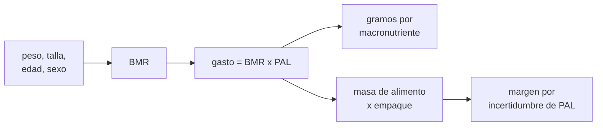

# B105-C12 — Nutrición espacial

<!-- nav:top -->
[🏠 Programa](../../../../README.md) · [📚 Bloque B105](../../../tronco-comun/B105-medicina-y-biologia-espacial.md) · [← Anterior: B105-C11 — Microbioma en ambientes cerrados](../B105-C11-microbioma-en-ambientes-cerrados/CLASE.md) · [Siguiente: B105-C13 — Farmacología y microgravedad →](../B105-C13-farmacologia-y-microgravedad/CLASE.md)
<!-- /nav -->

## 1. Ubicación, nivel y alcance

Clase 12 del bloque B105. Nivel N3. La nutrición en una misión es un problema de balance: energía que se gasta, macronutrientes que se reparten, agua y **masa que hay que transportar**. Aquí calculas el metabolismo basal con una ecuación de predicción, el gasto total, el reparto de macronutrientes, la masa de alimento de una tripulación **sintética** y el efecto de comer menos de lo que se gasta. La ecuación y los factores **no se consultaron en una fuente** y se usan como ejemplo.

## 2. Por qué esta clase existe

Cada kilogramo de alimento que se lanza cuesta; cada kilocaloría que falta se paga con masa corporal. La decisión central: **¿cuánto alimento hay que transportar para una misión y con qué margen frente a la incertidumbre del gasto?**

## 3. Lo que podrás hacer al terminar

1. Calcular el metabolismo basal con una ecuación de predicción y el gasto total con un nivel de actividad.
2. Repartir la energía en gramos de proteína, grasa y carbohidrato con factores de Atwater.
3. Calcular la masa de alimento de una misión, con empaque y con margen por incertidumbre.
4. Estimar el cambio de masa corporal por un déficit de ingesta con una regla aproximada.
5. Propagar la incertidumbre del nivel de actividad a la masa de provisiones.
6. Rotular qué es ilustrativo y no dar recomendaciones dietéticas.

La evidencia es la **ficha nutricional con balance y masa** del ejercicio 12 (sección 20).

## 4. Con qué llegas y cómo comprobarlo

1. ¿Qué es una kilocaloría?
2. ¿Qué es el metabolismo basal?
3. ¿Qué son los macronutrientes?
4. ¿Qué es un porcentaje de energía?
5. ¿Qué es un dato sintético?

<details>
<summary>Ver respuestas</summary>

1. Una unidad de energía (1 kcal = 4,184 kJ). 2. La energía que el cuerpo gasta en reposo. 3. Proteínas, grasas e hidratos de carbono. 4. La fracción de las kcal que aporta cada macronutriente. 5. Un dato generado para el ejemplo, no medido.
</details>

Con cuatro o cinco aciertos, sigue; si no, repasa los prerrequisitos.

## 5. Un caso de contexto y casos de referencia

Una tripulación **sintética** de 4 con pesos de 58 a 75 kg tiene un gasto total de 9.219 kcal/día con `PAL = 1,6` (media 2.305 kcal por persona). El tripulante 1 (75 kg, 178 cm, 40 años, hombre) tiene un metabolismo basal de 1.667,5 kcal/día y un gasto de 2.668 kcal/día, es decir 100,0 g de proteína, 88,9 g de grasa y 366,9 g de carbohidrato con el reparto 15/30/55 %. Una misión de 180 días necesita 1,659 millones de kcal y 539 kg de alimento con empaque (p5–p95: 456–623 kg). Es el **ejemplo conductor**: los números son **ilustrativos** y ninguna agencia los especificó.

## 6. Vocabulario

La **ecuación de Mifflin–St Jeor** estima el metabolismo basal: `10 w + 6,25 h − 5 a + 5` (hombre) o `−161` (mujer), en kcal/día, con `w` en kg, `h` en cm, `a` en años (recordada por el autor; no consultada aquí). El **PAL** multiplica el basal para dar el gasto total. Los **factores de Atwater** son 4 kcal/g de proteína y carbohidrato y 9 kcal/g de grasa. El **factor de empaque** (1,3, ilustrativo) convierte masa de alimento en masa transportada.

## 7. Modelo mental



*Descripción textual:* los datos de cada persona dan el metabolismo basal; con el nivel de actividad se obtiene el gasto, de él salen los gramos de cada macronutriente y la masa de provisiones, y se añade un margen por la incertidumbre del nivel de actividad.

Analogía: el combustible de un vuelo; se calcula el consumo, se añade margen y cada kilo extra cuesta combustible. Límite: el cuerpo se adapta (gasto y masa cambian), y el modelo no incluye esa respuesta.

## 8. La explicación, paso a paso

### 8.1 Metabolismo basal y gasto

Con 75 kg, 178 cm, 40 años, hombre: `750 + 1.112,5 − 200 + 5 = 1.667,5 kcal/día`; con `PAL = 1,6`: `2.668 kcal/día`. Los otros tres tripulantes: 2.512, 2.104,4 y 1.934,4 kcal/día; la tripulación, 9.219 kcal/día.

### 8.2 Macronutrientes y agua

Con el reparto 15/30/55 %, el tripulante 1 recibe 100,0 g de proteína (`2.668·0,15/4`), 88,9 g de grasa (`2.668·0,30/9`) y 366,9 g de carbohidrato (`2.668·0,55/4`); la suma de energía regresa a 2.668 kcal. Con la regla ilustrativa de 1 mL/kcal, la tripulación necesita 9,22 L/día.

### 8.3 Masa de provisiones

Para 180 días: `9.219·180 = 1,659 Mkcal`; a 4 kcal/g y con empaque 1,3: `1,659·10⁶/4/1.000·1,3 = 539 kg` (749 g por persona y día). Con `PAL ~ N(1,6; 0,15)`, la masa va de 456 a 623 kg (p5–p95): cubrir el p95 exige 84 kg más (15,6 %).

### 8.4 Déficit de ingesta

Con una regla didáctica de 7.700 kcal por kg: comer el 90 % del gasto del tripulante 1 da un déficit de 267 kcal/día y una pérdida de 6,2 kg (8,3 % de su masa) en 180 días; el 80 %, 12,5 kg (16,6 %). La regla es aproximada y el cuerpo compensa; sirve solo para dimensionar.

## 9. Magnitudes, símbolos y unidades

| Símbolo | Qué es | Unidad | Valor / nota |
|---|---|---|---|
| `w`, `h`, `a` | peso, talla, edad | kg, cm, años | 75, 178, 40 |
| BMR | metabolismo basal | kcal/día | 1.667,5 |
| PAL | nivel de actividad | — | 1,6 (ilustrativo) |
| `E` | gasto total | kcal/día | 2.668 |
| Atwater | energía por gramo | kcal/g | 4; 9; 4 |
| `f_emp` | factor de empaque | — | 1,3 (ilustrativo) |

## 10. Convenciones y referencias

Energía en kcal (1 kcal = 4,184 kJ); masa de alimento en base seca equivalente a 4 kcal/g (ilustrativa). Datos sintéticos con semilla 105. Tolerancias del laboratorio: BMR del tripulante 1 = 1.667,5 exactos; suma de energía por macronutrientes igual al gasto; masa media dentro del 2 % de la nominal. Numpy 2.4.4, Python 3.12.9.

## 11. De dónde sale lo que afirmamos

| ID | Fuente | Localizador | Respalda | Estado |
|---|---|---|---|---|
| — | Relaciones físicas, fisiológicas y estadísticas estándar usadas en el laboratorio | — | las verifica el laboratorio | No consultada en una fuente concreta (las verifica el laboratorio) |

Límites: no se consultó ninguna fuente de nutrición ni de requerimientos de una agencia; la ecuación, el PAL, la densidad energética, el factor de empaque y la regla de 7.700 kcal/kg son elecciones didácticas y no recomendaciones dietéticas.

## 12. Cómo ver el resultado

Descripción: la salida del laboratorio con el gasto por tripulante, los gramos de macronutriente, la masa de provisiones y el efecto de comer menos. Equivalente textual: 539 kg de alimento para 4 personas y 180 días, con 84 kg de margen para el p95.

## 13. Ejemplo trabajado: masa de alimento de un tripulante en 180 días

**Paso 1 · Gasto.** `2.668 kcal/día`.

**Paso 2 · Energía de la misión.** `2.668·180 = 480.240 kcal`.

**Paso 3 · Masa.** `480.240/4 = 120.060 g = 120,1 kg`.

**Paso 4 · Empaque.** `120,1·1,3 = 156,1 kg`.

## 14. Distintas formas de describir el problema

**Por ecuación:** BMR. **Por energía:** kcal/día. **Por masa:** g de macronutriente. **Por misión:** Mkcal y kg. **Por incertidumbre:** p5–p95. **Por déficit:** kg de masa corporal.

## 15. Práctica guiada

**Ejercicio 1 · con los pasos indicados.** Calcula el BMR de un hombre de 75 kg, 178 cm y 40 años. *Pasos:* `10w + 6,25h − 5a + 5`.

<details><summary>Solución comentada</summary>

`1.667,5 kcal/día`.
</details>

**Ejercicio 2 · con una pista.** Calcula el BMR de una mujer de 62 kg, 165 cm y 35 años. *Pista:* constante −161.

<details><summary>Solución comentada</summary>

`620 + 1.031,25 − 175 − 161 = 1.315,25`.
</details>

**Ejercicio 3 · casi autónomo.** ¿Cuál es el gasto total del tripulante 1 con `PAL = 1,6`?

<details><summary>Solución comentada</summary>

`2.668 kcal/día`.
</details>

## 16. Práctica autónoma, transferencia e integrador

**Ejercicio 4 · autónomo.** ¿Cuántos gramos de grasa corresponden al 30 % de 2.668 kcal?

<details><summary>Solución comentada</summary>

`2.668·0,30/9 = 88,9 g`.
</details>

**Ejercicio 5 · autónomo.** ¿Cuánta agua da la regla de 1 mL/kcal para 2.668 kcal?

<details><summary>Solución comentada</summary>

`2,67 L`.
</details>

**Ejercicio 6 · autónomo.** Calcula la masa de alimento con empaque de un tripulante en 180 días.

<details><summary>Solución comentada</summary>

`156,1 kg`.
</details>

**Ejercicio 7 · autónomo.** Con una ingesta del 90 % del gasto del tripulante 1, ¿qué pérdida de masa corporal da la regla en 180 días?

<details><summary>Solución comentada</summary>

`6,2 kg` (8,3 % de 75 kg).
</details>

**Ejercicio 8 · autónomo.** ¿Por qué la regla de 7.700 kcal/kg es solo aproximada?

<details><summary>Solución comentada</summary>

Porque el gasto cambia con la masa y la composición, y el cuerpo se adapta a la ingesta.
</details>

**Ejercicio 9 · transferencia.** Calcula el gasto del tripulante 1 con `PAL = 1,4` y con `1,8`.

<details><summary>Solución comentada</summary>

`2.334,5` y `3.001,5 kcal/día`: diferencia 667 kcal.
</details>

**Ejercicio 10 · transferencia.** Estima la masa de alimento con empaque para 900 días de la misma tripulación.

<details><summary>Solución comentada</summary>

`9.219·900/4/1.000·1,3 = 2.697 kg`.
</details>

**Ejercicio 11 · transferencia.** El margen para el p95 es 84 kg sobre 539 kg. ¿Qué porcentaje es y qué decisión informa?

<details><summary>Solución comentada</summary>

`15,6 %`: cuánto sobredimensionar la carga de alimento para cubrir la incertidumbre del gasto.
</details>

**Ejercicio 12 · integrador.** Elabora tu *ficha nutricional con balance y masa*: gasto por persona, macronutrientes, masa de provisiones con su margen, efecto de un déficit y lista de qué es ilustrativo.

<details><summary>Solución comentada</summary>

Secciones 8.1–8.4 y la salida del laboratorio.
</details>

## 17. Laboratorio: balance energético y masa de provisiones

El script [nutricion.py](nutricion.py) calcula el BMR y el gasto de 4 personas, los gramos de macronutriente, la masa de provisiones con incertidumbre de `PAL` y el efecto de comer menos (**comprueba** el BMR de 1.667,5 kcal/día, que la energía por macronutrientes iguala al gasto y que la masa media está dentro del 2 % de la nominal).

**Datos:** tripulación **sintética**; ecuación, PAL, empaque y reglas **no consultados**/ilustrativos; semilla 105. **Predice antes de ejecutar:** ¿Cuánta masa de alimento hay que añadir para cubrir el p95? (Unos 84 kg.) **Ejecución del 2026-11-10 (Python 3.12.9):**

```text
Python 3.12.9; numpy 2.4.4
DATOS SINTETICOS/ILUSTRATIVOS (semilla 105): tripulacion de 4; ecuacion y factores no consultados en una fuente
tripulante | BMR [kcal/d] | gasto total [kcal/d]
   1       |    1667.5   |    2668.0
   2       |    1570.0   |    2512.0
   3       |    1315.2   |    2104.4
   4       |    1209.0   |    1934.4
Energia diaria de la tripulacion = 9219 kcal; media 2305 kcal/persona
Reparto del tripulante 1 (gramos/dia): proteina 100.0, grasa 88.9, carbohidrato 366.9
  suma de energia por macronutrientes = 2668.0 kcal (debe igualar 2668.0)
Agua con la regla de 1 mL/kcal para la tripulacion = 9.22 L/dia
Mision de 180 dias: 1.659 Mkcal; masa de alimento con empaque = 539 kg (749 g por persona y dia)
Con PAL ~ N(1.6, 0.15): masa de alimento media 539 kg, p5-p95 = 456-623 kg; margen para cubrir el p95 = 84 kg
Ingesta del 100 % del gasto del tripulante 1: deficit 0 kcal/d; cambio de masa en 180 d = -0.0 kg (0.0 % de su masa)
Ingesta del 90 % del gasto del tripulante 1: deficit 267 kcal/d; cambio de masa en 180 d = -6.2 kg (8.3 % de su masa)
Ingesta del 80 % del gasto del tripulante 1: deficit 534 kcal/d; cambio de masa en 180 d = -12.5 kg (16.6 % de su masa)
Pruebas superadas.
```

```bash
python programa/clases/B105/B105-C12-nutricion-espacial/nutricion.py
```

**Límites:** sin adaptación metabólica, sin micronutrientes, sin pérdidas ni desperdicio, con reglas simples; no es una recomendación dietética ni una especificación de misión.

## 18. Errores frecuentes y cómo corregirlos

**Confundir kcal con kJ.** 1 kcal = 4,184 kJ.

**Olvidar el empaque.** Multiplica por `f_emp` (8.3).

**Aplicar 7.700 kcal/kg como ley.** Es una aproximación (8.4).

**Tomar el reparto 15/30/55 como recomendación.** Es un ejemplo.

## 19. Cómo sabrás que vas bien

Tras la sección 8: ¿calculas el gasto y la masa de una misión? Si dudas, repasa el ejemplo 13. Tras el laboratorio: ¿qué comprueba? (ver la sección 17).

## 20. Qué entregas y cómo se evalúa

El producto es tu **ficha nutricional con balance y masa** (ejercicio 12).

| Criterio | Inicial | En desarrollo | Logrado | Destacado |
|---|---|---|---|---|
| Conceptos | Confunde las magnitudes | Parciales | Explica BMR, PAL y Atwater | Explica el margen por incertidumbre |
| Cálculo | Sin unidades | Con errores | Calcula con unidades y tolerancias | Calcula casos nuevos |
| Numérico | Sin comprobar | Un caso | Compara con la verdad del generador | Interpreta la sensibilidad |
| Fuentes | Sin fuente | Sin fecha | Cita solo lo consultado, con fecha | Rotula lo sintético y lo no consultado |
| Límites | No los nombra | Uno | Tres | Discute qué falta del modelo |

**Condiciones críticas (no se compensan con promedio):** rotular los datos como sintéticos; no presentar un resultado simulado como observado; no dar consejo médico ni operativo; citar solo lo consultado.

## 21. Ética, seguridad y límites

Clase **educativa**: no es consejo médico, no sustituye la formación, la licencia ni la supervisión de profesionales, y no contiene dosis, tratamientos ni procedimientos para aplicar a una persona real. Ninguna cifra es una recomendación dietética; la nutrición de una persona real la planifican profesionales de la nutrición y de la medicina. Accesibilidad: tablas equivalentes a las gráficas, fórmulas en texto, ejercicios sin conexión.

## 22. Para cerrar y seguir

Una tripulación de 4 gasta 9.219 kcal/día con `PAL = 1,6` y necesita 539 kg de alimento para 180 días (hasta 623 kg en el p95). Queda una pregunta: ¿cómo cambia un fármaco su efecto en microgravedad?

**Glosario español–inglés.** metabolismo basal · *basal metabolic rate*; macronutriente · *macronutrient*; factor de Atwater · *Atwater factor*; empaque · *packaging*.

**Continuidad.** [B105-C13](../B105-C13-farmacologia-y-microgravedad/CLASE.md) estudia la farmacología y la microgravedad.

**Referencias:** ver sección 11.

<!-- nav:bottom -->
---

[← Anterior: B105-C11 — Microbioma en ambientes cerrados](../B105-C11-microbioma-en-ambientes-cerrados/CLASE.md) · [📚 Bloque B105](../../../tronco-comun/B105-medicina-y-biologia-espacial.md) · [Siguiente: B105-C13 — Farmacología y microgravedad →](../B105-C13-farmacologia-y-microgravedad/CLASE.md)
<!-- /nav -->
