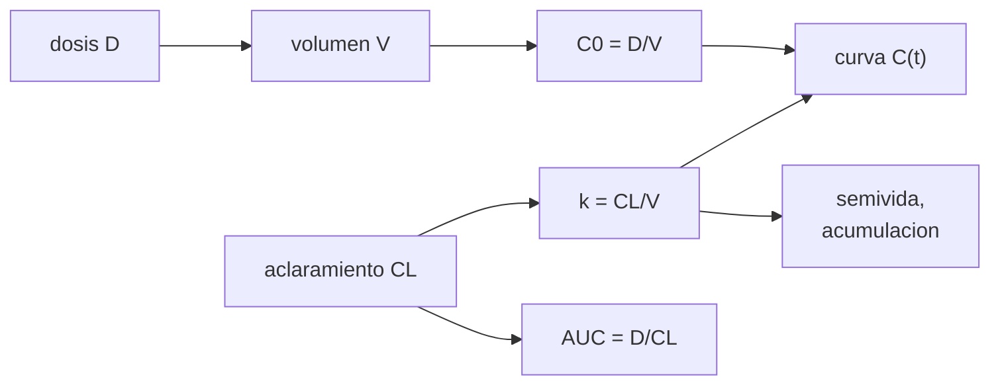

# B105-C13 — Farmacología y microgravedad

<!-- nav:top -->
[🏠 Programa](../../../../README.md) · [📚 Bloque B105](../../../tronco-comun/B105-medicina-y-biologia-espacial.md) · [← Anterior: B105-C12 — Nutrición espacial](../B105-C12-nutricion-espacial/CLASE.md) · [Siguiente: B105-C14 — Atención de urgencia remota →](../B105-C14-atencion-de-urgencia-remota/CLASE.md)
<!-- /nav -->

## 1. Ubicación, nivel y alcance

Clase 13 del bloque B105. Nivel N3. Un fármaco se distribuye en un volumen y se elimina con un aclaramiento; si el vuelo cambia el volumen de líquidos o la perfusión de los órganos de eliminación, cambian la concentración y la exposición. Aquí aprendes el modelo de un compartimento con un **fármaco hipotético** y datos **sintéticos**. **No se da ninguna dosis ni pauta de medicación**: es un ejercicio de modelado.

## 2. Por qué esta clase existe

Con un fármaco real, el efecto depende de su concentración en el tiempo. Un cambio de volumen modifica la concentración inicial; uno de aclaramiento, la exposición total. La decisión central: **¿qué parámetro cambia qué magnitud (concentración, semivida, exposición) y cómo se acumula con dosis repetidas?**

## 3. Lo que podrás hacer al terminar

1. Calcular `k = CL/V`, la semivida, el AUC `= D/CL` y la concentración inicial `D/V`.
2. Calcular el pico y el tiempo del pico de una absorción de primer orden (Bateman).
3. Calcular el factor de acumulación en estado estacionario `1/(1 − e^{−kτ})`.
4. Comparar escenarios con cambios de `V` y `CL` y comprobar el AUC por integración numérica.
5. Propagar la variabilidad poblacional lognormal.
6. Rotular el fármaco como hipotético y no dar nunca dosis.

La evidencia es la **ficha farmacocinética con escenarios** del ejercicio 12 (sección 20).

## 4. Con qué llegas y cómo comprobarlo

1. ¿Qué es el aclaramiento?
2. ¿Qué es el volumen de distribución?
3. ¿Qué es una semivida?
4. ¿Qué es el AUC?
5. ¿Qué es un fármaco hipotético?

<details>
<summary>Ver respuestas</summary>

1. El volumen de plasma depurado de fármaco por unidad de tiempo (L/h). 2. El volumen aparente en que se reparte el fármaco (L). 3. El tiempo en que la concentración se reduce a la mitad. 4. El área bajo la curva concentración–tiempo: la exposición. 5. Uno inventado para el ejemplo; no es un medicamento real.
</details>

Con cuatro o cinco aciertos, sigue; si no, repasa los prerrequisitos.

## 5. Un caso de contexto y casos de referencia

El **fármaco hipotético X** con `V = 40 L`, `CL = 5 L/h` y dosis arbitraria `D = 100` unidades: `k = 0,125 1/h`, semivida 5,55 h, AUC = 20,0, concentración inicial IV 2,50 u/L, pico oral 1,857 a las 2,38 h y acumulación de 1,287 con `τ = 12 h`. Con `V` −10 %, el AUC no cambia (20,0) y la concentración inicial sube a 2,778; con `CL` −20 %, el AUC sube 25 % (25,0) y la semivida a 6,93 h. Es el **ejemplo conductor**: todo es **sintético**; no representa ningún medicamento.

## 6. Vocabulario

El **modelo de un compartimento** trata al cuerpo como un volumen único. `C(t) = (D/V) e^{−kt}` tras un bolo IV; con absorción de primer orden (constante `k_a`), `C(t) = F D k_a/(V(k_a − k))(e^{−kt} − e^{−k_a t})` (Bateman). El **AUC** es `F D/CL`. El **factor de acumulación** es `R = 1/(1 − e^{−kτ})`. La **variabilidad lognormal** modela la dispersión entre individuos.

## 7. Modelo mental



*Descripción textual:* el volumen fija la concentración inicial, el aclaramiento fija la exposición y, junto con el volumen, la constante de eliminación, la semivida y la acumulación con dosis repetidas.

Analogía: una bañera con el desagüe abierto; el volumen de agua fija el nivel inicial y el caudal del desagüe fija cuánto tarda en vaciarse. Límite: el cuerpo tiene varios compartimentos y la eliminación puede saturarse.

## 8. La explicación, paso a paso

### 8.1 Bolo IV

`k = CL/V = 5/40 = 0,125 1/h`, `t½ = ln 2/k = 5,55 h`, `C₀ = D/V = 2,50 u/L`, `AUC = D/CL = 20,0 u·h/L`.

### 8.2 Absorción oral

Con `k_a = 1 1/h`, el pico es 1,857 u/L a `t_max = ln(k_a/k)/(k_a − k) = 2,38 h`. El AUC integrado por trapecios (0–200 h) coincide con `D/CL`: 20,00.

### 8.3 Escenarios

| Caso | `k` | `t½` | AUC | `C₀` | Pico oral | `R` (`τ = 12 h`) |
|---|---|---|---|---|---|---|
| Base | 0,1250 | 5,55 | 20,00 | 2,500 | 1,857 | 1,287 |
| `V` −10 % | 0,1389 | 4,99 | 20,00 | 2,778 | 2,020 | 1,233 |
| `CL` −20 % | 0,1000 | 6,93 | 25,00 | 2,500 | 1,936 | 1,431 |
| Ambos | 0,1111 | 6,24 | 25,00 | 2,778 | 2,111 | 1,358 |

El volumen cambia la concentración inicial y la semivida, **no** el AUC; el aclaramiento cambia el AUC.

### 8.4 Variabilidad

Con `V` y `CL` lognormales (CV 25 %, 5.000 individuos sintéticos), el AUC tiene mediana 20,75 y p5–p95 de 13,76 a 31,23 (nominal 20,00). Con `CL` −20 % para todos, la razón media de AUC es 1,250.

## 9. Magnitudes, símbolos y unidades

| Símbolo | Qué es | Unidad | Valor / nota |
|---|---|---|---|
| `D` | dosis (arbitraria) | unidades | 100 |
| `V` | volumen de distribución | L | 40 |
| `CL` | aclaramiento | L/h | 5 |
| `k` | constante de eliminación | 1/h | 0,125 |
| `k_a` | constante de absorción | 1/h | 1,0 |
| AUC | exposición | u·h/L | 20,0 |

## 10. Convenciones y referencias

Un compartimento, cinética lineal, biodisponibilidad `F = 1`. Integración por trapecios de 0 a 200 h con 200.001 puntos. Datos sintéticos con semilla 105. Tolerancias del laboratorio: AUC numérico = `D/CL` dentro de 0,1 %; razón de AUC con `CL` −20 % = 1,25 ± 0,001; el volumen no cambia el AUC. Numpy 2.4.4, Python 3.12.9.

## 11. De dónde sale lo que afirmamos

| ID | Fuente | Localizador | Respalda | Estado |
|---|---|---|---|---|
| — | Relaciones físicas, fisiológicas y estadísticas estándar usadas en el laboratorio | — | las verifica el laboratorio | No consultada en una fuente concreta (las verifica el laboratorio) |

Límites: no se consultó literatura de farmacología espacial ni de ningún medicamento real; los parámetros, el CV y los cambios de `V` y `CL` son hipotéticos y no representan efectos medidos en vuelo.

## 12. Cómo ver el resultado

Descripción: la tabla de 8.3 y la salida del laboratorio. Equivalente textual: `V` −10 % sube la concentración inicial sin cambiar el AUC; `CL` −20 % sube el AUC un 25 %.

## 13. Ejemplo trabajado: semivida y exposición del fármaco hipotético

**Paso 1 · Constante.** `k = 5/40 = 0,125 1/h`.

**Paso 2 · Semivida.** `0,693/0,125 = 5,55 h`.

**Paso 3 · Exposición.** `AUC = 100/5 = 20 u·h/L`.

**Paso 4 · Con `CL` −20 %.** `100/4 = 25`: +25 %.

## 14. Distintas formas de describir el problema

**Por constante:** `k`. **Por tiempo:** semivida. **Por exposición:** AUC. **Por curva:** `C(t)`. **Por acumulación:** `R`. **Por población:** percentiles.

## 15. Práctica guiada

**Ejercicio 1 · con los pasos indicados.** Calcula `k` con `CL = 5 L/h` y `V = 40 L`. *Pasos:* `CL/V`.

<details><summary>Solución comentada</summary>

`0,125 1/h`.
</details>

**Ejercicio 2 · con una pista.** Calcula la semivida. *Pista:* `ln 2/k`.

<details><summary>Solución comentada</summary>

`5,55 h`.
</details>

**Ejercicio 3 · casi autónomo.** Calcula el AUC con `D = 100` y `CL = 5`.

<details><summary>Solución comentada</summary>

`20 u·h/L`.
</details>

## 16. Práctica autónoma, transferencia e integrador

**Ejercicio 4 · autónomo.** ¿Cuál es la concentración inicial tras un bolo IV?

<details><summary>Solución comentada</summary>

`D/V = 2,5 u/L`.
</details>

**Ejercicio 5 · autónomo.** Con `CL` −20 %, ¿cuánto cambia el AUC?

<details><summary>Solución comentada</summary>

`100/4 = 25`: +25 %.
</details>

**Ejercicio 6 · autónomo.** ¿Por qué el volumen no cambia el AUC y el aclaramiento sí?

<details><summary>Solución comentada</summary>

Porque `AUC = D/CL`: el volumen solo reparte la misma cantidad en más o menos líquido.
</details>

**Ejercicio 7 · autónomo.** Calcula `R` con `k = 0,125` y `τ = 12 h`.

<details><summary>Solución comentada</summary>

`1/(1 − e^{−1,5}) = 1,287`.
</details>

**Ejercicio 8 · autónomo.** Calcula `t_max` oral con `k_a = 1` y `k = 0,125`.

<details><summary>Solución comentada</summary>

`ln 8/0,875 = 2,38 h`.
</details>

**Ejercicio 9 · transferencia.** Tras 5 semividas, ¿qué fracción de la concentración queda y cuánto tiempo es?

<details><summary>Solución comentada</summary>

`0,5⁵ = 3,1 %`; `5·5,55 = 27,7 h`.
</details>

**Ejercicio 10 · transferencia.** En la población sintética el AUC va de 13,76 a 31,23 (p5–p95). ¿Qué razón hay entre los extremos?

<details><summary>Solución comentada</summary>

`31,23/13,76 = 2,27`: más del doble entre percentiles.
</details>

**Ejercicio 11 · transferencia.** ¿Qué ocurriría si la eliminación se saturara (cinética no lineal)?

<details><summary>Solución comentada</summary>

El AUC crecería más que proporcionalmente con la dosis y `k` dejaría de ser constante; el modelo lineal no basta.
</details>

**Ejercicio 12 · integrador.** Elabora tu *ficha farmacocinética con escenarios*: modelo, parámetros, tabla de escenarios, acumulación, variabilidad poblacional y lista de qué es hipotético (sin dosis).

<details><summary>Solución comentada</summary>

Secciones 8.1–8.4 y la salida del laboratorio.
</details>

## 17. Laboratorio: farmacocinética de un compartimento con cambios de volumen y aclaramiento

El script [farmacocinetica.py](farmacocinetica.py) calcula `k`, semivida, AUC, pico oral y acumulación para cuatro escenarios, integra el AUC por trapecios y simula la variabilidad poblacional (**comprueba** que el AUC numérico iguala `D/CL`, que `CL` −20 % lo multiplica por 1,25 y que `V` no lo cambia).

**Datos:** fármaco **hipotético**; parámetros y cambios **hipotéticos**; población **sintética** (semilla 105). **Predice antes de ejecutar:** ¿Qué parámetro cambia el AUC, el volumen o el aclaramiento? (El aclaramiento.) **Ejecución del 2026-11-10 (Python 3.12.9):**

```text
Python 3.12.9; numpy 2.4.4
DATOS SINTETICOS/ILUSTRATIVOS (semilla 105): farmaco hipotetico X; no se da ninguna dosis real
caso                 k [1/h]  t1/2 [h]  AUC=D/CL   C0 [u/L]   Cmax oral   tmax [h]   AUC oral (trapecio)   R (tau = 12 h)
base                  0.1250     5.55     20.00     2.500      1.857     2.38         20.00              1.287
V -10 %               0.1389     4.99     20.00     2.778      2.020     2.29         20.00              1.233
CL -20 %              0.1000     6.93     25.00     2.500      1.936     2.56         25.00              1.431
V -10 % y CL -20 %    0.1111     6.24     25.00     2.778      2.111     2.47         25.00              1.358
Poblacion sintetica (CV 25 %): AUC mediana 20.75, p5-p95 = 13.76-31.23 (nominal 20.00)
Con CL -20 % en toda la poblacion: razon media de AUC = 1.250 (= 1/0.8 = 1.250)
Pruebas superadas.
```

```bash
python programa/clases/B105/B105-C13-farmacologia-y-microgravedad/farmacocinetica.py
```

**Límites:** un compartimento, cinética lineal, sin unión a proteínas, sin metabolitos, sin respuesta farmacodinámica ni efectos de la microgravedad medidos; no da dosis ni pauta.

## 18. Errores frecuentes y cómo corregirlos

**Creer que todo cambio de volumen cambia la exposición.** Solo cambia `C₀` y la semivida (8.3).

**Usar el modelo para decidir una dosis.** Es un ejercicio con un fármaco hipotético.

**Confundir semivida con tiempo de acción.** La semivida es una propiedad de la eliminación.

**Presentar los cambios de `V` y `CL` como medidos.** Son hipótesis (sección 10).

## 19. Cómo sabrás que vas bien

Tras la sección 8: ¿relacionas `V` y `CL` con las magnitudes? Si dudas, repasa el ejemplo 13. Tras el laboratorio: ¿qué comprueba? (ver la sección 17).

## 20. Qué entregas y cómo se evalúa

El producto es tu **ficha farmacocinética con escenarios** (ejercicio 12).

| Criterio | Inicial | En desarrollo | Logrado | Destacado |
|---|---|---|---|---|
| Conceptos | Confunde las magnitudes | Parciales | Explica `k`, AUC y semivida | Explica la acumulación y la variabilidad |
| Cálculo | Sin unidades | Con errores | Calcula con unidades y tolerancias | Calcula casos nuevos |
| Numérico | Sin comprobar | Un caso | Compara con la verdad del generador | Interpreta la sensibilidad |
| Fuentes | Sin fuente | Sin fecha | Cita solo lo consultado, con fecha | Rotula lo sintético y lo no consultado |
| Límites | No los nombra | Uno | Tres | Discute qué falta del modelo |

**Condiciones críticas (no se compensan con promedio):** rotular los datos como sintéticos; no presentar un resultado simulado como observado; no dar consejo médico ni operativo; citar solo lo consultado.

## 21. Ética, seguridad y límites

Clase **educativa**: no es consejo médico, no sustituye la formación, la licencia ni la supervisión de profesionales, y no contiene dosis, tratamientos ni procedimientos para aplicar a una persona real. Ninguna cifra es una dosis ni una pauta; el uso de medicamentos en una persona real lo decide un profesional con la información del fármaco y del paciente. Accesibilidad: tablas equivalentes a las gráficas, fórmulas en texto, ejercicios sin conexión.

## 22. Para cerrar y seguir

Con el fármaco hipotético X, el volumen cambia la concentración inicial y la semivida, pero solo el aclaramiento cambia el AUC (+25 % con −20 %). Queda una pregunta: ¿cómo se estudia el estrés del cuerpo como sistema?

**Glosario español–inglés.** aclaramiento · *clearance*; volumen de distribución · *volume of distribution*; semivida · *half-life*; acumulación · *accumulation*.

**Continuidad.** [B105-C14](../B105-C14-atencion-de-urgencia-remota/CLASE.md) estudia la atención de urgencia remota.

**Referencias:** ver sección 11.

<!-- nav:bottom -->
---

[← Anterior: B105-C12 — Nutrición espacial](../B105-C12-nutricion-espacial/CLASE.md) · [📚 Bloque B105](../../../tronco-comun/B105-medicina-y-biologia-espacial.md) · [Siguiente: B105-C14 — Atención de urgencia remota →](../B105-C14-atencion-de-urgencia-remota/CLASE.md)
<!-- /nav -->
