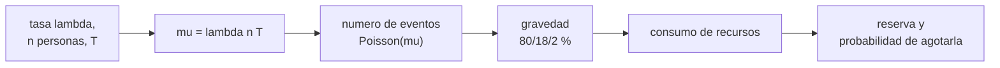

# B105-C14 — Atención de urgencia remota

<!-- nav:top -->
[🏠 Programa](../../../../README.md) · [📚 Bloque B105](../../../tronco-comun/B105-medicina-y-biologia-espacial.md) · [← Anterior: B105-C13 — Farmacología y microgravedad](../B105-C13-farmacologia-y-microgravedad/CLASE.md) · [Siguiente: B105-C15 — Telemedicina espacial →](../B105-C15-telemedicina-espacial/CLASE.md)
<!-- /nav -->

## 1. Ubicación, nivel y alcance

Clase 14 del bloque B105. Nivel N3. En una misión lejana no hay hospital cerca: los eventos médicos son aleatorios y los recursos son finitos. Aquí modelas los eventos como un proceso de Poisson con tasa **sintética**, calculas el riesgo de al menos uno, de varios y de uno grave, y el consumo de recursos de una reserva. La comunicación con tierra se trata en [B105-C15](../B105-C15-telemedicina-espacial/CLASE.md). **No define criterios de evacuación, triaje ni tratamiento**.

## 2. Por qué esta clase existe

La atención remota se diseña para eventos poco frecuentes pero casi seguros a lo largo de una misión. La decisión central: **¿cuántos eventos se esperan, con qué probabilidad hay al menos uno grave y qué reserva de recursos cubre el 99 % de las misiones?**

## 3. Lo que podrás hacer al terminar

1. Calcular los eventos esperados `μ = λ n T` y las probabilidades de Poisson `P(0)`, `P(≥1)` y `P(≥k)`.
2. Mezclar gravedades y calcular el consumo esperado de recursos.
3. Estimar por simulación la probabilidad de agotar una reserva y el cuantil de cobertura del 99 %.
4. Analizar la sensibilidad a la tasa `λ`.
5. Reconocer los límites del supuesto de independencia.
6. Rotular los datos como sintéticos y no dar criterios clínicos.

La evidencia es la **ficha de riesgo médico de misión sintética** del ejercicio 12 (sección 20).

## 4. Con qué llegas y cómo comprobarlo

1. ¿Qué es una distribución de Poisson?
2. ¿Qué es una probabilidad complementaria?
3. ¿Qué es un cuantil?
4. ¿Qué es la persona-año?
5. ¿Qué es un dato sintético?

<details>
<summary>Ver respuestas</summary>

1. La de los conteos de eventos independientes con tasa constante. 2. `P(≥1) = 1 − P(0)`. 3. El valor bajo el cual queda una fracción dada de los casos. 4. Una persona observada durante un año. 5. Un dato generado para el ejemplo, no medido.
</details>

Con cuatro o cinco aciertos, sigue; si no, repasa los prerrequisitos.

## 5. Un caso de contexto y casos de referencia

Una tripulación **sintética** de 6 personas durante 180 días con tasa de 0,5 eventos por persona-año espera `μ = 1,478` eventos: `P(0) = 0,228`, `P(≥1) = 0,772` y `P(≥3) = 0,186`. Con gravedad leve/moderada/grave de 80/18/2 % y costes de 1/3/8 unidades, el consumo medio es 2,22 unidades, el p95 es 7 y una reserva de 11 cubre el 99 % de las misiones; la probabilidad de al menos un evento grave es 0,030. Es el **ejemplo conductor**: la tasa, las gravedades y los costes son **sintéticos**; no son estadísticas de vuelo.

## 6. Vocabulario

El **proceso de Poisson** da `P(k) = e^{−μ} μ^k/k!`. La **tasa** `λ` es eventos por persona-año. Los **eventos esperados** son `μ = λ n T` con `T` en años. La **gravedad** clasifica los eventos (aquí tres clases sintéticas). La **reserva** es la cantidad de recursos disponibles (unidades arbitrarias). La **sobredispersión** es una varianza mayor que la media, típica de eventos agrupados.

## 7. Modelo mental



*Descripción textual:* la tasa, la tripulación y la duración dan los eventos esperados; el número de eventos es de Poisson; cada uno tiene una gravedad y un coste, y el total se compara con la reserva.

Analogía: las averías de una flota de vehículos remotos; se calcula cuántas se esperan y cuántas piezas de repuesto cubren casi todos los casos. Límite: las personas no son piezas; los eventos pueden agruparse y su gravedad cambia con el contexto.

## 8. La explicación, paso a paso

### 8.1 Eventos esperados

`μ = λ n T = 0,5·6·(180/365,25) = 1,478`. `P(0) = e^{−1,478} = 0,228`, `P(≥1) = 0,772`, `P(≥3) = 0,186`.

### 8.2 Simulación

Con 100.000 misiones: media de eventos 1,476, `P(≥1) = 0,7721` y `P(≥3) = 0,1856`, de acuerdo con la analítica.

### 8.3 Gravedad y recursos

El consumo esperado es `μ·(0,8·1 + 0,18·3 + 0,02·8) = 1,478·1,5 = 2,22` unidades; el p95 es 7; la probabilidad de superar una reserva de 20 es 0,00004, y la reserva que cubre el 99 % es 11. Al menos un evento grave: 0,0296 (analítica `1 − e^{−μ·0,02} = 0,0291`).

### 8.4 Sensibilidad a la tasa

| `λ` (1/persona-año) | `μ` | `P(≥1)` |
|---|---|---|
| 0,25 | 0,74 | 0,523 |
| 0,50 | 1,48 | 0,772 |
| 1,00 | 2,96 | 0,948 |
| 2,00 | 5,91 | 0,997 |

La probabilidad de al menos un evento crece rápido con la tasa; el diseño de recursos depende más de la cola que de la media.

## 9. Magnitudes, símbolos y unidades

| Símbolo | Qué es | Unidad | Valor / nota |
|---|---|---|---|
| `λ` | tasa de eventos | 1/(persona·año) | 0,5 (sintética) |
| `n` | tripulación | personas | 6 |
| `T` | duración | años | 0,493 (180 d) |
| `μ` | eventos esperados | — | 1,478 |
| `c` | coste por evento | unidades | 1; 3; 8 |
| reserva | recursos disponibles | unidades | 20 |

## 10. Convenciones y referencias

Año de 365,25 días; eventos independientes con tasa constante; gravedad independiente del evento previo. Datos sintéticos con semilla 105 (100.000 misiones). Tolerancias del laboratorio: `P(≥1)` simulada dentro de 0,005 de la analítica; media de eventos dentro de 0,02 de `μ`; probabilidad de un evento grave dentro de 0,002 de la analítica. Numpy 2.4.4, Python 3.12.9.

## 11. De dónde sale lo que afirmamos

| ID | Fuente | Localizador | Respalda | Estado |
|---|---|---|---|---|
| — | Relaciones físicas, fisiológicas y estadísticas estándar usadas en el laboratorio | — | las verifica el laboratorio | No consultada en una fuente concreta (las verifica el laboratorio) |

Límites: no se consultó ninguna estadística de eventos médicos en vuelo ni modelo de riesgo de una agencia; la tasa, las gravedades y los costes son sintéticos y no deben usarse para planificar una misión real.

## 12. Cómo ver el resultado

Descripción: la tabla de 8.4 y la salida con probabilidades y consumo. Equivalente textual: con 0,5 eventos/persona-año, un evento durante la misión es probable (0,77) y uno grave poco probable (0,03).

## 13. Ejemplo trabajado: eventos esperados y probabilidad de al menos uno

**Paso 1 · Duración.** `180/365,25 = 0,493 años`.

**Paso 2 · Esperados.** `μ = 0,5·6·0,493 = 1,478`.

**Paso 3 · Ninguno.** `P(0) = e^{−1,478} = 0,228`.

**Paso 4 · Al menos uno.** `1 − 0,228 = 0,772`.

## 14. Distintas formas de describir el problema

**Por tasa:** `λ`. **Por esperados:** `μ`. **Por probabilidad:** Poisson. **Por recursos:** consumo y reserva. **Por cola:** cuantil del 99 %. **Por sensibilidad:** `λ` frente a `P(≥1)`.

## 15. Práctica guiada

**Ejercicio 1 · con los pasos indicados.** Calcula `μ` para `λ = 0,5`, `n = 6` y 180 días. *Pasos:* `λ n T`.

<details><summary>Solución comentada</summary>

`1,478`.
</details>

**Ejercicio 2 · con una pista.** Calcula `P(0)`. *Pista:* `e^{−μ}`.

<details><summary>Solución comentada</summary>

`0,228`.
</details>

**Ejercicio 3 · casi autónomo.** Calcula `P(≥1)`.

<details><summary>Solución comentada</summary>

`0,772`.
</details>

## 16. Práctica autónoma, transferencia e integrador

**Ejercicio 4 · autónomo.** Calcula `P(≥3)`.

<details><summary>Solución comentada</summary>

`1 − P(0) − P(1) − P(2) = 0,186`.
</details>

**Ejercicio 5 · autónomo.** ¿Cuántos eventos espera cada persona en la misión?

<details><summary>Solución comentada</summary>

`0,5·0,493 = 0,246`.
</details>

**Ejercicio 6 · autónomo.** ¿Cuál es la probabilidad de al menos un evento grave?

<details><summary>Solución comentada</summary>

`1 − e^{−1,478·0,02} = 0,029`.
</details>

**Ejercicio 7 · autónomo.** Calcula `P(≥1)` con `λ = 1,0`.

<details><summary>Solución comentada</summary>

`0,948`.
</details>

**Ejercicio 8 · autónomo.** Calcula el consumo esperado de recursos.

<details><summary>Solución comentada</summary>

`1,478·1,5 = 2,22` unidades.
</details>

**Ejercicio 9 · transferencia.** Para 900 días con la misma tripulación y tasa, ¿cuál es `μ` y `P(≥1)`?

<details><summary>Solución comentada</summary>

`μ = 0,5·6·2,464 = 7,39`; `P(≥1) = 0,9994`.
</details>

**Ejercicio 10 · transferencia.** ¿Qué supuesto del modelo falla si los eventos se agrupan (por ejemplo, por contagio)?

<details><summary>Solución comentada</summary>

La independencia: aparece sobredispersión; la varianza supera a la media y la cola de la distribución es más pesada.
</details>

**Ejercicio 11 · transferencia.** ¿Por qué es mejor dimensionar la reserva con el cuantil del 99 % (11 unidades) que con la media (2,22)?

<details><summary>Solución comentada</summary>

Porque el riesgo de quedarse sin recursos está en la cola; la media subestima la reserva necesaria.
</details>

**Ejercicio 12 · integrador.** Elabora tu *ficha de riesgo médico de misión sintética*: tasa, `μ`, probabilidades, gravedades y consumo, reserva para el 99 %, sensibilidad a `λ` y lista de qué es sintético.

<details><summary>Solución comentada</summary>

Secciones 8.1–8.4 y la salida del laboratorio.
</details>

## 17. Laboratorio: eventos médicos de una misión como proceso de Poisson

El script [urgencias.py](urgencias.py) calcula probabilidades de Poisson de una misión sintética, simula 100.000 misiones con gravedad y consumo de recursos y analiza la sensibilidad a la tasa (**comprueba** que la `P(≥1)` simulada coincide con la analítica, que la media coincide con `μ` y que el evento grave coincide con `1 − e^{−μ p}`).

**Datos:** todo **sintético** (semilla 105); no hay estadísticas de vuelo. **Predice antes de ejecutar:** ¿Qué es más probable en la misión, ningún evento o al menos uno? (Al menos uno: 0,77.) **Ejecución del 2026-11-10 (Python 3.12.9):**

```text
Python 3.12.9; numpy 2.4.4
DATOS SINTETICOS (semilla 105): tasa 0.5/persona-anio; gravedad 80/18/2 %; costes 1/3/8 unidades; reserva 20; sin estadisticas reales
Eventos esperados en la mision mu = 1.478; P(0) = 0.2280; P(>=1) = 0.7720; P(>=3) = 0.1858
Simulacion: media de eventos = 1.476; P(>=1) = 0.7721; P(>=3) = 0.1856
Consumo de recursos: media 2.22, p95 = 7; P(consumo > reserva de 20) = 0.00004
P(al menos un evento grave) = 0.0296 (analitica 0.0291)
  lambda = 0.25/persona-anio: mu =  0.74; P(>=1) = 0.523
  lambda = 0.50/persona-anio: mu =  1.48; P(>=1) = 0.772
  lambda = 1.00/persona-anio: mu =  2.96; P(>=1) = 0.948
  lambda = 2.00/persona-anio: mu =  5.91; P(>=1) = 0.997
Reserva que cubre el 99 % de las misiones simuladas = 11 unidades
Pruebas superadas.
```

```bash
python programa/clases/B105/B105-C14-atencion-de-urgencia-remota/urgencias.py
```

**Límites:** independencia, tasa constante, tres gravedades fijas y costes arbitrarios; no define criterios de evacuación, triaje ni tratamiento; no sirve para planificar misiones reales.

## 18. Errores frecuentes y cómo corregirlos

**Usar la media como reserva.** Usa el cuantil (ejercicio 11).

**Confundir tasa por año con tasa por misión.** Convierte con `T` en años (8.1).

**Suponer independencia sin comprobarla.** Revisa la sobredispersión.

**Usar la tasa sintética como estadística real.** Se rotula (sección 10).

## 19. Cómo sabrás que vas bien

Tras la sección 8: ¿calculas `μ` y `P(≥1)`? Si dudas, repasa el ejemplo 13. Tras el laboratorio: ¿qué comprueba? (ver la sección 17).

## 20. Qué entregas y cómo se evalúa

El producto es tu **ficha de riesgo médico de misión sintética** (ejercicio 12).

| Criterio | Inicial | En desarrollo | Logrado | Destacado |
|---|---|---|---|---|
| Conceptos | Confunde las magnitudes | Parciales | Explica `μ`, `P(≥1)` y la reserva | Explica los límites de la independencia |
| Cálculo | Sin unidades | Con errores | Calcula con unidades y tolerancias | Calcula casos nuevos |
| Numérico | Sin comprobar | Un caso | Compara con la verdad del generador | Interpreta la sensibilidad |
| Fuentes | Sin fuente | Sin fecha | Cita solo lo consultado, con fecha | Rotula lo sintético y lo no consultado |
| Límites | No los nombra | Uno | Tres | Discute qué falta del modelo |

**Condiciones críticas (no se compensan con promedio):** rotular los datos como sintéticos; no presentar un resultado simulado como observado; no dar consejo médico ni operativo; citar solo lo consultado.

## 21. Ética, seguridad y límites

Clase **educativa**: no es consejo médico, no sustituye la formación, la licencia ni la supervisión de profesionales, y no contiene dosis, tratamientos ni procedimientos para aplicar a una persona real. Esta clase no establece criterios médicos: la atención de urgencia y las decisiones de evacuación corresponden a los profesionales y a los protocolos vigentes de la misión. Accesibilidad: tablas equivalentes a las gráficas, fórmulas en texto, ejercicios sin conexión.

## 22. Para cerrar y seguir

Con 0,5 eventos/persona-año, se espera 1,48 eventos en 180 días (`P(≥1) = 0,77`) y una reserva de 11 unidades cubre el 99 % de las misiones sintéticas. Queda una pregunta: ¿cuánto tarda una consulta con la Tierra?

**Glosario español–inglés.** proceso de Poisson · *Poisson process*; persona-año · *person-year*; sobredispersión · *overdispersion*; reserva · *reserve*.

**Continuidad.** [B105-C15](../B105-C15-telemedicina-espacial/CLASE.md) estudia la telemedicina espacial.

**Referencias:** ver sección 11.

<!-- nav:bottom -->
---

[← Anterior: B105-C13 — Farmacología y microgravedad](../B105-C13-farmacologia-y-microgravedad/CLASE.md) · [📚 Bloque B105](../../../tronco-comun/B105-medicina-y-biologia-espacial.md) · [Siguiente: B105-C15 — Telemedicina espacial →](../B105-C15-telemedicina-espacial/CLASE.md)
<!-- /nav -->
