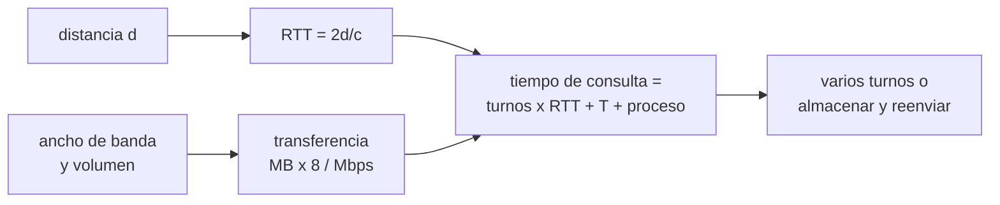

# B105-C15 — Telemedicina espacial

<!-- nav:top -->
[🏠 Programa](../../../../README.md) · [📚 Bloque B105](../../../tronco-comun/B105-medicina-y-biologia-espacial.md) · [← Anterior: B105-C14 — Atención de urgencia remota](../B105-C14-atencion-de-urgencia-remota/CLASE.md) · [Siguiente: B105-C16 — Contramedidas de ejercicio →](../B105-C16-contramedidas-de-ejercicio/CLASE.md)
<!-- /nav -->

## 1. Ubicación, nivel y alcance

Clase 15 del bloque B105. Nivel N3. La telemedicina espacial depende del tiempo que tarda la luz en cruzar la distancia y del ancho de banda del enlace. Aquí calculas el retardo de ida y de ida y vuelta a la Luna y a Marte (con un modelo circular del ciclo sinodico) y un presupuesto de tiempo de una consulta **sintética**. Sigue de [B105-C14](../B105-C14-atencion-de-urgencia-remota/CLASE.md).

## 2. Por qué esta clase existe

Una conversación en tiempo real es posible a la Luna (2,6 s de ida y vuelta) y deja de serlo a Marte (hasta 42 min). La decisión central: **¿cuánto dura una consulta según el destino y el diseño del intercambio (varios turnos o un paquete completo)?**

## 3. Lo que podrás hacer al terminar

1. Calcular el retardo de luz `d/c` y el de ida y vuelta para un destino.
2. Calcular las distancias del ciclo sinodico de Marte con órbitas circulares coplanares.
3. Calcular el tiempo de transferencia `MB·8/Mbps` y el presupuesto de una consulta.
4. Comparar un intercambio de varios turnos con uno de almacenar y reenviar.
5. Calcular qué fracción del ciclo supera un umbral de retardo.
6. Rotular constantes exactas, valores no consultados y datos sintéticos.

La evidencia es la **ficha de enlace con el presupuesto de latencia** del ejercicio 12 (sección 20).

## 4. Con qué llegas y cómo comprobarlo

1. ¿Cuál es la velocidad de la luz?
2. ¿Qué es una UA?
3. ¿Qué es el ancho de banda?
4. ¿Qué es el periodo sinódico?
5. ¿Qué es un dato sintético?

<details>
<summary>Ver respuestas</summary>

1. 299.792,458 km/s (valor exacto del SI). 2. La unidad astronómica: 149.597.870,7 km (valor exacto). 3. La tasa de transferencia (Mbps). 4. El tiempo entre dos alineaciones iguales de dos planetas con el Sol. 5. Un dato generado para el ejemplo, no medido.
</details>

Con cuatro o cinco aciertos, sigue; si no, repasa los prerrequisitos.

## 5. Un caso de contexto y casos de referencia

Una consulta **sintética** de 6 turnos de pregunta y respuesta con 5 MB de imágenes a 1 Mbps y 60 s de procesamiento: a la Luna (384.400 km, 1,28 s de ida; valor de orden de magnitud, no consultado) dura 115,4 s (1,9 min); a Marte en la mínima distancia del modelo (0,524 UA, ida 4,36 min), 54,0 min; en la máxima (2,524 UA, ida 20,99 min), 253,6 min. Enviar todo en un solo turno con el retardo máximo la reduce a 43,6 min. Es el **ejemplo conductor**: el enlace y la consulta son **sintéticos**; las constantes `c` y UA son exactas.

## 6. Vocabulario

El **retardo de ida** es `d/c`; el de **ida y vuelta** (RTT), `2d/c`. El **tiempo de transferencia** es `MB·8/Mbps`. El **modelo circular** supone órbitas circulares coplanares de 1 UA y 1,524 UA; la distancia es `√(1 + 1,524² − 2·1,524·cos θ)` UA con `θ = 2π t/779,9 d`. **Almacenar y reenviar** envía toda la información en un solo paquete. El **tiempo real** (RTT menor que 1 s, umbral ilustrativo) permite conversación.

## 7. Modelo mental



*Descripción textual:* la distancia fija el retardo de ida y vuelta; el volumen y el ancho de banda fijan el tiempo de transferencia; el tiempo de consulta suma turnos por RTT, transferencia y procesamiento, y se compara un diseño por turnos con uno de un solo paquete.

Analogía: una carta frente a una llamada; si la carta tarda 20 minutos, conviene escribir todo en una sola. Límite: el enlace real tiene pérdidas, retransmisiones y ventanas de visibilidad que el modelo ignora.

## 8. La explicación, paso a paso

### 8.1 Retardos

`d/c`: Luna `384.400/299.792,458 = 1,28 s` (RTT 2,56 s); Marte a 0,524 UA, 261,5 s (RTT 8,72 min); a 2,524 UA, 1.259,5 s (RTT 41,98 min).

### 8.2 El ciclo sinodico en el modelo circular

La distancia va de 0,524 a 2,524 UA; el retardo de ida, de 4,36 a 20,99 min (media 14,08). El 71,1 % del ciclo tiene un RTT mayor que 20 min y el 100 %, mayor que 1 s.

### 8.3 Presupuesto de consulta

`tiempo = n RTT + MB·8/Mbps + proceso`: la transferencia es `5·8/1 = 40 s`; Luna: `6·2,56 + 40 + 60 = 115,4 s`; Marte mínima: 3.237,7 s; máxima: 15.213,9 s. Los turnos dominan el tiempo a Marte.

### 8.4 Almacenar y reenviar

Un solo turno con todo el paquete: `2.519 + 40 + 60 = 2.619 s = 43,6 min` frente a 253,6 min. Cambiar el diseño del intercambio ahorra más que subir el ancho de banda.

## 9. Magnitudes, símbolos y unidades

| Símbolo | Qué es | Unidad | Valor / nota |
|---|---|---|---|
| `c` | velocidad de la luz | km/s | 299.792,458 (exacto) |
| `d` | distancia | km | 384.400 (Luna); 0,524 a 2,524 UA |
| RTT | retardo de ida y vuelta | s | 2,56 (Luna) |
| `V` | volumen de datos | MB | 5 (sintético) |
| `B` | ancho de banda | Mbps | 1 (sintético) |
| `n` | turnos de la consulta | — | 6 (sintético) |

## 10. Convenciones y referencias

Retardo de propagación en el vacío sin procesamiento de relés; 8 bits por byte; 1 MB = 10⁶ bytes. Distancia a Marte con órbitas circulares coplanares (modelo didáctico; la real varía por la excentricidad). Tolerancias del laboratorio: retardo lunar 1,282 ± 0,001 s; Marte mínima 4,36 ± 0,02 min y máxima 21,0 ± 0,1 min. Numpy 2.4.4, Python 3.12.9.

## 11. De dónde sale lo que afirmamos

| ID | Fuente | Localizador | Respalda | Estado |
|---|---|---|---|---|
| — | Relaciones físicas, fisiológicas y estadísticas estándar usadas en el laboratorio | — | las verifica el laboratorio | No consultada en una fuente concreta (las verifica el laboratorio) |

Límites: no se consultó ninguna fuente de comunicaciones espaciales (CCSDS, UIT, NASA) para esta clase; `c` y la UA son constantes exactas conocidas; la distancia lunar y las de Marte son de orden de magnitud o del modelo circular y no se consultaron.

## 12. Cómo ver el resultado

Descripción: la tabla de la salida con ida y RTT por destino y el presupuesto de consulta. Equivalente textual: la Luna permite conversación; Marte exige enviar paquetes completos.

## 13. Ejemplo trabajado: tiempo de una consulta a la Luna

**Paso 1 · RTT.** `2·384.400/299.792,458 = 2,56 s`.

**Paso 2 · Turnos.** `6·2,56 = 15,4 s`.

**Paso 3 · Transferencia.** `5·8/1 = 40 s`.

**Paso 4 · Total.** `15,4 + 40 + 60 = 115,4 s`.

## 14. Distintas formas de describir el problema

**Por distancia:** km o UA. **Por retardo:** `d/c`. **Por consulta:** `n RTT + T + proceso`. **Por diseño:** turnos o un paquete. **Por ciclo:** fracción del tiempo sobre un umbral.

## 15. Práctica guiada

**Ejercicio 1 · con los pasos indicados.** Calcula el retardo de ida a la Luna (384.400 km). *Pasos:* `d/c`.

<details><summary>Solución comentada</summary>

`1,282 s`.
</details>

**Ejercicio 2 · con una pista.** Calcula el RTT a la Luna. *Pista:* doble.

<details><summary>Solución comentada</summary>

`2,564 s`.
</details>

**Ejercicio 3 · casi autónomo.** ¿Cuánto tarda en transferirse 5 MB a 1 Mbps?

<details><summary>Solución comentada</summary>

`40 s`.
</details>

## 16. Práctica autónoma, transferencia e integrador

**Ejercicio 4 · autónomo.** ¿Cuánto tarda la luz en recorrer 1 UA?

<details><summary>Solución comentada</summary>

`149.597.870,7/299.792,458 = 499,0 s = 8,3 min`.
</details>

**Ejercicio 5 · autónomo.** ¿A cuántos km equivale 0,524 UA?

<details><summary>Solución comentada</summary>

`78,4 millones de km`.
</details>

**Ejercicio 6 · autónomo.** ¿Por qué conviene almacenar y reenviar a Marte?

<details><summary>Solución comentada</summary>

Porque cada turno cuesta un RTT de 9 a 42 minutos; un solo paquete completo evita repetirlo.
</details>

**Ejercicio 7 · autónomo.** Calcula el tiempo de una consulta a Marte (0,524 UA) con 6 turnos.

<details><summary>Solución comentada</summary>

`6·522,96 + 40 + 60 = 3.237,7 s = 54,0 min`.
</details>

**Ejercicio 8 · autónomo.** ¿Qué ancho de banda hace falta para enviar 5 MB en 10 s?

<details><summary>Solución comentada</summary>

`4 Mbps`.
</details>

**Ejercicio 9 · transferencia.** Con 10 Mbps, ¿cuánto tarda la transferencia de 5 MB?

<details><summary>Solución comentada</summary>

`4 s`; el tiempo total de la consulta a Marte apenas cambia, porque domina el RTT.
</details>

**Ejercicio 10 · transferencia.** ¿Qué fracción del ciclo tiene un RTT mayor que 20 min y qué implica para el diseño?

<details><summary>Solución comentada</summary>

`0,711`; el protocolo debe funcionar casi siempre con retardos largos.
</details>

**Ejercicio 11 · transferencia.** Un relé añade 2 s en cada sentido. ¿Cómo cambia el RTT a la Luna?

<details><summary>Solución comentada</summary>

Suma 4 s: `2,56 + 4 = 6,6 s`; la conversación deja de ser fluida.
</details>

**Ejercicio 12 · integrador.** Elabora tu *ficha de enlace con el presupuesto de latencia*: destinos, RTT, presupuesto de la consulta con turnos y almacenar y reenviar, y lista de qué es sintético.

<details><summary>Solución comentada</summary>

Secciones 8.1–8.4 y la salida del laboratorio.
</details>

## 17. Laboratorio: retardo de luz y presupuesto de latencia de una consulta remota

El script [enlace.py](enlace.py) calcula los retardos de luz a la Luna y a Marte (modelo circular), la fracción del ciclo sobre un umbral y el presupuesto de una consulta con turnos y con almacenar y reenviar (**comprueba** el retardo lunar de 1,282 s, los extremos del ciclo de Marte y que un solo turno es más corto que seis).

**Datos:** constantes **exactas** (`c`, UA); distancia lunar de orden de magnitud **no consultada**; enlace y consulta **sintéticos**. **Predice antes de ejecutar:** ¿Qué domina el tiempo de una consulta a Marte, la transferencia o los turnos? (Los turnos.) **Ejecución del 2026-11-10 (Python 3.12.9):**

```text
Python 3.12.9; numpy 2.4.4
DATOS: c y 1 UA exactos; distancia a la Luna de orden de magnitud no consultada; enlace y consulta SINTETICOS/ILUSTRATIVOS
destino                                   ida [s]   ida y vuelta [s]
  Luna (384 400 km)                            1.28        2.56   (  0.04 min ida y vuelta)
  Marte (distancia minima, 0.524 UA)         261.48      522.96   (  8.72 min ida y vuelta)
  Marte (distancia maxima, 2.524 UA)        1259.49     2518.98   ( 41.98 min ida y vuelta)
Ciclo sinodico (modelo circular): distancia entre 0.524 y 2.524 UA; retardo de ida 4.36 a 20.99 min; media 14.08 min
Fraccion del ciclo con ida y vuelta mayor que 20 min = 0.711; mayor que 1 s = 1.000
Presupuesto de una consulta (6 turnos de pregunta-respuesta, 5 MB de imagenes, 1 Mbps, 60 s de proceso):
  Luna (384 400 km)                        tiempo total =     115.4 s =     1.9 min
  Marte (distancia minima, 0.524 UA)       tiempo total =    3237.7 s =    54.0 min
  Marte (distancia maxima, 2.524 UA)       tiempo total =   15213.9 s =   253.6 min
Almacenar y reenviar (1 turno, todo el paquete) con retardo maximo: 43.6 min frente a 253.6 min con 6 turnos
Pruebas superadas.
```

```bash
python programa/clases/B105/B105-C15-telemedicina-espacial/enlace.py
```

**Límites:** órbitas circulares coplanares, sin relés, sin retransmisiones ni ventanas de visibilidad ni conjunción solar; no es un diseño de enlace.

## 18. Errores frecuentes y cómo corregirlos

**Mezclar Mbps y MB/s.** Un byte son 8 bits (8.3).

**Usar `d/c` como ida y vuelta.** El RTT es `2d/c`.

**Mejorar el ancho de banda para arreglar el retardo.** No cambia el retardo de propagación (8.4).

**Tomar la distancia del modelo como la real.** Es un modelo circular.

## 19. Cómo sabrás que vas bien

Tras la sección 8: ¿calculas el RTT y el tiempo de una consulta? Si dudas, repasa el ejemplo 13. Tras el laboratorio: ¿qué comprueba? (ver la sección 17).

## 20. Qué entregas y cómo se evalúa

El producto es tu **ficha de enlace con el presupuesto de latencia** (ejercicio 12).

| Criterio | Inicial | En desarrollo | Logrado | Destacado |
|---|---|---|---|---|
| Conceptos | Confunde las magnitudes | Parciales | Explica retardo, RTT y transferencia | Explica el diseño del intercambio frente al retardo |
| Cálculo | Sin unidades | Con errores | Calcula con unidades y tolerancias | Calcula casos nuevos |
| Numérico | Sin comprobar | Un caso | Compara con la verdad del generador | Interpreta la sensibilidad |
| Fuentes | Sin fuente | Sin fecha | Cita solo lo consultado, con fecha | Rotula lo sintético y lo no consultado |
| Límites | No los nombra | Uno | Tres | Discute qué falta del modelo |

**Condiciones críticas (no se compensan con promedio):** rotular los datos como sintéticos; no presentar un resultado simulado como observado; no dar consejo médico ni operativo; citar solo lo consultado.

## 21. Ética, seguridad y límites

Clase **educativa**: no es consejo médico, no sustituye la formación, la licencia ni la supervisión de profesionales, y no contiene dosis, tratamientos ni procedimientos para aplicar a una persona real. Esta clase no define protocolos clínicos: la telemedicina real exige canales aprobados, privacidad de los datos de salud y la supervisión de profesionales. Accesibilidad: tablas equivalentes a las gráficas, fórmulas en texto, ejercicios sin conexión.

## 22. Para cerrar y seguir

A la Luna una consulta sintética dura 1,9 min; a Marte, entre 54 y 254 min, y enviar un solo paquete la reduce a 43,6 min en el peor caso. Queda una pregunta: ¿qué indicadores clínicos se siguen y cuándo cambian de verdad?

**Glosario español–inglés.** retardo de luz · *light-time delay*; ida y vuelta · *round trip*; almacenar y reenviar · *store and forward*; ancho de banda · *bandwidth*.

**Continuidad.** [B105-C16](../B105-C16-contramedidas-de-ejercicio/CLASE.md) estudia las contramedidas de ejercicio.

**Referencias:** ver sección 11.

<!-- nav:bottom -->
---

[← Anterior: B105-C14 — Atención de urgencia remota](../B105-C14-atencion-de-urgencia-remota/CLASE.md) · [📚 Bloque B105](../../../tronco-comun/B105-medicina-y-biologia-espacial.md) · [Siguiente: B105-C16 — Contramedidas de ejercicio →](../B105-C16-contramedidas-de-ejercicio/CLASE.md)
<!-- /nav -->
