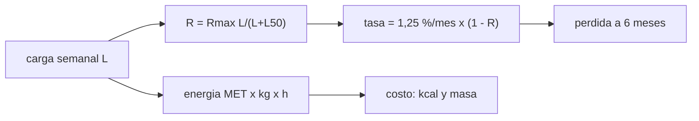

# B105-C16 — Contramedidas de ejercicio

<!-- nav:top -->
[🏠 Programa](../../../../README.md) · [📚 Bloque B105](../../../tronco-comun/B105-medicina-y-biologia-espacial.md) · [← Anterior: B105-C15 — Telemedicina espacial](../B105-C15-telemedicina-espacial/CLASE.md) · [Siguiente: B105-C17 — Rehabilitación posterior al vuelo →](../B105-C17-rehabilitacion-posterior-al-vuelo/CLASE.md)
<!-- /nav -->

## 1. Ubicación, nivel y alcance

Clase 16 del bloque B105. Nivel N3. El ejercicio es la contramedida principal contra la pérdida de hueso y de músculo (ver [B105-C02](../B105-C02-perdida-de-masa-osea/CLASE.md) y [B105-C03](../B105-C03-atrofia-muscular/CLASE.md)), pero cuesta tiempo, energía y masa. Aquí calculas la energía del ejercicio con MET, la carga mecánica y una curva dosis–respuesta de tipo Hill **sintética** con rendimientos decrecientes. **No es una prescripción de ejercicio.**

## 2. Por qué esta clase existe

Más ejercicio ayuda, pero con rendimientos decrecientes y con un costo de energía y tiempo. La decisión central: **¿qué parte de la pérdida se evita con una carga dada y cuánta energía extra exige?**

## 3. Lo que podrás hacer al terminar

1. Calcular la energía del ejercicio con `kcal = MET·kg·h`.
2. Calcular una fuerza de reacción `F = m a` y compararla con el peso.
3. Ajustar una curva de Hill de dosis–respuesta a datos sintéticos por mínimos cuadrados.
4. Traducir una reducción relativa en pérdida ósea a 6 meses.
5. Reconocer los rendimientos decrecientes y los límites de extrapolar.
6. Rotular qué es sintético y no dar prescripciones.

La evidencia es la **ficha de prescripción educativa con su balance** del ejercicio 12 (sección 20).

## 4. Con qué llegas y cómo comprobarlo

1. ¿Qué es un MET?
2. ¿Qué es una curva dosis–respuesta?
3. ¿Qué es un ajuste por mínimos cuadrados?
4. ¿Qué es la saturación?
5. ¿Qué es un dato sintético?

<details>
<summary>Ver respuestas</summary>

1. Un múltiplo del gasto en reposo (≈ 1 kcal/kg/h). 2. La relación entre una dosis y el efecto que produce. 3. Elegir los parámetros que minimizan la suma de cuadrados de los residuos. 4. Un efecto que deja de crecer con la dosis. 5. Un dato generado para el ejemplo, no medido.
</details>

Con cuatro o cinco aciertos, sigue; si no, repasa los prerrequisitos.

## 5. Un caso de contexto y casos de referencia

Un tripulante **sintético** de 75 kg hace 2 h/día de resistencia a 6 MET: 900 kcal/día (33,7 % del gasto de 2.668 kcal/día de B105-C12) y 5.400 kcal por semana de 6 días. Una curva de Hill `R = Rmax L/(L + L50)` con `Rmax = 0,8` y `L50 = 100` (ilustrativas) reduce la pérdida ósea: con `L = 100`, `R = 0,40` y la pérdida a 6 meses baja de 7,27 % a 4,21 %; con `L = 800`, a 2,15 %. El ajuste de datos sintéticos recupera `Rmax = 0,79` y `L50 = 83`. Es el **ejemplo conductor**: todo es **sintético**.

## 6. Vocabulario

Un **MET** equivale a unos 1 kcal/kg/h (aproximación, no consultada). La **carga semanal** `L` está en unidades arbitrarias. La **curva de Hill** `R(L) = Rmax L/(L + L50)` satura en `Rmax`; `L50` es la carga con la mitad del efecto máximo. La **reducción relativa** `R` multiplica la tasa de pérdida por `(1 − R)`. La **fuerza de reacción** `F = m a`. Un **rendimiento decreciente** es cada vez menos efecto por unidad añadida.

## 7. Modelo mental



*Descripción textual:* la carga semanal reduce la tasa de pérdida con una curva saturante y, a la vez, cuesta energía; se compara el beneficio con el costo.

Analogía: regar una planta; los primeros litros importan mucho y los últimos casi nada. Límite: aquí `Rmax` es un supuesto; no hay una dosis mínima conocida en este texto.

## 8. La explicación, paso a paso

### 8.1 Energía

`kcal = MET·kg·h`: caminata ligera (3,5 MET) 525 kcal en 2 h para 75 kg; carrera moderada (8 MET), 1.200; resistencia (6 MET), 900. Una semana de 6 días a 900 kcal son 5.400 kcal; una persona de 75 kg necesitaría 33,7 % más de energía solo por esas sesiones.

### 8.2 Carga mecánica

`F = m a`: 75 kg a 3 m/s² dan 225 N, 0,31 veces el peso terrestre (735,8 N). La carga que llega al hueso depende del dispositivo y de la postura, no solo de `m a`.

### 8.3 Dosis–respuesta de Hill

Con `R(L) = Rmax L/(L + L50)`, `L = 100` da `R = 0,4`. Con datos sintéticos con ruido de 0,03, el ajuste por rejilla da `Rmax = 0,79` y `L50 = 83` (suma de cuadrados 0,00345). La curva satura: de `L = 400` a 800, `R` sube de 0,650 a 0,711 pero la energía se duplica.

### 8.4 Perdida a 6 meses

Con la tasa de 1,25 %/mes del bloque: `L = 0`, 7,27 %; 50, 5,17 %; 100, 4,21 %; 200, 3,29 %; 400, 2,60 %; 800, 2,15 %. La carga para `R = 0,5` con los parámetros verdaderos es `L = 167`.

## 9. Magnitudes, símbolos y unidades

| Símbolo | Qué es | Unidad | Valor / nota |
|---|---|---|---|
| MET | equivalente metabólico | — | 3,5; 6; 8 |
| `m` | masa | kg | 75 |
| `L` | carga semanal | u.a. | 0 a 800 |
| `R` | reducción relativa de la pérdida | — | 0,4 (`L = 100`) |
| `R_max` | efecto máximo | — | 0,8 (ilustrativo) |
| `L50` | carga de efecto medio | u.a. | 100 (ilustrativa) |

## 10. Convenciones y referencias

Energía por sesión sin contabilizar el efecto térmico ni la adaptación. Datos sintéticos con semilla 105 (ruido de 0,03 en `R`). Ajuste por rejilla (101×281 puntos). Tolerancias del laboratorio: `R(L50) = Rmax/2`; 900 kcal para 6 MET, 75 kg, 2 h; `Rmax` ajustado dentro de 0,2 de 0,8 y `L50` dentro de 60 de 100. Numpy 2.4.4, Python 3.12.9.

## 11. De dónde sale lo que afirmamos

| ID | Fuente | Localizador | Respalda | Estado |
|---|---|---|---|---|
| — | Relaciones físicas, fisiológicas y estadísticas estándar usadas en el laboratorio | — | las verifica el laboratorio | No consultada en una fuente concreta (las verifica el laboratorio) |

Límites: no se consultó ninguna fuente de fisiología del ejercicio en vuelo ni los dispositivos reales; la tasa de 1,25 %/mes viene del rango consultado en B105-C02 (NASA); MET, cargas y la curva son didácticos.

## 12. Cómo ver el resultado

Descripción: la tabla de 8.4 y la salida del ajuste. Equivalente textual: más carga reduce la pérdida, con rendimientos decrecientes, y cuesta energía proporcional al tiempo.

## 13. Ejemplo trabajado: reducción y pérdida con L = 100

**Paso 1 · Reducción.** `R = 0,8·100/(100 + 100) = 0,40`.

**Paso 2 · Tasa.** `1,25·(1 − 0,40) = 0,75 %/mes`.

**Paso 3 · Seis meses.** `1 − 0,9925⁶ = 4,4 %`.

**Paso 4 · Costo.** Las sesiones asociadas cuestan energía (8.1).

## 14. Distintas formas de describir el problema

**Por energía:** MET. **Por fuerza:** `m a`. **Por curva:** Hill. **Por pérdida:** %/mes. **Por saturación:** `R_max`. **Por costo:** kcal.

## 15. Práctica guiada

**Ejercicio 1 · con los pasos indicados.** Calcula las kcal de 1 h de caminata a 3,5 MET con 75 kg. *Pasos:* `MET·kg·h`.

<details><summary>Solución comentada</summary>

`262,5 kcal`.
</details>

**Ejercicio 2 · con una pista.** Calcula las kcal de 2 h de resistencia a 6 MET con 62 kg. *Pista:* misma fórmula.

<details><summary>Solución comentada</summary>

`744 kcal`.
</details>

**Ejercicio 3 · casi autónomo.** Calcula `R` con `L = 100`, `Rmax = 0,8`, `L50 = 100`.

<details><summary>Solución comentada</summary>

`0,40`.
</details>

## 16. Práctica autónoma, transferencia e integrador

**Ejercicio 4 · autónomo.** ¿Qué significa `L50`?

<details><summary>Solución comentada</summary>

La carga con la que se logra la mitad del efecto máximo.
</details>

**Ejercicio 5 · autónomo.** Con `R = 0,4`, ¿cuál es la tasa mensual y la pérdida a 6 meses?

<details><summary>Solución comentada</summary>

`0,75 %/mes`; `4,4 %`.
</details>

**Ejercicio 6 · autónomo.** ¿Por qué la curva muestra rendimientos decrecientes?

<details><summary>Solución comentada</summary>

Porque `R` crece como `L/(L + L50)`: a cargas altas, cada unidad añadida suma menos.
</details>

**Ejercicio 7 · autónomo.** ¿Cuánta masa de alimento adicional por semana (4 kcal/g y empaque 1,3) exigen 5.400 kcal?

<details><summary>Solución comentada</summary>

`5.400/4 = 1.350 g`; con empaque, `1,76 kg` por persona y semana.
</details>

**Ejercicio 8 · autónomo.** Calcula la carga para `R = 0,5` con los parámetros verdaderos.

<details><summary>Solución comentada</summary>

`L = L50 R/(Rmax − R) = 100·0,5/0,3 = 167`.
</details>

**Ejercicio 9 · transferencia.** El efecto máximo es `Rmax = 0,8`. ¿Cuál es la pérdida mensual mínima alcanzable?

<details><summary>Solución comentada</summary>

`1,25·0,2 = 0,25 %/mes`.
</details>

**Ejercicio 10 · transferencia.** ¿Por qué no se debe extrapolar la curva a cargas mayores que 800?

<details><summary>Solución comentada</summary>

Porque no hay datos allí y el comportamiento real puede cambiar (lesión, fatiga, saturación distinta).
</details>

**Ejercicio 11 · transferencia.** Con 7 puntos y ruido, `L50` ajustado es 83 (verdad 100). ¿Qué implica para decidir una carga?

<details><summary>Solución comentada</summary>

Que `L50` tiene incertidumbre alta; hay que dar un intervalo y no fijar una carga con un solo ajuste.
</details>

**Ejercicio 12 · integrador.** Elabora tu *ficha de prescripción educativa con su balance*: energía, carga, curva dosis–respuesta con su incertidumbre, pérdida a 6 meses por carga y lista de qué es sintético (sin prescribir).

<details><summary>Solución comentada</summary>

Secciones 8.1–8.4 y la salida del laboratorio.
</details>

## 17. Laboratorio: energía del ejercicio y dosis–respuesta de una contramedida

El script [ejercicio.py](ejercicio.py) calcula la energía por MET, la fuerza de reacción, ajusta una curva de Hill a datos sintéticos y traduce la reducción en pérdida ósea a 6 meses (**comprueba** `R(L50) = Rmax/2`, los 900 kcal y que el ajuste recupera `Rmax` y `L50` dentro de tolerancia).

**Datos:** todo **sintético/ilustrativo** (semilla 105); la tasa de 1,25 %/mes proviene del rango de la NASA consultado en B105-C02. **Predice antes de ejecutar:** ¿Qué pasa con la ganancia al pasar de `L = 400` a `800`? (Es pequeña.) **Ejecución del 2026-11-10 (Python 3.12.9):**

```text
Python 3.12.9; numpy 2.4.4
DATOS SINTETICOS (semilla 105): MET, tiempos, cargas y dosis-respuesta ilustrativos; NO es una prescripcion
  caminata ligera    MET  3.5: 75 kg y 2 h =    525 kcal; 62 kg y 2 h =    434 kcal
  carrera moderada   MET  8.0: 75 kg y 2 h =   1200 kcal; 62 kg y 2 h =    992 kcal
  resistencia        MET  6.0: 75 kg y 2 h =    900 kcal; 62 kg y 2 h =    744 kcal
Con resistencia a 6 MET, 2 h/dia: 900 kcal/dia; semana de 6 dias = 5400 kcal; ingesta adicional equivalente = 33.7 % del gasto de 2668 kcal/dia (B105-C12)
Fuerza de reaccion F = m a para m = 75 kg y a = 3 m/s2: 225 N = 0.31 veces el peso terrestre
Reduccion observada (sintetica) por carga semanal L: 0->-0.00, 25->0.20, 50->0.33, 100->0.40, 200->0.53, 400->0.67, 800->0.71
Ajuste Hill por rejilla: Rmax = 0.79 (verdad 0.8), L50 = 83 (verdad 100); suma de cuadrados = 0.00345
Perdida osea a 6 meses con la tasa de 1.25 %/mes segun la carga (modelo con la reduccion R ajustada):
  L =    0: R = 0.000; tasa 1.250 %/mes; perdida a 6 meses =  7.27 %
  L =   50: R = 0.295; tasa 0.881 %/mes; perdida a 6 meses =  5.17 %
  L =  100: R = 0.429; tasa 0.714 %/mes; perdida a 6 meses =  4.21 %
  L =  200: R = 0.555; tasa 0.557 %/mes; perdida a 6 meses =  3.29 %
  L =  400: R = 0.650; tasa 0.437 %/mes; perdida a 6 meses =  2.60 %
  L =  800: R = 0.711; tasa 0.361 %/mes; perdida a 6 meses =  2.15 %
Carga para R = 0.5 con los parametros verdaderos: L = 167
Pruebas superadas.
```

```bash
python programa/clases/B105/B105-C16-contramedidas-de-ejercicio/ejercicio.py
```

**Límites:** curva única, sin tipos de ejercicio, sin lesiones ni fatiga, sin interacción entre hueso y músculo ni con nutrición; no es una prescripción de ejercicio.

## 18. Errores frecuentes y cómo corregirlos

**Confundir MET con kcal.** Multiplica por kg y h (8.1).

**Extrapolar la curva.** Solo vale en el rango de datos (ejercicio 10).

**Tomar `Rmax` como una garantía.** Es un supuesto del modelo.

**Usar la clase como plan de entrenamiento.** No lo es.

## 19. Cómo sabrás que vas bien

Tras la sección 8: ¿calculas energía y reducción? Si dudas, repasa el ejemplo 13. Tras el laboratorio: ¿qué comprueba? (ver la sección 17).

## 20. Qué entregas y cómo se evalúa

El producto es tu **ficha de prescripción educativa con su balance** (ejercicio 12).

| Criterio | Inicial | En desarrollo | Logrado | Destacado |
|---|---|---|---|---|
| Conceptos | Confunde las magnitudes | Parciales | Explica MET, `F = m a` y Hill | Explica los rendimientos decrecientes y la incertidumbre |
| Cálculo | Sin unidades | Con errores | Calcula con unidades y tolerancias | Calcula casos nuevos |
| Numérico | Sin comprobar | Un caso | Compara con la verdad del generador | Interpreta la sensibilidad |
| Fuentes | Sin fuente | Sin fecha | Cita solo lo consultado, con fecha | Rotula lo sintético y lo no consultado |
| Límites | No los nombra | Uno | Tres | Discute qué falta del modelo |

**Condiciones críticas (no se compensan con promedio):** rotular los datos como sintéticos; no presentar un resultado simulado como observado; no dar consejo médico ni operativo; citar solo lo consultado.

## 21. Ética, seguridad y límites

Clase **educativa**: no es consejo médico, no sustituye la formación, la licencia ni la supervisión de profesionales, y no contiene dosis, tratamientos ni procedimientos para aplicar a una persona real. No se prescribe ningún ejercicio, carga ni duración; el entrenamiento de una persona real lo diseñan y supervisan profesionales. Accesibilidad: tablas equivalentes a las gráficas, fórmulas en texto, ejercicios sin conexión.

## 22. Para cerrar y seguir

Con `L = 100` la pérdida ósea a 6 meses baja de 7,27 % a 4,21 % a costa de 900 kcal por sesión de 2 h; la curva satura en `Rmax`. Queda una pregunta: ¿cómo se recupera una persona tras el vuelo?

**Glosario español–inglés.** contramedida · *countermeasure*; equivalente metabólico · *metabolic equivalent*; dosis–respuesta · *dose–response*; saturación · *saturation*.

**Continuidad.** [B105-C17](../B105-C17-rehabilitacion-posterior-al-vuelo/CLASE.md) estudia la rehabilitación posterior al vuelo.

**Referencias:** ver sección 11.

<!-- nav:bottom -->
---

[← Anterior: B105-C15 — Telemedicina espacial](../B105-C15-telemedicina-espacial/CLASE.md) · [📚 Bloque B105](../../../tronco-comun/B105-medicina-y-biologia-espacial.md) · [Siguiente: B105-C17 — Rehabilitación posterior al vuelo →](../B105-C17-rehabilitacion-posterior-al-vuelo/CLASE.md)
<!-- /nav -->
