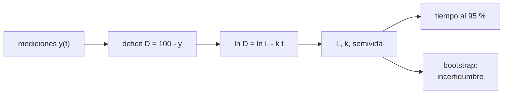

# B105-C17 — Rehabilitación posterior al vuelo

<!-- nav:top -->
[🏠 Programa](../../../../README.md) · [📚 Bloque B105](../../../tronco-comun/B105-medicina-y-biologia-espacial.md) · [← Anterior: B105-C16 — Contramedidas de ejercicio](../B105-C16-contramedidas-de-ejercicio/CLASE.md) · [Siguiente: B105-C18 — Investigación de efectos de gravedad parcial →](../B105-C18-investigacion-de-efectos-de-gravedad-parcial/CLASE.md)
<!-- /nav -->

## 1. Ubicación, nivel y alcance

Clase 17 del bloque B105. Nivel N3. Tras el vuelo la función recupera su valor previo a un ritmo que se puede modelar. Aquí ajustas una curva exponencial a mediciones **sintéticas** por regresión log-lineal, estimas la semivida y los tiempos para recuperar un porcentaje, y propagas la incertidumbre con bootstrap. Se apoya en [B105-C16](../B105-C16-contramedidas-de-ejercicio/CLASE.md) y [B105-C02](../B105-C02-perdida-de-masa-osea/CLASE.md).

## 2. Por qué esta clase existe

Prometer una fecha de recuperación sin su incertidumbre es engañoso: unas pocas mediciones ruidosas dan intervalos amplios. La decisión central: **¿cuánto tarda en recuperarse el 95 % y con qué incertidumbre, y cómo cambia para una persona lenta?**

## 3. Lo que podrás hacer al terminar

1. Plantear `y(t) = 100 − L e^{−kt}` y su ajuste log-lineal del déficit.
2. Calcular la semivida y los tiempos al 90 y 95 %.
3. Estimar la incertidumbre por bootstrap paramétrico.
4. Reconocer cuándo el ajuste log-lineal deja de ser válido (déficit cercano al ruido).
5. Comparar con una persona de recuperación lenta.
6. Rotular los datos como sintéticos y no dar plazos de rehabilitación.

La evidencia es la **ficha de rehabilitación con tiempos de recuperación** del ejercicio 12 (sección 20).

## 4. Con qué llegas y cómo comprobarlo

1. ¿Qué es una regresión log-lineal?
2. ¿Qué es la semivida?
3. ¿Qué es un bootstrap?
4. ¿Qué es un déficit funcional?
5. ¿Qué es un dato sintético?

<details>
<summary>Ver respuestas</summary>

1. Una recta ajustada a `ln y` frente a `t`. 2. El tiempo en que el déficit se reduce a la mitad. 3. Un remuestreo para estimar la incertidumbre de un estimador. 4. La diferencia entre el valor previo y el actual. 5. Un dato generado para el ejemplo, no medido.
</details>

Con cuatro o cinco aciertos, sigue; si no, repasa los prerrequisitos.

## 5. Un caso de contexto y casos de referencia

Mediciones **sintéticas** de una variable funcional (como % del valor previo al vuelo) en t = 1, 3, 7, 14, 30 y 60 días con ruido de 1,5 puntos: 71,4; 76,1; 81,8; 85,0; 92,9; 100,1. El ajuste log-lineal da `L = 27,8` (verdad 30) y `k = 0,0460/día` (verdad 0,05), semivida 15,1 d (verdad 13,9). El bootstrap da `k` de 0,0300 a 0,0631 y un tiempo al 95 % de 38,7 d (mediana; 29,0–52,5 d); una persona con `k` mitad tardaría 71,7 d. Es el **ejemplo conductor**: todo es **sintético/ilustrativo**.

## 6. Vocabulario

El **déficit** `D = 100 − y`. La **recuperación exponencial** `D(t) = L e^{−kt}`. La **semivida** `ln 2/k`. El **tiempo al `p` %** es `ln(L/(100 − p))/k`. El **bootstrap paramétrico** simula nuevas mediciones con el modelo ajustado y las reajusta. La **asíntota** es el valor al que tiende la recuperación (100 en este modelo; puede ser menor).

## 7. Modelo mental



*Descripción textual:* las mediciones dan el déficit; su logaritmo es lineal en el tiempo; la recta da `L` y `k`, de ahí la semivida y los tiempos de recuperación, y el bootstrap cuantifica su incertidumbre.

Analogía: una taza de té que se enfría hacia la temperatura ambiente; el tiempo hasta alcanzar casi el ambiente depende de la constante. Límite: la recuperación humana no siempre es exponencial ni llega a la asíntota supuesta.

## 8. La explicación, paso a paso

### 8.1 El modelo

`y(t) = 100 − 30 e^{−0,05 t}`: a 7 días, 78,9; a 60 días, 98,5. La semivida es `ln 2/0,05 = 13,9 d`.

### 8.2 Ajuste

Con seis mediciones y ruido de 1,5 puntos, el ajuste del déficit da `L = 27,8` y `k = 0,0460` (semivida 15,1 d). El ajuste log-lineal solo es válido mientras `D` supera el ruido: se descartan los puntos con `D ≤ 0,5`.

### 8.3 Tiempos de recuperación

Con el modelo verdadero: 90 % en 22,0 d y 95 % en 35,8 d; con el ajuste, 22,2 y 37,3 d. Bootstrap de 2.000 repeticiones: `k` entre 0,0300 y 0,0631 (p2,5–p97,5) y `L` entre 23,5 y 32,3; tiempo al 95 %: mediana 38,7 d, intervalo 29,0–52,5 d.

### 8.4 Una persona lenta

Con `k = 0,025` el 95 % llega a los 71,7 d: el doble. Un promedio no describe a quien recupera más despacio; el plan debe contemplar la dispersión.

## 9. Magnitudes, símbolos y unidades

| Símbolo | Qué es | Unidad | Valor / nota |
|---|---|---|---|
| `y` | función como % del valor previo | % | 71,4 a 100,1 |
| `D` | déficit | puntos | 30 al inicio |
| `L` | déficit inicial extrapolado | puntos | 30 (verdad); 27,8 (ajuste) |
| `k` | constante de recuperación | 1/día | 0,05 (verdad); 0,0460 (ajuste) |
| `t_p` | tiempo al `p` % | días | 35,8 (95 %) |

## 10. Convenciones y referencias

`t` en días desde el aterrizaje; asíntota 100 %. Datos sintéticos con semilla 105; ruido normal de 1,5 puntos. Bootstrap paramétrico de 2.000 repeticiones. Tolerancias del laboratorio: `k` ajustado dentro de 0,02 de 0,05; semivida verdadera 13,86 ± 0,01 d. Numpy 2.4.4, Python 3.12.9.

## 11. De dónde sale lo que afirmamos

| ID | Fuente | Localizador | Respalda | Estado |
|---|---|---|---|---|
| — | Relaciones físicas, fisiológicas y estadísticas estándar usadas en el laboratorio | — | las verifica el laboratorio | No consultada en una fuente concreta (las verifica el laboratorio) |

Límites: no se consultó ningún dato de rehabilitación ni de recuperación posvuelo (la página de la NASA sobre el cuerpo en el espacio solo describe efectos); la forma exponencial, `L`, `k` y el ruido son didácticos.

## 12. Cómo ver el resultado

Descripción: la salida con los datos, el ajuste, el bootstrap y los tiempos. Equivalente textual: la recuperación al 95 % tarda unos 36 días en el modelo y entre 29 y 53 días con la incertidumbre del ajuste.

## 13. Ejemplo trabajado: tiempo al 95 %

**Paso 1 · Déficit objetivo.** `100 − 95 = 5 puntos`.

**Paso 2 · Cociente.** `L/5 = 30/5 = 6`.

**Paso 3 · Tiempo.** `ln 6/0,05 = 35,8 d`.

**Paso 4 · Incertidumbre.** Con el bootstrap, 29,0–52,5 d.

## 14. Distintas formas de describir el problema

**Por curva:** `y(t)`. **Por déficit:** `ln D`. **Por constante:** `k`. **Por tiempo:** `t_p`. **Por intervalo:** bootstrap. **Por persona:** `k` distinto.

## 15. Práctica guiada

**Ejercicio 1 · con los pasos indicados.** Calcula `y(7)` con `L = 30` y `k = 0,05`. *Pasos:* `100 − 30 e^{−0,35}`.

<details><summary>Solución comentada</summary>

`78,9`.
</details>

**Ejercicio 2 · con una pista.** Calcula la semivida. *Pista:* `ln 2/k`.

<details><summary>Solución comentada</summary>

`13,9 d`.
</details>

**Ejercicio 3 · casi autónomo.** Calcula el tiempo al 90 %.

<details><summary>Solución comentada</summary>

`ln(30/10)/0,05 = 22,0 d`.
</details>

## 16. Práctica autónoma, transferencia e integrador

**Ejercicio 4 · autónomo.** Calcula el tiempo al 95 %.

<details><summary>Solución comentada</summary>

`35,8 d`.
</details>

**Ejercicio 5 · autónomo.** Calcula `y(60)`.

<details><summary>Solución comentada</summary>

`100 − 30 e^{−3} = 98,5`.
</details>

**Ejercicio 6 · autónomo.** ¿Por qué se descartan puntos con déficit cercano al ruido en el ajuste log-lineal?

<details><summary>Solución comentada</summary>

Porque `ln D` se vuelve inestable (valores pequeños o negativos por el ruido) y sesga la pendiente.
</details>

**Ejercicio 7 · autónomo.** Con `k = 0,025`, ¿cuándo llega al 95 %?

<details><summary>Solución comentada</summary>

`ln 6/0,025 = 71,7 d`.
</details>

**Ejercicio 8 · autónomo.** ¿Qué ancho tiene el intervalo del tiempo al 95 % (29,0–52,5 d)?

<details><summary>Solución comentada</summary>

`23,5 d`.
</details>

**Ejercicio 9 · transferencia.** Si la asíntota real fuera 97 % y se ajustara con 100 %, ¿qué sesgo habría en el déficit a 60 d?

<details><summary>Solución comentada</summary>

El déficit real sería 3 puntos y el modelo supondría 1,5: se subestimaría el déficit y se sobreestimaría `k`.
</details>

**Ejercicio 10 · transferencia.** ¿Por qué conviene ajustar por individuo y no solo promediar?

<details><summary>Solución comentada</summary>

Porque `k` varía entre personas y el promedio oculta a los lentos (ejercicio 7).
</details>

**Ejercicio 11 · transferencia.** Con 6 puntos, ¿qué pasaría con más mediciones tempranas?

<details><summary>Solución comentada</summary>

Reduciría la incertidumbre de `L` y `k`, porque el déficit es mayor y la relación señal/ruido, mejor.
</details>

**Ejercicio 12 · integrador.** Elabora tu *ficha de rehabilitación con tiempos de recuperación*: modelo, ajuste, semivida, tiempos al 90 y 95 % con su intervalo, caso de recuperación lenta y lista de qué es sintético.

<details><summary>Solución comentada</summary>

Secciones 8.1–8.4 y la salida del laboratorio.
</details>

## 17. Laboratorio: curvas de recuperación, ajuste y tiempos

El script [recuperacion.py](recuperacion.py) genera mediciones sintéticas de recuperación, ajusta el déficit por regresión log-lineal y estima la incertidumbre por bootstrap (**comprueba** que `k` ajustado está dentro de 0,02 del verdadero y la semivida verdadera de 13,86 d).

**Datos:** todo **sintético** (semilla 105); parámetros **ilustrativos**. **Predice antes de ejecutar:** ¿Qué tan ancha será la incertidumbre del tiempo al 95 %? (Más de 20 días.) **Ejecución del 2026-11-10 (Python 3.12.9):**

```text
Python 3.12.9; numpy 2.4.4
DATOS SINTETICOS (semilla 105): deficit inicial 30 puntos, k = 0.05/dia, ruido 1.5 puntos; sin datos de rehabilitacion
t [d]:           1      3      7     14     30     60
y [% previo]:  71.4   76.1   81.8   85.0   92.9  100.1   (modelo:  71.5  74.2  78.9  85.1  93.3  98.5)
Ajuste log-lineal: L = 27.8 (verdad 30), k = 0.0460/dia (verdad 0.05); semivida = 15.1 d (verdad 13.9)
Bootstrap parametrico: k p2.5-p97.5 = 0.0300-0.0631; L p2.5-p97.5 = 23.5-32.3
  el 50 % ya se cumple al aterrizar
Tiempo para recuperar el 90 % del valor previo (modelo verdadero) =  22.0 d; con el ajuste =  22.2 d
Tiempo para recuperar el 95 % del valor previo (modelo verdadero) =  35.8 d; con el ajuste =  37.3 d
Tiempo al 95 % con incertidumbre: mediana 38.7 d; p2.5-p97.5 = 29.0-52.5 d
Con k = 0.025/dia (persona lenta, ilustrativa) el 95 % llega a los 71.7 d
Pruebas superadas.
```

```bash
python programa/clases/B105/B105-C17-rehabilitacion-posterior-al-vuelo/recuperacion.py
```

**Límites:** exponencial simple, asíntota fija en 100 %, ruido normal homogéneo y una sola variable; no da plazos de rehabilitación.

## 18. Errores frecuentes y cómo corregirlos

**Informar un tiempo sin su intervalo.** Da el bootstrap (8.3).

**Ajustar con déficits dentro del ruido.** Descarta `D ≤ 0,5` (8.2).

**Asumir que todos recuperan al ritmo medio.** Considera la dispersión (8.4).

**Tomar los plazos como pautas.** Son sintéticos.

## 19. Cómo sabrás que vas bien

Tras la sección 8: ¿ajustas `k` y calculas un tiempo con su intervalo? Si dudas, repasa el ejemplo 13. Tras el laboratorio: ¿qué comprueba? (ver la sección 17).

## 20. Qué entregas y cómo se evalúa

El producto es tu **ficha de rehabilitación con tiempos de recuperación** (ejercicio 12).

| Criterio | Inicial | En desarrollo | Logrado | Destacado |
|---|---|---|---|---|
| Conceptos | Confunde las magnitudes | Parciales | Explica el ajuste log-lineal y la semivida | Explica la incertidumbre y la variación individual |
| Cálculo | Sin unidades | Con errores | Calcula con unidades y tolerancias | Calcula casos nuevos |
| Numérico | Sin comprobar | Un caso | Compara con la verdad del generador | Interpreta la sensibilidad |
| Fuentes | Sin fuente | Sin fecha | Cita solo lo consultado, con fecha | Rotula lo sintético y lo no consultado |
| Límites | No los nombra | Uno | Tres | Discute qué falta del modelo |

**Condiciones críticas (no se compensan con promedio):** rotular los datos como sintéticos; no presentar un resultado simulado como observado; no dar consejo médico ni operativo; citar solo lo consultado.

## 21. Ética, seguridad y límites

Clase **educativa**: no es consejo médico, no sustituye la formación, la licencia ni la supervisión de profesionales, y no contiene dosis, tratamientos ni procedimientos para aplicar a una persona real. No se dan plazos ni pautas de rehabilitación; la recuperación de una persona real la guían profesionales con sus datos clínicos. Accesibilidad: tablas equivalentes a las gráficas, fórmulas en texto, ejercicios sin conexión.

## 22. Para cerrar y seguir

Con datos sintéticos, la recuperación al 95 % llega en unos 36 días, con un intervalo de 29 a 52 días y el doble para quien recupera más despacio. Queda una pregunta: ¿qué cambia si la gravedad no es 0 ni 1, sino la de la Luna o Marte?

**Glosario español–inglés.** recuperación · *recovery*; déficit · *deficit*; bootstrap · *bootstrap*; asíntota · *asymptote*.

**Continuidad.** [B105-C18](../B105-C18-investigacion-de-efectos-de-gravedad-parcial/CLASE.md) estudia los efectos de la gravedad parcial.

**Referencias:** ver sección 11.

<!-- nav:bottom -->
---

[← Anterior: B105-C16 — Contramedidas de ejercicio](../B105-C16-contramedidas-de-ejercicio/CLASE.md) · [📚 Bloque B105](../../../tronco-comun/B105-medicina-y-biologia-espacial.md) · [Siguiente: B105-C18 — Investigación de efectos de gravedad parcial →](../B105-C18-investigacion-de-efectos-de-gravedad-parcial/CLASE.md)
<!-- /nav -->
