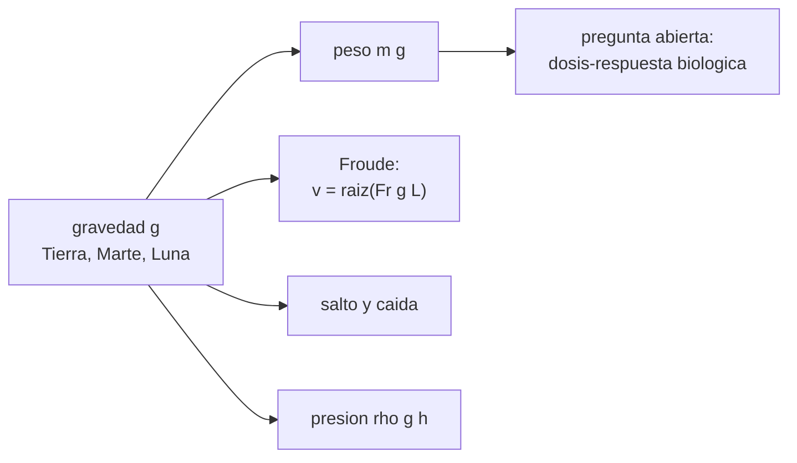

# B105-C18 — Investigación de efectos de gravedad parcial

<!-- nav:top -->
[🏠 Programa](../../../../README.md) · [📚 Bloque B105](../../../tronco-comun/B105-medicina-y-biologia-espacial.md) · [← Anterior: B105-C17 — Rehabilitación posterior al vuelo](../B105-C17-rehabilitacion-posterior-al-vuelo/CLASE.md) · [Siguiente: B105-C19 — Bioética en investigación tripulada →](../B105-C19-bioetica-en-investigacion-tripulada/CLASE.md)
<!-- /nav -->

## 1. Ubicación, nivel y alcance

Clase 18 del bloque B105. Nivel N3. Entre 0 g y 1 g hay un continuo que casi no se ha estudiado: la Luna (0,165 g) y Marte (0,378 g). Aquí calculas qué cambia con `g` por pura física (peso, velocidad de transición marcha–carrera, altura de salto, caída, presión hidrostática) y delimitas **qué no se sabe**: la dosis mínima de gravedad que protege hueso o músculo no se calcula en esta clase. Usa los resultados de [B105-C01](../B105-C01-respuesta-cardiovascular-a-microgravedad/CLASE.md).

## 2. Por qué esta clase existe

Se puede calcular con exactitud cuánto pesa y cómo se mueve un cuerpo en la Luna; no se puede deducir de eso cuánta gravedad hace falta para mantener el hueso. La decisión central: **¿qué parte de la respuesta a la gravedad parcial es física calculable y qué parte es una pregunta de investigación abierta?**

## 3. Lo que podrás hacer al terminar

1. Calcular peso, tiempo de caída y altura de salto en la Tierra, Marte y la Luna.
2. Calcular la velocidad de transición marcha–carrera con el número de Froude.
3. Calcular la presión hidrostática de la cabeza en cada gravedad.
4. Separar lo calculable (física) de lo desconocido (dosis–respuesta biológica).
5. Plantear una hipótesis de investigación con su variable y su rango.
6. Rotular valores usuales no consultados y parámetros didácticos.

La evidencia es la **ficha de gravedad parcial con los casos Luna y Marte** del ejercicio 12 (sección 20).

## 4. Con qué llegas y cómo comprobarlo

1. ¿Cuánto vale `g` en la Tierra?
2. ¿Qué es el número de Froude?
3. ¿Qué es la caída libre?
4. ¿Qué es una hipótesis?
5. ¿Qué es un dato sintético?

<details>
<summary>Ver respuestas</summary>

1. Unos 9,81 m/s². 2. Una razón adimensional `v²/(g L)` entre inercia y gravedad. 3. El movimiento bajo la gravedad sola: `h = ½ g t²`. 4. Una afirmación que se puede contrastar con datos. 5. Un dato generado para el ejemplo, no medido.
</details>

Con cuatro o cinco aciertos, sigue; si no, repasa los prerrequisitos.

## 5. Un caso de contexto y casos de referencia

Un cuerpo de 75 kg con pierna de 0,90 m y `Fr = 0,5` (didáctico). Pesa 735,8 N en la Tierra, 278,2 N en Marte y 121,5 N en la Luna. Su velocidad de transición marcha–carrera baja de 2,10 m/s (7,56 km/h) a 1,29 m/s (4,65) y 0,85 m/s (3,07). Con 2,5 m/s de despegue, el salto vertical es de 0,32 m en la Tierra, 0,84 en Marte y 1,93 en la Luna; la caída desde 1 m tarda 0,452; 0,734 y 1,111 s. Es el **ejemplo conductor**: las gravedades son valores usuales **no consultados** y los demás parámetros, **didácticos**.

## 6. Vocabulario

La **gravedad parcial** es una gravedad entre 0 y 1 g. El **número de Froude** `Fr = v²/(g L)` mide la importancia de la inercia frente a la gravedad; la transición marcha–carrera ocurre cerca de `Fr = 0,5` (valor empírico de enseñanza). El **peso** es `m g`. La **dosis de gravedad** sería la relación entre `g` y la respuesta biológica: se desconoce en este texto.

## 7. Modelo mental



*Descripción textual:* la gravedad fija por física el peso, la marcha, el salto, la caída y la presión hidrostática; de ahí no se deduce la respuesta biológica, que es la pregunta abierta de la investigación en gravedad parcial.

Analogía: se puede calcular con exactitud cuánto pesa una carga en distintos planetas; no se puede calcular cuánto ejercicio mantiene un músculo con esa carga. Límite: la analogía no dice nada sobre la dosis mínima.

## 8. La explicación, paso a paso

### 8.1 Peso y presión

`m g`: 735,8 N (Tierra), 278,2 N (Marte), 121,5 N (Luna). Los cocientes de pesos son 0,378 y 0,165. La presión hidrostática de la cabeza (0,35 m): 27,3; 10,3 y 4,5 mmHg.

### 8.2 Marcha y carrera

`v = √(Fr g L)`: 2,10; 1,29 y 0,85 m/s. El cociente Marte/Tierra es `√(3,71/9,81) = 0,615` y Luna/Tierra, 0,406. En gravedad baja, correr empieza a velocidades menores.

### 8.3 Salto y caída

Con la misma velocidad de despegue de 2,5 m/s: `h = v²/(2 g)` = 0,32; 0,84 y 1,93 m (cociente Luna/Tierra 6,05 = `g_T/g_L`). El alcance a 45° es 0,64; 1,68 y 3,86 m. La caída desde 1 m tarda 0,452; 0,734 y 1,111 s y llega con 4,43; 2,72 y 1,80 m/s. Elevar el centro de masa 0,30 m cuesta 220,7; 83,5 y 36,5 J.

### 8.4 Lo que no se calcula

Nada de lo anterior dice cuánta gravedad hace falta para mantener hueso, músculo o el sistema vestibular. Eso exige experimentos con gravedad parcial (centrífugas, vuelos parabólicos, estancias en superficie). Una hipótesis testeable: «la pérdida ósea depende de la carga mecánica, no solo de `g`», con variable independiente `g` o la carga diaria y variable de respuesta la tasa de pérdida.

## 9. Magnitudes, símbolos y unidades

| Símbolo | Qué es | Unidad | Valor / nota |
|---|---|---|---|
| `g` | gravedad de superficie | m/s² | 9,81; 3,71; 1,62 |
| `m` | masa | kg | 75 |
| `L` | longitud de pierna | m | 0,90 |
| `Fr` | número de Froude de transición | — | 0,5 (didáctico) |
| `v` | velocidad de transición | m/s | 2,10; 1,29; 0,85 |
| `h` | altura de salto | m | 0,32; 0,84; 1,93 |

## 10. Convenciones y referencias

Gravedad de superficie media; sin rotación ni altitud. Marcha en vertical y con `L` fija. Datos de enseñanza, sin mediciones. Tolerancias del laboratorio: peso en Marte 278,25 ± 0,01 N; cociente de velocidades igual a `√(g/g_T)`; altura de salto lunar ≈ 1,93 m. Numpy 2.4.4, Python 3.12.9.

## 11. De dónde sale lo que afirmamos

| ID | Fuente | Localizador | Respalda | Estado |
|---|---|---|---|---|
| — | Relaciones físicas, fisiológicas y estadísticas estándar usadas en el laboratorio | — | las verifica el laboratorio | No consultada en una fuente concreta (las verifica el laboratorio) |

Límites: no se consultó ninguna fuente para las gravedades de superficie (valores usuales) ni para el umbral de Froude ni para estudios de locomoción en gravedad parcial; no se consultó ningún dato de dosis–respuesta; la clase no pretende saber cuánta gravedad hace falta.

## 12. Cómo ver el resultado

Descripción: la tabla de la salida con peso, velocidad de transición, salto, caída y presión por cuerpo. Equivalente textual: en la Luna se pesa un sexto, se salta seis veces más alto y la marcha pasa a carrera a menos de la mitad de la velocidad terrestre.

## 13. Ejemplo trabajado: velocidad de transición en Marte

**Paso 1 · Datos.** `Fr = 0,5`, `g = 3,71`, `L = 0,90`.

**Paso 2 · Producto.** `0,5·3,71·0,90 = 1,670`.

**Paso 3 · Raíz.** `v = 1,29 m/s = 4,65 km/h`.

**Paso 4 · Contraste.** En la Tierra, 2,10 m/s: 61,5 % de ese valor en Marte.

## 14. Distintas formas de describir el problema

**Por peso:** `m g`. **Por Froude:** `v`. **Por salto:** `h`. **Por caída:** `t`. **Por presión:** `ρ g h`. **Por hipótesis:** variable y respuesta.

## 15. Práctica guiada

**Ejercicio 1 · con los pasos indicados.** Calcula el peso de 75 kg en Marte. *Pasos:* `m g`.

<details><summary>Solución comentada</summary>

`278,25 N`.
</details>

**Ejercicio 2 · con una pista.** Calcula el peso en la Luna. *Pista:* `g = 1,62`.

<details><summary>Solución comentada</summary>

`121,5 N`.
</details>

**Ejercicio 3 · casi autónomo.** Calcula la velocidad de transición lunar. *Pasos:* `√(0,5·1,62·0,90)`.

<details><summary>Solución comentada</summary>

`0,85 m/s = 3,07 km/h`.
</details>

## 16. Práctica autónoma, transferencia e integrador

**Ejercicio 4 · autónomo.** Calcula la velocidad de transición en Marte.

<details><summary>Solución comentada</summary>

`1,29 m/s = 4,65 km/h`.
</details>

**Ejercicio 5 · autónomo.** ¿Cuál es el cociente de velocidades de transición Marte/Tierra?

<details><summary>Solución comentada</summary>

`√(3,71/9,81) = 0,615`.
</details>

**Ejercicio 6 · autónomo.** ¿A qué altura salta un cuerpo con 2,5 m/s de despegue en la Luna?

<details><summary>Solución comentada</summary>

`1,93 m` (6,05 veces la terrestre, `9,81/1,62`).
</details>

**Ejercicio 7 · autónomo.** ¿Cuánto tarda en caer 1 m en la Luna?

<details><summary>Solución comentada</summary>

`√(2/1,62) = 1,111 s`.
</details>

**Ejercicio 8 · autónomo.** ¿Qué energía cuesta elevar 0,30 m el centro de masa en la Luna?

<details><summary>Solución comentada</summary>

`75·1,62·0,30 = 36,5 J`.
</details>

**Ejercicio 9 · transferencia.** Hipótesis: si la pérdida ósea fuera proporcional al peso que falta, `r = 1,25 %·(1 − g/g_T)`. ¿Qué `r` da Marte y qué da la Luna?

<details><summary>Solución comentada</summary>

Marte `1,25·0,622 = 0,78 %/mes`; Luna `1,25·0,835 = 1,04 %/mes`. Es una hipótesis para contrastar, no un dato.
</details>

**Ejercicio 10 · transferencia.** Para una pierna de 1,00 m, ¿cuál es la velocidad de transición terrestre?

<details><summary>Solución comentada</summary>

`√(0,5·9,81·1,0) = 2,21 m/s`.
</details>

**Ejercicio 11 · transferencia.** La presión de la cabeza en Marte es 10,3 mmHg frente a 27,3 en la Tierra. ¿Qué porcentaje es y qué no se puede concluir sobre los líquidos del cuerpo?

<details><summary>Solución comentada</summary>

`37,8 %`; no se sigue cómo se redistribuyen los líquidos ni la respuesta fisiológica, solo el término hidrostático.
</details>

**Ejercicio 12 · integrador.** Elabora tu *ficha de gravedad parcial con los casos Luna y Marte*: tabla de peso, marcha, salto y presión; qué es física calculable y qué es pregunta abierta; una hipótesis de investigación con variable y respuesta; y lista de qué es didáctico.

<details><summary>Solución comentada</summary>

Secciones 8.1–8.4 y la salida del laboratorio.
</details>

## 17. Laboratorio: gravedad parcial: peso, marcha, salto y presión hidrostática

El script [gravedad_parcial.py](gravedad_parcial.py) calcula peso, velocidad de transición marcha–carrera, salto, caída y presión hidrostática para tres gravedades (**comprueba** el peso en Marte (278,25 N), que el cociente de velocidades es `√(g/g_T)` y la altura de salto lunar).

**Datos:** gravedades usuales **no consultadas**; masa, pierna y `Fr` **didácticos**; sin mediciones. **Predice antes de ejecutar:** ¿Cuánto más alto salta un cuerpo en la Luna con la misma velocidad de despegue? (6 veces.) **Ejecución del 2026-11-10 (Python 3.12.9):**

```text
Python 3.12.9; numpy 2.4.4
DATOS: gravedades usuales no consultadas; parametros de enseñanza (m = 75 kg, L = 0.90 m, Fr = 0.5); no hay mediciones
cuerpo   g [m/s2]  g/g_T   peso [N]  v marcha-carrera [m/s] [km/h]  salto h [m]  caida 1 m: t [s], v [m/s]  P cabeza [mmHg]
Tierra     9.81   1.000     735.8     2.10    7.56                 0.32         0.452,  4.43               27.3
Marte      3.71   0.378     278.2     1.29    4.65                 0.84         0.734,  2.72               10.3
Luna       1.62   0.165     121.5     0.85    3.07                 1.93         1.111,  1.80                4.5
Cociente de pesos: Marte/Tierra = 0.378; Luna/Tierra = 0.165
Cociente de velocidades de transicion: Marte/Tierra = 0.615 (= raiz de g/g_T = 0.615); Luna/Tierra = 0.406
Longitud de zancada de salto, v = 2.5 m/s, angulo 45 grados (alcance = v^2 sen(2 theta)/g):
  Tierra  alcance =  0.64 m; tiempo de vuelo =  0.36 s
  Marte   alcance =  1.68 m; tiempo de vuelo =  0.95 s
  Luna    alcance =  3.86 m; tiempo de vuelo =  2.18 s
Energia para elevar el centro de masa 0.30 m: Tierra  220.7 J, Marte   83.5 J, Luna   36.5 J
Pruebas superadas.
```

```bash
python programa/clases/B105/B105-C18-investigacion-de-efectos-de-gravedad-parcial/gravedad_parcial.py
```

**Límites:** física elemental de cuerpo rígido; no incluye la biomecánica real, el calzado ni los trajes, y no estima ninguna respuesta biológica a la gravedad parcial.

## 18. Errores frecuentes y cómo corregirlos

**Deducir de la física la dosis biológica mínima.** Es una pregunta abierta (8.4).

**Confundir peso con masa.** El peso es `m g`.

**Usar `Fr = 0,5` como constante universal.** Es un valor empírico de enseñanza.

**Presentar la hipótesis como resultado.** Es una hipótesis (ejercicio 9).

## 19. Cómo sabrás que vas bien

Tras la sección 8: ¿separas lo calculable de lo desconocido? Si dudas, repasa el ejemplo 13. Tras el laboratorio: ¿qué comprueba? (ver la sección 17).

## 20. Qué entregas y cómo se evalúa

El producto es tu **ficha de gravedad parcial con los casos Luna y Marte** (ejercicio 12).

| Criterio | Inicial | En desarrollo | Logrado | Destacado |
|---|---|---|---|---|
| Conceptos | Confunde las magnitudes | Parciales | Calcula peso, marcha y salto por gravedad | Plantea una hipótesis testeable |
| Cálculo | Sin unidades | Con errores | Calcula con unidades y tolerancias | Calcula casos nuevos |
| Numérico | Sin comprobar | Un caso | Compara con la verdad del generador | Interpreta la sensibilidad |
| Fuentes | Sin fuente | Sin fecha | Cita solo lo consultado, con fecha | Rotula lo sintético y lo no consultado |
| Límites | No los nombra | Uno | Tres | Discute qué falta del modelo |

**Condiciones críticas (no se compensan con promedio):** rotular los datos como sintéticos; no presentar un resultado simulado como observado; no dar consejo médico ni operativo; citar solo lo consultado.

## 21. Ética, seguridad y límites

Clase **educativa**: no es consejo médico, no sustituye la formación, la licencia ni la supervisión de profesionales, y no contiene dosis, tratamientos ni procedimientos para aplicar a una persona real. Los resultados no se usan para decidir cuánto tiempo puede pasar una persona en gravedad parcial; esas decisiones requieren datos y profesionales. Accesibilidad: tablas equivalentes a las gráficas, fórmulas en texto, ejercicios sin conexión.

## 22. Para cerrar y seguir

En Marte se pesa 278 N y la marcha pasa a carrera a 1,29 m/s; en la Luna se salta 1,93 m con 2,5 m/s. Lo que no se sabe es cuánta gravedad hace falta para proteger al cuerpo. Queda una pregunta: ¿cómo se investiga con personas de forma ética?

**Glosario español–inglés.** gravedad parcial · *partial gravity*; número de Froude · *Froude number*; transición marcha–carrera · *walk–run transition*; hipótesis · *hypothesis*.

**Continuidad.** [B105-C19](../B105-C19-bioetica-en-investigacion-tripulada/CLASE.md) estudia la bioética en investigación tripulada.

**Referencias:** ver sección 11.

<!-- nav:bottom -->
---

[← Anterior: B105-C17 — Rehabilitación posterior al vuelo](../B105-C17-rehabilitacion-posterior-al-vuelo/CLASE.md) · [📚 Bloque B105](../../../tronco-comun/B105-medicina-y-biologia-espacial.md) · [Siguiente: B105-C19 — Bioética en investigación tripulada →](../B105-C19-bioetica-en-investigacion-tripulada/CLASE.md)
<!-- /nav -->
