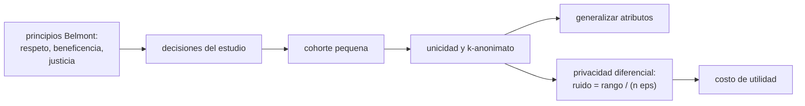

# B105-C19 — Bioética en investigación tripulada

<!-- nav:top -->
[🏠 Programa](../../../../README.md) · [📚 Bloque B105](../../../tronco-comun/B105-medicina-y-biologia-espacial.md) · [← Anterior: B105-C18 — Investigación de efectos de gravedad parcial](../B105-C18-investigacion-de-efectos-de-gravedad-parcial/CLASE.md) · [Siguiente: B105-C20 — Diseño de protocolo médico simulado →](../B105-C20-diseno-de-protocolo-medico-simulado/CLASE.md)
<!-- /nav -->

## 1. Ubicación, nivel y alcance

Clase 19 del bloque B105. Nivel N3. Investigar con una tripulación de 4 a 6 personas plantea un problema ético concreto: los datos de salud de pocas personas, muy conocidas, son casi siempre reidentificables. Aquí cruzas los tres principios del informe Belmont con una medición de ese riesgo (k-anonimato, unicidad) y del costo de proteger con privacidad diferencial, con datos **sintéticos**. Prepara el diseño de [B105-C20](../B105-C20-diseno-de-protocolo-medico-simulado/CLASE.md).

## 2. Por qué esta clase existe

No basta con quitar el nombre: con edad, sexo, profesión y misión, una persona de una cohorte de 6 suele ser única. La decisión central: **¿qué se puede publicar de una cohorte pequeña sin identificar a nadie y cuánta utilidad se pierde al protegerla?**

## 3. Lo que podrás hacer al terminar

1. Enumerar los tres principios del informe Belmont y asociarlos a decisiones de un estudio.
2. Calcular el k-anonimato y la fracción de registros únicos de una tabla.
3. Medir cómo la generalización de los cuasi-identificadores reduce la unicidad.
4. Calcular el ruido de Laplace de una media con privacidad diferencial y su costo de utilidad con `n` pequeño.
5. Reconocer los límites del consentimiento y de la participación voluntaria en una jerarquía laboral.
6. Rotular datos sintéticos y no ofrecer asesoría legal ni de ética de investigación.

La evidencia es la **ficha ética con riesgo de reidentificación** del ejercicio 12 (sección 20).

## 4. Con qué llegas y cómo comprobarlo

1. ¿Qué es el consentimiento informado?
2. ¿Qué es un cuasi-identificador?
3. ¿Qué es el k-anonimato?
4. ¿Qué es una distribución de Laplace?
5. ¿Qué es un dato sintético?

<details>
<summary>Ver respuestas</summary>

1. La aceptación voluntaria de participar tras recibir la información relevante. 2. Un atributo (edad, sexo…) que combinado con otros puede identificar a una persona. 3. Que cada combinación de cuasi-identificadores aparezca en al menos `k` registros. 4. Una distribución de colas exponenciales a ambos lados de una media. 5. Un dato generado para el ejemplo, no medido.
</details>

Con cuatro o cinco aciertos, sigue; si no, repasa los prerrequisitos.

## 5. Un caso de contexto y casos de referencia

Una cohorte **sintética** de 6 personas extraída de un conjunto de 150 con edad, sexo, profesión y misión: con edad exacta el 100 % de los registros es único (`k = 1`); con bandas de 5 años, 97,7 % en promedio sobre 5.000 cohortes; con bandas de 10 años, sexo y misión, 85,1 %; con solo la misión, 31,9 %. Una media con ruido de Laplace y `ε = 1` sobre un rango de 100 tiene un error medio de 16,7 puntos con `n = 6` y de 0,17 con `n = 600`. Es el **ejemplo conductor**: todo es **sintético**; ninguna persona real. Los tres principios del informe Belmont (respeto por las personas, beneficencia, justicia) se consultaron solo por un resumen de búsqueda web (2026-11-10).

## 6. Vocabulario

El **informe Belmont** nombra tres principios: **respeto por las personas** (autonomía y protección de quienes tienen autonomía disminuida), **beneficencia** (no dañar y maximizar beneficios) y **justicia** (reparto equitativo de cargas y beneficios). El **cuasi-identificador** combina atributos. El **k-anonimato** es el tamaño mínimo de grupo. La **unicidad** es la fracción de registros con grupo de tamaño 1. La **privacidad diferencial** añade ruido calibrado: escala `(b − a)/(n ε)` para una media en `[a, b]`.

## 7. Modelo mental



*Descripción textual:* los principios guían las decisiones del estudio; con una cohorte pequeña, casi todos los registros son únicos; se reduce el riesgo generalizando atributos o añadiendo ruido, con un costo de utilidad que crece cuando `n` es pequeño.

Analogía: describir a alguien en una sala de seis personas con tres rasgos basta para señalarla. Límite: en un pool grande, los mismos rasgos no identificarían a nadie; el riesgo depende del tamaño del conjunto y de lo público de los datos.

## 8. La explicación, paso a paso

### 8.1 Los tres principios (consultados por resumen)

Un resumen de búsqueda web (2026-11-10) del informe Belmont indica tres principios: respeto por las personas (voluntariedad e información adecuada; protección de quienes tienen autonomía disminuida), beneficencia (no dañar y maximizar beneficios minimizando daños) y justicia (quién carga con los riesgos y quién recibe los beneficios). El texto de HHS devolvió 403 y no se leyó.

### 8.2 Unicidad y k-anonimato

Cohorte de 6 con edad exacta, sexo, profesión y misión: `k = 1` y 100 % de unicidad. Promedios sobre 5.000 cohortes: 0,996 (edad exacta, sexo, profesión, misión); 0,977 (bandas de 5 años); 0,851 (bandas de 10 años, sexo, misión); 0,154 (solo banda de 10 años); 0,319 (solo misión).

### 8.3 Generalizar o añadir ruido

Generalizar reduce la unicidad a costa de detalle; el ruido de Laplace protege con `ε` pero pierde utilidad: con `n = 6`, el error medio esperado de una media con rango 100 es 166,5; 33,3; 16,7 y 3,3 puntos para `ε = 0,1; 0,5; 1; 5`. Con `n = 600` y `ε = 1`, 0,17.

### 8.4 Qué significa para el diseño

Con tripulaciones de 4 a 6 personas, no se pueden publicar tablas por persona; se usan resúmenes agregados, rangos amplios y acceso controlado, y se informa de antemano a los participantes de qué se publicará y del riesgo residual. El consentimiento debe poder retirarse sin represalias, algo difícil de garantizar en una organización jerárquica.

## 9. Magnitudes, símbolos y unidades

| Símbolo | Qué es | Unidad | Valor / nota |
|---|---|---|---|
| `n` | tamaño de la cohorte | personas | 6 |
| `k` | k-anonimato | — | 1 |
| `U` | unicidad | fracción | 0,15 a 1,00 |
| `ε` | presupuesto de privacidad | — | 0,1 a 5 |
| `b − a` | rango de la medida | u.a. | 100 |
| escala de Laplace | `(b − a)/(n ε)` | u.a. | 16,7 (`ε = 1`, `n = 6`) |

## 10. Convenciones y referencias

Pool sintético de 150 personas: edad 30–60, sexo (2), profesión (4), misión (5); cohortes de 6 al azar; semilla 105. Privacidad diferencial por el mecanismo de Laplace sobre una media acotada. Tolerancias del laboratorio: la unicidad con más cuasi-identificadores no es menor que con menos; el error del ruido de Laplace dentro de 0,3 de la escala. Numpy 2.4.4, Python 3.12.9.

## 11. De dónde sale lo que afirmamos

| ID | Fuente | Localizador | Respalda | Estado |
|---|---|---|---|---|
| 1 | Resumen de búsqueda web del informe Belmont (HHS/OHRP), tres principios | búsqueda web del 2026-11-10; el texto en hhs.gov devolvió 403 y no se abrió | los tres principios: respeto por las personas, beneficencia y justicia | Consultada solo por resumen de búsqueda; texto original no consultado |
| — | k-anonimato, unicidad y mecanismo de Laplace | — | los verifica el laboratorio | No consultados en una fuente concreta (los verifica el laboratorio) |

Límites: no se consultó el texto del informe Belmont ni normas de investigación con humanos (Declaración de Helsinki, Common Rule, CIOMS, políticas de la NASA) ni la legislación de protección de datos; no es asesoría legal ni de comités de ética.

## 12. Cómo ver el resultado

Descripción: la salida con la unicidad por esquema de cuasi-identificadores y el error de Laplace por `ε`. Equivalente textual: con una cohorte de 6, casi todo registro es único; el ruido con `ε = 1` es de 16,7 sobre 100.

## 13. Ejemplo trabajado: k-anonimato de una cohorte

**Paso 1 · Grupos.** Seis registros con tamaños de grupo (2, 2, 1, 1) tras generalizar.

**Paso 2 · k.** El tamaño mínimo es 1: `k = 1`.

**Paso 3 · Unicidad.** 2 registros únicos de 6: `0,33`.

**Paso 4 · Medida.** Generalizar más hasta que no queden grupos de tamaño 1.

## 14. Distintas formas de describir el problema

**Por principio:** respeto, beneficencia, justicia. **Por tabla:** `k` y unicidad. **Por generalización:** bandas. **Por ruido:** escala de Laplace. **Por utilidad:** error frente a `n`.

## 15. Práctica guiada

**Ejercicio 1 · con los pasos indicados.** Enumera los tres principios del informe Belmont. *Pasos:* ver 8.1.

<details><summary>Solución comentada</summary>

Respeto por las personas, beneficencia y justicia.
</details>

**Ejercicio 2 · con una pista.** Con grupos de tamaño (2, 2, 1, 1), ¿cuál es `k` y qué fracción es única?

<details><summary>Solución comentada</summary>

`k = 1` y `2/6 = 0,33`.
</details>

**Ejercicio 3 · casi autónomo.** Calcula la escala de Laplace con rango 100, `n = 6` y `ε = 0,5`. *Pista:* `(b − a)/(n ε)`.

<details><summary>Solución comentada</summary>

`100/(6·0,5) = 33,3`.
</details>

## 16. Práctica autónoma, transferencia e integrador

**Ejercicio 4 · autónomo.** ¿Qué `n` da un error de 2 puntos con `ε = 1`?

<details><summary>Solución comentada</summary>

`100/n = 2 → n = 50`.
</details>

**Ejercicio 5 · autónomo.** ¿Por qué generalizar la edad reduce la unicidad?

<details><summary>Solución comentada</summary>

Porque agrupa personas en una misma banda y los grupos crecen.
</details>

**Ejercicio 6 · autónomo.** ¿Cómo se relaciona la justicia con la selección de los 6 participantes?

<details><summary>Solución comentada</summary>

Pide revisar quién carga con los riesgos y quién recibe los beneficios; no elegir siempre al mismo grupo ni excluir sin motivo.
</details>

**Ejercicio 7 · autónomo.** Los nombres y las misiones de los tripulantes son públicos. ¿Qué implica para el riesgo de reidentificación?

<details><summary>Solución comentada</summary>

Que el atacante ya conoce el pool: con pocos atributos la cohorte se reidentifica casi seguro; el riesgo es mayor que el del pool anónimo.
</details>

**Ejercicio 8 · autónomo.** ¿Por qué el consentimiento en una organización jerárquica requiere cuidado especial?

<details><summary>Solución comentada</summary>

Porque la presión de superiores o compañeros puede afectar la voluntariedad; hay que garantizar que se pueda retirar sin consecuencias.
</details>

**Ejercicio 9 · transferencia.** ¿Qué publicarías de una cohorte de 4: un valor por persona, la media o ambos? Justifícalo.

<details><summary>Solución comentada</summary>

Solo agregados con rangos amplios y acceso controlado; los valores por persona son identificables.
</details>

**Ejercicio 10 · transferencia.** Con `n = 600`, `ε = 1` el ruido es 0,17. ¿Qué lección da frente a `n = 6`?

<details><summary>Solución comentada</summary>

Que la privacidad diferencial funciona con muchos datos; con cohortes pequeñas destruye la utilidad y hay que recurrir a otras salvaguardas.
</details>

**Ejercicio 11 · transferencia.** ¿Qué principio se tensiona si se omite el riesgo residual en el formulario de consentimiento?

<details><summary>Solución comentada</summary>

El respeto por las personas (información adecuada) y la beneficencia (minimizar daños).
</details>

**Ejercicio 12 · integrador.** Elabora tu *ficha ética con riesgo de reidentificación*: principios aplicados, unicidad por esquema, costo de utilidad del ruido, medidas de salvaguarda y lista de qué es sintético.

<details><summary>Solución comentada</summary>

Secciones 8.1–8.4 y la salida del laboratorio.
</details>

## 17. Laboratorio: reidentificación en cohortes pequeñas y privacidad diferencial

El script [privacidad.py](privacidad.py) mide el k-anonimato y la unicidad de cohortes sintéticas de 6 con cinco esquemas de cuasi-identificadores y calcula el error del ruido de Laplace por `ε` (**comprueba** que más cuasi-identificadores no reduce la unicidad y que el error del ruido iguala la escala de Laplace).

**Datos:** todo **sintético** (semilla 105); los principios Belmont provienen de un resumen de búsqueda. **Predice antes de ejecutar:** ¿Qué fracción de una cohorte de 6 es única con edad exacta, sexo, profesión y misión? (Casi toda.) **Ejecución del 2026-11-10 (Python 3.12.9):**

```text
Python 3.12.9; numpy 2.4.4
DATOS SINTETICOS (semilla 105): pool de 150 personas y cohortes extraidas al azar; ninguna persona real
Cohorte de 6 personas: k-anonimato y fraccion de registros unicos segun los cuasi-identificadores:
  edad exacta, sexo, profesion, mision               k = 1; unicos = 1.00
  banda de edad 5 anios, sexo, profesion, mision     k = 1; unicos = 1.00
  banda de 10 anios, sexo, mision                    k = 1; unicos = 1.00
  solo banda de 10 anios                             k = 1; unicos = 0.17
  solo mision                                        k = 1; unicos = 0.33
Fraccion media de registros unicos en 5000 cohortes de 6 (aleatorias del pool):
  edad exacta, sexo, profesion, mision               0.996
  banda de edad 5 anios, sexo, profesion, mision     0.977
  banda de 10 anios, sexo, mision                    0.851
  solo banda de 10 anios                             0.154
  solo mision                                        0.319
Privacidad diferencial (Laplace) para la media de una medida en [0, 100] con n = 6: error absoluto medio esperado = (b-a)/(n eps)
  eps =  0.1: escala  166.67; error medio simulado  166.53 (sobre una media de rango 100)
  eps =  0.5: escala   33.33; error medio simulado   33.32 (sobre una media de rango 100)
  eps =  1.0: escala   16.67; error medio simulado   16.67 (sobre una media de rango 100)
  eps =  5.0: escala    3.33; error medio simulado    3.33 (sobre una media de rango 100)
Con n = 6 y eps = 1 el ruido esperado es 16.7 puntos sobre 100: la utilidad se destruye; con n = 600 seria 0.17
Pruebas superadas.
```

```bash
python programa/clases/B105/B105-C19-bioetica-en-investigacion-tripulada/privacidad.py
```

**Límites:** atributos independientes y uniformes, un solo conjunto de cuasi-identificadores, un solo mecanismo de privacidad; no es una evaluación de riesgo de ningún estudio real ni asesoría legal.

## 18. Errores frecuentes y cómo corregirlos

**Creer que quitar el nombre anonimiza.** Los cuasi-identificadores reidentifican (8.2).

**Aplicar privacidad diferencial con `n` pequeño y esperar utilidad.** El ruido domina (8.3).

**Dar por cumplido el respeto por las personas con una firma.** Exige información y voluntariedad reales.

**Presentar el pool sintético como datos de una agencia.** Se rotula (sección 10).

## 19. Cómo sabrás que vas bien

Tras la sección 8: ¿aplicas los principios y mides el riesgo? Si dudas, repasa el ejemplo 13. Tras el laboratorio: ¿qué comprueba? (ver la sección 17).

## 20. Qué entregas y cómo se evalúa

El producto es tu **ficha ética con riesgo de reidentificación** (ejercicio 12).

| Criterio | Inicial | En desarrollo | Logrado | Destacado |
|---|---|---|---|---|
| Conceptos | Confunde las magnitudes | Parciales | Explica los tres principios y la unicidad | Explica el compromiso entre privacidad y utilidad |
| Cálculo | Sin unidades | Con errores | Calcula con unidades y tolerancias | Calcula casos nuevos |
| Numérico | Sin comprobar | Un caso | Compara con la verdad del generador | Interpreta la sensibilidad |
| Fuentes | Sin fuente | Sin fecha | Cita solo lo consultado, con fecha | Rotula lo sintético y lo no consultado |
| Límites | No los nombra | Uno | Tres | Discute qué falta del modelo |

**Condiciones críticas (no se compensan con promedio):** rotular los datos como sintéticos; no presentar un resultado simulado como observado; no dar consejo médico ni operativo; citar solo lo consultado.

## 21. Ética, seguridad y límites

Clase **educativa**: no es consejo médico, no sustituye la formación, la licencia ni la supervisión de profesionales, y no contiene dosis, tratamientos ni procedimientos para aplicar a una persona real. La clase es sobre ética, pero no es asesoría: los estudios con personas deben pasar por comités de ética de investigación y cumplir las normas vigentes; los datos de salud se protegen especialmente. Accesibilidad: tablas equivalentes a las gráficas, fórmulas en texto, ejercicios sin conexión.

## 22. Para cerrar y seguir

En una cohorte de 6, la edad exacta, el sexo, la profesión y la misión hacen únicos a casi todos los registros, y el ruido de Laplace con `ε = 1` mueve una media 16,7 puntos sobre 100. Queda una pregunta: ¿cómo se diseña un protocolo con muy pocas personas?

**Glosario español–inglés.** consentimiento informado · *informed consent*; k-anonimato · *k-anonymity*; privacidad diferencial · *differential privacy*; justicia · *justice*.

**Continuidad.** [B105-C20](../B105-C20-diseno-de-protocolo-medico-simulado/CLASE.md) estudia el diseño de un protocolo médico simulado.

**Referencias:** ver sección 11.

<!-- nav:bottom -->
---

[← Anterior: B105-C18 — Investigación de efectos de gravedad parcial](../B105-C18-investigacion-de-efectos-de-gravedad-parcial/CLASE.md) · [📚 Bloque B105](../../../tronco-comun/B105-medicina-y-biologia-espacial.md) · [Siguiente: B105-C20 — Diseño de protocolo médico simulado →](../B105-C20-diseno-de-protocolo-medico-simulado/CLASE.md)
<!-- /nav -->
