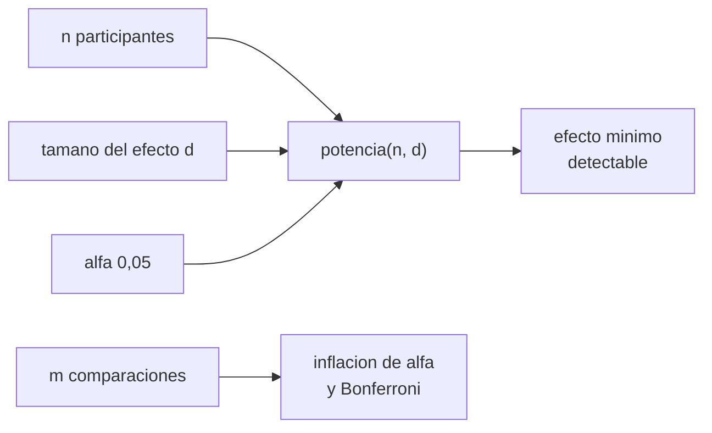

# B105-C20 — Diseño de protocolo médico simulado

<!-- nav:top -->
[🏠 Programa](../../../../README.md) · [📚 Bloque B105](../../../tronco-comun/B105-medicina-y-biologia-espacial.md) · [← Anterior: B105-C19 — Bioética en investigación tripulada](../B105-C19-bioetica-en-investigacion-tripulada/CLASE.md) · [Siguiente: B105-C21 — Fisiología respiratoria en microgravedad y atmósferas de cabina →](../../../tronco-comun/B105-medicina-y-biologia-espacial.md#b105-c21)
<!-- /nav -->

## 1. Ubicación, nivel y alcance

Clase 20 del bloque B105, cierre de la línea base del bloque. Nivel N3. Un protocolo simulado antes/después con N pequeño necesita decidir su tamaño del efecto detectable, su potencia y cuántas comparaciones hace. Aquí simulas una prueba t pareada, tabulas la potencia por `n` y `d`, calculas el efecto mínimo con 80 % de potencia y evalúas la inflación del error con comparaciones múltiples. Usa las salvaguardas de [B105-C19](../B105-C19-bioetica-en-investigacion-tripulada/CLASE.md); la elección de medidas sigue en [B105-C26](../B105-C26-medidas-fisiologicas-y-biomarcadores-en-investigacion-espacial/CLASE.md).

## 2. Por qué esta clase existe

Un estudio con 6 personas solo detecta efectos grandes; sin saberlo, se concluye «no hay efecto» cuando solo no había potencia. La decisión central: **¿qué efecto mínimo puede detectar el protocolo con su `n`, y cuántas comparaciones puede permitirse?**

## 3. Lo que podrás hacer al terminar

1. Definir el tamaño del efecto `d` de una diferencia pareada.
2. Simular una prueba t pareada y estimar la potencia y el error tipo I.
3. Leer una tabla de potencia por `n` y `d` y calcular el `n` para 80 %.
4. Calcular el efecto mínimo detectable con 80 % de potencia para un `n` dado.
5. Calcular la inflación del error por comparaciones múltiples y la corrección de Bonferroni.
6. Rotular el protocolo como simulado y no como guía clínica.

La evidencia es la **protocolo médico simulado con potencia** del ejercicio 12 (sección 20).

## 4. Con qué llegas y cómo comprobarlo

1. ¿Qué es una prueba t pareada?
2. ¿Qué es la potencia?
3. ¿Qué es el error tipo I?
4. ¿Qué es `d` de Cohen para pareadas?
5. ¿Qué es un dato sintético?

<details>
<summary>Ver respuestas</summary>

1. Una prueba de la media de las diferencias antes/después. 2. La probabilidad de detectar un efecto real. 3. Rechazar la hipótesis nula siendo cierta (falso positivo). 4. La media de las diferencias dividida por su desviación estándar. 5. Un dato generado para el ejemplo, no medido.
</details>

Con cuatro o cinco aciertos, sigue; si no, repasa los prerrequisitos.

## 5. Un caso de contexto y casos de referencia

Un protocolo **simulado** mide a cada persona antes y después de una exposición simulada. Con diferencias `~ N(d, 1)`, `n = 6` y `d = 1,0`, la potencia es 0,508; con `n = 12`, 0,882; con `n = 30`, 0,999. El error tipo I bajo el nulo es 0,050 para todo `n`. El efecto mínimo con 80 % de potencia es `d ≈ 1,45` con `n = 6` y `0,90` con `n = 12`. Con 10 comparaciones, la probabilidad de algún falso positivo es 0,401, o 0,049 con Bonferroni. Es el **ejemplo conductor**: todo es **sintético**; no es un protocolo real ni una guía clínica.

## 6. Vocabulario

El **tamaño del efecto** `d = diferencia media / DE de la diferencia`. La **potencia** `1 − β` es la probabilidad de rechazar el nulo cuando hay efecto. El **error tipo I** `α = 0,05`. El **efecto mínimo detectable** es el `d` con 80 % de potencia. Las **comparaciones múltiples** inflan `α`; la **corrección de Bonferroni** usa `α/m`. El **diseño pareado** compara a cada persona consigo misma.

## 7. Modelo mental



*Descripción textual:* el número de participantes, el tamaño del efecto y `α` fijan la potencia; con ella se calcula el efecto mínimo detectable, y las comparaciones múltiples exigen corregir `α`.

Analogía: una balanza que solo marca de a 5 kg no detecta una diferencia de 1 kg, y concluir «no pesan distinto» es un error. Límite: la potencia depende además de la variabilidad y del diseño.

## 8. La explicación, paso a paso

### 8.1 Calibración de la simulación

Bajo el nulo (`d = 0`), con valores críticos t de 3, 5, 7, 11, 19 y 29 grados de libertad (recordados por el autor, no consultados): el error tipo I es 0,049; 0,050; 0,050; 0,048; 0,049 y 0,052 para `n = 4, 6, 8, 12, 20, 30`: la simulación reproduce el 0,05 nominal.

### 8.2 Potencia

| `n` | `d = 0,5` | `d = 0,8` | `d = 1,0` | `d = 1,5` | `d = 2,0` |
|---|---|---|---|---|---|
| 4 | 0,111 | 0,208 | 0,285 | 0,541 | 0,753 |
| 6 | 0,172 | 0,349 | 0,508 | 0,835 | 0,971 |
| 8 | 0,228 | 0,500 | 0,682 | 0,952 | 0,998 |
| 12 | 0,351 | 0,709 | 0,882 | 0,997 | 1,000 |
| 20 | 0,565 | 0,922 | 0,988 | 1,000 | 1,000 |
| 30 | 0,752 | 0,988 | 0,999 | 1,000 | 1,000 |

Con `n = 6`, solo los efectos grandes (`d ≥ 1,5`) se detectan con buena probabilidad.

### 8.3 Tamaño necesario y efecto mínimo

`n ≈ ((1,96 + 0,84)/d)² + 2` para 80 %: 33,4 (`d = 0,5`); 14,2 (0,8); 9,8 (1,0); 5,5 (1,5); 4,0 (2,0). Efecto mínimo con 80 %: `d ≈ 1,45` con `n = 6` y `d ≈ 0,90` con `n = 12`.

### 8.4 Comparaciones múltiples

Con 10 comparaciones independientes y `α = 0,05`, `1 − 0,95¹⁰ = 0,401`; con Bonferroni (`α = 0,005`), `1 − 0,995¹⁰ = 0,049`. Un protocolo con muchas medidas debe declarar una principal y corregir las demás.

## 9. Magnitudes, símbolos y unidades

| Símbolo | Qué es | Unidad | Valor / nota |
|---|---|---|---|
| `n` | participantes | personas | 4 a 30 |
| `d` | tamaño del efecto | — | 0,5 a 2,0 |
| `α` | error tipo I | — | 0,05 |
| `1 − β` | potencia | — | 0,508 (`n = 6`, `d = 1`) |
| `d_min` | efecto mínimo detectable | — | 1,45 (`n = 6`) |
| `m` | comparaciones | — | 10 |

## 10. Convenciones y referencias

Prueba t pareada bilateral, `α = 0,05`; 20.000 simulaciones por celda (4.000 para el efecto mínimo); diferencias normales de DE 1. Datos sintéticos con semilla 105. Tolerancias del laboratorio: error tipo I = 0,05 ± 0,01; potencia creciente con `n`; potencia con `d = 2` mayor que con `d = 0,5`. Numpy 2.4.4, Python 3.12.9.

## 11. De dónde sale lo que afirmamos

| ID | Fuente | Localizador | Respalda | Estado |
|---|---|---|---|---|
| — | Relaciones físicas, fisiológicas y estadísticas estándar usadas en el laboratorio | — | las verifica el laboratorio | No consultada en una fuente concreta (las verifica el laboratorio) |

Límites: no se consultó ninguna fuente de diseño de protocolos ni de estadística (los valores críticos de la t y las fórmulas se verifican por simulación); no es un protocolo real ni una guía clínica ni un protocolo de la NASA.

## 12. Cómo ver el resultado

Descripción: la tabla de potencia de 8.2 y el efecto mínimo de 8.3. Equivalente textual: con 6 personas solo se detectan efectos de al menos 1,5 desviaciones; con 12, de unos 0,9.

## 13. Ejemplo trabajado: efecto y tamaño de muestra

**Paso 1 · Efecto.** Diferencia media 5 y DE de la diferencia 4: `d = 1,25`.

**Paso 2 · Tamaño.** `n ≈ (2,8/1,25)² + 2 = 7,0`.

**Paso 3 · Con `n = 6`.** Potencia ≈ 0,7 (entre 0,508 con `d = 1` y 0,835 con 1,5).

**Paso 4 · Decisión.** Subir a 8 personas o declarar el riesgo de no detectar el efecto.

## 14. Distintas formas de describir el problema

**Por efecto:** `d`. **Por potencia:** tabla `n`×`d`. **Por tamaño:** `n` para 80 %. **Por mínimo:** `d_min`. **Por comparaciones:** `1 − (1 − α)^m`.

## 15. Práctica guiada

**Ejercicio 1 · con los pasos indicados.** Calcula `d` con diferencia media 5 y DE de la diferencia 4. *Pasos:* `5/4`.

<details><summary>Solución comentada</summary>

`1,25`.
</details>

**Ejercicio 2 · con una pista.** ¿Qué `n` da 80 % de potencia con `d = 1,0`? *Pista:* `((1,96 + 0,84)/d)² + 2`.

<details><summary>Solución comentada</summary>

`9,8 ≈ 10`.
</details>

**Ejercicio 3 · casi autónomo.** ¿Cuál es la potencia con `n = 6` y `d = 1,0`?

<details><summary>Solución comentada</summary>

`0,508`.
</details>

## 16. Práctica autónoma, transferencia e integrador

**Ejercicio 4 · autónomo.** ¿Cuál es el error tipo I con `n = 6`?

<details><summary>Solución comentada</summary>

`0,050`.
</details>

**Ejercicio 5 · autónomo.** ¿Cuál es el efecto mínimo con 80 % y `n = 6`?

<details><summary>Solución comentada</summary>

`d ≈ 1,45`.
</details>

**Ejercicio 6 · autónomo.** ¿Por qué el diseño pareado aumenta la potencia?

<details><summary>Solución comentada</summary>

Porque cada persona es su propio control y se elimina la variabilidad entre personas.
</details>

**Ejercicio 7 · autónomo.** Calcula la probabilidad de algún falso positivo en 10 comparaciones y con Bonferroni.

<details><summary>Solución comentada</summary>

`0,401` y `0,049`.
</details>

**Ejercicio 8 · autónomo.** ¿Cuál es la potencia con `n = 8` y `d = 0,8`?

<details><summary>Solución comentada</summary>

`0,500`.
</details>

**Ejercicio 9 · transferencia.** Con DE de las diferencias de 4 unidades, ¿cuál es la diferencia mínima detectable con `n = 6` y 80 %?

<details><summary>Solución comentada</summary>

`1,45·4 = 5,8` unidades.
</details>

**Ejercicio 10 · transferencia.** ¿Por qué concluir «no hay efecto» con `n = 6` y `d = 0,5` es un error?

<details><summary>Solución comentada</summary>

La potencia es 0,172: lo más probable es no detectarlo aunque exista.
</details>

**Ejercicio 11 · transferencia.** ¿Qué elementos de un protocolo debes fijar antes de recoger datos?

<details><summary>Solución comentada</summary>

Hipótesis, medida principal, `n`, regla de análisis, `α` y comparaciones permitidas, para evitar el sesgo de elegir después.
</details>

**Ejercicio 12 · integrador.** Elabora tu *protocolo médico simulado con potencia*: hipótesis, diseño pareado, medida principal, `n`, potencia y efecto mínimo, comparaciones y corrección, salvaguardas éticas (B105-C19) y lista de qué es simulado.

<details><summary>Solución comentada</summary>

Secciones 8.1–8.4 y la salida del laboratorio.
</details>

## 17. Laboratorio: potencia y tamaño de muestra de un protocolo simulado

El script [protocolo.py](protocolo.py) simula una prueba t pareada para seis tamaños de muestra y cinco tamaños del efecto, verifica el error tipo I y calcula el efecto mínimo detectable y la inflación por comparaciones múltiples (**comprueba** que el error tipo I es 0,05 ± 0,01, que la potencia crece con `n` y con `d`).

**Datos:** todo **sintético** (semilla 105); los valores críticos de la t no se consultaron, se verificaron bajo el nulo. **Predice antes de ejecutar:** ¿Qué efecto mínimo detecta un protocolo de 6 personas con 80 % de potencia? (Más de una desviación: ≈ 1,45.) **Ejecución del 2026-11-10 (Python 3.12.9):**

```text
Python 3.12.9; numpy 2.4.4
DATOS SINTETICOS (semilla 105): diferencias normales; t criticos recordados y verificados bajo el nulo; protocolo simulado
Tasa de error tipo I bajo el nulo (d = 0):
  n =  4: 0.0488 (objetivo 0.05)
  n =  6: 0.0498 (objetivo 0.05)
  n =  8: 0.0500 (objetivo 0.05)
  n = 12: 0.0475 (objetivo 0.05)
  n = 20: 0.0494 (objetivo 0.05)
  n = 30: 0.0523 (objetivo 0.05)
Potencia segun n y tamano del efecto d:
   n   d=0.5   d=0.8   d=1.0   d=1.5   d=2.0
   4   0.111   0.208   0.285   0.541   0.753
   6   0.172   0.349   0.508   0.835   0.971
   8   0.228   0.500   0.682   0.952   0.998
  12   0.351   0.709   0.882   0.997   1.000
  20   0.565   0.922   0.988   1.000   1.000
  30   0.752   0.988   0.999   1.000   1.000
n aproximado para 80 % de potencia (aprox. normal + 2):
  d = 0.5: n ~  33.4
  d = 0.8: n ~  14.2
  d = 1.0: n ~   9.8
  d = 1.5: n ~   5.5
  d = 2.0: n ~   4.0
Efecto minimo con 80 % de potencia y n = 6: d ~ 1.45
Efecto minimo con 80 % de potencia y n = 12: d ~ 0.90
Probabilidad de al menos un falso positivo en 10 comparaciones con alfa 0.05 = 0.401; con Bonferroni (alfa/10): 0.049
Pruebas superadas.
```

```bash
python programa/clases/B105/B105-C20-diseno-de-protocolo-medico-simulado/protocolo.py
```

**Límites:** diferencias normales e independientes, un solo análisis, varianza conocida en el diseño; no es un protocolo clínico ni un plan de estudio real.

## 18. Errores frecuentes y cómo corregirlos

**Concluir ausencia de efecto sin mirar la potencia.** Calcula `d_min` (8.3).

**Hacer muchas comparaciones sin corregir.** Usa Bonferroni (8.4).

**Elegir la medida principal después de ver los datos.** Fíjala antes (ejercicio 11).

**Tratar el protocolo como guía clínica.** Es simulado.

## 19. Cómo sabrás que vas bien

Tras la sección 8: ¿calculas potencia y efecto mínimo? Si dudas, repasa el ejemplo 13. Tras el laboratorio: ¿qué comprueba? (ver la sección 17).

## 20. Qué entregas y cómo se evalúa

El producto es tu **protocolo médico simulado con potencia** (ejercicio 12).

| Criterio | Inicial | En desarrollo | Logrado | Destacado |
|---|---|---|---|---|
| Conceptos | Confunde las magnitudes | Parciales | Explica potencia, `d` y error tipo I | Explica `d_min` y las comparaciones múltiples |
| Cálculo | Sin unidades | Con errores | Calcula con unidades y tolerancias | Calcula casos nuevos |
| Numérico | Sin comprobar | Un caso | Compara con la verdad del generador | Interpreta la sensibilidad |
| Fuentes | Sin fuente | Sin fecha | Cita solo lo consultado, con fecha | Rotula lo sintético y lo no consultado |
| Límites | No los nombra | Uno | Tres | Discute qué falta del modelo |

**Condiciones críticas (no se compensan con promedio):** rotular los datos como sintéticos; no presentar un resultado simulado como observado; no dar consejo médico ni operativo; citar solo lo consultado.

## 21. Ética, seguridad y límites

Clase **educativa**: no es consejo médico, no sustituye la formación, la licencia ni la supervisión de profesionales, y no contiene dosis, tratamientos ni procedimientos para aplicar a una persona real. Un protocolo real exige un comité de ética, consentimiento informado y profesionales; esta clase no sustituye nada de eso (ver B105-C19). Accesibilidad: tablas equivalentes a las gráficas, fórmulas en texto, ejercicios sin conexión.

## 22. Para cerrar y seguir

Con 6 personas, la potencia para `d = 1,0` es 0,51 y el efecto mínimo con 80 % es `d ≈ 1,45`; con 12, `≈ 0,90`. Diez comparaciones sin corregir elevan el falso positivo a 0,40. Queda una pregunta: ¿qué medidas fisiológicas se eligen para un estudio?

**Glosario español–inglés.** potencia · *power*; tamaño del efecto · *effect size*; error tipo I · *type I error*; comparaciones múltiples · *multiple comparisons*.

**Continuidad.** [B105-C21](../B105-C21-fisiologia-respiratoria-en-microgravedad-y-atmosferas-de-cabina/CLASE.md) abre las clases ampliadas del bloque con la fisiología respiratoria.

**Referencias:** ver sección 11.

<!-- nav:bottom -->
---

[← Anterior: B105-C19 — Bioética en investigación tripulada](../B105-C19-bioetica-en-investigacion-tripulada/CLASE.md) · [📚 Bloque B105](../../../tronco-comun/B105-medicina-y-biologia-espacial.md) · [Siguiente: B105-C21 — Fisiología respiratoria en microgravedad y atmósferas de cabina →](../../../tronco-comun/B105-medicina-y-biologia-espacial.md#b105-c21)
<!-- /nav -->
