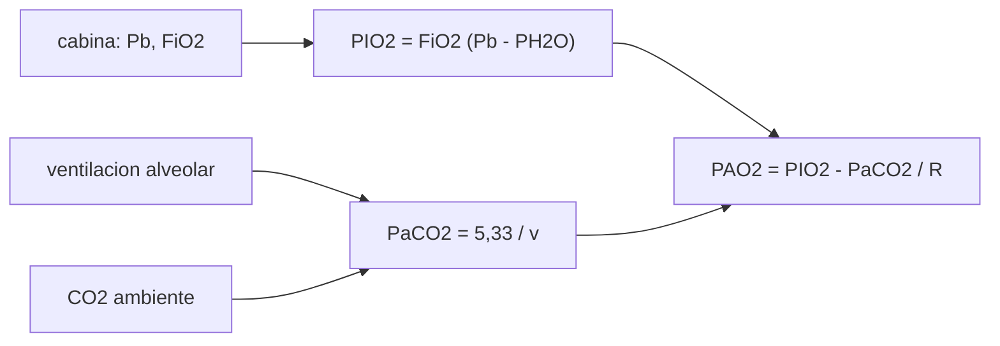

# B105-C21 — Fisiología respiratoria en microgravedad y atmósferas de cabina

<!-- nav:top -->
[🏠 Programa](../../../../README.md) · [📚 Bloque B105](../../../tronco-comun/B105-medicina-y-biologia-espacial.md) · [← Anterior: B105-C20 — Diseño de protocolo médico simulado](../B105-C20-diseno-de-protocolo-medico-simulado/CLASE.md) · [Siguiente: B105-C22 — Sistema neuroendocrino y respuesta al estrés en vuelo →](../B105-C22-sistema-neuroendocrino-y-respuesta-al-estres-en-vuelo/CLASE.md)
<!-- /nav -->

## 1. Ubicación, nivel y alcance

Clase 21 del bloque B105 (clase ampliada de la estructura `0.2.0`). Nivel N3. La atmósfera de la cabina y la ventilación del cuerpo determinan cuánto oxígeno llega a los alvéolos y cuánto CO₂ se retiene. Aquí calculas la presión inspirada y alveolar de oxígeno con la ecuación del gas alveolar, comparas tres atmósferas **ilustrativas**, el efecto del CO₂ ambiente y de la ventilación, y la altitud equivalente. El entorno de la cabina se trata en el bloque de hábitats; aquí interesa la fisiología.

## 2. Por qué esta clase existe

La misma cantidad de oxígeno inspirado no significa lo mismo a 101 kPa que a 70 kPa: importa la **presión parcial**. La decisión central: **¿qué presión parcial de oxígeno alveolar resulta de una atmósfera dada y cómo cambia con el CO₂ ambiente y la ventilación?**

## 3. Lo que podrás hacer al terminar

1. Calcular la presión inspirada `PIO₂ = FiO₂ (Pb − PH₂O)` y la alveolar `PAO₂` con la ecuación del gas alveolar.
2. Calcular presiones parciales de O₂, N₂ y CO₂ de una cabina.
3. Calcular la altitud equivalente de una presión con la atmósfera estándar.
4. Estimar el efecto del CO₂ ambiente y de la ventilación alveolar sobre `PAO₂`.
5. Comparar atmósferas de cabina por su `PIO₂` y no solo por su fracción de oxígeno.
6. Rotular las atmósferas como ilustrativas y no dar límites de seguridad.

La evidencia es la **ficha respiratoria con presiones parciales** del ejercicio 12 (sección 20).

## 4. Con qué llegas y cómo comprobarlo

1. ¿Qué es la presión parcial?
2. ¿Qué es el cociente respiratorio?
3. ¿Qué es el vapor de agua alveolar?
4. ¿Qué es la ventilación alveolar?
5. ¿Qué es un dato ilustrativo?

<details>
<summary>Ver respuestas</summary>

1. La presión que ejercería un gas de la mezcla si ocupara solo el volumen (ley de Dalton): `P_i = F_i P`. 2. El CO₂ producido dividido por el O₂ consumido (≈ 0,8). 3. El gas saturado a 37 °C: 6,28 kPa (47 mmHg). 4. El volumen de aire que llega a los alvéolos por minuto. 5. Un valor elegido para el ejemplo, no una especificación.
</details>

Con cuatro o cinco aciertos, sigue; si no, repasa los prerrequisitos.

## 5. Un caso de contexto y casos de referencia

Tres cabinas **ilustrativas**: A (101,325 kPa, 21 % O₂), B (70,3 kPa, 26,5 %) y C (56,5 kPa, 34 %). `PIO₂` y `PAO₂`: A 19,96 y 13,30 kPa (149,7 y 99,7 mmHg); B 16,97 y 10,30 kPa; C 17,07 y 10,41 kPa. La cabina B equivale a unos 2.979 m de altitud estándar en presión total, pero con 26,5 % de O₂ su `PIO₂` es el 85 % de la de A. Con 5.000 ppm de CO₂ en la cabina A, la presión parcial de CO₂ ambiente es 0,507 kPa y `PAO₂` baja a 12,73 kPa (modelo didáctico). Es el **ejemplo conductor**: las atmósferas no son especificaciones de ninguna agencia.

## 6. Vocabulario

La **ecuación del gas alveolar** es `PAO₂ = FiO₂ (Pb − PH₂O) − PaCO₂/R`. La **presión inspirada** de O₂ es `PIO₂ = FiO₂ (Pb − PH₂O)`. La **altitud equivalente** sigue la atmósfera estándar ISA: `p = 101,325 (1 − 2,25577·10⁻⁵ h)^5,25588 kPa`. **ppm** son partes por millón: `p_CO₂ = ppm·10⁻⁶·P_total`. La **hipoventilación** eleva `PaCO₂` y baja `PAO₂`. Constantes y fórmula estándar, **no consultadas** en una fuente.

## 7. Modelo mental



*Descripción textual:* la presión y la fracción de oxígeno de la cabina dan la presión inspirada; la ventilación y el CO₂ ambiente fijan el CO₂ alveolar; la ecuación del gas alveolar combina ambos para dar el oxígeno alveolar.

Analogía: llenar un vaso con una mezcla de dos líquidos a presión distinta; lo que importa es cuánto de cada uno entra, no solo la fracción. Límite: el intercambio de gases real depende además de la difusión y de la relación ventilación–perfusión.

## 8. La explicación, paso a paso

### 8.1 Presión inspirada y alveolar

Cabina A: `PIO₂ = 0,21·(101,325 − 6,28) = 19,96 kPa`; `PAO₂ = 19,96 − 5,33/0,8 = 13,30 kPa`. Cabina B: 16,97 y 10,30 kPa; cabina C: 17,07 y 10,41 kPa. Una mayor fracción de O₂ compensa en parte la presión total más baja.

### 8.2 Presiones parciales de la cabina

O₂ ambiente: 21,28; 18,63 y 19,21 kPa (A, B, C); N₂: 80,05; 51,67 y 37,29 kPa. La altitud estándar equivalente a la presión total: 0; 2.979 y 4.663 m. La altitud equivalente solo compara presión total y no es una medida de riesgo.

### 8.3 CO₂ y ventilación

Con CO₂ ambiente de 400; 2.000; 5.000; 10.000 y 20.000 ppm en la cabina A (elevación didáctica `PaCO₂ = 5,33 + 0,9·p_CO₂`): `PAO₂` de 13,25; 13,07; 12,73; 12,16 y 11,02 kPa. Con ventilación alveolar relativa `v` (`PaCO₂ = 5,33/v`): `v = 0,5` da `PaCO₂ = 10,66` y `PAO₂ = 6,63 kPa` (A) o 3,64 (B); `v = 2` da 16,63 y 13,63 kPa.

### 8.4 La gravedad y el pulmón

En la Tierra, la columna de sangre de 0,24 m del pulmón supone un gradiente hidrostático de 2,50 kPa (18,7 mmHg), que desaparece en microgravedad. La clase no calcula sus efectos sobre la distribución de ventilación y perfusión; solo señala que el gradiente cambia.

## 9. Magnitudes, símbolos y unidades

| Símbolo | Qué es | Unidad | Valor / nota |
|---|---|---|---|
| `Pb` | presión de la cabina | kPa | 101,325; 70,3; 56,5 |
| `FiO₂` | fracción de O₂ | — | 0,21; 0,265; 0,34 |
| `PH₂O` | vapor de agua alveolar | kPa | 6,28 |
| `PaCO₂` | CO₂ arterial | kPa | 5,33 |
| `R` | cociente respiratorio | — | 0,8 |
| `PAO₂` | O₂ alveolar | kPa | 13,30 (cabina A) |

## 10. Convenciones y referencias

Presiones en kPa (1 mmHg = 0,133322 kPa); gas húmedo a 37 °C; `FiO₂` constante. Atmósferas ilustrativas. Tolerancias del laboratorio: `PIO₂` de A = 19,96 ± 0,01 kPa; `PAO₂` de A = 13,30 ± 0,02; altitud de A = 0; altitud de B entre 2.900 y 3.100 m; `PIO₂` de B mayor que el 80 % de la de A. Numpy 2.4.4, Python 3.12.9.

## 11. De dónde sale lo que afirmamos

| ID | Fuente | Localizador | Respalda | Estado |
|---|---|---|---|---|
| — | Relaciones físicas, fisiológicas y estadísticas estándar usadas en el laboratorio | — | las verifica el laboratorio | No consultada en una fuente concreta (las verifica el laboratorio) |

Límites: no se consultó ninguna fuente de fisiología respiratoria, de atmósferas de cabina (NASA, ESA) ni de límites de CO₂; las atmósferas, la elevación de `PaCO₂` y los valores de ventilación son didácticos; no se consideró inflamabilidad ni seguridad.

## 12. Cómo ver el resultado

Descripción: la tabla de la salida con `PIO₂`, `PAO₂`, O₂ y N₂ ambiente y altitud por cabina. Equivalente textual: una mayor fracción de O₂ compensa en parte una presión total más baja.

## 13. Ejemplo trabajado: PAO₂ en la cabina B

**Paso 1 · Presión seca.** `70,3 − 6,28 = 64,02 kPa`.

**Paso 2 · PIO₂.** `0,265·64,02 = 16,97 kPa`.

**Paso 3 · CO₂ alveolar.** `5,33/0,8 = 6,66 kPa`.

**Paso 4 · PAO₂.** `16,97 − 6,66 = 10,30 kPa`.

## 14. Distintas formas de describir el problema

**Por presión:** `Pb`. **Por fracción:** `FiO₂`. **Por presión parcial:** `PIO₂`. **Por balance:** `PAO₂`. **Por altitud:** ISA. **Por ventilación:** `v`.

## 15. Práctica guiada

**Ejercicio 1 · con los pasos indicados.** Calcula `PIO₂` en la cabina A. *Pasos:* `0,21·(101,325 − 6,28)`.

<details><summary>Solución comentada</summary>

`19,96 kPa`.
</details>

**Ejercicio 2 · con una pista.** Calcula `PAO₂` en A con `PaCO₂ = 5,33 kPa` y `R = 0,8`. *Pista:* resta `PaCO₂/R`.

<details><summary>Solución comentada</summary>

`13,30 kPa`.
</details>

**Ejercicio 3 · casi autónomo.** ¿Qué presión parcial de O₂ hay en la cabina B?

<details><summary>Solución comentada</summary>

`0,265·70,3 = 18,63 kPa`.
</details>

## 16. Práctica autónoma, transferencia e integrador

**Ejercicio 4 · autónomo.** ¿Cuál es la presión parcial de CO₂ con 5.000 ppm a 101,325 kPa?

<details><summary>Solución comentada</summary>

`0,507 kPa` (3,80 mmHg).
</details>

**Ejercicio 5 · autónomo.** ¿Qué altitud estándar equivale a 70,3 kPa?

<details><summary>Solución comentada</summary>

Unos `2.979 m`.
</details>

**Ejercicio 6 · autónomo.** ¿Por qué la `PIO₂` de la cabina B es el 85 % de la de A aunque tenga más fracción de O₂?

<details><summary>Solución comentada</summary>

Porque la presión total es menor: `16,97/19,96 = 0,85`; la fracción más alta compensa solo en parte.
</details>

**Ejercicio 7 · autónomo.** Con `v = 0,5` (hipoventilación) en A, ¿cuánto vale `PAO₂`?

<details><summary>Solución comentada</summary>

`19,96 − 10,66/0,8 = 6,63 kPa`.
</details>

**Ejercicio 8 · autónomo.** Convierte 19,96 kPa a mmHg.

<details><summary>Solución comentada</summary>

`19,96/0,133322 = 149,7 mmHg`.
</details>

**Ejercicio 9 · transferencia.** ¿Por qué comparar cabinas solo por la altitud equivalente es insuficiente?

<details><summary>Solución comentada</summary>

Porque la altitud equivale a la presión total; la `PIO₂` depende también de `FiO₂`, y la inflamabilidad depende de la fracción de oxígeno.
</details>

**Ejercicio 10 · transferencia.** El gradiente hidrostático pulmonar de 18,7 mmHg desaparece en microgravedad. ¿Qué no se puede concluir?

<details><summary>Solución comentada</summary>

Su efecto sobre la ventilación y la perfusión: eso exige medidas y modelos más detallados que esta clase.
</details>

**Ejercicio 11 · transferencia.** ¿Qué diferencia hay entre `PIO₂` de B (16,97) y C (17,07) y qué dice del diseño?

<details><summary>Solución comentada</summary>

0,10 kPa: una cabina más baja con más O₂ puede igualar la `PIO₂`, a costa de otros riesgos como el de incendio.
</details>

**Ejercicio 12 · integrador.** Elabora tu *ficha respiratoria con presiones parciales*: ecuación, tabla de tres cabinas, efecto del CO₂ y de la ventilación, altitud equivalente y lista de qué es ilustrativo.

<details><summary>Solución comentada</summary>

Secciones 8.1–8.4 y la salida del laboratorio.
</details>

## 17. Laboratorio: presiones parciales respiratorias y atmósferas de cabina

El script [respiratorio.py](respiratorio.py) calcula `PIO₂` y `PAO₂` de tres cabinas ilustrativas, el efecto del CO₂ ambiente y de la ventilación y la altitud ISA equivalente (**comprueba** `PIO₂` de A (19,96 kPa), `PAO₂` de A (13,30 kPa), la altitud de A = 0 y la de B entre 2.900 y 3.100 m).

**Datos:** constantes estándar **no consultadas**; cabinas **ilustrativas**; sin mediciones. **Predice antes de ejecutar:** ¿Qué cabina da la mayor `PAO₂`? (La A, a 101 kPa.) **Ejecución del 2026-11-10 (Python 3.12.9):**

```text
Python 3.12.9; numpy 2.4.4
DATOS: constantes estandar no consultadas; cabinas ILUSTRATIVAS; sin mediciones
cabina                      PIO2 [kPa] [mmHg]   PAO2 [kPa] [mmHg]   O2 ambiente [kPa]   N2 ambiente [kPa]   altitud ISA equivalente [m]
A (101.325 kPa, 21 % O2)      19.96  149.7      13.30   99.7        21.28             80.05                  0
B (70.3 kPa, 26.5 % O2)       16.97  127.3      10.30   77.3        18.63             51.67               2979
C (56.5 kPa, 34 % O2)         17.07  128.1      10.41   78.1        19.21             37.29               4663
Efecto del CO2 ambiente en la cabina A (elevacion didactica de PaCO2 = 0.9 PICO2):
     400 ppm: p_CO2 ambiente =  0.041 kPa ( 0.30 mmHg); PaCO2 =  5.37 kPa; PAO2 =  13.25 kPa
    2000 ppm: p_CO2 ambiente =  0.203 kPa ( 1.52 mmHg); PaCO2 =  5.51 kPa; PAO2 =  13.07 kPa
    5000 ppm: p_CO2 ambiente =  0.507 kPa ( 3.80 mmHg); PaCO2 =  5.79 kPa; PAO2 =  12.73 kPa
   10000 ppm: p_CO2 ambiente =  1.013 kPa ( 7.60 mmHg); PaCO2 =  6.24 kPa; PAO2 =  12.16 kPa
   20000 ppm: p_CO2 ambiente =  2.026 kPa (15.20 mmHg); PaCO2 =  7.15 kPa; PAO2 =  11.02 kPa
PaCO2 y PAO2 con ventilacion alveolar relativa v (PaCO2 = 5.33/v):
  v = 0.50: PaCO2 = 10.66 kPa; PAO2 (cabina A) =   6.63 kPa; (cabina B) =   3.64 kPa
  v = 0.75: PaCO2 =  7.11 kPa; PAO2 (cabina A) =  11.08 kPa; (cabina B) =   8.08 kPa
  v = 1.00: PaCO2 =  5.33 kPa; PAO2 (cabina A) =  13.30 kPa; (cabina B) =  10.30 kPa
  v = 1.50: PaCO2 =  3.55 kPa; PAO2 (cabina A) =  15.52 kPa; (cabina B) =  12.52 kPa
  v = 2.00: PaCO2 =  2.67 kPa; PAO2 (cabina A) =  16.63 kPa; (cabina B) =  13.63 kPa
Gradiente hidrostatico de la sangre a lo largo del pulmon (h = 0.24 m, rho = 1060): Tierra 2.50 kPa = 18.7 mmHg; microgravedad 0
Pruebas superadas.
```

```bash
python programa/clases/B105/B105-C21-fisiologia-respiratoria-en-microgravedad-y-atmosferas-de-cabina/respiratorio.py
```

**Límites:** gas húmedo ideal, un solo cociente respiratorio, sin difusión ni relación ventilación–perfusión, sin inflamabilidad; no es un límite de seguridad ni una especificación de cabina.

## 18. Errores frecuentes y cómo corregirlos

**Comparar solo fracciones de O₂.** Compara `PIO₂` (8.1).

**Olvidar el vapor de agua.** Resta `PH₂O` a la presión.

**Tomar la altitud equivalente como riesgo.** Solo equivale en presión total.

**Usar las atmósferas como especificaciones.** Son ilustrativas (sección 10).

## 19. Cómo sabrás que vas bien

Tras la sección 8: ¿calculas `PAO₂` de una cabina? Si dudas, repasa el ejemplo 13. Tras el laboratorio: ¿qué comprueba? (ver la sección 17).

## 20. Qué entregas y cómo se evalúa

El producto es tu **ficha respiratoria con presiones parciales** (ejercicio 12).

| Criterio | Inicial | En desarrollo | Logrado | Destacado |
|---|---|---|---|---|
| Conceptos | Confunde las magnitudes | Parciales | Explica presión parcial y gas alveolar | Explica los límites de la altitud equivalente |
| Cálculo | Sin unidades | Con errores | Calcula con unidades y tolerancias | Calcula casos nuevos |
| Numérico | Sin comprobar | Un caso | Compara con la verdad del generador | Interpreta la sensibilidad |
| Fuentes | Sin fuente | Sin fecha | Cita solo lo consultado, con fecha | Rotula lo sintético y lo no consultado |
| Límites | No los nombra | Uno | Tres | Discute qué falta del modelo |

**Condiciones críticas (no se compensan con promedio):** rotular los datos como sintéticos; no presentar un resultado simulado como observado; no dar consejo médico ni operativo; citar solo lo consultado.

## 21. Ética, seguridad y límites

Clase **educativa**: no es consejo médico, no sustituye la formación, la licencia ni la supervisión de profesionales, y no contiene dosis, tratamientos ni procedimientos para aplicar a una persona real. No se fijan límites de seguridad ni de aptitud; la fisiología respiratoria de una persona real la evalúan profesionales y las normas de cabina las fija cada agencia. Accesibilidad: tablas equivalentes a las gráficas, fórmulas en texto, ejercicios sin conexión.

## 22. Para cerrar y seguir

La cabina B iguala el 85 % de la `PIO₂` de A pese a su menor presión total, y con ventilación a la mitad `PAO₂` cae a 6,63 kPa en A. Queda una pregunta: ¿cómo maneja el cuerpo el calor sin convección?

**Glosario español–inglés.** presión parcial · *partial pressure*; gas alveolar · *alveolar gas*; ventilación alveolar · *alveolar ventilation*; altitud equivalente · *equivalent altitude*.

**Continuidad.** [B105-C22](../B105-C22-sistema-neuroendocrino-y-respuesta-al-estres-en-vuelo/CLASE.md) estudia el sistema neuroendocrino y la respuesta al estrés.

**Referencias:** ver sección 11.

<!-- nav:bottom -->
---

[← Anterior: B105-C20 — Diseño de protocolo médico simulado](../B105-C20-diseno-de-protocolo-medico-simulado/CLASE.md) · [📚 Bloque B105](../../../tronco-comun/B105-medicina-y-biologia-espacial.md) · [Siguiente: B105-C22 — Sistema neuroendocrino y respuesta al estrés en vuelo →](../B105-C22-sistema-neuroendocrino-y-respuesta-al-estres-en-vuelo/CLASE.md)
<!-- /nav -->
