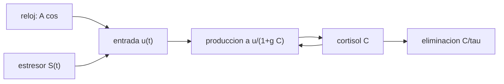

# B105-C22 — Sistema neuroendocrino y respuesta al estrés en vuelo

<!-- nav:top -->
[🏠 Programa](../../../../README.md) · [📚 Bloque B105](../../../tronco-comun/B105-medicina-y-biologia-espacial.md) · [← Anterior: B105-C21 — Fisiología respiratoria en microgravedad y atmósferas de cabina](../B105-C21-fisiologia-respiratoria-en-microgravedad-y-atmosferas-de-cabina/CLASE.md) · [Siguiente: B105-C23 — Termorregulación humana en vuelo →](../B105-C23-termorregulacion-humana-en-vuelo/CLASE.md)
<!-- /nav -->

## 1. Ubicación, nivel y alcance

Clase 22 del bloque B105 (clase ampliada). Nivel N3. El eje del estrés es un sistema con entrada circadiana y retroalimentación negativa. Aquí lo modelas con una sola variable (cortisol relativo), calibras su media, aplicas un estresor agudo y uno crónico y mides cómo la retroalimentación amortigua la respuesta, con datos **sintéticos**. Enlaza con [B105-C08](../B105-C08-sueno-y-ritmos-circadianos/CLASE.md) (ritmo) y [B105-C09](../B105-C09-salud-mental-en-aislamiento/CLASE.md) (aislamiento).

## 2. Por qué esta clase existe

Una medición de cortisol sin hora del día no se interpreta: el ritmo diario domina. Y un estresor crónico cambia el nivel medio de una forma distinta que uno agudo. La decisión central: **¿qué parte de una respuesta es ritmo, qué parte es estresor y cuánto amortigua la retroalimentación?**

## 3. Lo que podrás hacer al terminar

1. Plantear `dC/dt = a u(t)/(1 + g C) − C/τ` con entrada circadiana y estresor.
2. Calibrar la escala `a` para que el promedio diario sea 1.
3. Calcular la respuesta máxima y el aumento del área diaria a un estresor agudo.
4. Medir el efecto de la ganancia de retroalimentación `g`.
5. Comparar un estresor agudo con uno crónico.
6. Rotular el modelo como didáctico y no interpretar cortisol de nadie.

La evidencia es la **ficha neuroendocrina con simulación** del ejercicio 12 (sección 20).

## 4. Con qué llegas y cómo comprobarlo

1. ¿Qué es la retroalimentación negativa?
2. ¿Qué es la semivida?
3. ¿Qué es un ritmo circadiano?
4. ¿Qué es una ecuación diferencial?
5. ¿Qué es un dato sintético?

<details>
<summary>Ver respuestas</summary>

1. Un mecanismo en que la salida reduce su propia producción. 2. El tiempo en que una cantidad se reduce a la mitad: `τ ln 2`. 3. Una oscilación de periodo cercano a 24 h. 4. Una relación entre una variable y su derivada. 5. Un dato generado para el ejemplo, no medido.
</details>

Con cuatro o cinco aciertos, sigue; si no, repasa los prerrequisitos.

## 5. Un caso de contexto y casos de referencia

Una variable **sintética** con `τ = 1,5 h` (semivida 1,04 h), amplitud circadiana 0,8 y pico a las 8 h. Sin retroalimentación (`g = 0`), el máximo del día 3 es 1,745 a las 9,43 h y el mínimo 0,255 (amplitud 1,49); con `g = 1`, el máximo es 1,523 a las 8,92 h y la amplitud 1,156; con `g = 3`, 1,455 y 1,028. Un estresor de 2 h aumenta el nivel en 0,738; 0,559 y 0,500 y el área diaria en 8,3 %; 5,8 % y 4,9 %. Con `g = 1`, el aumento cae al 10 % en 2,74 h; un estresor crónico (+0,5 durante 7 días) sube la media diaria de 1,000 a 1,341 (+34,1 %). Es el **ejemplo conductor**: todo es **sintético**; no hay mediciones de cortisol.

## 6. Vocabulario

El **cortisol relativo** `C` es adimensional. La **entrada** `u(t) = 1 + A cos(2π(t − t₀)/24) + S(t)`. La **ganancia de retroalimentación** `g` reduce la producción cuando `C` sube. La **semivida** es `τ ln 2`. El **estresor agudo** `S(t) = 1` durante 2 h y el **crónico** `S = 0,5` durante 7 días. El **AUC diario** es el área bajo `C` en 24 h.

## 7. Modelo mental



*Descripción textual:* el reloj y el estresor forman la entrada; la producción se frena cuando el cortisol sube (retroalimentación) y se elimina con una constante `τ`.

Analogía: un termostato con un horno que se enciende por la mañana; si la sala se calienta, el termostato lo frena. Límite: el eje real tiene varios niveles hormonales, receptores y ritmos secundarios.

## 8. La explicación, paso a paso

### 8.1 El modelo y la calibración

`dC/dt = a u(t)/(1 + g C) − C/τ`, `τ = 1,5 h`, `A = 0,8`, `t₀ = 8 h`. La escala `a` se calibra para que el promedio diario sea 1: `a = 0,667` (`g = 0`), 1,442 (1) y 2,920 (3). Sin retroalimentación y con `u = 1`, `C* = a τ = 1,0`; con `g = 1`, `C(1 + C) = a τ` da `C* = 1,05`.

### 8.2 El ritmo

Día 3: `g = 0`: máx 1,745 (9,43 h), mín 0,255; `g = 1`: 1,523 (8,92 h) y 0,368; `g = 3`: 1,455 (8,82 h) y 0,427. La retroalimentación reduce la amplitud pico-valle de 1,490 a 1,028. El pico se retrasa respecto a la entrada (8 h) por la eliminación.

### 8.3 Estresor agudo

Un estresor de 2 h (`S = 1`, 14–16 h del día 2): aumento máximo 0,738 (`g = 0`), 0,559 (1) y 0,500 (3); aumento del área diaria 8,3 %; 5,8 %; 4,9 %. Con `g = 1`, tras un estresor de 38 a 40 h el aumento máximo es 0,559 a las 40,00 h y cae al 10 % en 2,74 h.

### 8.4 Estresor crónico

Con `S = 0,5` durante 7 días (`g = 1`), la media diaria sube de 1,000 a 1,341 (+34,1 %) y la amplitud pico-valle baja de 1,156 a 0,926: el estrés crónico eleva el nivel y aplana el ritmo en el modelo. Una medida única sin hora del día no discrimina: el cociente máximo/mínimo del ritmo es 4,1 (`g = 1`).

## 9. Magnitudes, símbolos y unidades

| Símbolo | Qué es | Unidad | Valor / nota |
|---|---|---|---|
| `C` | cortisol relativo | — | media 1 |
| `τ` | constante de eliminación | h | 1,5 (ilustrativa) |
| `A` | amplitud circadiana | — | 0,8 |
| `t₀` | hora del pico de la entrada | h | 8 |
| `g` | ganancia de retroalimentación | — | 0; 1; 3 |
| `a` | escala de producción | — | 0,667; 1,442; 2,920 |

## 10. Convenciones y referencias

Tiempo en horas desde la hora 0 del día 1; Euler con `dt = 0,01 h`; día 3 como referencia del ritmo. Datos sintéticos/ilustrativos. Tolerancias del laboratorio: la respuesta máxima con `g = 1` y `g = 3` menor que con `g = 0`; el área diaria aumenta con el estresor. Numpy 2.4.4, Python 3.12.9.

## 11. De dónde sale lo que afirmamos

| ID | Fuente | Localizador | Respalda | Estado |
|---|---|---|---|---|
| — | Relaciones físicas, fisiológicas y estadísticas estándar usadas en el laboratorio | — | las verifica el laboratorio | No consultada en una fuente concreta (las verifica el laboratorio) |

Límites: no se consultó literatura de endocrinología ni de estrés en vuelo; la semivida de 1,04 h, las amplitudes y la ganancia son didácticas; el modelo no incluye la hormona liberadora ni la ACTH ni receptores.

## 12. Cómo ver el resultado

Descripción: la salida del laboratorio con el ritmo por `g`, el aumento por el estresor agudo y el efecto del crónico. Equivalente textual: más retroalimentación, menos respuesta; el estrés crónico eleva el nivel medio un tercio.

## 13. Ejemplo trabajado: vida media y nivel de equilibrio

**Paso 1 · Semivida.** `1,5·ln 2 = 1,04 h`.

**Paso 2 · Sin retroalimentación.** `C* = a τ u = 0,667·1,5·1 = 1,0`.

**Paso 3 · Con estresor.** `u = 2`: `C* = 2,0`.

**Paso 4 · Con `g = 1`.** `C(1 + C) = 1,442·1,5·2 = 4,33` → `C* = 1,64` (frente a 2,0 sin retroalimentación): la retroalimentación frena el aumento.

## 14. Distintas formas de describir el problema

**Por ecuación:** `dC/dt`. **Por equilibrio:** `C*`. **Por ritmo:** máx/mín. **Por estresor:** aumento y AUC. **Por ganancia:** `g`. **Por duración:** agudo y crónico.

## 15. Práctica guiada

**Ejercicio 1 · con los pasos indicados.** Calcula la semivida con `τ = 1,5 h`. *Pasos:* `τ ln 2`.

<details><summary>Solución comentada</summary>

`1,04 h`.
</details>

**Ejercicio 2 · con una pista.** Con `g = 0`, `a = 0,667` y `u = 1`, ¿cuál es el nivel de equilibrio?

<details><summary>Solución comentada</summary>

`a τ u = 1,0`.
</details>

**Ejercicio 3 · casi autónomo.** Con `g = 1`, `a = 1,442` y `u = 1`, resuelve `C(1 + C) = a τ`.

<details><summary>Solución comentada</summary>

`C² + C − 2,163 = 0` → `C* = 1,05`.
</details>

## 16. Práctica autónoma, transferencia e integrador

**Ejercicio 4 · autónomo.** Con `g = 0` y `u = 2`, ¿cuál es `C*`?

<details><summary>Solución comentada</summary>

`2,0`: se duplica.
</details>

**Ejercicio 5 · autónomo.** ¿En qué porcentaje cae la amplitud pico-valle de `g = 0` a `g = 3`?

<details><summary>Solución comentada</summary>

`(1,490 − 1,028)/1,490 = 31 %`.
</details>

**Ejercicio 6 · autónomo.** ¿Por qué la retroalimentación reduce la respuesta al estresor?

<details><summary>Solución comentada</summary>

Porque al subir `C` el denominador `1 + g C` frena la producción, así que el aumento es menor.
</details>

**Ejercicio 7 · autónomo.** ¿En cuánto tiempo cae al 10 % el aumento de un estresor agudo con `g = 1`?

<details><summary>Solución comentada</summary>

`2,74 h`.
</details>

**Ejercicio 8 · autónomo.** ¿Cuánto sube la media diaria con el estresor crónico en el modelo?

<details><summary>Solución comentada</summary>

De 1,000 a 1,341: `+34,1 %`.
</details>

**Ejercicio 9 · transferencia.** Si el reloj se retrasa 6 h (`t₀ = 14 h`), ¿cuándo se esperaría el pico?

<details><summary>Solución comentada</summary>

Unas 6 h después, cerca de las 15 h (por construcción del modelo).
</details>

**Ejercicio 10 · transferencia.** En el ritmo con `g = 1` el máximo es 1,523 y el mínimo 0,368. ¿Qué cociente hay y qué implica para una medida única?

<details><summary>Solución comentada</summary>

`4,1`: la hora de la muestra cambia el valor en un factor 4; sin hora no se interpreta.
</details>

**Ejercicio 11 · transferencia.** ¿Qué limitaciones tiene una ecuación de una sola variable para el eje real?

<details><summary>Solución comentada</summary>

No incluye los niveles superiores (hormona liberadora, ACTH), la sensibilidad de receptores ni la dependencia del estrés crónico de la historia previa.
</details>

**Ejercicio 12 · integrador.** Elabora tu *ficha neuroendocrina con simulación*: modelo, calibración, ritmo por `g`, respuesta agudo y crónico, y lista de qué es sintético.

<details><summary>Solución comentada</summary>

Secciones 8.1–8.4 y la salida del laboratorio.
</details>

## 17. Laboratorio: cortisol circadiano con retroalimentación y respuesta a un estresor

El script [estres.py](estres.py) integra el modelo con tres ganancias de retroalimentación, aplica un estresor agudo de 2 h y uno crónico de 7 días y mide ritmo, aumento y recuperación (**comprueba** que la respuesta máxima con retroalimentación es menor que sin ella y que el área diaria sube con el estresor).

**Datos:** todo **sintético/ilustrativo**; no hay mediciones de cortisol. **Predice antes de ejecutar:** ¿Qué ocurre con la respuesta a un estresor al aumentar la ganancia? (Disminuye.) **Ejecución del 2026-11-10 (Python 3.12.9):**

```text
Python 3.12.9; numpy 2.4.4
DATOS SINTETICOS/ILUSTRATIVOS: sin mediciones de cortisol; no es una prueba diagnostica
g = 0.0: a =  0.667; dia 3: media 1.000, maximo 1.745 a las  9.43 h, minimo 0.255 (amplitud pico-valle 1.490)
        estresor agudo (u + 1,0 de 14 a 16 h del dia 2): aumento maximo 0.738; AUC diaria 24.00 -> 25.99 (+8.3 %)
g = 1.0: a =  1.442; dia 3: media 1.000, maximo 1.523 a las  8.92 h, minimo 0.368 (amplitud pico-valle 1.156)
        estresor agudo (u + 1,0 de 14 a 16 h del dia 2): aumento maximo 0.559; AUC diaria 23.99 -> 25.38 (+5.8 %)
g = 3.0: a =  2.920; dia 3: media 1.000, maximo 1.455 a las  8.82 h, minimo 0.427 (amplitud pico-valle 1.028)
        estresor agudo (u + 1,0 de 14 a 16 h del dia 2): aumento maximo 0.500; AUC diaria 23.99 -> 25.18 (+4.9 %)
g = 1.0: tras un estresor de 2 h (t = 38-40 h), el aumento maximo es 0.559 a las 40.00 h y cae al 10 % en 2.74 h
Estres cronico (+0.5 durante 7 dias, g = 1): media diaria del dia 7: 1.000 -> 1.341 (+34.1 %); amplitud pico-valle 1.156 -> 0.926
Pico matutino: si el reloj se retrasa 6 h (t0 = 14 h), el maximo se desplaza ~6 h (por construccion).
Pruebas superadas.
```

```bash
python programa/clases/B105/B105-C22-sistema-neuroendocrino-y-respuesta-al-estres-en-vuelo/estres.py
```

**Límites:** una variable, sin receptores ni niveles superiores, sin variación entre individuos; no es una prueba diagnóstica ni interpreta niveles reales.

## 18. Errores frecuentes y cómo corregirlos

**Interpretar cortisol sin hora del día.** El ritmo domina (8.4).

**Creer que la retroalimentación elimina la respuesta.** Solo la amortigua (8.3).

**Confundir estrés agudo y crónico.** Efectos distintos en nivel y ritmo.

**Interpretar niveles de una persona.** Son sintéticos.

## 19. Cómo sabrás que vas bien

Tras la sección 8: ¿calibras `a` y calculas la respuesta? Si dudas, repasa el ejemplo 13. Tras el laboratorio: ¿qué comprueba? (ver la sección 17).

## 20. Qué entregas y cómo se evalúa

El producto es tu **ficha neuroendocrina con simulación** (ejercicio 12).

| Criterio | Inicial | En desarrollo | Logrado | Destacado |
|---|---|---|---|---|
| Conceptos | Confunde las magnitudes | Parciales | Explica ritmo, retroalimentación y estresor | Explica agudo frente a crónico |
| Cálculo | Sin unidades | Con errores | Calcula con unidades y tolerancias | Calcula casos nuevos |
| Numérico | Sin comprobar | Un caso | Compara con la verdad del generador | Interpreta la sensibilidad |
| Fuentes | Sin fuente | Sin fecha | Cita solo lo consultado, con fecha | Rotula lo sintético y lo no consultado |
| Límites | No los nombra | Uno | Tres | Discute qué falta del modelo |

**Condiciones críticas (no se compensan con promedio):** rotular los datos como sintéticos; no presentar un resultado simulado como observado; no dar consejo médico ni operativo; citar solo lo consultado.

## 21. Ética, seguridad y límites

Clase **educativa**: no es consejo médico, no sustituye la formación, la licencia ni la supervisión de profesionales, y no contiene dosis, tratamientos ni procedimientos para aplicar a una persona real. Ninguna cifra es un valor de referencia; la evaluación del estrés y de las hormonas de una persona real corresponde a profesionales. Accesibilidad: tablas equivalentes a las gráficas, fórmulas en texto, ejercicios sin conexión.

## 22. Para cerrar y seguir

Con retroalimentación (`g = 1`), el estresor agudo sube el nivel 0,559 y se recupera al 10 % en 2,74 h; el crónico eleva la media diaria 34 %. Queda una pregunta: ¿cómo cambia el control del movimiento?

**Glosario español–inglés.** eje del estrés · *stress axis*; retroalimentación · *feedback*; ganancia · *gain*; estresor · *stressor*.

**Continuidad.** [B105-C23](../B105-C23-termorregulacion-humana-en-vuelo/CLASE.md) estudia la termorregulación humana en vuelo.

**Referencias:** ver sección 11.

<!-- nav:bottom -->
---

[← Anterior: B105-C21 — Fisiología respiratoria en microgravedad y atmósferas de cabina](../B105-C21-fisiologia-respiratoria-en-microgravedad-y-atmosferas-de-cabina/CLASE.md) · [📚 Bloque B105](../../../tronco-comun/B105-medicina-y-biologia-espacial.md) · [Siguiente: B105-C23 — Termorregulación humana en vuelo →](../B105-C23-termorregulacion-humana-en-vuelo/CLASE.md)
<!-- /nav -->
