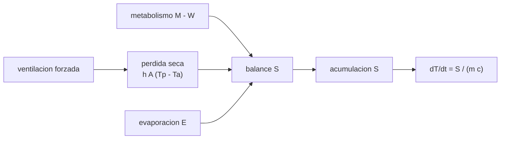

# B105-C23 — Termorregulación humana en vuelo

<!-- nav:top -->
[🏠 Programa](../../../../README.md) · [📚 Bloque B105](../../../tronco-comun/B105-medicina-y-biologia-espacial.md) · [← Anterior: B105-C22 — Sistema neuroendocrino y respuesta al estrés en vuelo](../B105-C22-sistema-neuroendocrino-y-respuesta-al-estres-en-vuelo/CLASE.md) · [Siguiente: B105-C24 — Indicadores clínicos y biomarcadores de vuelo →](../B105-C24-indicadores-clinicos-y-biomarcadores-de-vuelo/CLASE.md)
<!-- /nav -->

## 1. Ubicación, nivel y alcance

Clase 23 del bloque B105 (clase ampliada). Nivel N3. El cuerpo produce calor y debe disiparlo. En la Tierra el aire caliente sube y renueva la capa junto a la piel; en microgravedad no hay flotabilidad y esa capa queda estancada. Aquí planteas el balance de calor del cuerpo, comparas la pérdida seca con y sin ventilación, calculas el sudor necesario y el aumento de la temperatura central si el sudor no se evapora, con parámetros **ilustrativos**. Es distinta del control térmico del hábitat (otro bloque).

## 2. Por qué esta clase existe

El ejercicio genera 400 W de calor; si el cuerpo no los disipa, la temperatura central sube. La decisión central: **¿cuánto calor se disipa en seco, cuánto debe evaporarse y qué pasa si el sudor no se evapora?**

## 3. Lo que podrás hacer al terminar

1. Plantear el balance `S = M − W − E − (C + R)`.
2. Calcular la pérdida seca con `h A ΔT` y su cambio sin convección natural.
3. Calcular la evaporación necesaria y el sudor en g/h con el calor latente.
4. Calcular el aumento de temperatura central por acumulación `S/(m c)`.
5. Comparar ventilación forzada con aire estancado.
6. Rotular parámetros ilustrativos y no dar pautas de seguridad térmica.

La evidencia es la **ficha térmica con el balance de calor** del ejercicio 12 (sección 20).

## 4. Con qué llegas y cómo comprobarlo

1. ¿Qué es el calor latente de vaporización?
2. ¿Qué es el calor específico?
3. ¿Qué es la convección?
4. ¿Qué es la radiación térmica?
5. ¿Qué es un parámetro ilustrativo?

<details>
<summary>Ver respuestas</summary>

1. La energía por kg al evaporar un líquido (≈ 2,43 MJ/kg a la temperatura de la piel). 2. La energía por kg y kelvin que cambia la temperatura de un material. 3. El transporte de calor por el movimiento de un fluido. 4. El intercambio de calor por ondas electromagnéticas, sin medio. 5. Un valor elegido para el ejemplo, no una especificación.
</details>

Con cuatro o cinco aciertos, sigue; si no, repasa los prerrequisitos.

## 5. Un caso de contexto y casos de referencia

Una persona **ilustrativa** de 75 kg con 1,9 m² de superficie, piel a 33 °C y ambiente a 22 °C. La pérdida seca (radiación más convección) es 156,8 W en la Tierra (`h_c = 3`), 94,0 W en microgravedad sin ventilación (`h_c = 0`), 160,1 W con 0,2 m/s y 208,5 W con 0,5 m/s. En ejercicio (M = 450 W, trabajo 50 W: 400 W de calor), la evaporación necesaria es 306,0 W (453 g/h de sudor) sin ventilación y 191,5 W con 0,5 m/s. Si solo se evapora la mitad del sudor, se acumulan 153 W y la temperatura central sube 2,12 °C en 1 h. Es el **ejemplo conductor**: todos los parámetros son **ilustrativos**.

## 6. Vocabulario

El **balance** es `S = M − W − E − (C + R)`, con `M` metabolismo, `W` trabajo externo, `E` evaporación, `C` convección y `R` radiación, en W. La **pérdida seca** `(h_r + h_c) A (T_piel − T_amb)`. La **convección natural** depende de la flotabilidad; en microgravedad `h_c ≈ 0` sin ventilación. La **ventilación forzada** da `h_c = 8,3 v^0,6` (relación de confort usada como ejemplo, no consultada). La **acumulación** eleva la temperatura `dT/dt = S/(m c)` con `c = 3.470 J/(kg·K)`.

## 7. Modelo mental



*Descripción textual:* el calor producido menos la pérdida seca y la evaporación es el calor acumulado, que eleva la temperatura central según la masa y el calor específico; la ventilación aumenta la pérdida seca.

Analogía: un radiador en una habitación sin corrientes de aire; calienta el aire de su alrededor y deja de ceder calor si nada lo renueva. Límite: el cuerpo regula el flujo sanguíneo de la piel y suda; el modelo estático no lo incluye.

## 8. La explicación, paso a paso

### 8.1 Pérdida seca

`(4,5 + h_c)·1,9·11`: 156,8 W (Tierra, `h_c = 3,0`); 94,0 W (microgravedad sin ventilación); 160,1 W (`v = 0,2 m/s`, `h_c = 3,16`) y 208,5 W (`v = 0,5 m/s`, `h_c = 5,48`). Con un ambiente a 28 °C, 71,2; 42,7; 72,8 y 94,8 W: el ambiente más cálido reduce la pérdida seca.

### 8.2 Reposo y ejercicio

En reposo, 100 W: en microgravedad sin ventilación la pérdida seca (94 W) casi lo cubre, con 6 W acumulados (0,08 °C/h). En ejercicio, 400 W de calor: la pérdida seca cubre una parte y el resto debe evaporarse: 243,2; 306,0; 239,9 y 191,5 W, es decir 360; 453; 355 y 284 g de sudor por hora (`E/2,43·10⁶ J/kg`).

### 8.3 Si el sudor no se evapora

Sin ventilación en microgravedad el sudor necesario es 306 W. Con la fracción del sudor evaporada `f`: 1,00, sin acumulación; 0,75, 76,5 W y +1,06 °C/h (56,7 min por °C); 0,50, 153 W y +2,12 °C/h (28,4 min); 0,25, 229,5 W y +3,17 °C/h (18,9 min). Aire estancado y húmedo: el sudor cubre la piel pero no se evapora.

### 8.4 Qué significa

La ventilación forzada no es un lujo: en microgravedad es la sustituta de la convección natural. La clase no da límites de temperatura ni de duración de ejercicio.

## 9. Magnitudes, símbolos y unidades

| Símbolo | Qué es | Unidad | Valor / nota |
|---|---|---|---|
| `M` | tasa metabólica | W | 100 (reposo); 450 (ejercicio) |
| `W` | trabajo externo | W | 0; 50 |
| `A` | superficie corporal | m² | 1,9 |
| `h_c` | coef. de convección | W/(m²·K) | 3,0; 0; 3,16; 5,48 |
| `h_r` | coef. de radiación | W/(m²·K) | 4,5 |
| `λ` | calor latente | J/kg | 2,43·10⁶ |

## 10. Convenciones y referencias

Piel a 33 °C y ambiente a 22 °C (28 °C en una variante); `m = 75 kg`; `c = 3.470 J/(kg K)`. Parámetros ilustrativos y relaciones de confort no consultadas. Tolerancias del laboratorio: pérdida seca terrestre = `7,5·1,9·11` W exacta; la pérdida en microgravedad sin ventilación menor que en la Tierra; la ventilación de 0,5 m/s mayor que sin ventilar. Numpy 2.4.4, Python 3.12.9.

## 11. De dónde sale lo que afirmamos

| ID | Fuente | Localizador | Respalda | Estado |
|---|---|---|---|---|
| — | Relaciones físicas, fisiológicas y estadísticas estándar usadas en el laboratorio | — | las verifica el laboratorio | No consultada en una fuente concreta (las verifica el laboratorio) |

Límites: no se consultó ninguna fuente de termorregulación humana ni de control térmico de trajes y cabinas; los coeficientes, el calor específico y el calor latente son valores de enseñanza; no hay regulación fisiológica del flujo sanguíneo ni de la tasa de sudoración.

## 12. Cómo ver el resultado

Descripción: la salida con la pérdida seca por escenario, la evaporación y el sudor necesarios y el aumento de temperatura según la fracción evaporada. Equivalente textual: sin ventilación, el calor casi no sale en seco y debe evaporarse; sin evaporación, la temperatura central sube rápidamente.

## 13. Ejemplo trabajado: sudor necesario en microgravedad sin ventilación

**Paso 1 · Calor a disipar.** `450 − 50 = 400 W`.

**Paso 2 · Pérdida seca.** `4,5·1,9·11 = 94,0 W`.

**Paso 3 · Evaporación.** `400 − 94 = 306 W`.

**Paso 4 · Sudor.** `306/2,43·10⁶·3.600·1.000 = 453 g/h`.

## 14. Distintas formas de describir el problema

**Por balance:** `S`. **Por pérdida seca:** `h A ΔT`. **Por evaporación:** `E`. **Por sudor:** g/h. **Por temperatura:** `S/(m c)`. **Por ventilación:** `v`.

## 15. Práctica guiada

**Ejercicio 1 · con los pasos indicados.** Calcula la pérdida seca en microgravedad sin ventilación (`h_c = 0`). *Pasos:* `4,5·1,9·11`.

<details><summary>Solución comentada</summary>

`94,0 W`.
</details>

**Ejercicio 2 · con una pista.** En reposo (100 W), ¿qué calor se acumula con esa pérdida y cuánto sube la temperatura en 1 h? *Pista:* `S·3.600/(m c)`.

<details><summary>Solución comentada</summary>

`S = 6 W`; `+0,08 °C/h`.
</details>

**Ejercicio 3 · casi autónomo.** ¿Cuántos g/h de sudor evaporado necesita disipar 306 W?

<details><summary>Solución comentada</summary>

`453 g/h`.
</details>

## 16. Práctica autónoma, transferencia e integrador

**Ejercicio 4 · autónomo.** ¿Cuánto tarda en subir 1 °C con una acumulación de 100 W?

<details><summary>Solución comentada</summary>

`75·3.470/100 = 2.602 s = 43,4 min`.
</details>

**Ejercicio 5 · autónomo.** Calcula `h_c` con ventilación de 0,5 m/s. *Pista:* `8,3 v^0,6`.

<details><summary>Solución comentada</summary>

`5,48 W/(m²·K)`.
</details>

**Ejercicio 6 · autónomo.** ¿Por qué la pérdida seca baja en microgravedad sin ventilación?

<details><summary>Solución comentada</summary>

Porque sin flotabilidad no hay convección natural y el aire junto a la piel se calienta y queda estancado.
</details>

**Ejercicio 7 · autónomo.** ¿Qué le pasa a la pérdida seca si el ambiente sube de 22 a 28 °C (microgravedad sin ventilación)?

<details><summary>Solución comentada</summary>

Baja de 94,0 a 42,7 W: el gradiente es menor.
</details>

**Ejercicio 8 · autónomo.** Con ventilación de 0,5 m/s, ¿cuántos g/h de sudor hacen falta?

<details><summary>Solución comentada</summary>

`191,5 W → 284 g/h`.
</details>

**Ejercicio 9 · transferencia.** Un ejercicio de 2 h sin ventilación requiere 453 g/h de sudor evaporado. ¿Cuántos litros son?

<details><summary>Solución comentada</summary>

`0,9 L` (agua que debe reponerse, ver B105-C12).
</details>

**Ejercicio 10 · transferencia.** Si solo el 50 % del sudor se evapora, ¿cuánto sube la temperatura en 1 h y qué implica?

<details><summary>Solución comentada</summary>

`+2,12 °C`; en el modelo, subir 1 °C tarda 28 min: el calor se acumula rápido.
</details>

**Ejercicio 11 · transferencia.** ¿Qué mecanismos fisiológicos no incluye el modelo y pueden cambiar la respuesta?

<details><summary>Solución comentada</summary>

El flujo sanguíneo de la piel, la tasa de sudoración regulada, la aclimatación y el comportamiento.
</details>

**Ejercicio 12 · integrador.** Elabora tu *ficha térmica con el balance de calor*: balance, pérdida seca por escenario, evaporación y sudor, efecto de una evaporación incompleta y lista de qué es ilustrativo.

<details><summary>Solución comentada</summary>

Secciones 8.1–8.4 y la salida del laboratorio.
</details>

## 17. Laboratorio: balance de calor del cuerpo sin convección natural

El script [termico.py](termico.py) calcula la pérdida seca de cuatro escenarios, la evaporación y el sudor necesarios en ejercicio y el aumento de temperatura según la fracción de sudor evaporada (**comprueba** la pérdida seca terrestre exacta, que sin ventilación en microgravedad es menor y que la ventilación de 0,5 m/s la aumenta).

**Datos:** todo **ilustrativo**; relaciones de confort y calor específico **no consultados**; sin mediciones. **Predice antes de ejecutar:** ¿Qué ocurre con la pérdida seca sin convección natural? (Disminuye.) **Ejecución del 2026-11-10 (Python 3.12.9):**

```text
Python 3.12.9; numpy 2.4.4
DATOS ILUSTRATIVOS: sin mediciones; relaciones de confort y calor especifico no consultadas
escenario                                     h_c [W/m2K]   perdida seca a 22 C [W]   a 28 C [W]
  Tierra, conveccion natural (h_c = 3.0)         3.00          156.8                     71.2
  microgravedad sin ventilacion (h_c = 0)        0.00           94.0                     42.7
  microgravedad con ventilacion 0.2 m/s          3.16          160.1                     72.8
  microgravedad con ventilacion 0.5 m/s          5.48          208.5                     94.8
Reposo (M = 100 W, W = 0): calor a disipar = 100 W
Ejercicio (M = 450 W, W = 50 W): calor a disipar = 400 W
escenario                                     seca [W]   evaporacion necesaria [W]   sudor [g/h]   S sin sudor [W]   dT/h sin sudor [C]
  Tierra, conveccion natural (h_c = 3.0)         156.8      243.2                    360.4        243.2              3.36
  microgravedad sin ventilacion (h_c = 0)         94.0      306.0                    453.3        306.0              4.23
  microgravedad con ventilacion 0.2 m/s          160.1      239.9                    355.4        239.9              3.32
  microgravedad con ventilacion 0.5 m/s          208.5      191.5                    283.7        191.5              2.65
Sin ventilacion en microgravedad, ejercicio de 1 h, evaporacion limitada a E_max = 450 W e igual a lo necesario (no sube T_central si E >= necesaria).
  E necesaria = 306.0 W <= E_max = 450 W: la evaporacion basta si el sudor se evapora; si el sudor no se evapora (humedad alta, aire estancado), la piel se moja y el calor no sale.
  fraccion del sudor que se evapora = 1.00: acumulacion    0.0 W; aumento de T central en 1 h =  0.00 C; tiempo para +1 C = sin aumento
  fraccion del sudor que se evapora = 0.75: acumulacion   76.5 W; aumento de T central en 1 h =  1.06 C; tiempo para +1 C =    56.7 min
  fraccion del sudor que se evapora = 0.50: acumulacion  153.0 W; aumento de T central en 1 h =  2.12 C; tiempo para +1 C =    28.4 min
  fraccion del sudor que se evapora = 0.25: acumulacion  229.5 W; aumento de T central en 1 h =  3.17 C; tiempo para +1 C =    18.9 min
Pruebas superadas.
```

```bash
python programa/clases/B105/B105-C23-termorregulacion-humana-en-vuelo/termico.py
```

**Límites:** modelo de un solo nodo y estacionario, sin regulación del flujo cutáneo ni de la sudoración, sin ropa ni humedad explícita; no es una pauta de seguridad térmica.

## 18. Errores frecuentes y cómo corregirlos

**Olvidar el trabajo externo.** El calor es `M − W`.

**Suponer convección natural en microgravedad.** No hay flotabilidad (8.1).

**Tomar el sudor necesario como una pauta.** Es un cálculo ilustrativo.

**Usar el aumento de temperatura como límite de seguridad.** No lo es (sección 21).

## 19. Cómo sabrás que vas bien

Tras la sección 8: ¿calculas el sudor necesario y la acumulación? Si dudas, repasa el ejemplo 13. Tras el laboratorio: ¿qué comprueba? (ver la sección 17).

## 20. Qué entregas y cómo se evalúa

El producto es tu **ficha térmica con el balance de calor** (ejercicio 12).

| Criterio | Inicial | En desarrollo | Logrado | Destacado |
|---|---|---|---|---|
| Conceptos | Confunde las magnitudes | Parciales | Explica el balance y la pérdida seca | Explica el papel de la ventilación y de la evaporación |
| Cálculo | Sin unidades | Con errores | Calcula con unidades y tolerancias | Calcula casos nuevos |
| Numérico | Sin comprobar | Un caso | Compara con la verdad del generador | Interpreta la sensibilidad |
| Fuentes | Sin fuente | Sin fecha | Cita solo lo consultado, con fecha | Rotula lo sintético y lo no consultado |
| Límites | No los nombra | Uno | Tres | Discute qué falta del modelo |

**Condiciones críticas (no se compensan con promedio):** rotular los datos como sintéticos; no presentar un resultado simulado como observado; no dar consejo médico ni operativo; citar solo lo consultado.

## 21. Ética, seguridad y límites

Clase **educativa**: no es consejo médico, no sustituye la formación, la licencia ni la supervisión de profesionales, y no contiene dosis, tratamientos ni procedimientos para aplicar a una persona real. No se fijan límites de temperatura ni de exposición: la seguridad térmica de una persona real depende de normas, equipos y supervisión profesional. Accesibilidad: tablas equivalentes a las gráficas, fórmulas en texto, ejercicios sin conexión.

## 22. Para cerrar y seguir

En microgravedad sin ventilación la pérdida seca es 94 W y un ejercicio de 400 W obliga a evaporar 306 W; con la mitad del sudor evaporado, la temperatura central sube 2,12 °C/h. Queda una pregunta: ¿qué indicadores permiten seguir estos cambios?

**Glosario español–inglés.** balance de calor · *heat balance*; convección natural · *natural convection*; calor latente · *latent heat*; temperatura central · *core temperature*.

**Continuidad.** [B105-C24](../B105-C24-indicadores-clinicos-y-biomarcadores-de-vuelo/CLASE.md) estudia los indicadores clínicos y los biomarcadores.

**Referencias:** ver sección 11.

<!-- nav:bottom -->
---

[← Anterior: B105-C22 — Sistema neuroendocrino y respuesta al estrés en vuelo](../B105-C22-sistema-neuroendocrino-y-respuesta-al-estres-en-vuelo/CLASE.md) · [📚 Bloque B105](../../../tronco-comun/B105-medicina-y-biologia-espacial.md) · [Siguiente: B105-C24 — Indicadores clínicos y biomarcadores de vuelo →](../B105-C24-indicadores-clinicos-y-biomarcadores-de-vuelo/CLASE.md)
<!-- /nav -->
