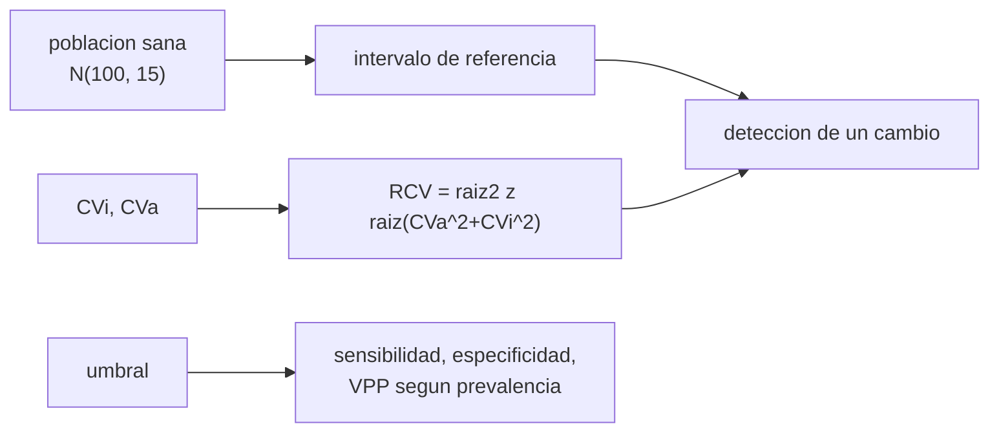

# B105-C24 — Indicadores clínicos y biomarcadores de vuelo

<!-- nav:top -->
[🏠 Programa](../../../../README.md) · [📚 Bloque B105](../../../tronco-comun/B105-medicina-y-biologia-espacial.md) · [← Anterior: B105-C23 — Termorregulación humana en vuelo](../B105-C23-termorregulacion-humana-en-vuelo/CLASE.md) · [Siguiente: B105-C25 — Adaptación sensoriomotora y control motor en microgravedad →](../B105-C25-adaptacion-sensoriomotora-y-control-motor-en-microgravedad/CLASE.md)
<!-- /nav -->

## 1. Ubicación, nivel y alcance

Clase 24 del bloque B105 (clase ampliada). Nivel N3. B105 describe los sistemas por separado; aquí se aprende a **seguir** un indicador en el tiempo: cuándo un valor es anómalo respecto de la población y cuándo ha cambiado respecto de la propia persona. Con un biomarcador **sintético** calculas el intervalo de referencia, el valor de cambio de referencia (RCV) y el desempeño de un umbral (sensibilidad, especificidad, VPP). Es una clase de estadística de indicadores: **no sustituye formación, licencia ni supervisión profesional**.

## 2. Por qué esta clase existe

Con tripulaciones pequeñas, el intervalo de la población general es poco sensible a los cambios personales, y un umbral con baja prevalencia da más falsas alarmas que aciertos. La decisión central: **¿cuándo un cambio de un indicador es real y qué umbral equilibra sensibilidad y valor predictivo?**

## 3. Lo que podrás hacer al terminar

1. Calcular un intervalo de referencia poblacional y el índice de individualidad `CVi/CVg`.
2. Calcular el valor de cambio de referencia `√2 z √(CVa² + CVi²)`.
3. Comparar la detección de un cambio real con el RCV personal y con el intervalo poblacional.
4. Calcular sensibilidad, especificidad, VPP y VPN de un umbral con una prevalencia dada.
5. Calcular el AUC de un indicador y su significado.
6. Rotular el biomarcador como sintético y no dar criterios clínicos.

La evidencia es la **ficha de indicadores con umbrales** del ejercicio 12 (sección 20).

## 4. Con qué llegas y cómo comprobarlo

1. ¿Qué es un intervalo de referencia?
2. ¿Qué es el coeficiente de variación?
3. ¿Qué es la sensibilidad?
4. ¿Qué es el valor predictivo positivo?
5. ¿Qué es un dato sintético?

<details>
<summary>Ver respuestas</summary>

1. El rango central (por ejemplo, 2,5–97,5 %) de una población sana. 2. La desviación estándar dividida por la media. 3. La fracción de afectados con resultado positivo. 4. La fracción de positivos que realmente están afectados. 5. Un dato generado para el ejemplo, no medido.
</details>

Con cuatro o cinco aciertos, sigue; si no, repasa los prerrequisitos.

## 5. Un caso de contexto y casos de referencia

Un biomarcador **sintético** X (u.a.): población sana `N(100, 15)`, variación intraindividual CVi = 5 %, analítica CVa = 3 %. El intervalo de referencia es 69,5–132,6 u.a.; el índice de individualidad `CVi/CVg = 0,33`; el RCV es 16,2 %. Un cambio real de +25 u.a. se detecta con el RCV personal en el 80,9 % de los casos y con el intervalo poblacional en el 31,7 %. Con un umbral de 130 u.a. y prevalencia de 2 %: sensibilidad 0,399, especificidad 0,977 y VPP 0,264; el AUC es 0,838. Es el **ejemplo conductor**: nada es un criterio clínico.

## 6. Vocabulario

El **intervalo de referencia** son los percentiles 2,5–97,5 de la población sana. `CVi`, `CVg` y `CVa` son los coeficientes de variación intraindividual, interindividual y analítico. El **índice de individualidad** `CVi/CVg` menor que 0,6 indica que el rango poblacional detecta mal cambios personales. El **RCV** es `√2·z·√(CVa² + CVi²)` (fórmula estándar, no consultada aquí). La **sensibilidad**, la **especificidad**, el **VPP** y el **VPN** miden un umbral. El **AUC** es la probabilidad de que un afectado supere a un sano.

## 7. Modelo mental



*Descripción textual:* el intervalo poblacional y el RCV personal son dos reglas para decidir si un valor es anómalo o ha cambiado; un umbral se evalúa con sensibilidad, especificidad y valor predictivo según la prevalencia.

Analogía: la temperatura de una persona frente a la media de la población; 37,3 °C puede ser normal para la población pero un cambio para quien suele tener 36,2 °C. Límite: aquí el indicador es sintético y sin significado clínico.

## 8. La explicación, paso a paso

### 8.1 Referencia poblacional e individualidad

Con 200.000 valores sintéticos, el intervalo 2,5–97,5 % es 69,5–132,6 u.a. `CVg = 15 %`; `CVi/CVg = 0,33`: el intervalo poblacional es poco sensible a cambios personales.

### 8.2 RCV

`RCV = √2·1,96·√(0,03² + 0,05²) = 0,162` (16,2 %). Simulación sin cambio real: la fracción que supera el RCV es 0,0510 (esperado 0,05). Con un cambio real de +25 u.a.: el RCV personal lo detecta en 0,809 y salir del intervalo poblacional, en 0,317.

### 8.3 Desempeño de un umbral

Con sanos `N(100, 15)`, afectados `N(125, 20)` y prevalencia 2 %:

| Umbral | Sens. | Espec. | VPP | VPN |
|---|---|---|---|---|
| 110 | 0,772 | 0,748 | 0,059 | 0,9938 |
| 120 | 0,596 | 0,909 | 0,118 | 0,9910 |
| 130 | 0,399 | 0,977 | 0,264 | 0,9876 |
| 140 | 0,226 | 0,996 | 0,541 | 0,9844 |
| 150 | 0,105 | 1,000 | 0,834 | 0,9821 |

Subir el umbral sube la especificidad y el VPP y baja la sensibilidad. El AUC es 0,838.

### 8.4 Con una tripulación

Si 6 personas se miden semanalmente durante 26 semanas, cada una hace 156 comparaciones: con una regla del 5 % se esperan ~8 alertas falsas por persona. Se necesitan umbrales más estrictos, confirmación o reglas por tendencia.

## 9. Magnitudes, símbolos y unidades

| Símbolo | Qué es | Unidad | Valor / nota |
|---|---|---|---|
| `CVi`, `CVa`, `CVg` | variación intraindividual, analítica, interindividual | % | 5; 3; 15 |
| RCV | valor de cambio de referencia | % | 16,2 |
| `T` | umbral | u.a. | 110 a 150 |
| Se, Sp | sensibilidad, especificidad | — | 0,399; 0,977 (`T = 130`) |
| VPP | valor predictivo positivo | — | 0,264 (prevalencia 2 %) |
| AUC | área bajo la curva ROC | — | 0,838 |

## 10. Convenciones y referencias

Biomarcador en unidades arbitrarias (u.a.); prevalencia 2 %; `z = 1,96` bilateral. Datos sintéticos con semilla 105. Tolerancias del laboratorio: fracción que supera el RCV sin cambio = 0,05 ± 0,01; VPP creciente con el umbral; AUC entre 0,5 y 1. Numpy 2.4.4, Python 3.12.9.

## 11. De dónde sale lo que afirmamos

| ID | Fuente | Localizador | Respalda | Estado |
|---|---|---|---|---|
| — | Relaciones físicas, fisiológicas y estadísticas estándar usadas en el laboratorio | — | las verifica el laboratorio | No consultada en una fuente concreta (las verifica el laboratorio) |

Límites: no se consultó ninguna fuente de laboratorio clínico ni de biomarcadores de vuelo; la fórmula del RCV y el cálculo del AUC se verifican por simulación; las distribuciones y la prevalencia son sintéticas y no son criterios clínicos.

## 12. Cómo ver el resultado

Descripción: la tabla de 8.3 y la salida con el intervalo, el RCV y la detección de un cambio. Equivalente textual: la regla personal detecta cuatro de cada cinco cambios y la poblacional, uno de cada tres.

## 13. Ejemplo trabajado: ¿Cambió realmente un valor?

**Paso 1 · Línea base.** El valor habitual de la persona es 100.

**Paso 2 · Valor nuevo.** 120: cambio de 20 %.

**Paso 3 · Regla personal.** `20 % > RCV = 16,2 %`: cambio real.

**Paso 4 · Regla poblacional.** `120` está dentro de 69,5–132,6: no se detectaría.

## 14. Distintas formas de describir el problema

**Por población:** intervalo. **Por persona:** línea base y RCV. **Por umbral:** sensibilidad y especificidad. **Por prevalencia:** VPP. **Por AUC:** separación.

## 15. Práctica guiada

**Ejercicio 1 · con los pasos indicados.** Calcula el RCV con CVa = 3 % y CVi = 5 %. *Pasos:* `√2·1,96·√(0,03² + 0,05²)`.

<details><summary>Solución comentada</summary>

`16,2 %`.
</details>

**Ejercicio 2 · con una pista.** Calcula el índice de individualidad con CVi = 5 % y CVg = 15 %.

<details><summary>Solución comentada</summary>

`0,33`.
</details>

**Ejercicio 3 · casi autónomo.** ¿Qué sensibilidad y especificidad tiene el umbral 130?

<details><summary>Solución comentada</summary>

`0,399` y `0,977`.
</details>

## 16. Práctica autónoma, transferencia e integrador

**Ejercicio 4 · autónomo.** ¿Cuál es el VPP del umbral 130 con prevalencia 2 %?

<details><summary>Solución comentada</summary>

`0,264`.
</details>

**Ejercicio 5 · autónomo.** Con CVa = 1 %, ¿cuál sería el RCV?

<details><summary>Solución comentada</summary>

`2,772·√(0,0001 + 0,0025) = 14,1 %`.
</details>

**Ejercicio 6 · autónomo.** ¿Por qué el VPP es tan bajo con prevalencia de 2 %?

<details><summary>Solución comentada</summary>

Porque hay muchos más sanos que afectados y aun con especificidad alta los falsos positivos superan a los verdaderos.
</details>

**Ejercicio 7 · autónomo.** Una persona con línea base 100 mide 120. ¿Es un cambio real según el RCV? ¿Y según el intervalo poblacional?

<details><summary>Solución comentada</summary>

Sí (20 % > 16,2 %); no (120 está dentro de 69,5–132,6).
</details>

**Ejercicio 8 · autónomo.** Entre el umbral 120 y el 150, ¿qué se gana y qué se pierde?

<details><summary>Solución comentada</summary>

Se gana especificidad (0,909 → 1,000) y VPP (0,118 → 0,834); se pierde sensibilidad (0,596 → 0,105).
</details>

**Ejercicio 9 · transferencia.** Con 156 comparaciones por persona al 5 %, ¿cuántas alertas falsas se esperan?

<details><summary>Solución comentada</summary>

`156·0,05 ≈ 7,8`.
</details>

**Ejercicio 10 · transferencia.** ¿Qué es el AUC = 0,838?

<details><summary>Solución comentada</summary>

La probabilidad de que un afectado elegido al azar tenga un valor mayor que un sano elegido al azar.
</details>

**Ejercicio 11 · transferencia.** ¿Por qué conviene combinar el RCV con la tendencia en vez de usar un solo valor?

<details><summary>Solución comentada</summary>

Porque una tendencia sostenida es menos probable por azar que un solo valor extremo y reduce las falsas alertas.
</details>

**Ejercicio 12 · integrador.** Elabora tu *ficha de indicadores con umbrales*: intervalo, RCV, tabla de umbrales con prevalencia, AUC, regla de alerta con confirmación y lista de qué es sintético (sin criterios clínicos).

<details><summary>Solución comentada</summary>

Secciones 8.1–8.4 y la salida del laboratorio.
</details>

## 17. Laboratorio: intervalos de referencia, línea base personal y desempeño de un umbral

El script [indicadores.py](indicadores.py) simula una población sintética, calcula el intervalo de referencia, el índice de individualidad, el RCV y su comprobación, la detección de un cambio real y la tabla de un umbral con prevalencia del 2 % (**comprueba** que la fracción que supera el RCV sin cambio es 0,05 ± 0,01, que el VPP crece con el umbral y que el AUC está entre 0,5 y 1).

**Datos:** todo **sintético** (semilla 105); no son valores clínicos. **Predice antes de ejecutar:** ¿Qué regla detecta más cambios personales, el intervalo poblacional o el RCV personal? (El RCV.) **Ejecución del 2026-11-10 (Python 3.12.9):**

```text
Python 3.12.9; numpy 2.4.4
DATOS SINTETICOS (semilla 105): biomarcador X en u.a.; poblacion N(100, 15); CVi 5 %, CVa 3 %; no es un criterio clinico
Intervalo de referencia poblacional (2.5-97.5 %) = 69.5 - 132.6 u.a.
CVg = 15.0 %; indice de individualidad CVi/CVg = 0.33 (< 0.6 sugiere que el intervalo poblacional es poco sensible a cambios personales)
Valor de cambio de referencia RCV = 16.2 % (16.2 u.a. sobre 100)
Simulacion: fraccion de individuos sin cambio real que superan el RCV = 0.0510 (esperado ~ 0.05 bilateral)
Cambio real de +25 u.a.: detectado por RCV personal = 0.809; detectado por salir del intervalo poblacional = 0.317
umbral  sensibilidad  especificidad   VPP (prevalencia 2 %)   VPN
   110    0.772        0.748          0.059                 0.9938
   120    0.596        0.909          0.118                 0.9910
   130    0.399        0.977          0.264                 0.9876
   140    0.226        0.996          0.541                 0.9844
   150    0.105        1.000          0.834                 0.9821
AUC (probabilidad de que un afectado supere a un sano) = 0.838
Pruebas superadas.
```

```bash
python programa/clases/B105/B105-C24-indicadores-clinicos-y-biomarcadores-de-vuelo/indicadores.py
```

**Límites:** distribuciones normales, un solo indicador, variabilidad constante y mediciones independientes; no es un criterio clínico ni un protocolo de vigilancia.

## 18. Errores frecuentes y cómo corregirlos

**Usar solo el intervalo poblacional para vigilar a una persona.** Usa la línea base y el RCV (8.2).

**Ignorar la prevalencia al evaluar un umbral.** El VPP depende de ella (8.3).

**Hacer muchas comparaciones sin corregir.** Se esperan alertas falsas (8.4).

**Tomar umbrales sintéticos como clínicos.** No lo son.

## 19. Cómo sabrás que vas bien

Tras la sección 8: ¿decides si un cambio es real? Si dudas, repasa el ejemplo 13. Tras el laboratorio: ¿qué comprueba? (ver la sección 17).

## 20. Qué entregas y cómo se evalúa

El producto es tu **ficha de indicadores con umbrales** (ejercicio 12).

| Criterio | Inicial | En desarrollo | Logrado | Destacado |
|---|---|---|---|---|
| Conceptos | Confunde las magnitudes | Parciales | Explica referencia, RCV y umbral | Explica el VPP y las alertas falsas |
| Cálculo | Sin unidades | Con errores | Calcula con unidades y tolerancias | Calcula casos nuevos |
| Numérico | Sin comprobar | Un caso | Compara con la verdad del generador | Interpreta la sensibilidad |
| Fuentes | Sin fuente | Sin fecha | Cita solo lo consultado, con fecha | Rotula lo sintético y lo no consultado |
| Límites | No los nombra | Uno | Tres | Discute qué falta del modelo |

**Condiciones críticas (no se compensan con promedio):** rotular los datos como sintéticos; no presentar un resultado simulado como observado; no dar consejo médico ni operativo; citar solo lo consultado.

## 21. Ética, seguridad y límites

Clase **educativa**: no es consejo médico, no sustituye la formación, la licencia ni la supervisión de profesionales, y no contiene dosis, tratamientos ni procedimientos para aplicar a una persona real. Contenido educativo: no sustituye formación, licencia ni supervisión profesional; ningún umbral de esta clase es clínico y la interpretación de indicadores de una persona real corresponde a profesionales de la salud. Accesibilidad: tablas equivalentes a las gráficas, fórmulas en texto, ejercicios sin conexión.

## 22. Para cerrar y seguir

Con un RCV de 16,2 %, la regla personal detecta el 80,9 % de los cambios reales y el intervalo poblacional, el 31,7 %; con prevalencia de 2 %, el umbral 130 tiene VPP de 0,264. Queda una pregunta: ¿cómo se adapta el cerebro al control del movimiento?

**Glosario español–inglés.** intervalo de referencia · *reference interval*; valor de cambio de referencia · *reference change value*; valor predictivo positivo · *positive predictive value*; individualidad · *individuality*.

**Continuidad.** [B105-C25](../B105-C25-adaptacion-sensoriomotora-y-control-motor-en-microgravedad/CLASE.md) estudia la adaptación sensoriomotora.

**Referencias:** ver sección 11.

<!-- nav:bottom -->
---

[← Anterior: B105-C23 — Termorregulación humana en vuelo](../B105-C23-termorregulacion-humana-en-vuelo/CLASE.md) · [📚 Bloque B105](../../../tronco-comun/B105-medicina-y-biologia-espacial.md) · [Siguiente: B105-C25 — Adaptación sensoriomotora y control motor en microgravedad →](../B105-C25-adaptacion-sensoriomotora-y-control-motor-en-microgravedad/CLASE.md)
<!-- /nav -->
