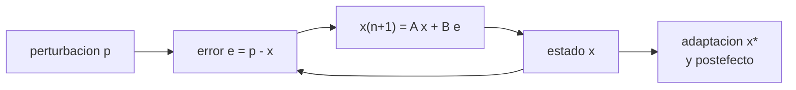

# B105-C25 — Adaptación sensoriomotora y control motor en microgravedad

<!-- nav:top -->
[🏠 Programa](../../../../README.md) · [📚 Bloque B105](../../../tronco-comun/B105-medicina-y-biologia-espacial.md) · [← Anterior: B105-C24 — Indicadores clínicos y biomarcadores de vuelo](../B105-C24-indicadores-clinicos-y-biomarcadores-de-vuelo/CLASE.md) · [Siguiente: B105-C26 — Medidas fisiológicas y biomarcadores en investigación espacial →](../B105-C26-medidas-fisiologicas-y-biomarcadores-en-investigacion-espacial/CLASE.md)
<!-- /nav -->

## 1. Ubicación, nivel y alcance

Clase 25 del bloque B105 (clase ampliada). Nivel N3. [B105-C04](../B105-C04-sistema-vestibular/CLASE.md) trata el sensor vestibular; aquí se trata cómo el control motor se **adapta** cuando cambia la relación entre la orden y el resultado (por ejemplo, un cambio de gravedad). Usas un modelo de estado–espacio de una tasa, con retención y sensibilidad al error, calculas la adaptación incompleta, el postefecto y ajustas los parámetros a datos **sintéticos**.

## 2. Por qué esta clase existe

Quien se adapta a un entorno nuevo comete errores al volver al anterior. Entender el ritmo de adaptación y el postefecto permite diseñar el entrenamiento y anticipar las torpezas. La decisión central: **¿cuántos ensayos tarda en adaptarse, hasta dónde llega y qué postefecto deja al retirar la perturbación?**

## 3. Lo que podrás hacer al terminar

1. Plantear `x_{n+1} = A x_n + B (p_n − x_n)` y su estado estacionario `B p/(1 − A + B)`.
2. Calcular la tasa de aprendizaje `A − B`, la constante de tiempo y la adaptación incompleta.
3. Calcular el postefecto al retirar la perturbación y el número de ensayos de lavado.
4. Ajustar `A` y `B` a observaciones ruidosas por mínimos cuadrados.
5. Comparar una segunda exposición con mayor sensibilidad al error.
6. Rotular el modelo como didáctico y sin datos de vuelo.

La evidencia es la **ficha de adaptación con las constantes ajustadas** del ejercicio 12 (sección 20).

## 4. Con qué llegas y cómo comprobarlo

1. ¿Qué es un modelo de estado–espacio?
2. ¿Qué es el error motor?
3. ¿Qué es un postefecto?
4. ¿Qué es un ajuste por mínimos cuadrados?
5. ¿Qué es un dato sintético?

<details>
<summary>Ver respuestas</summary>

1. Uno que actualiza un estado ensayo a ensayo con una regla fija. 2. La diferencia entre el resultado deseado y el obtenido. 3. El error contrario que aparece al retirar una perturbación a la que se adaptó. 4. Elegir parámetros que minimizan la suma de cuadrados de los residuos. 5. Un dato generado para el ejemplo, no medido.
</details>

Con cuatro o cinco aciertos, sigue; si no, repasa los prerrequisitos.

## 5. Un caso de contexto y casos de referencia

Un modelo con `A = 0,95` (retención) y `B = 0,20` (sensibilidad al error) enfrenta una perturbación de 30° durante 40 ensayos y luego 40 ensayos de lavado. La tasa es `A − B = 0,75` por ensayo (constante de tiempo 3,48 ensayos); la adaptación se estabiliza en `x* = 24,0°` (80 % de la perturbación). Al retirarla, el postefecto es de −24° y vuelve a menos de 1° en el ensayo 52. El ajuste de 80 observaciones **sintéticas** con ruido de 2° da `A = 0,941` y `B = 0,222`. Es el **ejemplo conductor**: todo es **sintético**; no hay datos de microgravedad.

## 6. Vocabulario

El **estado** `x` es la adaptación (grados). El **error** `e_n = p_n − x_n`. La **retención** `A` (< 1 olvida) y la **sensibilidad al error** `B` fijan la tasa `λ = A − B` y el estado estacionario `x* = B p/(1 − A + B)`. El **postefecto** es `−x` al retirar `p`. El **lavado** es el retorno a 0. La **adaptación incompleta** ocurre porque `A < 1`.

## 7. Modelo mental



*Descripción textual:* el error entre la perturbación y el estado actualiza el estado con una retención y una sensibilidad; el estado converge a un estado estacionario y deja un postefecto al retirar la perturbación.

Analogía: ajustar un volante con holgura; con cada giro se corrige una fracción del error y se olvida un poco de lo aprendido. Límite: el aprendizaje motor real tiene varios procesos con distintas escalas de tiempo, no uno solo.

## 8. La explicación, paso a paso

### 8.1 El modelo

`x_{n+1} = A x_n + B (p − x_n) = (A − B) x_n + B p`. Con `A = 0,95`, `B = 0,20`, `p = 30°`: `λ = 0,75`, `x* = 0,2·30/(1 − 0,95 + 0,20) = 24,0°` (80 %). La constante de tiempo es `−1/ln 0,75 = 3,48` ensayos; reducir a la mitad la distancia a `x*` toma 2,41 ensayos.

### 8.2 Trayectoria

`x`: 0; 6,0 (ensayo 1); 10,5 (2); 18,3 (5); 22,6 (10); 23,9 (20); 24,0 (39). El error pasa de 30° a 7,4° en el ensayo 10 y 6,0° en el 39: no llega a cero porque `A < 1`.

### 8.3 Postefecto

Al retirar la perturbación (ensayo 40), `x = 24,0°`: el error es −24°. Decae como `0,75^n`: 18,0 (41); 5,7 (45); 0,1 (60); menos de 1° en el ensayo 52.

### 8.4 Ajuste y segunda exposición

El ajuste por rejilla de 80 observaciones con ruido de 2° da `A = 0,941` y `B = 0,222` (verdad 0,95 y 0,20; `λ` ajustada 0,719). Una segunda exposición con `B = 0,30` llega a 25,4° en el ensayo 10 frente a 22,6° (+2,7°): más sensibilidad al error acelera la adaptación.

## 9. Magnitudes, símbolos y unidades

| Símbolo | Qué es | Unidad | Valor / nota |
|---|---|---|---|
| `x` | estado de adaptación | grados | 0 a 24 |
| `p` | perturbación | grados | 30 |
| `A` | retención | — | 0,95 |
| `B` | sensibilidad al error | — | 0,20 |
| `λ` | tasa de aprendizaje | por ensayo | 0,75 |
| `x*` | estado estacionario | grados | 24,0 |

## 10. Convenciones y referencias

Un ensayo es una unidad de tiempo; perturbación de 30° en los ensayos 0–39 y 0 en 40–79; ruido normal de 2°. Datos sintéticos con semilla 105. Rejilla de 201×241 puntos. Tolerancias del laboratorio: `x* = 24,0°` exacto; `x` en el ensayo 39 dentro de 1° de `x*`; `A` ajustado dentro de 0,05 y `B` dentro de 0,1. Numpy 2.4.4, Python 3.12.9.

## 11. De dónde sale lo que afirmamos

| ID | Fuente | Localizador | Respalda | Estado |
|---|---|---|---|---|
| — | Relaciones físicas, fisiológicas y estadísticas estándar usadas en el laboratorio | — | las verifica el laboratorio | No consultada en una fuente concreta (las verifica el laboratorio) |

Límites: no se consultó literatura de aprendizaje motor ni de adaptación en microgravedad; los valores de `A` y `B` y la perturbación son didácticos; el modelo de una sola tasa no representa los procesos rápido y lento.

## 12. Cómo ver el resultado

Descripción: la salida del laboratorio con la trayectoria de `x`, el postefecto y el ajuste. Equivalente textual: el estado converge al 80 % de la perturbación y deja un postefecto de la misma magnitud que decae en unos 12 ensayos.

## 13. Ejemplo trabajado: dos pasos de adaptación

**Paso 1 · Inicio.** `x₀ = 0`, `p = 30`.

**Paso 2 · Primer ensayo.** `x₁ = 0,95·0 + 0,20·30 = 6,0°`.

**Paso 3 · Segundo.** `x₂ = 0,95·6 + 0,20·(30 − 6) = 5,7 + 4,8 = 10,5°`.

**Paso 4 · Equilibrio.** `x* = 24°`.

## 14. Distintas formas de describir el problema

**Por recurrencia:** `x_{n+1}`. **Por tasa:** `λ`. **Por equilibrio:** `x*`. **Por postefecto:** `−x`. **Por ajuste:** `A` y `B`.

## 15. Práctica guiada

**Ejercicio 1 · con los pasos indicados.** Calcula `x₁` con `x₀ = 0`, `A = 0,95`, `B = 0,20`, `p = 30`. *Pasos:* `B p`.

<details><summary>Solución comentada</summary>

`6,0°`.
</details>

**Ejercicio 2 · con una pista.** Calcula `x₂`. *Pista:* `A x₁ + B (p − x₁)`.

<details><summary>Solución comentada</summary>

`10,5°`.
</details>

**Ejercicio 3 · casi autónomo.** Calcula el estado estacionario `x*`.

<details><summary>Solución comentada</summary>

`0,2·30/0,25 = 24°`.
</details>

## 16. Práctica autónoma, transferencia e integrador

**Ejercicio 4 · autónomo.** ¿Cuál es la tasa `λ` y la constante de tiempo?

<details><summary>Solución comentada</summary>

`0,75`; `3,48` ensayos.
</details>

**Ejercicio 5 · autónomo.** ¿Cuántos ensayos reducen a la mitad la distancia a `x*`?

<details><summary>Solución comentada</summary>

`ln 0,5/ln 0,75 = 2,41`.
</details>

**Ejercicio 6 · autónomo.** ¿Por qué la adaptación no llega al 100 % de la perturbación?

<details><summary>Solución comentada</summary>

Porque `A < 1`: parte de lo aprendido se olvida en cada ensayo.
</details>

**Ejercicio 7 · autónomo.** ¿Qué postefecto hay al retirar la perturbación?

<details><summary>Solución comentada</summary>

`−24°`.
</details>

**Ejercicio 8 · autónomo.** Con `B = 0,30`, ¿cuál es `λ` y cuál `x*`?

<details><summary>Solución comentada</summary>

`λ = 0,65`; `x* = 0,3·30/0,35 = 25,7°`.
</details>

**Ejercicio 9 · transferencia.** ¿Por qué el postefecto importa al volver a un entorno conocido?

<details><summary>Solución comentada</summary>

Porque el sistema motor sigue ajustado al entorno anterior y comete errores hasta readaptarse.
</details>

**Ejercicio 10 · transferencia.** El ajuste dio `λ = 0,719` frente a 0,75. ¿Qué lo explica?

<details><summary>Solución comentada</summary>

El ruido de 2° y 80 puntos: la estimación tiene incertidumbre; conviene dar un intervalo.
</details>

**Ejercicio 11 · transferencia.** ¿Qué diferencia habría si la adaptación tuviera dos procesos (rápido y lento)?

<details><summary>Solución comentada</summary>

La curva tendría dos escalas de tiempo y el modelo de una tasa las confundiría en una sola.
</details>

**Ejercicio 12 · integrador.** Elabora tu *ficha de adaptación con las constantes ajustadas*: modelo, trayectoria, estado estacionario, postefecto, ajuste con su incertidumbre y lista de qué es sintético.

<details><summary>Solución comentada</summary>

Secciones 8.1–8.4 y la salida del laboratorio.
</details>

## 17. Laboratorio: adaptación de estado–espacio del control motor

El script [adaptacion.py](adaptacion.py) simula la adaptación a una perturbación de 30° y su lavado, calcula el estado estacionario y el postefecto y ajusta `A` y `B` a observaciones ruidosas (**comprueba** `x* = 24°`, que `x` converge a `x*` y que el ajuste recupera `A` y `B` dentro de tolerancia).

**Datos:** todo **sintético** (semilla 105); no hay datos de microgravedad. **Predice antes de ejecutar:** ¿Qué postefecto deja la adaptación al retirar la perturbación? (De −24°.) **Ejecución del 2026-11-10 (Python 3.12.9):**

```text
Python 3.12.9; numpy 2.4.4
DATOS SINTETICOS (semilla 105): A = 0.95, B = 0.20, perturbacion 30 grados x 40 ensayos, luego lavado de 40; ruido 2 grados
Tasa lambda = A - B = 0.75 por ensayo; estado estacionario x* = 24.0 grados (80 % de la perturbacion); constante de tiempo = 3.48 ensayos
Ensayo:     0     1     2     5    10    20    39    40    41    45    60    79
x [gr]:   0.0   6.0  10.5  18.3  22.6  23.9  24.0  24.0  18.0   5.7   0.1   0.0
Error al inicio = 30.0 grados; error en el ensayo 10 = 7.4; en el 39 = 6.0
Postefecto al retirar la perturbacion (ensayo 40): x = 24.0 grados, es decir error de -24.0 grados; vuelve a menos de 1 grado en el ensayo 52
Ajuste por rejilla a 80 observaciones ruidosas: A = 0.941 (verdad 0.95), B = 0.222 (verdad 0.2); SSE = 295.9; lambda ajustada = 0.719
Segunda exposicion con B = 0.30 (mas sensibilidad al error): x en el ensayo 10 = 25.4 grados frente a 22.6; ahorro = 2.7 grados
Ensayos para reducir a la mitad la distancia al estado estacionario = 2.41
Pruebas superadas.
```

```bash
python programa/clases/B105/B105-C25-adaptacion-sensoriomotora-y-control-motor-en-microgravedad/adaptacion.py
```

**Límites:** un proceso de aprendizaje, sin ruido de ejecución ni de planificación, sin generalización entre tareas; no representa datos de vuelo.

## 18. Errores frecuentes y cómo corregirlos

**Esperar adaptación completa.** Con `A < 1`, `x* < p` (8.1).

**Ignorar el postefecto.** Aparece al retirar la perturbación (8.3).

**Tomar `A` y `B` como medidas.** Son ilustrativos (sección 10).

**Confundir tasa de aprendizaje y sensibilidad.** `λ = A − B` incluye ambas.

## 19. Cómo sabrás que vas bien

Tras la sección 8: ¿calculas `x*` y el postefecto? Si dudas, repasa el ejemplo 13. Tras el laboratorio: ¿qué comprueba? (ver la sección 17).

## 20. Qué entregas y cómo se evalúa

El producto es tu **ficha de adaptación con las constantes ajustadas** (ejercicio 12).

| Criterio | Inicial | En desarrollo | Logrado | Destacado |
|---|---|---|---|---|
| Conceptos | Confunde las magnitudes | Parciales | Explica `A`, `B`, `λ` y `x*` | Explica el postefecto y sus límites |
| Cálculo | Sin unidades | Con errores | Calcula con unidades y tolerancias | Calcula casos nuevos |
| Numérico | Sin comprobar | Un caso | Compara con la verdad del generador | Interpreta la sensibilidad |
| Fuentes | Sin fuente | Sin fecha | Cita solo lo consultado, con fecha | Rotula lo sintético y lo no consultado |
| Límites | No los nombra | Uno | Tres | Discute qué falta del modelo |

**Condiciones críticas (no se compensan con promedio):** rotular los datos como sintéticos; no presentar un resultado simulado como observado; no dar consejo médico ni operativo; citar solo lo consultado.

## 21. Ética, seguridad y límites

Clase **educativa**: no es consejo médico, no sustituye la formación, la licencia ni la supervisión de profesionales, y no contiene dosis, tratamientos ni procedimientos para aplicar a una persona real. No se valora el control motor de nadie; el entrenamiento y la evaluación reales corresponden a profesionales con los datos de la tarea. Accesibilidad: tablas equivalentes a las gráficas, fórmulas en texto, ejercicios sin conexión.

## 22. Para cerrar y seguir

Con `A = 0,95` y `B = 0,20`, la adaptación llega al 80 % de la perturbación en unos 10 ensayos y deja un postefecto de −24°. Queda una pregunta: ¿qué medidas conviene elegir para investigarlo?

**Glosario español–inglés.** adaptación · *adaptation*; postefecto · *aftereffect*; retención · *retention*; sensibilidad al error · *error sensitivity*.

**Continuidad.** [B105-C26](../B105-C26-medidas-fisiologicas-y-biomarcadores-en-investigacion-espacial/CLASE.md) estudia la elección de medidas fisiológicas y biomarcadores.

**Referencias:** ver sección 11.

<!-- nav:bottom -->
---

[← Anterior: B105-C24 — Indicadores clínicos y biomarcadores de vuelo](../B105-C24-indicadores-clinicos-y-biomarcadores-de-vuelo/CLASE.md) · [📚 Bloque B105](../../../tronco-comun/B105-medicina-y-biologia-espacial.md) · [Siguiente: B105-C26 — Medidas fisiológicas y biomarcadores en investigación espacial →](../B105-C26-medidas-fisiologicas-y-biomarcadores-en-investigacion-espacial/CLASE.md)
<!-- /nav -->
