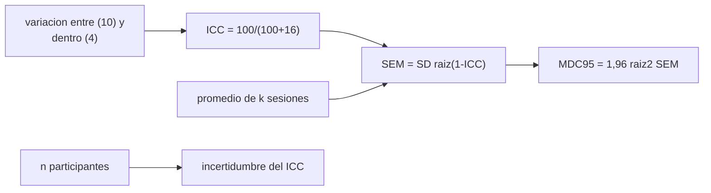

# B105-C26 — Medidas fisiológicas y biomarcadores en investigación espacial

<!-- nav:top -->
[🏠 Programa](../../../../README.md) · [📚 Bloque B105](../../../tronco-comun/B105-medicina-y-biologia-espacial.md) · [← Anterior: B105-C25 — Adaptación sensoriomotora y control motor en microgravedad](../B105-C25-adaptacion-sensoriomotora-y-control-motor-en-microgravedad/CLASE.md) · [Siguiente: B105-C27 — Instrumentos validados y psicometría en investigación →](../B105-C27-instrumentos-validados-y-psicometria-en-investigacion/CLASE.md)
<!-- /nav -->

## 1. Ubicación, nivel y alcance

Clase 26 del bloque B105 (clase ampliada). Nivel N3. [B105-C20](../B105-C20-diseno-de-protocolo-medico-simulado/CLASE.md) diseña el protocolo; aquí se elige y se evalúa **la medida**: ¿cuánto ruido tiene, qué cambio mínimo puede distinguir del ruido y cuántas repeticiones valen la pena? Con datos **sintéticos** calculas el coeficiente de correlación intraclase (ICC), el error estándar de medida (SEM), el cambio mínimo detectable (MDC), los límites de acuerdo de Bland–Altman y el efecto de promediar sesiones.

## 2. Por qué esta clase existe

Un biomarcador con alta variación interna no detecta cambios pequeños aunque sea «preciso». Con pocos participantes, además, el propio ICC es incierto. La decisión central: **¿qué cambio mínimo distingue esta medida del ruido y cuántas sesiones hay que promediar para detectar el efecto esperado?**

## 3. Lo que podrás hacer al terminar

1. Calcular el ICC(1,1) por ANOVA de una vía a partir de dos sesiones.
2. Calcular el SEM `SD √(1 − ICC)` y el MDC95 `1,96 √2 SEM`.
3. Medir cómo la incertidumbre del ICC depende del número de participantes.
4. Calcular los límites de acuerdo de Bland–Altman y detectar un sesgo sistemático.
5. Calcular el MDC al promediar `k` sesiones.
6. Rotular los datos como sintéticos y elegir una medida según su MDC frente al efecto esperado.

La evidencia es la **ficha de medidas con su MDC** del ejercicio 12 (sección 20).

## 4. Con qué llegas y cómo comprobarlo

1. ¿Qué es la fiabilidad test–retest?
2. ¿Qué es la varianza entre y dentro de individuos?
3. ¿Qué es el error estándar?
4. ¿Qué es un sesgo sistemático?
5. ¿Qué es un dato sintético?

<details>
<summary>Ver respuestas</summary>

1. El grado en que una medida repetida da el mismo resultado. 2. La variación entre personas frente a la variación de una misma persona entre sesiones. 3. La desviación estándar de un estimador. 4. Una diferencia constante entre sesiones o métodos. 5. Un dato generado para el ejemplo, no medido.
</details>

Con cuatro o cinco aciertos, sigue; si no, repasa los prerrequisitos.

## 5. Un caso de contexto y casos de referencia

Una medida **sintética** con variación entre individuos `SD = 10` y variación dentro de individuos `SD = 4`: ICC verdadero `100/(100 + 16) = 0,862`, SEM = 4,00 y MDC95 = 11,09. Con 6 participantes el ICC estimado es 0,810 con DE de 0,174 (la cobertura del IC bootstrap del 95 % es 0,80); con 100, 0,860 (DE 0,027; cobertura 0,935). Promediar 4 sesiones baja el MDC95 de 11,09 a 5,54. Es el **ejemplo conductor**: todo es **sintético**; ninguna medida real.

## 6. Vocabulario

El **ICC(1,1)** es `(MSB − MSW)/(MSB + (k − 1) MSW)`. El **SEM** es `SD √(1 − ICC)`. El **MDC95** es `1,96 √2 SEM`: el cambio mínimo que supera el ruido con 95 % de confianza. Los **límites de acuerdo** de **Bland–Altman** son `d̄ ± 1,96 SD_d`. Promediar `k` sesiones reduce el SEM a `SEM/√k`. El **bootstrap** remuestrea participantes para dar un intervalo del ICC.

## 7. Modelo mental



*Descripción textual:* la variación entre y dentro de individuos da el ICC; con él se calcula el SEM y el cambio mínimo detectable; promediar sesiones lo reduce, y el número de participantes determina la incertidumbre de la fiabilidad estimada.

Analogía: una regla con graduación borrosa; solo distingue diferencias mayores que su borrosidad. Límite: la borrosidad real cambia con el rango del valor y con la persona.

## 8. La explicación, paso a paso

### 8.1 ICC, SEM y MDC

`ICC = σ²_entre/(σ²_entre + σ²_dentro) = 100/116 = 0,862`. `SEM = SD_total √(1 − ICC) = 10,77·0,372 = 4,00`. `MDC95 = 1,96·√2·4 = 11,09`: un cambio menor que 11 unidades no se distingue del ruido en una persona.

### 8.2 Efecto del número de participantes

| `n` | ICC medio (DE) | SEM medio | MDC95 medio | Cobertura IC bootstrap 95 % |
|---|---|---|---|---|
| 6 | 0,810 (0,174) | 3,67 | 10,17 | 0,800 |
| 10 | 0,832 (0,115) | 3,83 | 10,63 | 0,875 |
| 20 | 0,849 (0,067) | 3,90 | 10,80 | 0,905 |
| 50 | 0,857 (0,039) | 3,97 | 11,00 | 0,900 |
| 100 | 0,860 (0,027) | 3,98 | 11,03 | 0,935 |

Con pocos participantes el ICC es muy incierto y el intervalo cubre menos del 95 %.

### 8.3 Bland–Altman

Con 50 pares y un sesgo sistemático sintético de +1,5 en la segunda sesión: sesgo estimado 2,08 y límites de acuerdo de −9,96 a 14,13. El ICC no detecta el sesgo; Bland–Altman sí.

### 8.4 Promediar sesiones

Promediar `k` sesiones da `SEM = 4/√k`: 4,00 (1); 2,83 (2) y 2,00 (4); el MDC95 baja a 11,09; 7,84 y 5,54. Si el efecto esperado es de 8 unidades, hacen falta al menos 2 sesiones por medición.

## 9. Magnitudes, símbolos y unidades

| Símbolo | Qué es | Unidad | Valor / nota |
|---|---|---|---|
| `σ_entre`, `σ_dentro` | variación entre y dentro | u.a. | 10; 4 |
| ICC | correlación intraclase | — | 0,862 |
| SEM | error estándar de medida | u.a. | 4,00 |
| MDC95 | cambio mínimo detectable | u.a. | 11,09 |
| `k` | sesiones promediadas | — | 1; 2; 4 |
| `n` | participantes | — | 6 a 100 |

## 10. Convenciones y referencias

Dos sesiones por participante; ICC(1,1) por ANOVA de una vía; MDC95 con `z = 1,96`; 2.000 repeticiones por `n` y 200 para la cobertura del bootstrap (300 remuestreos). Datos sintéticos con semilla 105. Tolerancias del laboratorio: ICC medio con `n = 100` dentro de 0,03 de 0,862; DE del ICC decreciente con `n`; MDC con `n = 100` dentro de 1,5 de 11,09. Numpy 2.4.4, Python 3.12.9.

## 11. De dónde sale lo que afirmamos

| ID | Fuente | Localizador | Respalda | Estado |
|---|---|---|---|---|
| — | Relaciones físicas, fisiológicas y estadísticas estándar usadas en el laboratorio | — | las verifica el laboratorio | No consultada en una fuente concreta (las verifica el laboratorio) |

Límites: no se consultó ninguna fuente de metrología ni de fiabilidad de medidas fisiológicas de vuelo; las fórmulas estándar de ICC, SEM y MDC se verifican por simulación; las desviaciones y el sesgo son sintéticos.

## 12. Cómo ver el resultado

Descripción: la tabla de 8.2 y la salida con Bland–Altman y el promedio de sesiones. Equivalente textual: con 6 personas el ICC es muy incierto; promediar 4 sesiones reduce a la mitad el cambio mínimo detectable.

## 13. Ejemplo trabajado: ¿Un cambio de 8 unidades es real?

**Paso 1 · SEM.** `4,0`.

**Paso 2 · MDC95.** `1,96·1,414·4 = 11,09`.

**Paso 3 · Comparación.** `8 < 11,09`: con una sesión no se distingue del ruido.

**Paso 4 · Con 2 sesiones.** `MDC = 7,84 < 8`: se distingue.

## 14. Distintas formas de describir el problema

**Por ICC:** fiabilidad. **Por SEM:** unidades de la medida. **Por MDC:** cambio mínimo. **Por Bland–Altman:** sesgo y límites. **Por promedio:** `SEM/√k`.

## 15. Práctica guiada

**Ejercicio 1 · con los pasos indicados.** Calcula el ICC verdadero con `σ_entre = 10` y `σ_dentro = 4`. *Pasos:* `100/(100 + 16)`.

<details><summary>Solución comentada</summary>

`0,862`.
</details>

**Ejercicio 2 · con una pista.** Calcula el SEM con `SD_total = 10,77` e ICC 0,862. *Pista:* `SD √(1 − ICC)`.

<details><summary>Solución comentada</summary>

`4,00`.
</details>

**Ejercicio 3 · casi autónomo.** Calcula el MDC95 con SEM = 4.

<details><summary>Solución comentada</summary>

`1,96·1,414·4 = 11,09`.
</details>

## 16. Práctica autónoma, transferencia e integrador

**Ejercicio 4 · autónomo.** Calcula el MDC95 al promediar 4 sesiones.

<details><summary>Solución comentada</summary>

`5,54`.
</details>

**Ejercicio 5 · autónomo.** ¿Qué DE tiene el ICC con `n = 6` y qué implica?

<details><summary>Solución comentada</summary>

`0,174`: la fiabilidad estimada con 6 personas es muy incierta.
</details>

**Ejercicio 6 · autónomo.** ¿Por qué la cobertura del bootstrap es menor que 95 % con `n` pequeño?

<details><summary>Solución comentada</summary>

Porque el remuestreo de pocos individuos subestima la variabilidad y el intervalo es demasiado estrecho.
</details>

**Ejercicio 7 · autónomo.** Con los datos de Bland–Altman, ¿cuál es el ancho de los límites de acuerdo?

<details><summary>Solución comentada</summary>

`14,13 − (−9,96) = 24,1`.
</details>

**Ejercicio 8 · autónomo.** Un cambio individual de 8 unidades, ¿se distingue del ruido con una sesión?

<details><summary>Solución comentada</summary>

No: `8 < 11,09`.
</details>

**Ejercicio 9 · transferencia.** Una medida con `σ_entre = 10` y `σ_dentro = 8`, ¿qué ICC y qué MDC95 tiene?

<details><summary>Solución comentada</summary>

`ICC = 100/164 = 0,61`; `MDC95 = 1,96·1,414·8 = 22,2`.
</details>

**Ejercicio 10 · transferencia.** ¿Qué detecta Bland–Altman que el ICC no?

<details><summary>Solución comentada</summary>

El sesgo sistemático entre sesiones o métodos.
</details>

**Ejercicio 11 · transferencia.** Dos medidas del mismo efecto: ICC 0,95 con MDC 15 y ICC 0,80 con MDC 5. ¿Cuál conviene si el efecto esperado es 8?

<details><summary>Solución comentada</summary>

La segunda: su MDC (5) es menor que el efecto; el ICC alto no basta si el cambio mínimo es mayor que el efecto.
</details>

**Ejercicio 12 · integrador.** Elabora tu *ficha de medidas con su MDC*: modelo, ICC, SEM, MDC95, incertidumbre según `n`, Bland–Altman, efecto del promedio y lista de qué es sintético.

<details><summary>Solución comentada</summary>

Secciones 8.1–8.4 y la salida del laboratorio.
</details>

## 17. Laboratorio: fiabilidad test–retest, error estándar de medida y cambio mínimo detectable

El script [fiabilidad.py](fiabilidad.py) simula dos sesiones para cinco tamaños de muestra, calcula el ICC, el SEM, el MDC, la cobertura del bootstrap, los límites de Bland–Altman y el efecto de promediar sesiones (**comprueba** que el ICC medio con `n = 100` está dentro de 0,03 del verdadero, que su DE decrece con `n` y que el MDC está dentro de 1,5 de 11,09).

**Datos:** todo **sintético** (semilla 105); las fórmulas se verifican por simulación. **Predice antes de ejecutar:** ¿Qué ocurre con la DE del ICC al pasar de 6 a 100 participantes? (Cae unas 6 veces.) **Ejecución del 2026-11-10 (Python 3.12.9):**

```text
Python 3.12.9; numpy 2.4.4
DATOS SINTETICOS (semilla 105): mu_i ~ N(100, 10); e ~ N(0, 4); verdad ICC = 0.862, SEM = 4.0, MDC95 = 11.1
Verdad: ICC = 0.862; SEM = 4.00; MDC95 = 11.09
n individuos | ICC estimado (media de 2000 repeticiones) [DE] | SEM medio | MDC95 medio | cobertura bootstrap 95 % del ICC (200 rep.)
      6      | 0.810 [0.174]                              |  3.67     |  10.17      | 0.800
     10      | 0.832 [0.115]                              |  3.83     |  10.63      | 0.875
     20      | 0.849 [0.067]                              |  3.90     |  10.80      | 0.905
     50      | 0.857 [0.039]                              |  3.97     |  11.00      | 0.900
    100      | 0.860 [0.027]                              |  3.98     |  11.03      | 0.935
Bland-Altman (n = 50, sesgo sistematico sintetico +1.5): sesgo = 2.08; limites de acuerdo = -9.96 a 14.13 (esperado +-11.1 alrededor de 1.5)
Promedio de 1 sesion(es): SEM = 4.00; MDC95 de la media = 11.09
Promedio de 2 sesion(es): SEM = 2.83; MDC95 de la media = 7.84
Promedio de 4 sesion(es): SEM = 2.00; MDC95 de la media = 5.54
Pruebas superadas.
```

```bash
python programa/clases/B105/B105-C26-medidas-fisiologicas-y-biomarcadores-en-investigacion-espacial/fiabilidad.py
```

**Límites:** una sola fuente de variación dentro del individuo, normalidad, ICC(1,1), sin efectos de sesión ni tendencia; no valida ninguna medida real.

## 18. Errores frecuentes y cómo corregirlos

**Confiar en un ICC estimado con pocos participantes.** Da su incertidumbre (8.2).

**Confundir ICC alto con poca variabilidad dentro.** Depende de la variación entre individuos.

**Ignorar el sesgo sistemático.** Usa Bland–Altman (8.3).

**Elegir la medida por ICC sin mirar el MDC.** Compara el MDC con el efecto esperado.

## 19. Cómo sabrás que vas bien

Tras la sección 8: ¿calculas el MDC y decides? Si dudas, repasa el ejemplo 13. Tras el laboratorio: ¿qué comprueba? (ver la sección 17).

## 20. Qué entregas y cómo se evalúa

El producto es tu **ficha de medidas con su MDC** (ejercicio 12).

| Criterio | Inicial | En desarrollo | Logrado | Destacado |
|---|---|---|---|---|
| Conceptos | Confunde las magnitudes | Parciales | Explica ICC, SEM y MDC | Explica el compromiso entre `n`, `k` y el MDC |
| Cálculo | Sin unidades | Con errores | Calcula con unidades y tolerancias | Calcula casos nuevos |
| Numérico | Sin comprobar | Un caso | Compara con la verdad del generador | Interpreta la sensibilidad |
| Fuentes | Sin fuente | Sin fecha | Cita solo lo consultado, con fecha | Rotula lo sintético y lo no consultado |
| Límites | No los nombra | Uno | Tres | Discute qué falta del modelo |

**Condiciones críticas (no se compensan con promedio):** rotular los datos como sintéticos; no presentar un resultado simulado como observado; no dar consejo médico ni operativo; citar solo lo consultado.

## 21. Ética, seguridad y límites

Clase **educativa**: no es consejo médico, no sustituye la formación, la licencia ni la supervisión de profesionales, y no contiene dosis, tratamientos ni procedimientos para aplicar a una persona real. Elegir medidas para estudios con personas exige comités de ética y profesionales; esta clase solo ejercita estadística sobre datos sintéticos. Accesibilidad: tablas equivalentes a las gráficas, fórmulas en texto, ejercicios sin conexión.

## 22. Para cerrar y seguir

Con variación entre 10 y dentro 4, el cambio mínimo detectable es 11,09 y promediar 4 sesiones lo reduce a 5,54; con 6 personas el ICC (0,81) tiene DE de 0,17. Queda una pregunta: ¿cómo se valida un cuestionario?

**Glosario español–inglés.** correlación intraclase · *intraclass correlation*; error estándar de medida · *standard error of measurement*; cambio mínimo detectable · *minimal detectable change*; Bland–Altman · *Bland–Altman*.

**Continuidad.** [B105-C27](../B105-C27-instrumentos-validados-y-psicometria-en-investigacion/CLASE.md) estudia los instrumentos validados y la psicometría.

**Referencias:** ver sección 11.

<!-- nav:bottom -->
---

[← Anterior: B105-C25 — Adaptación sensoriomotora y control motor en microgravedad](../B105-C25-adaptacion-sensoriomotora-y-control-motor-en-microgravedad/CLASE.md) · [📚 Bloque B105](../../../tronco-comun/B105-medicina-y-biologia-espacial.md) · [Siguiente: B105-C27 — Instrumentos validados y psicometría en investigación →](../B105-C27-instrumentos-validados-y-psicometria-en-investigacion/CLASE.md)
<!-- /nav -->
