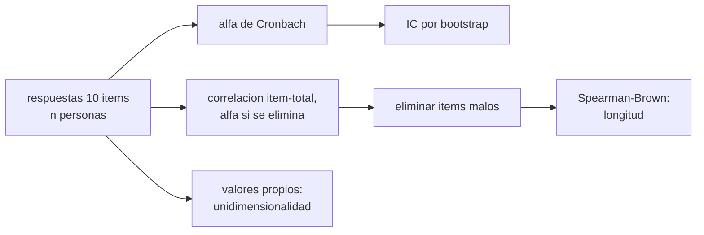

# B105-C27 — Instrumentos validados y psicometría en investigación

<!-- nav:top -->
[🏠 Programa](../../../../README.md) · [📚 Bloque B105](../../../tronco-comun/B105-medicina-y-biologia-espacial.md) · [← Anterior: B105-C26 — Medidas fisiológicas y biomarcadores en investigación espacial](../B105-C26-medidas-fisiologicas-y-biomarcadores-en-investigacion-espacial/CLASE.md) · [Siguiente: B106-C01 — Requisitos de habitabilidad →](../../../tronco-comun/B106-habitats-espaciales-y-soporte-vital.md#b106-c01)
<!-- /nav -->

## 1. Ubicación, nivel y alcance

Clase 27 del bloque B105, cierre del bloque. Nivel N3. Ninguna clase previa trata la validación de instrumentos. Aquí aprendes qué hace fiable a un cuestionario con un cuestionario **sintético** de 10 ítems (dos defectuosos a propósito): calculas el alfa de Cronbach, las correlaciones ítem–total, el alfa si se elimina un ítem, su intervalo por bootstrap, la fórmula de Spearman–Brown y los valores propios para la unidimensionalidad. Es el complemento de [B105-C09](../B105-C09-salud-mental-en-aislamiento/CLASE.md) y de [B105-C26](../B105-C26-medidas-fisiologicas-y-biomarcadores-en-investigacion-espacial/CLASE.md).

## 2. Por qué esta clase existe

Un cuestionario con ítems que no miden lo mismo produce una puntuación poco fiable, y con pocos participantes su fiabilidad ni siquiera se puede estimar. La decisión central: **¿qué ítems sobran, cuántos ítems hacen falta y cuántos participantes se necesitan para estimar el alfa con una incertidumbre aceptable?**

## 3. Lo que podrás hacer al terminar

1. Calcular el alfa de Cronbach `k/(k − 1)(1 − Σσ²_j/σ²_total)`.
2. Calcular la correlación ítem–total corregida y el alfa si se elimina cada ítem.
3. Estimar el intervalo del alfa por bootstrap y ver cómo depende de `n`.
4. Aplicar la fórmula de Spearman–Brown para cambiar la longitud del cuestionario.
5. Examinar la unidimensionalidad con los valores propios.
6. Rotular el cuestionario como inventado y distinguir fiabilidad de validez.

La evidencia es la **ficha psicométrica con alfa e intervalo** del ejercicio 12 (sección 20).

## 4. Con qué llegas y cómo comprobarlo

1. ¿Qué es una escala Likert?
2. ¿Qué es la correlación ítem–total?
3. ¿Qué es un valor propio?
4. ¿Qué es la fiabilidad?
5. ¿Qué es un dato sintético?

<details>
<summary>Ver respuestas</summary>

1. Una escala ordinal de acuerdo (aquí 1 a 5). 2. La correlación de un ítem con la suma de los demás. 3. La varianza explicada por un componente de la matriz de correlaciones. 4. La consistencia de las puntuaciones; no es lo mismo que validez. 5. Un dato generado para el ejemplo, no medido.
</details>

Con cuatro o cinco aciertos, sigue; si no, repasa los prerrequisitos.

## 5. Un caso de contexto y casos de referencia

Un cuestionario **inventado** de 10 ítems Likert (1–5) sobre un constructo único, con ítems 1–8 de carga 0,7 y 9–10 de carga 0,2 (defectuosos), contestado por 200 personas **sintéticas** (semilla 105). El alfa de los 10 ítems es 0,857 (IC bootstrap 95 %: 0,824–0,881); las correlaciones ítem–total de los ítems 9 y 10 son 0,283 y 0,145 y eliminar cada uno sube el alfa a 0,867 y 0,879; con solo los ítems 1–8, el alfa es 0,894. Con 6 personas el alfa calculado es 0,975 pero su IC es 0,865–0,992: no es estimable. Es el **ejemplo conductor**: ningún instrumento real.

## 6. Vocabulario

El **alfa de Cronbach** mide la consistencia interna: `α = k/(k − 1)(1 − Σσ²_j/σ²_total)`. La **correlación ítem–total corregida** correlaciona un ítem con la suma de los demás. **Spearman–Brown**: `ρ_k = k r̄/(1 + (k − 1) r̄)` con `r̄` la correlación media entre ítems. La **unidimensionalidad** se examina con el primer valor propio de la matriz de correlaciones. La **validez** (que mida lo que debe) es distinta de la fiabilidad.

## 7. Modelo mental



*Descripción textual:* las respuestas permiten calcular el alfa, las correlaciones ítem–total y los valores propios; se eliminan los ítems defectuosos, se acompaña el alfa de un intervalo y se usa Spearman–Brown para decidir la longitud.

Analogía: varios termómetros midiendo la misma sala; si uno mide otra cosa, el promedio se vuelve menos fiable. Límite: que concuerden no garantiza que midan la temperatura que interesa (validez).

## 8. La explicación, paso a paso

### 8.1 Alfa y análisis de ítems

Con 200 respuestas, alfa = 0,857. Correlaciones ítem–total corregidas: 0,716; 0,623; 0,649; 0,715; 0,624; 0,669; 0,594; 0,689 (ítems 1–8) y 0,283 y 0,145 (9 y 10). Alfa si se elimina: 0,830–0,841 para los ítems 1–8 (baja) y 0,867 y 0,879 para 9 y 10 (sube): son los defectuosos.

### 8.2 Alfa con los ítems buenos

Con los ítems 1–8, alfa = 0,894. El IC bootstrap de 95 % del alfa de 10 ítems con `n = 200` es 0,824–0,881.

### 8.3 Efecto del tamaño de la muestra

| `n` | Alfa (ítems 1–8) | IC 95 % | Ancho |
|---|---|---|---|
| 6 | 0,975 | 0,865–0,992 | 0,127 |
| 20 | 0,882 | 0,728–0,938 | 0,210 |
| 50 | 0,815 | 0,712–0,877 | 0,164 |
| 200 | 0,852 | 0,818–0,878 | 0,060 |
| 1.000 | 0,864 | 0,849–0,876 | 0,027 |

Con 6 personas el alfa es extremo y engañoso; los IC son anchos hasta `n` de decenas.

### 8.4 Longitud y unidimensionalidad

`r̄ = 0,514` entre los ítems 1–8. Spearman–Brown: `k = 4`, 0,809; `k = 8`, 0,894; `k = 16`, 0,944. Valores propios de las correlaciones (10 ítems): 4,73; 1,02; 0,93; 0,62; el cociente primero/segundo es 4,63: una dimensión dominante.

## 9. Magnitudes, símbolos y unidades

| Símbolo | Qué es | Unidad | Valor / nota |
|---|---|---|---|
| `k` | número de ítems | — | 10; 8 |
| `n` | respondientes | personas | 6 a 1.000 |
| `α` | alfa de Cronbach | — | 0,857; 0,894 |
| `r_it` | correlación ítem–total | — | 0,145 a 0,716 |
| `r̄` | correlación media entre ítems | — | 0,514 |
| `λ₁/λ₂` | cociente de valores propios | — | 4,63 |

## 10. Convenciones y referencias

Constructo único `θ ~ N(0,1)`; ítems continuos discretizados a 1–5 con cortes en −1,2; −0,4; 0,4 y 1,2; ruido independiente. Datos sintéticos con semilla 105; 2.000 remuestreos del bootstrap para `n = 200` y 1.000 para el resto. Tolerancias del laboratorio: el alfa de los ítems 1–8 mayor que el de los 10; el ancho del IC con `n = 6` mayor que con `n = 200`; `λ₁/λ₂ > 2`. Numpy 2.4.4, Python 3.12.9.

## 11. De dónde sale lo que afirmamos

| ID | Fuente | Localizador | Respalda | Estado |
|---|---|---|---|---|
| — | Relaciones físicas, fisiológicas y estadísticas estándar usadas en el laboratorio | — | las verifica el laboratorio | No consultada en una fuente concreta (las verifica el laboratorio) |

Límites: no se consultó literatura psicométrica ni instrumentos validados; el cuestionario, las cargas y los cortes son inventados; no se evaluó ninguna escala real de salud mental ni de bienestar.

## 12. Cómo ver el resultado

Descripción: la tabla de 8.3 y la salida con las correlaciones ítem–total y el alfa si se elimina. Equivalente textual: los ítems 9 y 10 bajan el alfa; con 6 personas el alfa no se puede estimar.

## 13. Ejemplo trabajado: alfa de un cuestionario de 3 ítems

**Paso 1 · Varianzas.** Tres ítems con varianza 1 cada uno (suma 3); varianza de la suma 6.

**Paso 2 · Cociente.** `3/6 = 0,5`.

**Paso 3 · Alfa.** `3/2·(1 − 0,5) = 0,75`.

**Paso 4 · Lectura.** Una consistencia aceptable para un instrumento de 3 ítems, pero no se concluye validez.

## 14. Distintas formas de describir el problema

**Por fórmula:** `α`. **Por ítem:** correlación ítem–total. **Por eliminación:** alfa si se elimina. **Por longitud:** Spearman–Brown. **Por dimensiones:** valores propios. **Por incertidumbre:** bootstrap.

## 15. Práctica guiada

**Ejercicio 1 · con los pasos indicados.** Calcula el alfa con 3 ítems, suma de varianzas 3 y varianza total 6. *Pasos:* `k/(k − 1)(1 − Σσ²/σ²_T)`.

<details><summary>Solución comentada</summary>

`0,75`.
</details>

**Ejercicio 2 · con una pista.** Calcula Spearman–Brown con `r̄ = 0,514` y `k = 16`. *Pista:* `k r̄/(1 + (k − 1) r̄)`.

<details><summary>Solución comentada</summary>

`0,944`.
</details>

**Ejercicio 3 · casi autónomo.** ¿Qué ítems conviene eliminar y por qué?

<details><summary>Solución comentada</summary>

Los 9 y 10: su correlación ítem–total es baja (0,283; 0,145) y el alfa sube al eliminarlos.
</details>

## 16. Práctica autónoma, transferencia e integrador

**Ejercicio 4 · autónomo.** ¿Cuál es el alfa con solo los ítems 1–8?

<details><summary>Solución comentada</summary>

`0,894`.
</details>

**Ejercicio 5 · autónomo.** ¿Qué sentido tiene un alfa de 0,975 con 6 personas?

<details><summary>Solución comentada</summary>

Ninguno fiable: su IC es 0,865–0,992 y la estimación es inestable.
</details>

**Ejercicio 6 · autónomo.** ¿Qué indica el cociente de valores propios 4,63?

<details><summary>Solución comentada</summary>

Que hay una dimensión dominante, coherente con un constructo único.
</details>

**Ejercicio 7 · autónomo.** ¿Por qué un alfa muy alto (> 0,95) no siempre es bueno?

<details><summary>Solución comentada</summary>

Puede indicar ítems redundantes, no más validez.
</details>

**Ejercicio 8 · autónomo.** Con `r̄ = 0,514`, ¿cuántos ítems hacen falta para una fiabilidad de 0,9? (aproximadamente)

<details><summary>Solución comentada</summary>

`k = 0,9·(1 − 0,514)/(0,514·0,1) ≈ 8,5`: unos 9 ítems.
</details>

**Ejercicio 9 · transferencia.** Una tripulación de 6 personas contesta el cuestionario. ¿Qué se puede decir de su fiabilidad?

<details><summary>Solución comentada</summary>

Nada fiable: se debe usar la fiabilidad de un instrumento validado en muestras grandes.
</details>

**Ejercicio 10 · transferencia.** ¿Qué diferencia hay entre fiabilidad y validez?

<details><summary>Solución comentada</summary>

La fiabilidad es la consistencia; la validez, que mida el constructo deseado; un instrumento puede ser fiable y no válido.
</details>

**Ejercicio 11 · transferencia.** Muchas personas responden «4» o «5» en casi todos los ítems (efecto techo). ¿Cómo afecta al alfa y a la detección de cambios?

<details><summary>Solución comentada</summary>

Reduce la varianza y limita la capacidad de detectar mejoras; el alfa puede calcularse mal.
</details>

**Ejercicio 12 · integrador.** Elabora tu *ficha psicométrica con alfa e intervalo*: ítems, alfa, análisis de ítems, intervalo según `n`, decisión de eliminar ítems, longitud y lista de qué es sintético.

<details><summary>Solución comentada</summary>

Secciones 8.1–8.4 y la salida del laboratorio.
</details>

## 17. Laboratorio: alfa de Cronbach, análisis de ítems y Spearman–Brown

El script [psicometria.py](psicometria.py) genera un cuestionario sintético de 10 ítems con dos defectuosos, calcula el alfa, el análisis de ítems, el efecto de `n` en el IC, Spearman–Brown y los valores propios (**comprueba** que el alfa de los ítems buenos es mayor que el de los 10, que el IC con `n = 6` es más ancho que con `n = 200` y que el cociente de valores propios es mayor que 2).

**Datos:** todo **sintético** (semilla 105); el cuestionario es inventado. **Predice antes de ejecutar:** ¿Sube o baja el alfa al eliminar los ítems con baja correlación ítem–total? (Sube.) **Ejecución del 2026-11-10 (Python 3.12.9):**

```text
Python 3.12.9; numpy 2.4.4
DATOS SINTETICOS (semilla 105): 10 items Likert 1-5; items 9 y 10 defectuosos (carga 0.2); no es un instrumento real
n = 200 respondientes; media de items = 3.02; alfa de Cronbach (10 items) = 0.857
item  carga verd.  corr. item-total corregida  alfa si se elimina
   1     0.7             0.716                    0.830
   2     0.7             0.623                    0.839
   3     0.7             0.649                    0.836
   4     0.7             0.715                    0.829
   5     0.7             0.624                    0.838
   6     0.7             0.669                    0.835
   7     0.7             0.594                    0.841
   8     0.7             0.689                    0.833
   9     0.2             0.283                    0.867
  10     0.2             0.145                    0.879
Alfa con solo los items 1-8 = 0.894
IC bootstrap 95 % del alfa (10 items, n = 200) = 0.824 - 0.881
Efecto del tamano de la muestra en el IC del alfa (items 1-8):
  n =     6: alfa = 0.975; IC95 = 0.865 - 0.992 (ancho 0.127)
  n =    20: alfa = 0.882; IC95 = 0.728 - 0.938 (ancho 0.210)
  n =    50: alfa = 0.815; IC95 = 0.712 - 0.877 (ancho 0.164)
  n =   200: alfa = 0.852; IC95 = 0.818 - 0.878 (ancho 0.060)
  n =  1000: alfa = 0.864; IC95 = 0.849 - 0.876 (ancho 0.027)
Correlacion media entre los items 1-8 = 0.514
  Spearman-Brown con k =  4 items: confiabilidad = 0.809
  Spearman-Brown con k =  8 items: confiabilidad = 0.894
  Spearman-Brown con k = 16 items: confiabilidad = 0.944
Valores propios de la matriz de correlaciones: 4.73, 1.02, 0.93, 0.62; primero/segundo = 4.63
Pruebas superadas.
```

```bash
python programa/clases/B105/B105-C27-instrumentos-validados-y-psicometria-en-investigacion/psicometria.py
```

**Límites:** constructo único, ítems con ruido independiente, sin sesgos de respuesta ni efecto techo, un solo cuestionario; no es un instrumento validado ni evalúa a nadie.

## 18. Errores frecuentes y cómo corregirlos

**Confundir fiabilidad con validez.** Son propiedades distintas (ejercicio 10).

**Calcular el alfa con muestras diminutas.** Es inestable (8.3).

**Buscar el alfa máximo sin criterio.** Puede reflejar redundancia.

**Presentar el cuestionario sintético como real.** Se rotula (sección 10).

## 19. Cómo sabrás que vas bien

Tras la sección 8: ¿calculas el alfa y decides qué ítems quitar? Si dudas, repasa el ejemplo 13. Tras el laboratorio: ¿qué comprueba? (ver la sección 17).

## 20. Qué entregas y cómo se evalúa

El producto es tu **ficha psicométrica con alfa e intervalo** (ejercicio 12).

| Criterio | Inicial | En desarrollo | Logrado | Destacado |
|---|---|---|---|---|
| Conceptos | Confunde las magnitudes | Parciales | Explica alfa, ítem–total y Spearman–Brown | Explica la fiabilidad frente a la validez |
| Cálculo | Sin unidades | Con errores | Calcula con unidades y tolerancias | Calcula casos nuevos |
| Numérico | Sin comprobar | Un caso | Compara con la verdad del generador | Interpreta la sensibilidad |
| Fuentes | Sin fuente | Sin fecha | Cita solo lo consultado, con fecha | Rotula lo sintético y lo no consultado |
| Límites | No los nombra | Uno | Tres | Discute qué falta del modelo |

**Condiciones críticas (no se compensan con promedio):** rotular los datos como sintéticos; no presentar un resultado simulado como observado; no dar consejo médico ni operativo; citar solo lo consultado.

## 21. Ética, seguridad y límites

Clase **educativa**: no es consejo médico, no sustituye la formación, la licencia ni la supervisión de profesionales, y no contiene dosis, tratamientos ni procedimientos para aplicar a una persona real. No se evalúa a nadie; los instrumentos psicológicos reales se usan con licencia, con consentimiento y por profesionales, y sus resultados no se interpretan fuera de ese marco. Accesibilidad: tablas equivalentes a las gráficas, fórmulas en texto, ejercicios sin conexión.

## 22. Para cerrar y seguir

Con 10 ítems (2 defectuosos), el alfa es 0,857; con los 8 buenos, 0,894; con 6 participantes no se puede estimar y Spearman–Brown muestra que 16 ítems darían 0,944. Con esta clase se cierra el bloque: de la fisiología del cuerpo a la forma de investigarlo con rigor y respeto.

**Glosario español–inglés.** alfa de Cronbach · *Cronbach's alpha*; correlación ítem–total · *item–total correlation*; unidimensionalidad · *unidimensionality*; validez · *validity*.

**Continuidad.** Es la última clase del bloque B105; el bloque siguiente es [B106](../../../tronco-comun/B106-habitats-espaciales-y-soporte-vital.md).

**Referencias:** ver sección 11.

<!-- nav:bottom -->
---

[← Anterior: B105-C26 — Medidas fisiológicas y biomarcadores en investigación espacial](../B105-C26-medidas-fisiologicas-y-biomarcadores-en-investigacion-espacial/CLASE.md) · [📚 Bloque B105](../../../tronco-comun/B105-medicina-y-biologia-espacial.md) · [Siguiente: B106-C01 — Requisitos de habitabilidad →](../../../tronco-comun/B106-habitats-espaciales-y-soporte-vital.md#b106-c01)
<!-- /nav -->
