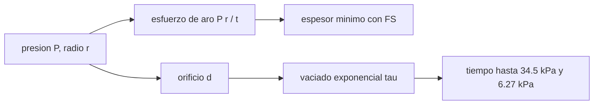

# B106-C02 — Presurización de módulos

<!-- nav:top -->
[🏠 Programa](../../../../README.md) · [📚 Bloque B106](../../../tronco-comun/B106-habitats-espaciales-y-soporte-vital.md) · [← Anterior: B106-C01 — Requisitos de habitabilidad](../B106-C01-requisitos-de-habitabilidad/CLASE.md) · [Siguiente: B106-C03 — Composición atmosférica respirable →](../B106-C03-composicion-atmosferica-respirable/CLASE.md)
<!-- /nav -->

## 1. Ubicación, nivel y alcance

Clase 2 del bloque B106 (hábitats espaciales y soporte vital). Nivel N3. Cierra la pregunta de «¿qué contiene la presión?»: el casco que la sostiene y lo que pasa cuando se pierde. Retoma los umbrales de presión de la clase C03 de forma anticipada solo como límites de tiempo. Todos los datos del laboratorio son **sintéticos o ilustrativos** y se rotulan como tales; solo se tratan como consultados los valores de la sección 11 que dicen «Consultada».

## 2. Por qué esta clase existe

La presión interior empuja hacia afuera sobre todo el casco; un espesor insuficiente rompe el recinto y un orificio pequeño lo vacía lentamente. La decisión central: **¿qué espesor mínimo y qué tiempo de respuesta hay que garantizar para una presión y un tamaño de orificio dados?**

## 3. Lo que podrás hacer al terminar

1. Calcular el esfuerzo de aro de un cilindro de pared delgada y el espesor mínimo con un factor de seguridad.
2. Comparar cilindro y esfera, y ver que el espesor escala con la presión.
3. Calcular el caudal estrangulado de gas por un orificio y la constante de tiempo de despresurización.
4. Obtener el tiempo hasta los umbrales de presión consultados (34,5 kPa y 6,27 kPa).
5. Verificar la solución analítica con una integración numérica (RK4).
6. Rotular que la aleación y el coeficiente de descarga son ilustrativos.

La evidencia es la **ficha de presurización con margen y tiempo de fuga** del ejercicio 12 (sección 20).

## 4. Con qué llegas y cómo comprobarlo

1. ¿Qué es el esfuerzo?
2. ¿Qué es un factor de seguridad?
3. ¿Qué es un flujo estrangulado?
4. ¿Qué es una constante de tiempo?
5. ¿Qué es un valor ilustrativo?

<details>
<summary>Ver respuestas</summary>

1. Fuerza por unidad de área (Pa). 2. El cociente entre la resistencia y la carga de diseño. 3. El caudal máximo de un gas por un orificio, que se alcanza cuando la velocidad en la garganta es la del sonido. 4. El tiempo en que una cantidad con decaimiento exponencial cae a `1/e`. 5. Uno inventado o aproximado que se rotula como tal.
</details>

Con cuatro o cinco aciertos, sigue; si no, repasa los prerrequisitos.

## 5. Un caso de contexto y casos de referencia

Un cilindro de 2 m de radio a 101,325 kPa necesita, con factor de seguridad 2 y una aleación ilustrativa de 276 MPa, un espesor mínimo de **1,468 mm** (51,7 kg de pared por metro); a 34,5 kPa bastan 0,500 mm. En un módulo de 100 m³ un orificio de 10 mm tiene `τ = 2,97 h` y la presión baja a 34,5 kPa en **3,20 h**; uno de 30 mm, en 21 min; uno de 1 mm tarda 13,3 días. Todo con valores ilustrativos y sin datos de un módulo real.

## 6. Vocabulario

**Esfuerzo de aro:** esfuerzo circunferencial `σ = P r/t`. **Factor de seguridad (FS):** cociente entre límite elástico y esfuerzo. **Flujo estrangulado:** caudal máximo por un orificio. **Coeficiente de descarga `Cd`:** corrección entre el área geométrica y la efectiva. **Constante de tiempo `τ`:** escala del vaciado exponencial.

## 7. Modelo mental



*Descripción textual:* la presión determina el esfuerzo en la pared y, a través del orificio, el vaciado exponencial; de ambos salen el espesor mínimo y el tiempo de aviso.

Analogía: un globo que se hincha (esfuerzo) y se desinfla por un agujero (vaciado). Límite: un casco real tiene juntas, concentraciones de esfuerzo, fatiga y un mínimo constructivo mucho mayor que el espesor teórico.

## 8. La explicación, paso a paso

### 8.1 Esfuerzo de aro y espesor

Para un cilindro de pared delgada, `σ = P r/t`. Con `FS = 2` y `σ_y = 276 MPa` (ilustrativo), `t = P r FS/σ_y`: a 101,325 kPa y `r = 2 m`, `t = 1,468 mm`. Es proporcional a `P`: a 34,5 kPa, 0,500 mm (control del laboratorio). La esfera necesita la mitad de espesor (0,734 mm). La masa de pared es `2π r t ρ = 51,7 kg/m` con `ρ = 2800 kg/m³`.

### 8.2 Flujo por un orificio

Con presión por encima del doble de la exterior (vacío), el flujo es estrangulado: `ṁ = Cd A p √(γ/(R_s T))·ψ`, con `ψ = (2/(γ+1))^((γ+1)/(2(γ−1)))`. Como `p V = m R_s T`, la presión decae de forma exponencial `p(t) = p₀ e^{−t/τ}` con `τ = V/(Cd A √(γ R_s T) ψ)`.

### 8.3 Tiempos de aviso

`t = τ ln(p₀/p)`. Para 10 mm: 3,20 h hasta 34,5 kPa y 8,26 h hasta 6,27 kPa (donde los fluidos corporales hierven a 37 °C, dato consultado en TB-003). Para 1 mm, 320 h. El modelo es isotermo; en un vaciado real el gas se enfría y los tiempos cambian.

### 8.4 Qué comprueba el laboratorio

La integración RK4 tras un `τ` da 37,275384 kPa, igual a `p₀ e⁻¹` (diferencia 1·10⁻¹³ kPa), y los tiempos disminuyen con el diámetro.

## 9. Magnitudes, símbolos y unidades

| Símbolo | Qué es | Unidad | Valor / nota |
|---|---|---|---|
| `σ` | esfuerzo de aro | Pa | `P r/t` |
| `t` | espesor de pared | mm | 1,468 a 101,3 kPa |
| `FS` | factor de seguridad | — | 2 (ilustrativo) |
| `τ` | constante de tiempo de vaciado | h | 2,97 (10 mm, 100 m³) |
| `Cd` | coeficiente de descarga | — | 0,6 (ilustrativo) |
| `p` | presión de cabina | kPa | 34,5 y 6,27 consultados |

## 10. Convenciones y referencias

Cilindro de pared delgada de radio 2 m; aluminio ilustrativo de 276 MPa y 2800 kg/m³; aire ideal (`γ = 1,4`, `M = 28,97 g/mol`), 293,15 K, 100 m³; vaciado isotermo hacia vacío. Tolerancias: espesor proporcional a la presión (1e-9) y RK4 contra la solución exponencial (1e-8 kPa). Numpy y Python: ver la primera línea de la salida del laboratorio (Python 3.12.9, numpy 2.4.4 en la ejecución del 2026-11-10).

## 11. De dónde sale lo que afirmamos

| ID | Fuente | Localizador | Respalda | Estado |
|---|---|---|---|---|
| S3 | NASA OCHMO, OCHMO-TB-003, «Habitable Atmosphere», resumen técnico derivado de NASA-STD-3001 vol. 2 rev. D — https://www.nasa.gov/wp-content/uploads/2023/12/ochmo-tb-003-habitable-atmosphere.pdf (consultada 2026-11-10; PDF leído con PyMuPDF) | sección «Total Pressure Limits» y requisito V2 6006 | ebullismo a 6,27 kPa (47 mmHg) a 37 °C; presión total de indefinida exposición entre 34,5 kPa y 103 kPa (5,0 a 15,0 psia) | Consultada (resumen técnico) |
| — | Esfuerzo de aro, flujo estrangulado de gas ideal, vaciado exponencial | — | las verifica el laboratorio | No consultada en una fuente concreta |

Límites: el límite elástico, la densidad, `Cd` y el factor de seguridad son ilustrativos: no proceden de una especificación consultada. Normas de estructuras presurizadas y de fuga de misión **no se consultaron**.

## 12. Cómo ver el resultado

| Resultado | Valor |
|---|---|
| Espesor mínimo a 101,325 kPa | 1,468 mm |
| Espesor mínimo a 34,5 kPa | 0,500 mm |
| Masa de pared | 51,7 kg/m |
| `τ` de un orificio de 10 mm | 2,97 h |
| Tiempo a 34,5 kPa (10 mm / 1 mm) | 3,20 h / 320 h |

Descripción larga: el espesor sube con la presión y el tiempo de aviso cae con el cuadrado del diámetro del orificio.

## 13. Ejemplo trabajado: espesor mínimo

**Paso 1.** `P = 101 325 Pa`, `r = 2 m`, `FS = 2`, `σ_y = 276·10⁶ Pa`.

**Paso 2.** `t = 101 325·2·2/276·10⁶ = 1,468·10⁻³ m`.

**Paso 3.** Masa por metro: `2π·2·1,468·10⁻³·2800 = 51,7 kg/m`.

**Paso 4 · Control.** A 34,5 kPa el espesor es `1,468·34,5/101,325 = 0,500 mm`.

## 14. Distintas formas de describir el problema

**Por esfuerzo:** `σ`. **Por espesor:** `t` con FS. **Por tiempo:** `τ` y `t = τ ln(p₀/p)`. **Por tabla:** diámetro frente a tiempo. **Por comparación:** cilindro y esfera.

## 15. Práctica guiada

**Ejercicio 1 · con los pasos indicados.** Calcula `t` para `r = 1,5 m` y 70,3 kPa. *Pasos:* fórmula, unidades.

<details><summary>Solución comentada</summary>

`70 300·1,5·2/276·10⁶ = 0,764 mm`.
</details>

**Ejercicio 2 · con una pista.** Calcula `σ` con `t = 1,5 mm` a 101,325 kPa y `r = 2 m`. *Pista:* `σ = P r/t`.

<details><summary>Solución comentada</summary>

`101 325·2/1,5·10⁻³ = 135 MPa`, la mitad del límite ilustrativo (FS 2).
</details>

**Ejercicio 3 · casi autónomo.** ¿Cuánto tarda un orificio de 10 mm en bajar a 34,5 kPa? *Pista:* `τ ln(p₀/p)`.

<details><summary>Solución comentada</summary>

`2,968 h·ln(101,325/34,5) = 3,20 h`.
</details>

## 16. Práctica autónoma, transferencia e integrador

**Ejercicio 4 · autónomo.** ¿Cuánto tarda un orificio de 3 mm?

<details><summary>Solución comentada</summary>

`τ = 32,98 h`; `t = 35,5 h`.
</details>

**Ejercicio 5 · autónomo.** Si el diámetro se duplica, ¿cómo cambia `τ`?

<details><summary>Solución comentada</summary>

Se divide por 4 (el área crece con `d²`).
</details>

**Ejercicio 6 · autónomo.** ¿A qué presión alcanza un orificio de 10 mm tras 6 h?

<details><summary>Solución comentada</summary>

`101,325·e^(−6/2,968) = 13,4 kPa`.
</details>

**Ejercicio 7 · autónomo.** ¿Por qué la esfera necesita la mitad de espesor?

<details><summary>Solución comentada</summary>

Su esfuerzo de membrana es `P r/(2t)`.
</details>

**Ejercicio 8 · autónomo.** Si `Cd` real fuera 0,8 en lugar de 0,6, ¿cómo cambia el tiempo de aviso?

<details><summary>Solución comentada</summary>

Se reduce en `0,6/0,8 = 0,75`: el modelo ilustrativo es optimista.
</details>

**Ejercicio 9 · transferencia.** Un módulo de 400 m³ con un orificio de 10 mm, ¿cuánto vale `τ`?

<details><summary>Solución comentada</summary>

`τ ∝ V`: `4·2,97 = 11,9 h`.
</details>

**Ejercicio 10 · transferencia.** ¿Qué margen de tiempo da una fuga de 1 mm frente a una de 30 mm?

<details><summary>Solución comentada</summary>

320 h frente a 21 min: el sistema de detección debe cubrir ambos regímenes.
</details>

**Ejercicio 11 · transferencia.** Un casco real tiene un espesor mayor que el teórico. ¿Por qué no sirve entonces el cálculo?

<details><summary>Solución comentada</summary>

Sirve como cota inferior y para ver la escala; las cargas de lanzamiento, las juntas y los impactos fijan el espesor real.
</details>

**Ejercicio 12 · integrador.** Elabora tu *ficha de presurización con margen y tiempo de fuga*: geometría, presión, espesor mínimo con FS y su comparación con la esfera, tabla de tiempos a 34,5 y 6,27 kPa para cuatro diámetros, control numérico y qué es ilustrativo.

<details><summary>Solución comentada</summary>

Secciones 8.1–8.4 y la salida del laboratorio.
</details>

## 17. Laboratorio: espesor de pared y vaciado por un orificio

El script [presurizacion.py](presurizacion.py) calcula espesor y masa de pared para tres presiones, el vaciado exponencial por orificios de 1 a 30 mm y verifica con RK4 (**comprueba** la proporcionalidad del espesor, el orden de los tiempos y la integración).

**Datos:** modelo **propio** con aleación y `Cd` **ilustrativos**; sin aleatoriedad. **Predice antes de ejecutar:** ¿Qué orden de magnitud tiene el tiempo para bajar a 34,5 kPa con un orificio de 10 mm en 100 m³? (unas 3 h). **Ejecución del 2026-11-10 (Python 3.12.9):**

```text
Python 3.12.9; numpy 2.4.4
DATOS: modelo propio con valores ILUSTRATIVOS (276 MPa, Cd 0.6); umbrales de presion consultados; ningun modulo real
Cilindro de radio 2.0 m, factor de seguridad 2.0, limite elastico 276 MPa (ilustrativo)
  presion [kPa]   sigma con t=1.5 mm [MPa]   t minimo [mm]   masa de pared [kg/m]
        34.5               46.0                0.500           17.59
        70.3               93.7                1.019           35.85
       101.3              135.1                1.468           51.67
Esfera de igual radio: espesor 0.734 mm (la mitad que el cilindro)
Modulo de 100 m3 a 20 C, Cd = 0.6: constante de tiempo tau = V/(Cd A c) y tiempos hasta los umbrales
  diametro [mm]   tau [h]   a 34.5 kPa [h]   a 6.27 kPa [h]
          1        296.789        319.753        825.833
          3         32.977         35.528         91.759
         10          2.968          3.198          8.258
         30          0.330          0.355          0.918
Control: RK4 tras 1 tau da 37.275384 kPa frente a 37.275384 kPa (diferencia 9.95e-14 kPa)
Pruebas superadas.
```

```bash
python programa/clases/B106/B106-C02-presurizacion-de-modulos/presurizacion.py
```

**Límites:** cilindro de pared delgada, vaciado isotermo, sin fatiga ni concentración de esfuerzos, sin pared mínima constructiva y sin dinámica térmica.

## 18. Errores frecuentes y cómo corregirlos

**Usar el espesor teórico como espesor de diseño.** Es una cota inferior (8.1).

**Olvidar que el tiempo crece con el volumen.** `τ ∝ V` (ej. 9).

**Aplicar el flujo estrangulado con presión exterior alta.** Vale con vacío o con `p_ext < 0,53 p`.

**Tratar `Cd` ilustrativo como dato.** Rotula y mide en pruebas reales.

## 19. Cómo sabrás que vas bien

Tras la sección 8: ¿cuánto vale `τ` de un orificio de 10 mm y cuál es el espesor a 34,5 kPa? Si dudas, repasa el ejemplo 13. Tras el laboratorio: ¿qué comprueba? (ver la sección 17).

## 20. Qué entregas y cómo se evalúa

El producto es tu **ficha de presurización con margen y tiempo de fuga** (ejercicio 12).

| Criterio | Inicial | En desarrollo | Logrado | Destacado |
|---|---|---|---|---|
| Conceptos | Confunde las magnitudes | Parciales | Explica esfuerzo de aro, vaciado y umbrales | Explica los supuestos y sus límites |
| Cálculo | Sin unidades | Con errores | Calcula con unidades y cifras coherentes | Calcula casos nuevos y los verifica |
| Numérico | Sin comprobación | Un caso | Compara con el control del laboratorio | Interpreta la sensibilidad |
| Fuentes | Sin fuente | Sin fecha | Fuentes con fecha y estado | Declara lo ilustrativo y lo no consultado |
| Límites | No los nombra | Uno | Tres | Discute qué falta para un hábitat real |

**Condiciones críticas (no se compensan con promedio):** rotular los datos como sintéticos o ilustrativos; no presentar un valor ilustrativo como límite de una norma; citar solo lo consultado; no usar la clase como consejo médico ni operativo.

## 21. Ética, seguridad y límites

Clase **educativa**: no da consejo médico ni operativo y no sirve para decidir la atmósfera, el agua, la exposición ni la respuesta ante una emergencia de un hábitat o de una persona reales. Los tiempos de despresurización son del modelo y no sirven para planificar la respuesta ante una fuga real. Accesibilidad: tablas equivalentes a las gráficas, fórmulas en texto, ejercicios sin conexión.

## 22. Para cerrar y seguir

El casco se dimensiona por esfuerzo (`σ = P r/t`) y la fuga por un vaciado exponencial: un orificio de 10 mm en 100 m³ baja la presión a 34,5 kPa en unas 3,2 h. La clase siguiente pregunta qué hay dentro de ese volumen presurizado.

**Glosario español–inglés.** esfuerzo de aro · *hoop stress*; factor de seguridad · *safety factor*; flujo estrangulado · *choked flow*; despresurización · *depressurization*; orificio · *orifice*.

**Continuidad.** Sigue con la clase siguiente del bloque (enlace en la navegación) o vuelve al [bloque B106](../../../tronco-comun/B106-habitats-espaciales-y-soporte-vital.md).

**Referencias:** ver sección 11.

<!-- nav:bottom -->
---

[← Anterior: B106-C01 — Requisitos de habitabilidad](../B106-C01-requisitos-de-habitabilidad/CLASE.md) · [📚 Bloque B106](../../../tronco-comun/B106-habitats-espaciales-y-soporte-vital.md) · [Siguiente: B106-C03 — Composición atmosférica respirable →](../B106-C03-composicion-atmosferica-respirable/CLASE.md)
<!-- /nav -->
