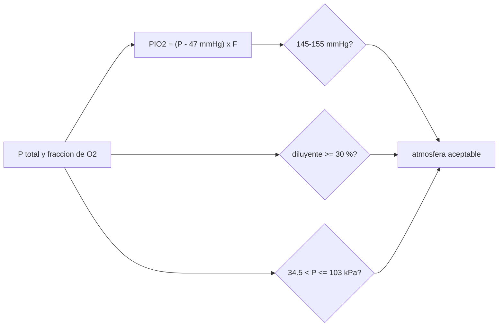

# B106-C03 — Composición atmosférica respirable

<!-- nav:top -->
[🏠 Programa](../../../../README.md) · [📚 Bloque B106](../../../tronco-comun/B106-habitats-espaciales-y-soporte-vital.md) · [← Anterior: B106-C02 — Presurización de módulos](../B106-C02-presurizacion-de-modulos/CLASE.md) · [Siguiente: B106-C04 — Control de dióxido de carbono →](../B106-C04-control-de-dioxido-de-carbono/CLASE.md)
<!-- /nav -->

## 1. Ubicación, nivel y alcance

Clase 3 del bloque B106 (hábitats espaciales y soporte vital). Nivel N3. Segunda de las tres clases de atmósfera: qué mezcla respirar a qué presión. Usa los umbrales consultados de la presión parcial inspirada de oxígeno, del diluyente y de la presión total. Todos los datos del laboratorio son **sintéticos o ilustrativos** y se rotulan como tales; solo se tratan como consultados los valores de la sección 11 que dicen «Consultada».

## 2. Por qué esta clase existe

El cuerpo no responde a la fracción de oxígeno sino a su presión parcial; bajar la presión total exige subir la fracción, y eso trae riesgo de incendio (C17). La decisión central: **¿qué par presión–composición da normoxia dentro de los límites consultados?**

## 3. Lo que podrás hacer al terminar

1. Calcular la presión parcial inspirada de oxígeno `PIO₂ = (P_B − P_H₂O)·F_IO₂`.
2. Reproducir el valor de normoxia al nivel del mar y los mínimos de 3,8 y 5,0 psia.
3. Comprobar normoxia, diluyente y rango de presión de una atmósfera dada.
4. Calcular la masa de O₂ por metro cúbico de una atmósfera.
5. Explicar por qué una atmósfera de 8 psia/32 % cae por debajo del intervalo de normoxia.
6. Rotular qué atmósferas son ejemplos de cálculo.

La evidencia es la **tabla de atmósferas con su verificación** del ejercicio 12 (sección 20).

## 4. Con qué llegas y cómo comprobarlo

1. ¿Qué es una presión parcial?
2. ¿Por qué se resta 47 mmHg?
3. ¿Qué es la hipoxia?
4. ¿Cuántos kPa son 14,7 psia?
5. ¿Qué es un gas diluyente?

<details>
<summary>Ver respuestas</summary>

1. La presión que ejercería un gas si estuviera solo; `p_i = x_i P`. 2. Es la presión de vapor de agua en las vías respiratorias a 37 °C. 3. Falta de oxígeno a nivel de los tejidos. 4. 101,3 kPa. 5. Un gas inerte que acompaña al oxígeno (nitrógeno en la ISS).
</details>

Con cuatro o cinco aciertos, sigue; si no, repasa los prerrequisitos.

## 5. Un caso de contexto y casos de referencia

Al nivel del mar, `PIO₂ = (760 − 47)·0,21 = 149,7 mmHg`, el valor de referencia del resumen consultado. La presión mínima con O₂ puro para esa `PIO₂` es **3,79 psia** y con 30 % de diluyente, **5,02 psia**, que reproducen los 3,8 y 5,0 psia consultados. Una cabina de 8 psia con 32 % de O₂ da 117,4 mmHg: bajo el intervalo de normoxia de 145–155 mmHg.

## 6. Vocabulario

**Presión parcial inspirada de O₂ (`PIO₂`):** presión de O₂ en el aire inspirado y saturado de vapor. **Normoxia:** `PIO₂` de 145 a 155 mmHg. **Diluyente:** gas inerte de la mezcla (al menos 30 %). **Psia:** libras por pulgada cuadrada absolutas. **Ebullismo:** vaporización de fluidos corporales a baja presión.

## 7. Modelo mental



*Descripción textual:* una atmósfera es aceptable si cumple a la vez normoxia, diluyente mínimo y rango de presión total.

Analogía: la altitud. Respirar 21 % de O₂ en la cumbre no es lo mismo que al nivel del mar porque cambia la presión parcial. Límite: aquí la presión baja a propósito y la fracción de O₂ sube para compensar.

## 8. La explicación, paso a paso

### 8.1 La presión parcial importa, no la fracción

`PIO₂ = (P_B − 47 mmHg)·F_IO₂`. Con `P_B = 760` y 21 %: 149,7 mmHg. Con 100 % de O₂ el mínimo es `47 + 149 = 196 mmHg = 26,13 kPa = 3,79 psia`.

### 8.2 El diluyente fija el piso

Con un máximo de 70 % de O₂, `P = 47 + 149/0,7 = 259,9 mmHg = 34,64 kPa = 5,02 psia`. El resumen consultado da 5,0 psia como presión más baja alcanzable. Menos presión hace más simple pasar a un traje de baja presión, pero exige más oxígeno y más riesgo de incendio.

### 8.3 Comparar atmósferas

8 psia/32 %: `PIO₂ = 117,4`; 56,5 kPa/34 %: 128,1; 70,3 kPa/26,5 %: 127,3. Ninguna alcanza el intervalo de normoxia; el resumen consultado describe que se evalúan compromisos entre estas combinaciones. O₂ puro a 4,3 psia da 175,4 mmHg pero incumple el diluyente y el rango de presión.

### 8.4 Masa de oxígeno

La masa de O₂ por metro cúbico es `p·F·M/(R T)`: 0,279 kg/m³ en la cabina tipo ISS y 0,232 kg/m³ en 8 psia/32 %: la segunda tiene un 17 % menos de O₂ por volumen aunque el porcentaje sea mayor.

## 9. Magnitudes, símbolos y unidades

| Símbolo | Qué es | Unidad | Valor / nota |
|---|---|---|---|
| `P_B` | presión barométrica de cabina | mmHg o kPa | 1 atm = 760 mmHg = 101,325 kPa |
| `P_H₂O` | presión de vapor del agua a 37 °C | mmHg | 47 |
| `F_IO₂` | fracción de O₂ | — | 0,21; 0,32; 0,34 |
| `PIO₂` | presión parcial inspirada de O₂ | mmHg | 145–155 (normoxia) |
| `P_min` | presión mínima para normoxia | psia | 3,79 (100 % O₂); 5,02 (70 %) |

## 10. Convenciones y referencias

1 psia = 6,894757 kPa; 1 kPa = 7,50062 mmHg; `P_H₂O = 47 mmHg`; `T = 293,15 K` para la masa de O₂. Los casos de cabina son ejemplos de cálculo. Tolerancias: 149,7 ± 0,3 mmHg; 3,8 y 5,0 psia ± 0,05. Numpy y Python: ver la primera línea de la salida del laboratorio (Python 3.12.9, numpy 2.4.4 en la ejecución del 2026-11-10).

## 11. De dónde sale lo que afirmamos

| ID | Fuente | Localizador | Respalda | Estado |
|---|---|---|---|---|
| S3 | NASA OCHMO, OCHMO-TB-003, «Habitable Atmosphere», resumen técnico derivado de NASA-STD-3001 vol. 2 rev. D — https://www.nasa.gov/wp-content/uploads/2023/12/ochmo-tb-003-habitable-atmosphere.pdf (consultada 2026-11-10; PDF leído con PyMuPDF) | secciones de límites de presión total y de diluyente; requisitos V2 6002 y V2 6006 | `PIO₂ = (PB − PH₂O)·F_IO₂` con 149,7 mmHg al nivel del mar; 3,8 psia con 100 % de O₂; 5,0 psia con 30 % de diluyente; presión total entre 5,0 y 15,0 psia; ISS típica de 14,7 psia con 21 % de O₂ | Consultada (resumen técnico) |
| S2 | NASA, Oficina del Jefe de Salud y Medicina (OCHMO), OCHMO-TB-002 rev. B (14 de noviembre de 2023), «Environmental Control & Life Support System (ECLSS): Human-Centered Approach», resumen técnico derivado de NASA-STD-3001 vol. 2 rev. D — https://www.nasa.gov/wp-content/uploads/2023/12/ochmo-tb-002-eclss.pdf (consultada 2026-11-10; PDF leído con PyMuPDF) | sección «Oxígeno» y «Presión» | normoxia de 145 a 155 mmHg; más de 30 % de diluyente | Consultada (resumen técnico) |
| — | Aritmética de presiones parciales y gas ideal | — | la verifica el laboratorio | No consultada en una fuente concreta |

Límites: el resumen cita las atmósferas de 8 psia/32 % y de 56,5 kPa/34 % como estudios; aquí solo se usan como ejemplos y sus conclusiones **no se consultaron**. La norma completa (vol. 2 rev. D) tampoco.

## 12. Cómo ver el resultado

| Resultado | Valor |
|---|---|
| `PIO₂` al nivel del mar | 149,7 mmHg |
| Presión mínima, O₂ puro | 3,79 psia |
| Presión mínima, 30 % de diluyente | 5,02 psia |
| `PIO₂` 8 psia/32 % | 117,4 mmHg |
| O₂ por m³ (14,7 psia / 8 psia) | 0,279 / 0,232 kg/m³ |

Descripción larga: la presión parcial de oxígeno, y no el porcentaje, decide si una atmósfera da normoxia; el diluyente y la presión total acotan las combinaciones posibles.

## 13. Ejemplo trabajado: PIO₂ de una atmósfera

**Paso 1.** Cabina de 56,5 kPa con 34 % de O₂: `P_B = 56,5·7,50062 = 423,8 mmHg`.

**Paso 2.** `PIO₂ = (423,8 − 47)·0,34 = 128,1 mmHg`.

**Paso 3.** Comparar: 128,1 < 145, así que no hay normoxia.

**Paso 4.** Para normoxia con ese `P_B`, `F = 149/376,8 = 0,395`: 39,5 % de O₂.

## 14. Distintas formas de describir el problema

**Por fórmula:** `PIO₂`. **Por tabla:** atmósferas y pruebas. **Por mínimo:** `P_min(F)`. **Por masa:** kg de O₂ por m³. **Por altitud:** equivalente a subir en la atmósfera.

## 15. Práctica guiada

**Ejercicio 1 · con los pasos indicados.** Calcula `PIO₂` a 70,3 kPa con 30 % de O₂. *Pasos:* mmHg, resta, fracción.

<details><summary>Solución comentada</summary>

`70,3·7,50062 = 527,3`; `(527,3 − 47)·0,30 = 144,1 mmHg`.
</details>

**Ejercicio 2 · con una pista.** ¿Qué fracción da normoxia a 70,3 kPa? *Pista:* `149/(P − 47)`.

<details><summary>Solución comentada</summary>

`149/480,3 = 0,310`.
</details>

**Ejercicio 3 · casi autónomo.** ¿Cumple 101,3 kPa con 79 % de diluyente el piso de 30 %? *Pista:* diluyente.

<details><summary>Solución comentada</summary>

Sí: `79 % ≥ 30 %`.
</details>

## 16. Práctica autónoma, transferencia e integrador

**Ejercicio 4 · autónomo.** Calcula la presión mínima con 50 % de O₂ y `PIO₂ = 149`.

<details><summary>Solución comentada</summary>

`47 + 298 = 345 mmHg = 46,0 kPa = 6,67 psia`.
</details>

**Ejercicio 5 · autónomo.** ¿Qué `PIO₂` da 8 psia/32 % en kPa?

<details><summary>Solución comentada</summary>

55,16 kPa = 413,7 mmHg; `(413,7 − 47)·0,32 = 117,4`.
</details>

**Ejercicio 6 · autónomo.** ¿Cuánto O₂ por m³ hay a 34,6 kPa con 70 %?

<details><summary>Solución comentada</summary>

`34 640·0,7·0,032/(8,3145·293,15) = 0,318 kg/m³` (mayor que a 14,7 psia con 21 %).
</details>

**Ejercicio 7 · autónomo.** ¿Cuál es la presión mínima con 100 % de O₂ y `PIO₂ = 127`?

<details><summary>Solución comentada</summary>

`47 + 127 = 174 mmHg = 23,2 kPa`.
</details>

**Ejercicio 8 · autónomo.** ¿Por qué el porcentaje no basta como especificación?

<details><summary>Solución comentada</summary>

Porque el cuerpo responde a la presión parcial (8.1).
</details>

**Ejercicio 9 · transferencia.** Una atmósfera de 8 psia con 32 % de O₂ queda por debajo de la normoxia. ¿Qué compromiso se hace?

<details><summary>Solución comentada</summary>

Se acepta hipoxia leve a cambio de menor presión (traje más simple) o se sube el O₂ a costa de inflamabilidad (C17); es una decisión de diseño con médicos y riesgos.
</details>

**Ejercicio 10 · transferencia.** ¿Cómo cambia la masa de O₂ de la cabina si baja la presión manteniendo el porcentaje?

<details><summary>Solución comentada</summary>

Baja proporcionalmente a `P` (8.4).
</details>

**Ejercicio 11 · transferencia.** ¿Qué atmósfera elegirías para un hábitat de larga duración y por qué cuidarías el diluyente?

<details><summary>Solución comentada</summary>

Una cercana a la normoxia con diluyente suficiente; el resumen consultado relaciona el diluyente con atelectasia en exposiciones largas e inflamabilidad.
</details>

**Ejercicio 12 · integrador.** Elabora tu *tabla de atmósferas con su verificación*: cinco atmósferas con `PIO₂`, diluyente, rango, O₂ por m³, el control del nivel del mar y de los dos mínimos, y qué es consultado o ejemplo.

<details><summary>Solución comentada</summary>

Secciones 8.1–8.4 y la salida del laboratorio.
</details>

## 17. Laboratorio: PIO₂ y comparación de atmósferas

El script [atmosfera_respirable.py](atmosfera_respirable.py) calcula `PIO₂` y las tres comprobaciones para seis atmósferas, reproduce los mínimos de 3,8 y 5,0 psia y estima la masa de O₂ por metro cúbico (**comprueba** el 149,7 mmHg, el 3,8 y el 5,0 consultados).

**Datos:** aritmética **propia** con umbrales **consultados**; los casos de cabina son ejemplos; sin aleatoriedad. **Predice antes de ejecutar:** ¿Qué presión mínima en psia da normoxia con 30 % de diluyente? (unos 5,0). **Ejecución del 2026-11-10 (Python 3.12.9):**

```text
Python 3.12.9; numpy 2.4.4
DATOS: aritmetica propia con umbrales consultados (OCHMO-TB-002/003); los casos de cabina son ejemplos de calculo, no mediciones
Control: nivel del mar (101.325 kPa, 21 % O2): PIO2 = 149.7 mmHg (consultado: 149.7)
Presion minima para PIO2 = 149 mmHg: con 100 % de O2 26.13 kPa = 3.79 psia (consultado 3.8); con 70 % de O2 (30 % de diluyente) 34.64 kPa = 5.02 psia (consultado 5.0)
Atmosfera                  P [kPa]  O2 [%]  diluyente [%]  PIO2 [mmHg]  normoxia  diluyente>=30%  P en 34.5-103 kPa
ISS tipica (14.7 psia)       101.3    21.0          79.0        149.7        si              si             si
Reducida 10.2 psia            70.3    26.5          73.5        127.3        no              si             si
8 psia / 32 %                 55.2    32.0          68.0        117.4        no              si             si
56.5 kPa / 34 %               56.5    34.0          66.0        128.1        no              si             si
Minima con 30 % de N2         34.6    70.0          30.0        149.0        si              si             si
Pura a 4.3 psia               29.6   100.0           0.0        175.4        no              no             no
Masa de O2 por m3 de cabina (gas ideal, 293.15 K): 
   ISS tipica (14.7 psia)      0.279 kg/m3
   Reducida 10.2 psia          0.245 kg/m3
   8 psia / 32 %               0.232 kg/m3
   56.5 kPa / 34 %             0.252 kg/m3
Pruebas superadas.
```

```bash
python programa/clases/B106/B106-C03-composicion-atmosferica-respirable/atmosfera_respirable.py
```

**Límites:** humedad fija de 47 mmHg, mezcla de dos gases, sin efecto de la exposición prolongada ni de la altitud equivalente; no evalúa riesgo de incendio.

## 18. Errores frecuentes y cómo corregirlos

**Comparar atmósferas por el porcentaje de O₂.** Compara `PIO₂` (8.1).

**Olvidar restar la presión de vapor de agua.** Resta 47 mmHg.

**Pensar que más O₂ siempre es mejor.** El exceso aumenta la inflamabilidad y la toxicidad (C17).

**Presentar un ejemplo de cálculo como atmósfera de diseño.** Es un ejemplo (sección 10).

## 19. Cómo sabrás que vas bien

Tras la sección 8: ¿qué `PIO₂` da una cabina de 8 psia con 32 % de O₂ y qué presión mínima da normoxia con 30 % de diluyente? Si dudas, repasa el ejemplo 13. Tras el laboratorio: ¿qué comprueba? (ver la sección 17).

## 20. Qué entregas y cómo se evalúa

El producto es tu **tabla de atmósferas con su verificación** (ejercicio 12).

| Criterio | Inicial | En desarrollo | Logrado | Destacado |
|---|---|---|---|---|
| Conceptos | Confunde las magnitudes | Parciales | Explica presión parcial, diluyente y rango | Explica los supuestos y sus límites |
| Cálculo | Sin unidades | Con errores | Calcula con unidades y cifras coherentes | Calcula casos nuevos y los verifica |
| Numérico | Sin comprobación | Un caso | Compara con el control del laboratorio | Interpreta la sensibilidad |
| Fuentes | Sin fuente | Sin fecha | Fuentes con fecha y estado | Declara lo ilustrativo y lo no consultado |
| Límites | No los nombra | Uno | Tres | Discute qué falta para un hábitat real |

**Condiciones críticas (no se compensan con promedio):** rotular los datos como sintéticos o ilustrativos; no presentar un valor ilustrativo como límite de una norma; citar solo lo consultado; no usar la clase como consejo médico ni operativo.

## 21. Ética, seguridad y límites

Clase **educativa**: no da consejo médico ni operativo y no sirve para decidir la atmósfera, el agua, la exposición ni la respuesta ante una emergencia de un hábitat o de una persona reales. Elegir una atmósfera real exige médicos, toxicólogos y seguridad contra incendios; esta clase no lo reemplaza. Accesibilidad: tablas equivalentes a las gráficas, fórmulas en texto, ejercicios sin conexión.

## 22. Para cerrar y seguir

La normoxia depende de la presión parcial: `PIO₂ = (P − 47)·F` con 145–155 mmHg; el diluyente de al menos 30 % fija un mínimo de unos 5 psia. Ahora que sabemos qué se respira, la clase siguiente muestra cómo se retira el CO₂ que exhalamos.

**Glosario español–inglés.** presión parcial · *partial pressure*; normoxia · *normoxia*; diluyente · *diluent gas*; ebullismo · *ebullism*; hipoxia · *hypoxia*.

**Continuidad.** Sigue con la clase siguiente del bloque (enlace en la navegación) o vuelve al [bloque B106](../../../tronco-comun/B106-habitats-espaciales-y-soporte-vital.md).

**Referencias:** ver sección 11.

<!-- nav:bottom -->
---

[← Anterior: B106-C02 — Presurización de módulos](../B106-C02-presurizacion-de-modulos/CLASE.md) · [📚 Bloque B106](../../../tronco-comun/B106-habitats-espaciales-y-soporte-vital.md) · [Siguiente: B106-C04 — Control de dióxido de carbono →](../B106-C04-control-de-dioxido-de-carbono/CLASE.md)
<!-- /nav -->
