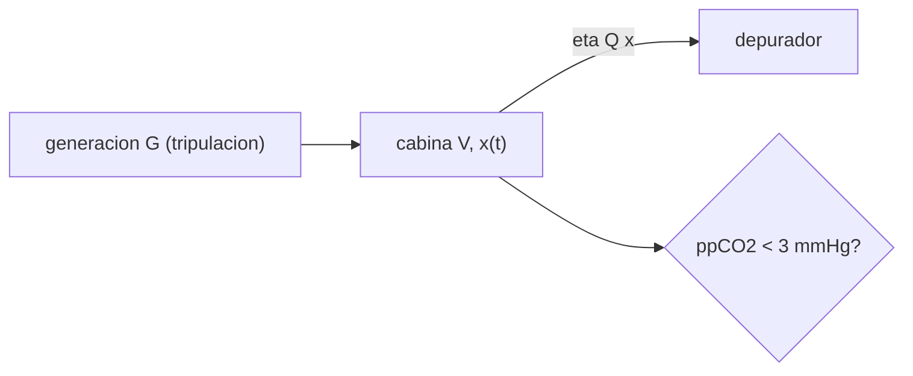

# B106-C04 — Control de dióxido de carbono

<!-- nav:top -->
[🏠 Programa](../../../../README.md) · [📚 Bloque B106](../../../tronco-comun/B106-habitats-espaciales-y-soporte-vital.md) · [← Anterior: B106-C03 — Composición atmosférica respirable](../B106-C03-composicion-atmosferica-respirable/CLASE.md) · [Siguiente: B106-C05 — Suministro y generación de oxígeno →](../B106-C05-suministro-y-generacion-de-oxigeno/CLASE.md)
<!-- /nav -->

## 1. Ubicación, nivel y alcance

Clase 4 del bloque B106 (hábitats espaciales y soporte vital). Nivel N3. Aplica el balance de masa a la sustancia que más rápido se acumula en una cabina: el CO₂ exhalado (C01). Es el primer ejemplo del «tiempo hasta un límite» que se repite en el bloque. Todos los datos del laboratorio son **sintéticos o ilustrativos** y se rotulan como tales; solo se tratan como consultados los valores de la sección 11 que dicen «Consultada».

## 2. Por qué esta clase existe

Una cabina cerrada acumula el CO₂ de la tripulación hasta que un depurador lo retira. Si el depurador es insuficiente o falla, hay un tiempo finito antes de pasar los límites. La decisión central: **¿qué caudal y eficiencia de depurador mantienen la ppCO₂ bajo el límite y cuánto tiempo hay si falla?**

## 3. Lo que podrás hacer al terminar

1. Plantear el balance de CO₂ de una cabina bien mezclada con generación y depurador.
2. Calcular la ppCO₂ de estado estacionario `G/(ηQ)` y comparar con el límite consultado de 3 mmHg.
3. Calcular la subida lineal sin depurador y el tiempo hasta 3 y 4,5 mmHg.
4. Verificar el modelo por integración numérica frente a la solución analítica.
5. Ver cómo escala el resultado con el número de tripulantes.
6. Rotular que caudal y eficiencia son ilustrativos y los límites consultados.

La evidencia es la **curva de ppCO₂ con y sin depurador** del ejercicio 12 (sección 20).

## 4. Con qué llegas y cómo comprobarlo

1. ¿Qué es una ecuación de balance?
2. ¿Qué es una presión parcial?
3. ¿Qué es la eficiencia de un depurador?
4. ¿Cuántos mmHg son 0,5 % de 760 mmHg?
5. ¿Qué es un estado estacionario?

<details>
<summary>Ver respuestas</summary>

1. Acumulación = entrada − salida + generación. 2. `p_i = x_i P`. 3. La fracción del CO₂ que entra y se retira. 4. 3,8 mmHg. 5. Un estado en que lo que entra iguala a lo que sale y la concentración no cambia.
</details>

Con cuatro o cinco aciertos, sigue; si no, repasa los prerrequisitos.

## 5. Un caso de contexto y casos de referencia

Cuatro personas generan 3,61 kg de CO₂ al día en 100 m³ de cabina: sin depurador la ppCO₂ sube **0,624 mmHg por hora**. Con un depurador de 10 L/s y 70 % de eficiencia (ilustrativos) queda en **2,48 mmHg**, bajo el límite consultado de 3 mmHg; con 5 L/s llega a 4,95 mmHg. Si el depurador falla desde ese estado, se llega a 3 mmHg en **0,84 h** y a 4,5 mmHg en 3,24 h. Con 6 personas el mismo depurador da 3,71 mmHg: no cumple.

## 6. Vocabulario

**ppCO₂:** presión parcial de CO₂ en mmHg. **Depurador:** equipo que retira CO₂ del aire (tamices moleculares en la página consultada). **Caudal `Q`:** volumen de aire procesado por segundo. **Eficiencia `η`:** fracción retirada. **Estado estacionario:** concentración constante. **Mezcla perfecta:** composición uniforme en toda la cabina.

## 7. Modelo mental



*Descripción textual:* la generación de CO₂ entra a la cabina, el depurador retira `ηQx` y la ppCO₂ se compara con el límite.

Analogía: una bañera con el grifo abierto (generación) y un desagüe proporcional al nivel (depurador). Límite: la mezcla perfecta no existe en microgravedad sin ventilación; hay bolsas de CO₂ (el resumen consultado lo advierte).

## 8. La explicación, paso a paso

### 8.1 El balance

Con `x` la fracción molar de CO₂, `n` los moles de gas y `g` los mol/s generados: `dx/dt = g/n − k x`, `k = ηQ/V`. En estado estacionario `x_ss = g/(n k)` y en mmHg `ppCO₂ = x P`. Sin depurador, `d(ppCO₂)/dt = g P/n = 0,624 mmHg/h`.

### 8.2 Dimensionar el depurador

Para `ppCO₂ ≤ 3 mmHg` hace falta `ηQ ≥ g/(n·x_max)`: con 4 personas, unos 5,8 L/s efectivos. Con `η = 0,7`, `Q = 10 L/s`: 2,48 mmHg (cumple); `Q = 5 L/s`: 4,95 (no cumple). Aumentar `η` a 0,9 baja a 1,93 mmHg.

### 8.3 Tiempo ante una falla

Desde 2,48 mmHg y sin depurador: `t = (3 − 2,48)/0,624 = 0,84 h` hasta el límite de 3 mmHg y 3,24 h hasta 4,5 mmHg. El resumen consultado asocia dolores de cabeza a entre 2,8 y 4,5 mmHg. Estos tiempos son del modelo, no una predicción de síntomas.

### 8.4 La tripulación escala la generación

Con 6 personas, el mismo depurador da 3,71 mmHg: la generación es proporcional al número de personas y el estacionario también.

### 8.5 Control

La integración (`dt = 10 s`) a las 6 h da 1,9306 mmHg frente a 1,9303 analítico (diferencia 2,9·10⁻⁴).

## 9. Magnitudes, símbolos y unidades

| Símbolo | Qué es | Unidad | Valor / nota |
|---|---|---|---|
| `x` | fracción molar de CO₂ | — | ppCO₂ = x·P |
| `g` | generación de CO₂ | mol/s | 0,9481·10⁻³ (4 personas) |
| `k = ηQ/V` | tasa de retiro | 1/s | 7·10⁻⁵ (Q 10 L/s, η 0,7) |
| ppCO₂ | presión parcial de CO₂ | mmHg | 3 (límite consultado) |
| `t₃` | tiempo sin depurador hasta 3 mmHg | h | 0,84 |

## 10. Convenciones y referencias

Cabina de 100 m³, 293,15 K, 101,325 kPa (760 mmHg), 4 personas a 0,9013 kg/día (C01); mezcla perfecta; sin fugas. Caudal y eficiencia ilustrativos. Tolerancias: integración dentro de 5·10⁻³ mmHg de la analítica; 0,5 % = 3,8 mmHg. Numpy y Python: ver la primera línea de la salida del laboratorio (Python 3.12.9, numpy 2.4.4 en la ejecución del 2026-11-10).

## 11. De dónde sale lo que afirmamos

| ID | Fuente | Localizador | Respalda | Estado |
|---|---|---|---|---|
| S4 | NASA OCHMO, OCHMO-TB-004, «Carbon Dioxide (CO2)», resumen técnico derivado de NASA-STD-3001 vol. 2 rev. D — https://www.nasa.gov/wp-content/uploads/2023/12/ochmo-tb-004-carbon-dioxide.pdf (consultada 2026-11-10; PDF leído con PyMuPDF) | texto sobre el requisito V2 6004 y sobre dolores de cabeza | ppCO₂ medio de 1 h < 3 mmHg; dolores de cabeza entre 2,8 y 4,5 mmHg; 0,5 % de CO₂ = 3,8 mmHg; en la ISS, los niveles de 24 h se mantuvieron por debajo de 3 mmHg tras el criterio de 2016 | Consultada (resumen técnico) |
| S1 | NASA, «Environmental Control and Life Support Systems (ECLSS)» — https://www.nasa.gov/reference/environmental-control-and-life-support-systems-eclss/ (consultada 2026-11-10; la página indica actualización del 4 de abril de 2025) | párrafo de aire y CO₂ | el CO₂ exhalado se captura con tamices moleculares | Consultada |
| — | Balance de masa de mezcla perfecta; solución exponencial | — | los verifica el laboratorio | No consultada en una fuente concreta |

Límites: los caudales y eficiencias son ilustrativos; no se consultaron datos de un depurador real ni su rendimiento. El resumen técnico no es la norma completa.

## 12. Cómo ver el resultado

| Resultado | Valor |
|---|---|
| Subida sin depurador | 0,624 mmHg/h |
| ppCO₂ estacionario (10 L/s, η 0,7) | 2,48 mmHg |
| ppCO₂ estacionario (5 L/s, η 0,7) | 4,95 mmHg |
| Tiempo a 3 / 4,5 mmHg sin depurador | 0,84 h / 3,24 h |
| Con 6 personas (10 L/s, η 0,7) | 3,71 mmHg |

Descripción larga: el estado estacionario depende de la generación y del producto `ηQ`; la falla del depurador convierte el margen en un reloj de unas horas.

## 13. Ejemplo trabajado: ppCO₂ estacionaria

**Paso 1.** `g = 4·20,48 mol/86 400 s = 9,481·10⁻⁴ mol/s`; `n = 4157 mol`.

**Paso 2.** `k = 0,7·0,010/100 = 7·10⁻⁵ s⁻¹`.

**Paso 3.** `x_ss = (9,481·10⁻⁴/4157)/7·10⁻⁵ = 3,26·10⁻³`.

**Paso 4.** `ppCO₂ = 3,26·10⁻³·760 = 2,48 mmHg`: cumple.

## 14. Distintas formas de describir el problema

**Por ecuación:** `dx/dt`. **Por estacionario:** `G/(ηQ)`. **Por reloj:** tiempo hasta el límite. **Por tabla:** Q y η. **Por escala:** número de tripulantes.

## 15. Práctica guiada

**Ejercicio 1 · con los pasos indicados.** Calcula `ηQ` mínimo para 3 mmHg con 4 personas. *Pasos:* `x_max`, `g/n`, división.

<details><summary>Solución comentada</summary>

`x_max = 3/760 = 3,95·10⁻³`; `g/n = 2,28·10⁻⁷ s⁻¹`; `k = 5,78·10⁻⁵`; `ηQ = k V = 5,78 L/s`.
</details>

**Ejercicio 2 · con una pista.** Con `η = 0,9`, ¿qué `Q` hace falta? *Pista:* `ηQ = 5,78`.

<details><summary>Solución comentada</summary>

`Q = 6,4 L/s`.
</details>

**Ejercicio 3 · casi autónomo.** ¿Cuánto sube la ppCO₂ en 2 h sin depurador? *Pista:* usa 0,624 mmHg/h.

<details><summary>Solución comentada</summary>

`1,25 mmHg`.
</details>

## 16. Práctica autónoma, transferencia e integrador

**Ejercicio 4 · autónomo.** Con 2 personas y `Q = 10`, `η = 0,7`, ¿cuál es el estacionario?

<details><summary>Solución comentada</summary>

Mitad que con 4: 1,24 mmHg.
</details>

**Ejercicio 5 · autónomo.** ¿Y con un volumen de 200 m³ (mismo `ηQ`)?

<details><summary>Solución comentada</summary>

El estacionario no cambia; solo el tiempo de respuesta se duplica.
</details>

**Ejercicio 6 · autónomo.** ¿Cuánto tarda en pasar de 2,48 a 3,8 mmHg sin depurador?

<details><summary>Solución comentada</summary>

`(3,8 − 2,48)/0,624 = 2,1 h`.
</details>

**Ejercicio 7 · autónomo.** ¿Qué pasa si `η` cae a 0,5 con `Q = 10`?

<details><summary>Solución comentada</summary>

`ppCO₂ = 3,47 mmHg`: excede los 3 mmHg.
</details>

**Ejercicio 8 · autónomo.** ¿Por qué importa la mezcla en microgravedad?

<details><summary>Solución comentada</summary>

Sin convección natural pueden formarse bolsas de CO₂ donde el valor local supera al promedio (resumen consultado).
</details>

**Ejercicio 9 · transferencia.** Una cabina de 6 personas necesita `ηQ` mínimo. ¿Cuánto?

<details><summary>Solución comentada</summary>

`6/4·5,78 = 8,7 L/s`.
</details>

**Ejercicio 10 · transferencia.** El ejercicio duplica la generación de CO₂ durante 1 h. ¿Cuánto sube la ppCO₂ sin cambiar el depurador?

<details><summary>Solución comentada</summary>

Se acerca a un nuevo estacionario mayor; en 1 h sube unos 0,6 mmHg adicionales respecto al nominal; la ventilación debe cubrir el pico.
</details>

**Ejercicio 11 · transferencia.** Un sensor falla y lee la mitad. ¿Qué consecuencia tiene?

<details><summary>Solución comentada</summary>

Se subestima el CO₂ (C25); hace falta redundancia.
</details>

**Ejercicio 12 · integrador.** Elabora tu *curva de ppCO₂ con y sin depurador*: ecuación, tabla de estacionarios para cuatro combinaciones, tiempo a 3 y 4,5 mmHg ante una falla, efecto de seis tripulantes, control numérico y qué es consultado o ilustrativo.

<details><summary>Solución comentada</summary>

Secciones 8.1–8.5 y la salida del laboratorio.
</details>

## 17. Laboratorio: balance de CO₂ de una cabina

El script [control_co2.py](control_co2.py) integra el balance de CO₂ de 4 personas en 100 m³, calcula estacionarios, la subida sin depurador y los tiempos ante una falla (**comprueba** la integración contra la solución analítica, el 3,8 mmHg consultado y el orden de los resultados).

**Datos:** modelo **propio** con caudal y eficiencia **ilustrativos**; límites **consultados**; sin aleatoriedad. **Predice antes de ejecutar:** ¿Cuánto tarda en pasar de 2,5 a 3 mmHg si el depurador se apaga? (menos de una hora). **Ejecución del 2026-11-10 (Python 3.12.9):**

```text
Python 3.12.9; numpy 2.4.4
DATOS: modelo propio con caudal y eficiencia ILUSTRATIVOS; umbrales de ppCO2 consultados (OCHMO-TB-004); sin datos de un habitat real
Cabina 100 m3: 4157 mol de gas; 4 personas generan 0.9481 mmol/s de CO2 (3.61 kg/dia)
Sin depurador: ppCO2 sube 0.624 mmHg por hora (lineal); 0.5 % de CO2 equivale a 3.80 mmHg (consultado 3.8)
Con depurador (eficiencia eta, caudal Q): estacionario ppCO2_ss = G / (eta Q) en mmHg
   Q [L/s]   eta   ppCO2_ss [mmHg]   cumple < 3 mmHg
        5   0.70          4.952        no
       10   0.70          2.476        si
       10   0.90          1.926        si
       20   0.70          1.238        si
Control: ppCO2 a las 6 h por integracion 1.9306 mmHg frente a 1.9303 mmHg analitico (diferencia 2.9e-04)
Falla del depurador desde el estacionario (2.48 mmHg): llega a 3 mmHg en 0.84 h y a 4.5 mmHg en 3.24 h
Con Q = 10 L/s y eta = 0.7, 4 personas: ppCO2_ss = 2.48 mmHg
Con Q = 10 L/s y eta = 0.7, 6 personas: ppCO2_ss = 3.71 mmHg
Pruebas superadas.
```

```bash
python programa/clases/B106/B106-C04-control-de-dioxido-de-carbono/control_co2.py
```

**Límites:** mezcla perfecta, generación constante, sin fugas ni otros gases, sin saturación del lecho; no modela síntomas.

## 18. Errores frecuentes y cómo corregirlos

**Usar la fracción en % sin pasar a mmHg.** ppCO₂ = x·P (8.1).

**Suponer que el depurador nunca falla.** Calcula el reloj (8.3).

**Olvidar que el estacionario escala con la tripulación.** Ver 8.4.

**Tomar el límite ilustrativo del depurador como dato.** Rotula y mide.

## 19. Cómo sabrás que vas bien

Tras la sección 8: ¿cuál es la ppCO₂ estacionaria y cuánto tiempo hay si falla el depurador? Si dudas, repasa el ejemplo 13. Tras el laboratorio: ¿qué comprueba? (ver la sección 17).

## 20. Qué entregas y cómo se evalúa

El producto es tu **curva de ppCO₂ con y sin depurador** (ejercicio 12).

| Criterio | Inicial | En desarrollo | Logrado | Destacado |
|---|---|---|---|---|
| Conceptos | Confunde las magnitudes | Parciales | Explica balance, estacionario y reloj | Explica los supuestos y sus límites |
| Cálculo | Sin unidades | Con errores | Calcula con unidades y cifras coherentes | Calcula casos nuevos y los verifica |
| Numérico | Sin comprobación | Un caso | Compara con el control del laboratorio | Interpreta la sensibilidad |
| Fuentes | Sin fuente | Sin fecha | Fuentes con fecha y estado | Declara lo ilustrativo y lo no consultado |
| Límites | No los nombra | Uno | Tres | Discute qué falta para un hábitat real |

**Condiciones críticas (no se compensan con promedio):** rotular los datos como sintéticos o ilustrativos; no presentar un valor ilustrativo como límite de una norma; citar solo lo consultado; no usar la clase como consejo médico ni operativo.

## 21. Ética, seguridad y límites

Clase **educativa**: no da consejo médico ni operativo y no sirve para decidir la atmósfera, el agua, la exposición ni la respuesta ante una emergencia de un hábitat o de una persona reales. Ninguna cifra de síntomas o de exposición de esta clase es un criterio médico. Accesibilidad: tablas equivalentes a las gráficas, fórmulas en texto, ejercicios sin conexión.

## 22. Para cerrar y seguir

El CO₂ se controla con un balance: el estacionario `G/(ηQ)` debe quedar bajo 3 mmHg y, si el depurador falla, hay del orden de una hora hasta el límite y unas tres hasta 4,5 mmHg. La clase siguiente produce el oxígeno que ese CO₂ representa.

**Glosario español–inglés.** depurador · *scrubber*; tamiz molecular · *molecular sieve*; estado estacionario · *steady state*; mezcla perfecta · *well-mixed*; caudal · *flow rate*.

**Continuidad.** Sigue con la clase siguiente del bloque (enlace en la navegación) o vuelve al [bloque B106](../../../tronco-comun/B106-habitats-espaciales-y-soporte-vital.md).

**Referencias:** ver sección 11.

<!-- nav:bottom -->
---

[← Anterior: B106-C03 — Composición atmosférica respirable](../B106-C03-composicion-atmosferica-respirable/CLASE.md) · [📚 Bloque B106](../../../tronco-comun/B106-habitats-espaciales-y-soporte-vital.md) · [Siguiente: B106-C05 — Suministro y generación de oxígeno →](../B106-C05-suministro-y-generacion-de-oxigeno/CLASE.md)
<!-- /nav -->
