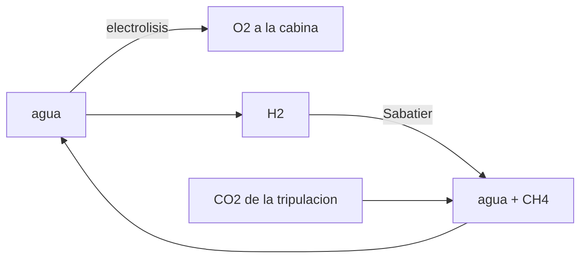

# B106-C05 — Suministro y generación de oxígeno

<!-- nav:top -->
[🏠 Programa](../../../../README.md) · [📚 Bloque B106](../../../tronco-comun/B106-habitats-espaciales-y-soporte-vital.md) · [← Anterior: B106-C04 — Control de dióxido de carbono](../B106-C04-control-de-dioxido-de-carbono/CLASE.md) · [Siguiente: B106-C06 — Reciclaje de agua →](../../../tronco-comun/B106-habitats-espaciales-y-soporte-vital.md#b106-c06)
<!-- /nav -->

## 1. Ubicación, nivel y alcance

Clase 5 del bloque B106 (hábitats espaciales y soporte vital). Nivel N3. Del consumo humano (C01) pasa a la fuente: cómo se obtiene el oxígeno del agua y cómo se recupera el agua del CO₂ (C04). Usa solo estequiometría y termodinámica de manual. Todos los datos del laboratorio son **sintéticos o ilustrativos** y se rotulan como tales; solo se tratan como consultados los valores de la sección 11 que dicen «Consultada».

## 2. Por qué esta clase existe

Llevar oxígeno comprimido o líquido pesa; electrolizar agua exige energía y reponer agua. La decisión central: **¿cuánta agua, hidrógeno y energía implica producir el oxígeno de una tripulación y qué parte del agua devuelve la reacción de Sabatier?**

## 3. Lo que podrás hacer al terminar

1. Escribir y balancear las reacciones de electrólisis y de Sabatier.
2. Calcular masa de agua, de hidrógeno y energía mínima por kilogramo de oxígeno.
3. Hacer el balance diario por persona con el RQ de 0,85.
4. Comprobar la conservación de C, H y O.
5. Calcular el agua neta consumida con y sin Sabatier.
6. Rotular los valores de manual como no consultados.

La evidencia es la **balance de oxígeno e hidrógeno por tripulante** del ejercicio 12 (sección 20).

## 4. Con qué llegas y cómo comprobarlo

1. ¿Qué es la estequiometría?
2. ¿Qué es la entalpía de formación?
3. ¿Qué es un mol?
4. ¿Cuánta masa tiene un mol de agua?
5. ¿Qué significa «conservación de elementos»?

<details>
<summary>Ver respuestas</summary>

1. Las proporciones de moles en una reacción balanceada. 2. El calor asociado a formar un compuesto desde sus elementos. 3. Una cantidad de `6,022·10²³` entidades; la masa de un mol es la masa molar. 4. 18,015 g. 5. Los átomos de cada elemento que entran son los que salen.
</details>

Con cuatro o cinco aciertos, sigue; si no, repasa los prerrequisitos.

## 5. Un caso de contexto y casos de referencia

Por kilogramo de O₂, la electrólisis consume **1,126 kg de agua**, produce 0,126 kg de H₂ y exige como mínimo **4,96 kWh** (entalpía; 4,12 con energía libre). Por persona y día (0,771 kg de O₂): 0,868 kg de agua; el H₂ producido reduce solo el 58,8 % del CO₂ exhalado y el agua neta consumida baja a 0,434 kg (de 0,868 kg sin Sabatier). La potencia eléctrica mínima es 159 W por persona. Valores de manual, no consultados.

## 6. Vocabulario

**Electrólisis:** `2 H₂O → 2 H₂ + O₂`. **Sabatier:** `CO₂ + 4 H₂ → CH₄ + 2 H₂O`. **Entalpía:** energía total de la reacción; **energía libre:** mínimo reversible. **Cociente respiratorio:** CO₂ por O₂ (0,85). **Cierre del lazo:** fracción recuperada.

## 7. Modelo mental



*Descripción textual:* la electrólisis da O₂ y H₂ desde el agua; el H₂ reacciona con el CO₂ exhalado y devuelve agua y metano.

Analogía: una cuenta con un solo ingreso (H₂) para dos gastos (CO₂ y pérdida). Límite: aquí todo el H₂ va al reactor; en la práctica se vende o se ventila parte según el diseño.

## 8. La explicación, paso a paso

### 8.1 Electrólisis

`2 H₂O → 2 H₂ + O₂`. Para 1 kg de O₂ (31,25 mol) hacen falta 62,5 mol de agua (1,126 kg) y se producen 62,5 mol de H₂ (0,126 kg). La masa se conserva: `1 + 0,126 = 1,126`. Energía mínima con `ΔH = 285,83 kJ/mol`: 4,96 kWh; con `ΔG = 237,1`, 4,12 kWh.

### 8.2 Sabatier

`CO₂ + 4 H₂ → CH₄ + 2 H₂O`. Por persona exhala 20,48 mol de CO₂/día, pero el H₂ de la electrólisis (48,19 mol) da para `48,19/4 = 12,05 mol` (58,8 %). Produce 24,1 mol de agua (0,434 kg) y 193,3 g de CH₄.

### 8.3 Agua neta

Se electrolizan 0,868 kg de agua al día y vuelven 0,434 kg: el consumo neto baja a 0,434 kg. Sin Sabatier el H₂ se ventila y se pierde toda el agua.

### 8.4 Potencia

`P = 0,771 kg·4,96 kWh/kg/24 h = 159 W` por persona, de modo que 4 personas necesitan al menos 0,64 kW solo para oxígeno (sin rendimiento ni pérdidas).

### 8.5 Conservación

El laboratorio comprueba que C (12,048), H (96,381) y O (24,095) entran y salen en la misma cantidad en la reacción de Sabatier.

## 9. Magnitudes, símbolos y unidades

| Símbolo | Qué es | Unidad | Valor / nota |
|---|---|---|---|
| `n_O₂` | moles de O₂ por persona y día | mol | 24,10 |
| `m_H₂O` | agua electrolizada por kg de O₂ | kg | 1,126 |
| `ΔH` | entalpía de electrólisis | kJ/mol H₂O | 285,83 (manual) |
| `E_min` | energía por kg de O₂ | kWh/kg | 4,96 |
| `f_red` | fracción de CO₂ reducida | — | 0,588 |

## 10. Convenciones y referencias

Masas molares de manual; `ΔH` y `ΔG` del agua líquida a 25 °C como constantes de manual; RQ 0,85; todo el H₂ va al reactor Sabatier. Sin rendimiento de equipo. Tolerancia: conservación de masa 1e-3 y de elementos 1e-9. Numpy y Python: ver la primera línea de la salida del laboratorio (Python 3.12.9, numpy 2.4.4 en la ejecución del 2026-11-10).

## 11. De dónde sale lo que afirmamos

| ID | Fuente | Localizador | Respalda | Estado |
|---|---|---|---|---|
| S1 | NASA, «Environmental Control and Life Support Systems (ECLSS)» — https://www.nasa.gov/reference/environmental-control-and-life-support-systems-eclss/ (consultada 2026-11-10; la página indica actualización del 4 de abril de 2025) | párrafo «Generación de oxígeno» | el conjunto de generación electroliza agua en O₂ (cabina) e H₂; un reactor Sabatier combina el H₂ con el CO₂ exhalado para dar metano y agua | Consultada |
| — | Masas molares, ΔH y ΔG del agua, estequiometría | — | los verifica el laboratorio con valores de manual | No consultada en una fuente concreta |

Límites: la página de la NASA no da cifras de producción; los valores termodinámicos son de manual y **no se consultaron** en una fuente concreta. El rendimiento de un electrolizador real y su consumo eléctrico **no se consultaron**.

## 12. Cómo ver el resultado

| Resultado | Valor |
|---|---|
| Agua por kg de O₂ | 1,126 kg |
| Energía mínima por kg de O₂ | 4,96 kWh |
| Fracción de CO₂ reducida | 58,8 % |
| Agua neta/día (con Sabatier) | 0,434 kg |
| Potencia mínima por persona | 159 W |

Descripción larga: producir oxígeno desde agua es caro en energía y consume agua; la reacción de Sabatier devuelve parte de ella y fija el carbono como metano.

## 13. Ejemplo trabajado: O₂ y agua de una persona

**Paso 1.** `0,771 kg/0,032 kg/mol = 24,1 mol de O₂`.

**Paso 2.** Agua: `2·24,1 = 48,2 mol = 0,868 kg`; H₂: `48,2 mol = 0,097 kg`.

**Paso 3.** Sabatier: `48,2/4 = 12,05 mol de CO₂` y `24,1 mol de agua = 0,434 kg`.

**Paso 4.** Agua neta: `0,868 − 0,434 = 0,434 kg/día`.

## 14. Distintas formas de describir el problema

**Por reacción:** ecuaciones balanceadas. **Por masa:** kg por kg de O₂. **Por energía:** kWh. **Por moles:** conservación. **Por lazo:** agua neta.

## 15. Práctica guiada

**Ejercicio 1 · con los pasos indicados.** Calcula los moles de agua para 2 kg de O₂. *Pasos:* moles de O₂, factor 2.

<details><summary>Solución comentada</summary>

`2/0,032 = 62,5 mol de O₂`; `125 mol de agua = 2,25 kg`.
</details>

**Ejercicio 2 · con una pista.** ¿Cuánto H₂ produce 1 kg de O₂? *Pista:* 2 mol por mol de O₂.

<details><summary>Solución comentada</summary>

`62,5 mol·2,016 g/mol = 0,126 kg`.
</details>

**Ejercicio 3 · casi autónomo.** ¿Se conservan los átomos de O en `CO₂ + 4 H₂ → CH₄ + 2 H₂O`? *Pista:* cuenta.

<details><summary>Solución comentada</summary>

Sí: 2 O a la izquierda y 2 O en `2 H₂O`.
</details>

## 16. Práctica autónoma, transferencia e integrador

**Ejercicio 4 · autónomo.** ¿Cuántos kWh por día para el O₂ de 4 personas?

<details><summary>Solución comentada</summary>

`4·0,771·4,96 = 15,3 kWh`.
</details>

**Ejercicio 5 · autónomo.** Si el electrolizador tiene 60 % de rendimiento, ¿qué potencia por persona?

<details><summary>Solución comentada</summary>

`159/0,6 = 265 W`.
</details>

**Ejercicio 6 · autónomo.** ¿Cuánto CH₄ por persona y día?

<details><summary>Solución comentada</summary>

`12,05 mol·16,04 g/mol = 193 g`.
</details>

**Ejercicio 7 · autónomo.** ¿Qué fracción del agua electrolizada devuelve Sabatier?

<details><summary>Solución comentada</summary>

50 % (0,434 de 0,868).
</details>

**Ejercicio 8 · autónomo.** ¿Por qué el H₂ producido no alcanza para todo el CO₂?

<details><summary>Solución comentada</summary>

Se necesitan 4 H₂ por CO₂ y la electrólisis da 2,36 H₂ por CO₂ exhalado.
</details>

**Ejercicio 9 · transferencia.** Una misión de 180 días con 4 personas: ¿cuánta agua se reduce con Sabatier?

<details><summary>Solución comentada</summary>

`4·180·0,434 = 312 kg` de agua evitada.
</details>

**Ejercicio 10 · transferencia.** ¿Qué haces con el CH₄?

<details><summary>Solución comentada</summary>

Se ventila o se procesa más (pirólisis para recuperar H₂); la decisión de diseño depende de masa y energía.
</details>

**Ejercicio 11 · transferencia.** Si hay un aporte externo de H₂, ¿qué fracción de CO₂ puedes reducir?

<details><summary>Solución comentada</summary>

Hasta el 100 %: con 82 mol de H₂/día (4·20,48 mol de CO₂).
</details>

**Ejercicio 12 · integrador.** Elabora tu *balance de oxígeno e hidrógeno por tripulante*: reacciones, masas por kg de O₂, tabla diaria por persona y para 4, energía mínima, agua neta con y sin Sabatier, conservación de elementos y qué es de manual.

<details><summary>Solución comentada</summary>

Secciones 8.1–8.5 y la salida del laboratorio.
</details>

## 17. Laboratorio: estequiometría de electrólisis y Sabatier

El script [oxigeno_sabatier.py](oxigeno_sabatier.py) calcula masas y energía por kilogramo de O₂, el balance diario por persona y comprueba la conservación de C, H y O (**comprueba** la conservación de masa y de elementos).

**Datos:** estequiometría **propia** con constantes de manual **no consultadas**; sin aleatoriedad. **Predice antes de ejecutar:** ¿Qué masa de agua se necesita para 1 kg de O₂? (unos 1,13 kg). **Ejecución del 2026-11-10 (Python 3.12.9):**

```text
Python 3.12.9; numpy 2.4.4
DATOS: estequiometria propia con valores de manual NO consultados; sin datos de un equipo real
Por kg de O2 producido por electrolisis (2 H2O -> 2 H2 + O2):
   agua consumida 1.1260 kg; H2 producido 0.1260 kg; energia minima (entalpia) 17.87 MJ = 4.963 kWh; (energia libre) 4.117 kWh
Por persona y dia (O2 = 0.771 kg, RQ 0.85):
   O2: 24.10 mol; H2O electrolizada: 0.868 kg; H2 producido: 48.19 mol = 0.0972 kg
   CO2 exhalado: 20.48 mol = 0.901 kg; el H2 alcanza para reducir 12.05 mol (58.8 %)
   Sabatier: CH4 193.3 g; agua recuperada 0.434 kg; agua neta consumida 0.434 kg (sin Sabatier: 0.868 kg)
   Potencia electrica minima continua (entalpia): 159 W por persona; para 4 personas 0.64 kW
Control Sabatier (C, H, O entran/salen mol): C 12.048/12.048; H 96.381/96.381; O 24.095/24.095
Pruebas superadas.
```

```bash
python programa/clases/B106/B106-C05-suministro-y-generacion-de-oxigeno/oxigeno_sabatier.py
```

**Límites:** energía mínima termodinámica sin rendimiento ni pérdidas; todo el H₂ al reactor; sin otras vías de recuperación de oxígeno ni agua de reposición de la cabina.

## 18. Errores frecuentes y cómo corregirlos

**Olvidar que se necesitan 2 mol de agua por mol de O₂.** Ver 8.1.

**Dar la energía mínima como consumo real.** Aplica el rendimiento.

**Suponer que Sabatier cierra todo el CO₂.** Está limitado por el H₂ (8.2).

**Presentar valores de manual como consultados.** Ver sección 11.

## 19. Cómo sabrás que vas bien

Tras la sección 8: ¿cuántos kg de agua y kWh hacen falta por kg de O₂? Si dudas, repasa el ejemplo 13. Tras el laboratorio: ¿qué comprueba? (ver la sección 17).

## 20. Qué entregas y cómo se evalúa

El producto es tu **balance de oxígeno e hidrógeno por tripulante** (ejercicio 12).

| Criterio | Inicial | En desarrollo | Logrado | Destacado |
|---|---|---|---|---|
| Conceptos | Confunde las magnitudes | Parciales | Explica electrólisis, Sabatier y balance | Explica los supuestos y sus límites |
| Cálculo | Sin unidades | Con errores | Calcula con unidades y cifras coherentes | Calcula casos nuevos y los verifica |
| Numérico | Sin comprobación | Un caso | Compara con el control del laboratorio | Interpreta la sensibilidad |
| Fuentes | Sin fuente | Sin fecha | Fuentes con fecha y estado | Declara lo ilustrativo y lo no consultado |
| Límites | No los nombra | Uno | Tres | Discute qué falta para un hábitat real |

**Condiciones críticas (no se compensan con promedio):** rotular los datos como sintéticos o ilustrativos; no presentar un valor ilustrativo como límite de una norma; citar solo lo consultado; no usar la clase como consejo médico ni operativo.

## 21. Ética, seguridad y límites

Clase **educativa**: no da consejo médico ni operativo y no sirve para decidir la atmósfera, el agua, la exposición ni la respuesta ante una emergencia de un hábitat o de una persona reales. Los cálculos son estequiométricos y no incluyen los riesgos de manipular hidrógeno y oxígeno. Accesibilidad: tablas equivalentes a las gráficas, fórmulas en texto, ejercicios sin conexión.

## 22. Para cerrar y seguir

Un kilogramo de O₂ cuesta 1,126 kg de agua y al menos 4,96 kWh; Sabatier devuelve alrededor de la mitad del agua. Con la atmósfera cubierta, la clase siguiente (C06) cierra el lazo del agua.

**Glosario español–inglés.** electrólisis · *electrolysis*; Sabatier · *Sabatier reaction*; entalpía · *enthalpy*; metano · *methane*; estequiometría · *stoichiometry*.

**Continuidad.** Sigue con la clase siguiente del bloque (enlace en la navegación) o vuelve al [bloque B106](../../../tronco-comun/B106-habitats-espaciales-y-soporte-vital.md).

**Referencias:** ver sección 11.

<!-- nav:bottom -->
---

[← Anterior: B106-C04 — Control de dióxido de carbono](../B106-C04-control-de-dioxido-de-carbono/CLASE.md) · [📚 Bloque B106](../../../tronco-comun/B106-habitats-espaciales-y-soporte-vital.md) · [Siguiente: B106-C06 — Reciclaje de agua →](../../../tronco-comun/B106-habitats-espaciales-y-soporte-vital.md#b106-c06)
<!-- /nav -->
