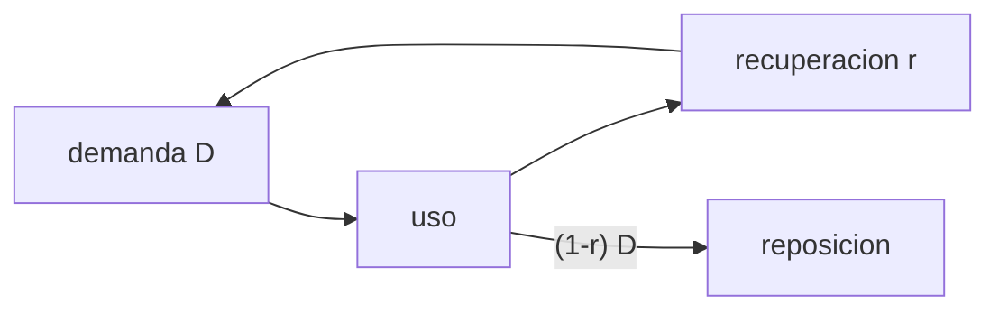

# B106-C06 — Reciclaje de agua

<!-- nav:top -->
[🏠 Programa](../../../../README.md) · [📚 Bloque B106](../../../tronco-comun/B106-habitats-espaciales-y-soporte-vital.md) · [← Anterior: B106-C05 — Suministro y generación de oxígeno](../B106-C05-suministro-y-generacion-de-oxigeno/CLASE.md) · [Siguiente: B106-C07 — Gestión de humedad →](../B106-C07-gestion-de-humedad/CLASE.md)
<!-- /nav -->

## 1. Ubicación, nivel y alcance

Clase 6 del bloque B106 (hábitats espaciales y soporte vital). Nivel N3. Abre el tramo de agua: el agua es el mayor caudal másico de una tripulación, y reciclarla es lo que hace viable una misión larga. Todos los datos del laboratorio son **sintéticos o ilustrativos** y se rotulan como tales; solo se tratan como consultados los valores de la sección 11 que dicen «Consultada».

## 2. Por qué esta clase existe

Lanzar agua cuesta masa; reciclarla cuesta hardware, energía y repuestos. La decisión central: **¿a partir de qué duración y con qué fracción de recuperación conviene cerrar el lazo del agua?**

## 3. Lo que podrás hacer al terminar

1. Plantear la demanda de agua de una tripulación y la reposición `(1 − r)·D`.
2. Calcular la masa total (agua repuesta más sistema) para varias recuperaciones y duraciones.
3. Obtener el punto de equilibrio `M_sys/(r D)`.
4. Combinar etapas en serie: `r = r₁ + (1 − r₁) r₂`.
5. Verificar con una simulación día a día.
6. Rotular la demanda y la masa del sistema como ilustrativas y el ~90 % como consultado.

La evidencia es la **curva de masa lanzada frente a recuperación** del ejercicio 12 (sección 20).

## 4. Con qué llegas y cómo comprobarlo

1. ¿Qué es una fracción de recuperación?
2. ¿Qué es un punto de equilibrio?
3. ¿Qué es una serie geométrica?
4. ¿Cuánto es el 10 % de 40 kg?
5. ¿Qué es masa lanzada?

<details>
<summary>Ver respuestas</summary>

1. La parte del agua usada que se vuelve potable. 2. El valor en que dos opciones cuestan lo mismo. 3. Una suma de términos con razón constante. 4. 4 kg. 5. La masa que hay que poner en órbita para la misión.
</details>

Con cuatro o cinco aciertos, sigue; si no, repasa los prerrequisitos.

## 5. Un caso de contexto y casos de referencia

Cuatro personas con una demanda ilustrativa de 10 kg/día cada una necesitan 40 kg/día. Con recuperación de 0,9 (cifra consultada para la ISS) se reponen **4,0 kg/día**; en 180 días el total (agua más sistema ilustrativo) baja de **7200 kg** sin reciclar a **2640 kg**, y en 900 días de 36000 a 5520 kg. El lazo se paga a partir de **53,3 días**.

## 6. Vocabulario

**Recuperación `r`:** fracción de agua reutilizada. **Reposición:** agua nueva que hay que aportar. **Salmuera:** residuo concentrado de la orina. **Punto de equilibrio:** duración a la que el ahorro iguala el costo del sistema. **Procesador en serie:** etapa que trata lo que la anterior no recuperó.

## 7. Modelo mental



*Descripción textual:* el agua usada vuelve a la demanda en la fracción `r`; el resto debe reponerse desde la Tierra o desde otro proceso.

Analogía: una cuenta con un interés `r` que se reinvierte; cuanto mayor `r`, menos hay que aportar. Límite: cada punto de `r` extra cuesta cada vez más masa de sistema (el modelo ilustrativo usa `2000 r²`).

## 8. La explicación, paso a paso

### 8.1 Reposición y masa total

La reposición diaria es `(1 − r) D` y el total de una misión de `T` días es `(1 − r) D T + M_sys(r)`. Con `D = 40 kg/día` y `M_sys = 300 + 2000 r²` (ilustrativo): 2640 kg a `r = 0,9` frente a 7200 kg sin reciclar a 180 días.

### 8.2 Punto de equilibrio

`T = M_sys/(r D)`: con `r = 0,9`, 53,3 días. Antes de eso el sistema no se amortiza; en una misión de 30 días conviene almacenar el agua.

### 8.3 Etapas en serie

Si la primera etapa recupera 0,75 y la salmuera pasa a otra que recupera 0,65, `r = 0,75 + 0,25·0,65 = 0,9125`. Es la lógica de añadir un procesador de salmuera: el resumen consultado atribuye el paso a más del 90 % a ese procesador adicional.

### 8.4 Cuántas veces se reutiliza

Con `r = 0,9`, el agua se reutiliza en promedio `1/(1 − r) = 10` veces; tras 43,7 ciclos queda el 1 % del agua original. Los contaminantes se acumulan en cada vuelta: el lazo exige tratamiento y control de calidad (C28 y C29).

## 9. Magnitudes, símbolos y unidades

| Símbolo | Qué es | Unidad | Valor / nota |
|---|---|---|---|
| `D` | demanda de agua de la tripulación | kg/día | 40 (ilustrativo) |
| `r` | fracción de recuperación | — | 0,9 (consultado: ~90 %) |
| `M_sys` | masa del sistema | kg | `300 + 2000 r²` (ilustrativo) |
| `T` | duración de la misión | días | 30 a 900 |
| `T_eq` | punto de equilibrio | días | 53,3 |

## 10. Convenciones y referencias

4 personas; demanda y masa del sistema ilustrativas; sin otras pérdidas. Tolerancias: simulación contra fórmula 1e-9 kg y punto de equilibrio con los dos totales iguales 1e-6 kg. Numpy y Python: ver la primera línea de la salida del laboratorio (Python 3.12.9, numpy 2.4.4 en la ejecución del 2026-11-10).

## 11. De dónde sale lo que afirmamos

| ID | Fuente | Localizador | Respalda | Estado |
|---|---|---|---|---|
| S1 | NASA, «Environmental Control and Life Support Systems (ECLSS)» — https://www.nasa.gov/reference/environmental-control-and-life-support-systems-eclss/ (consultada 2026-11-10; la página indica actualización del 4 de abril de 2025) | párrafo de agua | el sistema puede recuperar y reciclar cerca del 90 % del agua de la estación (orina incluida) | Consultada |
| S2 | NASA, Oficina del Jefe de Salud y Medicina (OCHMO), OCHMO-TB-002 rev. B (14 de noviembre de 2023), «Environmental Control & Life Support System (ECLSS): Human-Centered Approach», resumen técnico derivado de NASA-STD-3001 vol. 2 rev. D — https://www.nasa.gov/wp-content/uploads/2023/12/ochmo-tb-002-eclss.pdf (consultada 2026-11-10; PDF leído con PyMuPDF) | sección «Water Management» y de calcio en el UPA | agua mínima de 2,5 L/día; hasta 90 % de recuperación en la ISS; el procesador de salmuera permitió recuperar más del 90 % | Consultada (resumen técnico) |
| — | Balance de masa y punto de equilibrio | — | los verifica el laboratorio | No consultada en una fuente concreta |

Límites: la página de recuperación de agua de la NASA (error 404) y los resúmenes OCHMO sobre agua **no se consultaron**; la demanda total y la masa del sistema son ilustrativas.

## 12. Cómo ver el resultado

| Resultado | Valor |
|---|---|
| Reposición a `r = 0,9` | 4,0 kg/día |
| Total a 180 días, `r = 0` / `0,9` | 7200 / 2640 kg |
| Total a 900 días, `r = 0` / `0,9` | 36000 / 5520 kg |
| Punto de equilibrio (`r = 0,9`) | 53,3 días |
| `r` de dos etapas en serie | 0,9125 |

Descripción larga: el reciclaje reduce la masa lanzada de forma creciente con la duración; en misiones cortas no se amortiza.

## 13. Ejemplo trabajado: reposición y punto de equilibrio

**Paso 1.** `D = 4·10 = 40 kg/día`.

**Paso 2.** Reposición a `r = 0,9`: `0,1·40 = 4 kg/día`; en 180 días 720 kg.

**Paso 3.** `M_sys = 300 + 2000·0,81 = 1920 kg`; total `720 + 1920 = 2640 kg`.

**Paso 4.** Equilibrio: `1920/(0,9·40) = 53,3 días`.

## 14. Distintas formas de describir el problema

**Por flujo:** `D`, `r`. **Por masa total:** `(1−r) D T + M_sys`. **Por tiempo:** `T_eq`. **Por serie:** etapas. **Por ciclos:** reutilizaciones.

## 15. Práctica guiada

**Ejercicio 1 · con los pasos indicados.** Calcula la reposición con `r = 0,95`. *Pasos:* `(1 − r) D`.

<details><summary>Solución comentada</summary>

`0,05·40 = 2 kg/día`.
</details>

**Ejercicio 2 · con una pista.** Calcula el total a 180 días con `r = 0,95`. *Pista:* `M_sys = 300 + 2000·0,9025`.

<details><summary>Solución comentada</summary>

`360 + 2105 = 2465 kg`.
</details>

**Ejercicio 3 · casi autónomo.** ¿Cuántos días hacen falta para amortizar con `r = 0,8`? *Pista:* `M_sys/(r D)`.

<details><summary>Solución comentada</summary>

`1580/(0,8·40) = 49,4 días`.
</details>

## 16. Práctica autónoma, transferencia e integrador

**Ejercicio 4 · autónomo.** Con 6 personas y la misma demanda, ¿cuánto se repone a `r = 0,9`?

<details><summary>Solución comentada</summary>

`0,1·60 = 6 kg/día`.
</details>

**Ejercicio 5 · autónomo.** ¿Qué `r` total da una etapa de 0,8 y otra de 0,5?

<details><summary>Solución comentada</summary>

`0,8 + 0,2·0,5 = 0,9`.
</details>

**Ejercicio 6 · autónomo.** ¿Cuántos ciclos para dejar 1 % con `r = 0,95`?

<details><summary>Solución comentada</summary>

`ln 0,01/ln 0,95 = 89,8`.
</details>

**Ejercicio 7 · autónomo.** ¿A 30 días conviene `r = 0,9`?

<details><summary>Solución comentada</summary>

No: total 2040 kg frente a 1200 kg sin reciclar.
</details>

**Ejercicio 8 · autónomo.** ¿Qué ocurre si el sistema real tiene 1,5 veces más masa?

<details><summary>Solución comentada</summary>

El equilibrio sube a unos 80 días.
</details>

**Ejercicio 9 · transferencia.** Una misión de 900 días a Marte con 4 personas. ¿Qué `r` mínimo elegirías con este modelo?

<details><summary>Solución comentada</summary>

El total baja hasta `r ≈ 0,98` (2941 kg frente a 3905 kg con 0,95), aunque la fiabilidad (C18) puede dominar la decisión.
</details>

**Ejercicio 10 · transferencia.** ¿Qué cambia si parte del agua se obtiene de la superficie (hielo)?

<details><summary>Solución comentada</summary>

Baja la reposición y el punto de equilibrio sube; el reciclaje sigue siendo necesario si el aporte no es fiable.
</details>

**Ejercicio 11 · transferencia.** ¿Por qué no basta mirar solo `r`?

<details><summary>Solución comentada</summary>

El costo del sistema crece con `r`; hay que comparar totales.
</details>

**Ejercicio 12 · integrador.** Elabora tu *curva de masa lanzada frente a recuperación*: tabla para seis `r` y tres duraciones, punto de equilibrio, etapas en serie, ciclos de reutilización y qué es consultado o ilustrativo.

<details><summary>Solución comentada</summary>

Secciones 8.1–8.4 y la salida del laboratorio.
</details>

## 17. Laboratorio: lazo de agua y masa lanzada

El script [lazo_de_agua.py](lazo_de_agua.py) calcula reposición y masa total para seis recuperaciones y tres duraciones, el punto de equilibrio y las etapas en serie (**comprueba** la simulación día a día contra la fórmula y el equilibrio).

**Datos:** modelo **propio** con demanda y masa **ilustrativas**; el ~90 % es **consultado**; sin aleatoriedad. **Predice antes de ejecutar:** ¿A partir de cuántos días se amortiza el sistema con `r = 0,9`? (unos 53). **Ejecución del 2026-11-10 (Python 3.12.9):**

```text
Python 3.12.9; numpy 2.4.4
DATOS: demanda y masa del sistema ILUSTRATIVAS; la cifra de ~90 % de recuperacion es la consultada (pagina del ECLSS)
Demanda: 4 personas x 10 kg/dia = 40 kg/dia (de ellos 10 kg/dia de bebida minima consultada)
  r      reposicion [kg/dia]   total 30 d [kg]   total 180 d [kg]   total 900 d [kg]
  0.00            40.00               1200              7200              36000
  0.50            20.00               1400              4400              18800
  0.80             8.00               1820              3020               8780
  0.90             4.00               2040              2640               5520
  0.95             2.00               2165              2465               3905
  0.98             0.80               2245              2365               2941
Punto de equilibrio con r = 0.9: M_sys/(r D) = 53.3 dias (a partir de ahi el lazo ahorra masa lanzada)
Control: simulacion dia a dia de 180 dias con r = 0.9 -> 720.0 kg frente a 720.0 kg por formula
Etapas en serie: la primera recupera 0.75, la salmuera pasa a una segunda que recupera 0.65 -> r total = 0.9125
Ciclos de reciclaje para que quede 1 % del agua original con r = 0.9: 43.7 (el agua se reutiliza ~10 veces)
Pruebas superadas.
```

```bash
python programa/clases/B106/B106-C06-reciclaje-de-agua/lazo_de_agua.py
```

**Límites:** demanda constante, sin pérdidas aparte de la no recuperada, masa del sistema con forma inventada, sin energía ni repuestos.

## 18. Errores frecuentes y cómo corregirlos

**Comparar solo la reposición diaria.** Compara el total con el sistema (8.1).

**Olvidar la duración.** Calcula `T_eq` (8.2).

**Sumar recuperaciones de etapas.** Usa `r₁ + (1 − r₁) r₂` (8.3).

**Tomar la masa del sistema ilustrativa como dato.** Rotula y sustituye por datos de un diseño.

## 19. Cómo sabrás que vas bien

Tras la sección 8: ¿qué reposición y qué punto de equilibrio da `r = 0,9`? Si dudas, repasa el ejemplo 13. Tras el laboratorio: ¿qué comprueba? (ver la sección 17).

## 20. Qué entregas y cómo se evalúa

El producto es tu **curva de masa lanzada frente a recuperación** (ejercicio 12).

| Criterio | Inicial | En desarrollo | Logrado | Destacado |
|---|---|---|---|---|
| Conceptos | Confunde las magnitudes | Parciales | Explica reposición, equilibrio y etapas | Explica los supuestos y sus límites |
| Cálculo | Sin unidades | Con errores | Calcula con unidades y cifras coherentes | Calcula casos nuevos y los verifica |
| Numérico | Sin comprobación | Un caso | Compara con el control del laboratorio | Interpreta la sensibilidad |
| Fuentes | Sin fuente | Sin fecha | Fuentes con fecha y estado | Declara lo ilustrativo y lo no consultado |
| Límites | No los nombra | Uno | Tres | Discute qué falta para un hábitat real |

**Condiciones críticas (no se compensan con promedio):** rotular los datos como sintéticos o ilustrativos; no presentar un valor ilustrativo como límite de una norma; citar solo lo consultado; no usar la clase como consejo médico ni operativo.

## 21. Ética, seguridad y límites

Clase **educativa**: no da consejo médico ni operativo y no sirve para decidir la atmósfera, el agua, la exposición ni la respuesta ante una emergencia de un hábitat o de una persona reales. El agua reciclada exige calidad verificada; esta clase no define criterios de potabilidad. Accesibilidad: tablas equivalentes a las gráficas, fórmulas en texto, ejercicios sin conexión.

## 22. Para cerrar y seguir

Reciclar agua al 90 % baja la reposición de 40 a 4 kg/día y se amortiza en unas 53 jornadas con los supuestos del modelo. Las siguientes clases tratan las corrientes que alimentan el lazo.

**Glosario español–inglés.** recuperación · *recovery*; salmuera · *brine*; reposición · *makeup*; punto de equilibrio · *break-even*; masa lanzada · *launch mass*.

**Continuidad.** Sigue con la clase siguiente del bloque (enlace en la navegación) o vuelve al [bloque B106](../../../tronco-comun/B106-habitats-espaciales-y-soporte-vital.md).

**Referencias:** ver sección 11.

<!-- nav:bottom -->
---

[← Anterior: B106-C05 — Suministro y generación de oxígeno](../B106-C05-suministro-y-generacion-de-oxigeno/CLASE.md) · [📚 Bloque B106](../../../tronco-comun/B106-habitats-espaciales-y-soporte-vital.md) · [Siguiente: B106-C07 — Gestión de humedad →](../B106-C07-gestion-de-humedad/CLASE.md)
<!-- /nav -->
