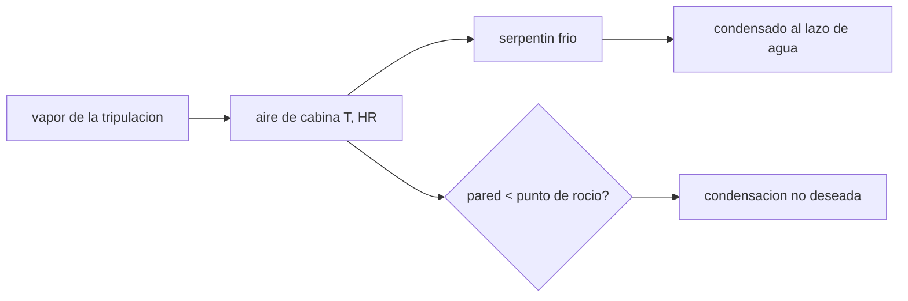

# B106-C07 — Gestión de humedad

<!-- nav:top -->
[🏠 Programa](../../../../README.md) · [📚 Bloque B106](../../../tronco-comun/B106-habitats-espaciales-y-soporte-vital.md) · [← Anterior: B106-C06 — Reciclaje de agua](../B106-C06-reciclaje-de-agua/CLASE.md) · [Siguiente: B106-C08 — Control térmico interior →](../B106-C08-control-termico-interior/CLASE.md)
<!-- /nav -->

## 1. Ubicación, nivel y alcance

Clase 7 del bloque B106 (hábitats espaciales y soporte vital). Nivel N3. Primera clase del tramo de ambiente térmico: el vapor de agua que emite la tripulación y cómo se controla para quedarse en la zona consultada de humedad y evitar condensación. Todos los datos del laboratorio son **sintéticos o ilustrativos** y se rotulan como tales; solo se tratan como consultados los valores de la sección 11 que dicen «Consultada».

## 2. Por qué esta clase existe

Sin convección y con 4 personas, el vapor se acumula, sube la humedad relativa y se condensa en superficies frías. La decisión central: **¿cuánto vapor hay que retirar y con qué superficie fría, sin condensar sobre las paredes?**

## 3. Lo que podrás hacer al terminar

1. Calcular la presión de saturación (Magnus), el punto de rocío y la relación de humedad.
2. Estimar cuánto tarda la humedad relativa en subir sin retirar vapor.
3. Calcular la carga latente de la tripulación en vatios.
4. Evaluar el riesgo de condensación en pared y serpentín.
5. Comprobar la fórmula contra un valor de tablas de manual.
6. Rotular lo ilustrativo: emisión de vapor, temperaturas de pared y caudal.

La evidencia es la **ficha de humedad con margen de rocío** del ejercicio 12 (sección 20).

## 4. Con qué llegas y cómo comprobarlo

1. ¿Qué es la humedad relativa?
2. ¿Qué es el punto de rocío?
3. ¿Qué es calor latente?
4. ¿Qué es una relación de humedad?
5. ¿Cuántos vatios son 6 kg/día de vapor?

<details>
<summary>Ver respuestas</summary>

1. El cociente de la presión de vapor sobre la de saturación. 2. La temperatura a la que el aire se satura y empieza a condensar. 3. El calor intercambiado al cambiar de fase (2,45 MJ/kg del agua). 4. La masa de vapor por kilogramo de aire seco. 5. `6·2,45·10⁶/86 400 = 170 W`.
</details>

Con cuatro o cinco aciertos, sigue; si no, repasa los prerrequisitos.

## 5. Un caso de contexto y casos de referencia

En 120 m³ a 22 °C y 45 % de humedad (punto de rocío **9,52 °C**), cuatro personas que emiten 6 kg/día de vapor (ilustrativo) llevan la humedad al 75 % (límite de salud consultado) en **2,9 h** si no se retira nada; la carga latente es **170 W**. Un serpentín a 7 °C condensa y puede retirar unos 50 kg/día, mucho más de lo generado. A 22 °C y 50 % el punto de rocío es 11,09 °C y la relación de humedad 8,20 g/kg.

## 6. Vocabulario

**Presión de saturación `e_s(T)`:** presión de vapor del aire saturado. **Humedad relativa:** `p_v/e_s`. **Punto de rocío:** `T` con `e_s(T_d) = p_v`. **Relación de humedad `w`:** `0,622 p_v/(P − p_v)`. **Carga latente:** potencia por vapor. **Condensado:** agua líquida retirada.

## 7. Modelo mental



*Descripción textual:* el vapor sube la humedad; el serpentín frío lo condensa para el lazo de agua; si una pared está bajo el punto de rocío, condensa donde no debe.

Analogía: el vaso frío en verano. Límite: en microgravedad el agua condensada no cae; se queda adherida y hay que recogerla con una superficie y un flujo específicos.

## 8. La explicación, paso a paso

### 8.1 Saturación y rocío

Magnus: `e_s = 6,112 exp(17,62 T/(243,12 + T)) hPa`. El punto de rocío a 22 °C y 50 % es 11,09 °C; la relación de humedad es 8,20 g/kg, a menos del 3 % del valor de tablas de manual (~8,3 g/kg).

### 8.2 Cuánto tarda en subir

El aire de 120 m³ a 22 °C pesa 144 kg. De 45 % a 75 % la relación de humedad sube 5,0 g/kg (0,73 kg de vapor) y con 6 kg/día de vapor (0,25 kg/h) pasan 2,9 h. En microgravedad, sin convección, el vapor se reparte peor.

### 8.3 Carga latente

`Q_lat = ṁ L_v = (6/86 400)·2,45·10⁶ = 170 W`. Con la cota de 3,870 kg/día por persona del resumen consultado (que incluye la orina y es ambigua) sería 439 W.

### 8.4 Condensación

Una pared a 12 °C queda 2,48 °C sobre el rocío del 45 % y no condensa; una a 9 °C sí. El serpentín a 7 °C satura el aire a 6,20 g/kg y, con 0,5 kg/s, retira 50 kg/día.

## 9. Magnitudes, símbolos y unidades

| Símbolo | Qué es | Unidad | Valor / nota |
|---|---|---|---|
| `e_s` | presión de saturación | hPa | Magnus |
| `T_d` | punto de rocío | °C | 9,52 (22 °C, 45 %) |
| `w` | relación de humedad | g/kg | 8,20 (22 °C, 50 %) |
| `Q_lat` | carga latente | W | 170 |
| `L_v` | calor latente del agua | J/kg | 2,45·10⁶ (manual) |

## 10. Convenciones y referencias

Presión de cabina 101,325 kPa; aire seco como gas ideal (`R = 287,05 J/(kg K)`); Magnus (constantes de manual, 0–60 °C); vapor de 1,5 kg/día por persona, pared de 12 °C y serpentín de 7 °C ilustrativos. Tolerancias: rocío a 100 % igual a `T` (1e-9); relación de humedad dentro del 3 % de 8,3 g/kg. Numpy y Python: ver la primera línea de la salida del laboratorio (Python 3.12.9, numpy 2.4.4 en la ejecución del 2026-11-10).

## 11. De dónde sale lo que afirmamos

| ID | Fuente | Localizador | Respalda | Estado |
|---|---|---|---|---|
| S2 | NASA, Oficina del Jefe de Salud y Medicina (OCHMO), OCHMO-TB-002 rev. B (14 de noviembre de 2023), «Environmental Control & Life Support System (ECLSS): Human-Centered Approach», resumen técnico derivado de NASA-STD-3001 vol. 2 rev. D — https://www.nasa.gov/wp-content/uploads/2023/12/ochmo-tb-002-eclss.pdf (consultada 2026-11-10; PDF leído con PyMuPDF) | sección «Temperature and Humidity» | zona de salud 18–27 °C y 25–75 % de humedad; zona de desempeño 20–25 °C y 30–60 %; ventilación necesaria por falta de convección natural; 3,870 kg/día de líquido por persona (respiración y sudor, combinado con la orina) | Consultada (resumen técnico) |
| — | Magnus, calor latente, psicrometría | — | los verifica el laboratorio con constantes de manual | No consultada en una fuente concreta |

Límites: el vapor emitido, las temperaturas de pared y serpentín y el caudal son ilustrativos. El texto del resumen sobre los 3,870 kg/día es ambiguo y solo se usa como cota superior.

## 12. Cómo ver el resultado

| Resultado | Valor |
|---|---|
| Punto de rocío (22 °C, 45 %) | 9,52 °C |
| Relación de humedad (22 °C, 50 %) | 8,20 g/kg |
| Tiempo de 45 % a 75 % sin retirar vapor | 2,9 h |
| Carga latente | 170 W |
| Capacidad del serpentín a 7 °C | 50 kg/día |

Descripción larga: el vapor de cuatro personas puede saturar el límite de humedad en unas horas; un serpentín bajo el rocío lo retira, pero cualquier pared fría también condensa.

## 13. Ejemplo trabajado: punto de rocío

**Paso 1.** `e_s(22) = 6,112 exp(17,62·22/265,12) = 26,4 hPa`.

**Paso 2.** `p_v = 0,45·26,4 = 11,9 hPa`.

**Paso 3.** `ln(p_v/6,112) = 0,666`; `T_d = 243,12·0,666/(17,62 − 0,666) = 9,5 °C`.

**Paso 4.** Una pared a 12 °C no condensa; una a 9 °C sí.

## 14. Distintas formas de describir el problema

**Por fórmula:** Magnus. **Por diagrama:** psicrométrico. **Por potencia:** carga latente. **Por tiempo:** subida sin retiro. **Por margen:** `T_pared − T_d`.

## 15. Práctica guiada

**Ejercicio 1 · con los pasos indicados.** Calcula `e_s` a 20 °C. *Pasos:* Magnus.

<details><summary>Solución comentada</summary>

`6,112 exp(17,62·20/263,12) = 23,4 hPa`.
</details>

**Ejercicio 2 · con una pista.** Calcula `p_v` a 20 °C y 40 %. *Pista:* `HR·e_s`.

<details><summary>Solución comentada</summary>

`9,35 hPa`.
</details>

**Ejercicio 3 · casi autónomo.** ¿Cuál es el punto de rocío con 20 °C y 40 %? *Pista:* fórmula inversa.

<details><summary>Solución comentada</summary>

Unos 6,0 °C.
</details>

## 16. Práctica autónoma, transferencia e integrador

**Ejercicio 4 · autónomo.** ¿Cuánta carga latente hay con 6 personas a 1,5 kg/día?

<details><summary>Solución comentada</summary>

`6·1,5·2,45·10⁶/86 400 = 255 W`.
</details>

**Ejercicio 5 · autónomo.** ¿Qué margen tiene una pared a 10 °C a 22 °C y 45 %?

<details><summary>Solución comentada</summary>

`10 − 9,52 = +0,48 °C`: peligro.
</details>

**Ejercicio 6 · autónomo.** ¿A qué HR condensa una pared a 12 °C con la cabina a 22 °C?

<details><summary>Solución comentada</summary>

Cuando `T_d = 12 °C`: HR ≈ 53 %.
</details>

**Ejercicio 7 · autónomo.** ¿Cuántas horas pasan de 45 % a 60 % sin retirar vapor?

<details><summary>Solución comentada</summary>

Menos de la mitad que a 75 %: unas 1,4 h.
</details>

**Ejercicio 8 · autónomo.** ¿Por qué el serpentín debe estar bajo el punto de rocío?

<details><summary>Solución comentada</summary>

Solo allí el aire se satura y el vapor se condensa.
</details>

**Ejercicio 9 · transferencia.** La zona de desempeño llega hasta 60 % de humedad. ¿Qué punto de rocío corresponde a 24 °C y 60 %?

<details><summary>Solución comentada</summary>

15,75 °C; las paredes deben estar sobre ese valor.
</details>

**Ejercicio 10 · transferencia.** En microgravedad, ¿qué falla si el condensado no se separa?

<details><summary>Solución comentada</summary>

Se forma una película o gotas flotantes que pueden entrar en equipos; hace falta un separador (no consultado).
</details>

**Ejercicio 11 · transferencia.** ¿Cómo cambia la carga latente con el ejercicio?

<details><summary>Solución comentada</summary>

Sube con el sudor y la respiración; el diseño debe cubrir el pico.
</details>

**Ejercicio 12 · integrador.** Elabora tu *ficha de humedad con margen de rocío*: tabla de rocío y relación de humedad para cuatro estados, tiempo de subida, carga latente, margen de pared y serpentín, control contra tablas y qué es ilustrativo.

<details><summary>Solución comentada</summary>

Secciones 8.1–8.4 y la salida del laboratorio.
</details>

## 17. Laboratorio: psicrometría y carga latente

El script [humedad.py](humedad.py) calcula punto de rocío, relación de humedad, tiempo de subida de la humedad, carga latente y riesgo de condensación (**comprueba** el rocío a 100 %, la relación de humedad contra tablas y que el serpentín condensa).

**Datos:** fórmulas de **manual** y valores **ilustrativos**; límites **consultados**; sin aleatoriedad. **Predice antes de ejecutar:** ¿Condensa una pared a 12 °C con la cabina a 22 °C y 45 %? (no: el rocío es 9,5 °C). **Ejecución del 2026-11-10 (Python 3.12.9):**

```text
Python 3.12.9; numpy 2.4.4
DATOS: formula de Magnus (manual, NO consultada) y valores ILUSTRATIVOS de emision y de temperaturas; limites T-HR consultados
   T [C]  HR [%]   punto de rocio [C]   w [g/kg]
    22.0    45.0               9.52       7.37
    22.0    50.0              11.09       8.20
    24.0    60.0              15.75      11.16
    26.0    70.0              20.10      14.75
Cabina 120 m3 a 22 C: 144 kg de aire; 4 personas emiten 6.0 kg/dia de vapor (ilustrativo)
Sin retirar vapor, la HR pasa de 45 % a 75 % (limite de salud) en 2.9 h
Carga latente: 170 W; con 3.870 kg/dia por persona (cota superior consultada, ambigua) seria 439 W
Punto de rocio a 22 C y 45 %: 9.52 C. Pared a 12 C: no condensa (margen +2.48 C); serpentin a 7 C: condensa
Serpentin saturado a 7 C: w = 6.20 g/kg; con 0.5 kg/s de aire retira 0.58 g/s = 50 kg/dia (genera 6.0 kg/dia -> sobra capacidad)
Pruebas superadas.
```

```bash
python programa/clases/B106/B106-C07-gestion-de-humedad/humedad.py
```

**Límites:** aire como gas ideal, mezcla perfecta, vapor constante, sin sorción en materiales; Magnus aproximado.

## 18. Errores frecuentes y cómo corregirlos

**Confundir humedad relativa con humedad absoluta.** Usa `w` o `p_v` (8.1).

**Olvidar las paredes frías.** Calcula el margen (8.4).

**Pensar que el condensado cae.** En microgravedad no cae.

**Usar 3,870 kg/día como vapor.** Incluye la orina; es una cota.

## 19. Cómo sabrás que vas bien

Tras la sección 8: ¿cuál es el punto de rocío a 22 °C y 45 % y cuánto es la carga latente de 6 kg/día? Si dudas, repasa el ejemplo 13. Tras el laboratorio: ¿qué comprueba? (ver la sección 17).

## 20. Qué entregas y cómo se evalúa

El producto es tu **ficha de humedad con margen de rocío** (ejercicio 12).

| Criterio | Inicial | En desarrollo | Logrado | Destacado |
|---|---|---|---|---|
| Conceptos | Confunde las magnitudes | Parciales | Explica rocío, carga latente y condensación | Explica los supuestos y sus límites |
| Cálculo | Sin unidades | Con errores | Calcula con unidades y cifras coherentes | Calcula casos nuevos y los verifica |
| Numérico | Sin comprobación | Un caso | Compara con el control del laboratorio | Interpreta la sensibilidad |
| Fuentes | Sin fuente | Sin fecha | Fuentes con fecha y estado | Declara lo ilustrativo y lo no consultado |
| Límites | No los nombra | Uno | Tres | Discute qué falta para un hábitat real |

**Condiciones críticas (no se compensan con promedio):** rotular los datos como sintéticos o ilustrativos; no presentar un valor ilustrativo como límite de una norma; citar solo lo consultado; no usar la clase como consejo médico ni operativo.

## 21. Ética, seguridad y límites

Clase **educativa**: no da consejo médico ni operativo y no sirve para decidir la atmósfera, el agua, la exposición ni la respuesta ante una emergencia de un hábitat o de una persona reales. Los límites de humedad son los consultados y no una recomendación médica. Accesibilidad: tablas equivalentes a las gráficas, fórmulas en texto, ejercicios sin conexión.

## 22. Para cerrar y seguir

La humedad es un balance de vapor: 6 kg/día son unos 170 W latentes y llevan la cabina al 75 % en menos de tres horas si no se retira. La clase siguiente cierra el balance de energía total.

**Glosario español–inglés.** humedad relativa · *relative humidity*; punto de rocío · *dew point*; calor latente · *latent heat*; condensado · *condensate*; serpentín · *cooling coil*.

**Continuidad.** Sigue con la clase siguiente del bloque (enlace en la navegación) o vuelve al [bloque B106](../../../tronco-comun/B106-habitats-espaciales-y-soporte-vital.md).

**Referencias:** ver sección 11.

<!-- nav:bottom -->
---

[← Anterior: B106-C06 — Reciclaje de agua](../B106-C06-reciclaje-de-agua/CLASE.md) · [📚 Bloque B106](../../../tronco-comun/B106-habitats-espaciales-y-soporte-vital.md) · [Siguiente: B106-C08 — Control térmico interior →](../B106-C08-control-termico-interior/CLASE.md)
<!-- /nav -->
