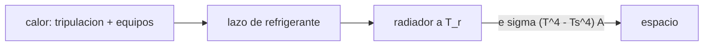

# B106-C08 — Control térmico interior

<!-- nav:top -->
[🏠 Programa](../../../../README.md) · [📚 Bloque B106](../../../tronco-comun/B106-habitats-espaciales-y-soporte-vital.md) · [← Anterior: B106-C07 — Gestión de humedad](../B106-C07-gestion-de-humedad/CLASE.md) · [Siguiente: B106-C09 — Sistemas ECLSS →](../B106-C09-sistemas-eclss/CLASE.md)
<!-- /nav -->

## 1. Ubicación, nivel y alcance

Clase 8 del bloque B106 (hábitats espaciales y soporte vital). Nivel N3. Cierra el balance de energía de la cabina: el calor de la tripulación y de los equipos tiene que salir por un radiador. Reutiliza los 147 W por persona de C01. Todos los datos del laboratorio son **sintéticos o ilustrativos** y se rotulan como tales; solo se tratan como consultados los valores de la sección 11 que dicen «Consultada».

## 2. Por qué esta clase existe

En el vacío el calor solo sale por radiación; el área del radiador depende de la temperatura y de lo que «ve». La decisión central: **¿cuánta área y qué caudal de refrigerante para evacuar la carga, y cuánto tiempo hay si el enfriamiento falla?**

## 3. Lo que podrás hacer al terminar

1. Sumar las cargas térmicas de tripulación y equipos.
2. Calcular el área de un radiador con la ley de Stefan–Boltzmann y un sumidero efectivo.
3. Calcular el caudal de agua y de aire necesarios para un salto de temperatura dado.
4. Estimar la tasa de calentamiento y el tiempo hasta 27 °C si falla el enfriamiento.
5. Ver cómo un sumidero caliente o la radiación solar reducen la capacidad.
6. Rotular lo ilustrativo: equipos, emisividad, sumidero y capacidad térmica.

La evidencia es la **presupuesto térmico con área de radiador** del ejercicio 12 (sección 20).

## 4. Con qué llegas y cómo comprobarlo

1. ¿Qué es la ley de Stefan–Boltzmann?
2. ¿Qué es el calor específico?
3. ¿Qué es la emisividad?
4. ¿Cuántos vatios aporta una persona?
5. ¿Qué es un sumidero efectivo?

<details>
<summary>Ver respuestas</summary>

1. Un cuerpo negro emite `σ T⁴` por metro cuadrado. 2. La energía por kg y por kelvin para calentar una sustancia. 3. La fracción de la emisión del cuerpo negro que emite una superficie. 4. Unos 147 W (C01). 5. La temperatura radiativa equivalente del entorno que ve el radiador.
</details>

Con cuatro o cinco aciertos, sigue; si no, repasa los prerrequisitos.

## 5. Un caso de contexto y casos de referencia

Cuatro personas (588 W) y 3000 W de equipos (ilustrativo) suman **3588 W**. Un radiador a 285 K con emisividad 0,85 necesita **14,9 m²** con un sumidero de 200 K y 58,0 m² con uno de 270 K. El lazo de agua con salto de 5 K mueve 0,171 kg/s (10,3 L/min); el de aire, 0,60 m³/s. Si falla el enfriamiento, la cabina sube 6,46 K/h y llega a 27 °C (límite de salud consultado) en **0,77 h**.

## 6. Vocabulario

**Carga térmica:** potencia que hay que evacuar. **Radiador:** superficie que emite al espacio. **Sumidero efectivo:** temperatura radiativa del entorno visto. **Salto de temperatura `ΔT`:** diferencia entrada–salida del refrigerante. **Absortividad solar:** fracción de la radiación solar absorbida.

## 7. Modelo mental



*Descripción textual:* el calor de la cabina se transporta por un lazo hasta un radiador que lo emite al espacio según `εσ(T⁴ − T_s⁴)`.

Analogía: una olla que pierde calor por su superficie; más superficie o más temperatura, más pérdida. Límite: la radiación depende de la cuarta potencia y del entorno visto; sobre la superficie lunar en el día un radiador es mucho menos efectivo.

## 8. La explicación, paso a paso

### 8.1 Carga

`Q = 4·147 + 3000 = 3588 W`. La tripulación aporta el 16 %; los equipos dominan.

### 8.2 Radiador

`A = Q/(ε σ (T_r⁴ − T_s⁴))` con `σ = 5,670374·10⁻⁸ W/(m² K⁴)`. A 285 K: 14,9 m² (sumidero 200 K), 27,7 m² (250 K) y 58,0 m² (270 K). Cada vez que el sumidero se acerca al radiador el área se dispara.

### 8.3 Transporte

`ṁ = Q/(c_p ΔT)`. Con agua (4186 J/(kg K)) y 5 K: 0,171 kg/s. Con aire (1005 J/(kg K)): 0,714 kg/s, es decir 0,60 m³/s: el agua es 4 veces más eficiente por kilo y mucho más por volumen.

### 8.4 Falla del enfriamiento

Con una capacidad térmica ilustrativa de 2·10⁶ J/K, `dT/dt = Q/C = 6,46 K/h` y desde 22 °C se llega a 27 °C en 0,77 h.

### 8.5 Radiación solar

Un radiador que mira al Sol (absortividad 0,2) absorbe 272 W/m²; su capacidad neta cae de 241 a −31 W/m²: no evacúa nada. Se orienta de canto al Sol.

## 9. Magnitudes, símbolos y unidades

| Símbolo | Qué es | Unidad | Valor / nota |
|---|---|---|---|
| `Q` | carga térmica | W | 3588 |
| `A` | área del radiador | m² | 14,9 (sumidero 200 K) |
| `ε` | emisividad | — | 0,85 (ilustrativo) |
| `ṁ` | caudal de refrigerante | kg/s | 0,171 (agua, 5 K) |
| `t₂₇` | tiempo a 27 °C sin enfriamiento | h | 0,77 |

## 10. Convenciones y referencias

Radiador de una cara; temperaturas en kelvin; `σ = 5,670374·10⁻⁸`; agua y aire con calores específicos constantes; sumideros efectivos de 200, 250 y 270 K ilustrativos. Tolerancia: área contra la fórmula directa 1e-12. Numpy y Python: ver la primera línea de la salida del laboratorio (Python 3.12.9, numpy 2.4.4 en la ejecución del 2026-11-10).

## 11. De dónde sale lo que afirmamos

| ID | Fuente | Localizador | Respalda | Estado |
|---|---|---|---|---|
| S2 | NASA, Oficina del Jefe de Salud y Medicina (OCHMO), OCHMO-TB-002 rev. B (14 de noviembre de 2023), «Environmental Control & Life Support System (ECLSS): Human-Centered Approach», resumen técnico derivado de NASA-STD-3001 vol. 2 rev. D — https://www.nasa.gov/wp-content/uploads/2023/12/ochmo-tb-002-eclss.pdf (consultada 2026-11-10; PDF leído con PyMuPDF) | secciones de temperatura y de ingesta | límites de temperatura (hasta 27 °C salud; 20–25 °C desempeño); 3035 kcal/día por persona | Consultada (resumen técnico) |
| — | Stefan–Boltzmann, `ṁ cp ΔT` | — | las verifica el laboratorio | No consultada en una fuente concreta |

Límites: la carga de equipos, la emisividad, los sumideros y la capacidad térmica son ilustrativos. Datos de radiadores o de lazos térmicos reales **no se consultaron**.

## 12. Cómo ver el resultado

| Resultado | Valor |
|---|---|
| Carga total | 3588 W |
| Área a 285 K, sumidero 200 K / 270 K | 14,9 / 58,0 m² |
| Caudal de agua (5 K) | 0,171 kg/s |
| Caudal de aire (5 K) | 0,60 m³/s |
| Tiempo a 27 °C sin enfriamiento | 0,77 h |

Descripción larga: los equipos dominan la carga, el sumidero fija el área del radiador y una falla del enfriamiento deja menos de una hora.

## 13. Ejemplo trabajado: área de radiador

**Paso 1.** `Q = 3588 W`.

**Paso 2.** `T_r⁴ − T_s⁴ = 285⁴ − 200⁴ = 6,597·10⁹ − 1,6·10⁹ = 4,997·10⁹ K⁴`.

**Paso 3.** `A = 3588/(0,85·5,670374·10⁻⁸·4,997·10⁹) = 14,9 m²`.

**Paso 4.** Control: la fórmula directa da el mismo valor.

## 14. Distintas formas de describir el problema

**Por potencia:** vatios. **Por área:** `A`. **Por caudal:** `ṁ`. **Por tiempo:** `t₂₇`. **Por entorno:** sumidero.

## 15. Práctica guiada

**Ejercicio 1 · con los pasos indicados.** Calcula `ṁ` de agua para 5 kW con `ΔT = 10 K`. *Pasos:* `Q/(c_p ΔT)`.

<details><summary>Solución comentada</summary>

`5000/(4186·10) = 0,119 kg/s`.
</details>

**Ejercicio 2 · con una pista.** Calcula `A` para 2 kW a 290 K con sumidero 200 K y `ε = 0,9`. *Pista:* Stefan–Boltzmann.

<details><summary>Solución comentada</summary>

`290⁴ = 7,07·10⁹`; `−1,6·10⁹ = 5,47·10⁹`; `A = 2000/(0,9·5,67·10⁻⁸·5,47·10⁹) = 7,2 m²`.
</details>

**Ejercicio 3 · casi autónomo.** ¿Cuántos vatios por m² emite un radiador a 285 K frente a 200 K? *Pista:* usa el valor del laboratorio.

<details><summary>Solución comentada</summary>

Unos 241 W/m².
</details>

## 16. Práctica autónoma, transferencia e integrador

**Ejercicio 4 · autónomo.** Si `ε` baja a 0,6 por contaminación, ¿cómo cambia `A`?

<details><summary>Solución comentada</summary>

`A` sube a `0,85/0,6 = 1,42` veces: 21,1 m².
</details>

**Ejercicio 5 · autónomo.** ¿Y si el radiador se enfría a 275 K?

<details><summary>Solución comentada</summary>

`275⁴ − 200⁴ = 4,1·10⁹`: `A ≈ 18 m²`.
</details>

**Ejercicio 6 · autónomo.** ¿Qué potencia aporta la tripulación de 6 personas?

<details><summary>Solución comentada</summary>

`6·147 = 882 W`.
</details>

**Ejercicio 7 · autónomo.** ¿Cuánto sube la cabina en 30 min si falla el enfriamiento?

<details><summary>Solución comentada</summary>

`6,46·0,5 = 3,2 K`.
</details>

**Ejercicio 8 · autónomo.** ¿Por qué el agua mueve el calor con menos volumen que el aire?

<details><summary>Solución comentada</summary>

Su calor específico por volumen es unas 3500 veces mayor.
</details>

**Ejercicio 9 · transferencia.** En la superficie lunar con día caliente un sumidero efectivo puede estar sobre 300 K. ¿Qué ocurre con un radiador a 285 K?

<details><summary>Solución comentada</summary>

No evacúa: `T_s > T_r` y el área tiende a infinito; se necesita otro concepto (radiador orientado, bomba de calor, enterrar).
</details>

**Ejercicio 10 · transferencia.** Si los equipos pasan de 3 a 6 kW, ¿cómo cambia el área?

<details><summary>Solución comentada</summary>

Casi se duplica.
</details>

**Ejercicio 11 · transferencia.** ¿Qué margen de tiempo da la capacidad térmica del hábitat?

<details><summary>Solución comentada</summary>

Menos de 1 h con 3,6 kW: se necesita redundancia del lazo (C18).
</details>

**Ejercicio 12 · integrador.** Elabora tu *presupuesto térmico con área de radiador*: carga, área para tres sumideros, caudales de agua y de aire, tiempo de falla, efecto solar y qué es ilustrativo.

<details><summary>Solución comentada</summary>

Secciones 8.1–8.5 y la salida del laboratorio.
</details>

## 17. Laboratorio: presupuesto térmico y radiador

El script [control_termico.py](control_termico.py) calcula la carga, el área del radiador para tres sumideros, los caudales de agua y aire, el calentamiento tras una falla y el efecto solar (**comprueba** el área contra la fórmula y que un sumidero caliente exige más área).

**Datos:** modelo **propio** con valores **ilustrativos**; límites de temperatura **consultados**; sin aleatoriedad. **Predice antes de ejecutar:** ¿Cuánta área necesita evacuar 3,6 kW a 285 K con un sumidero de 200 K? (unos 15 m²). **Ejecución del 2026-11-10 (Python 3.12.9):**

```text
Python 3.12.9; numpy 2.4.4
DATOS: modelo propio con potencias, emisividad y sumideros ILUSTRATIVOS; limites de temperatura consultados; sin datos de un habitat
Carga: tripulacion 4 x 147 W = 588 W + equipos 3000 W = 3588 W
Radiador a 285 K (emisividad 0.85):
   sumidero [K]   area [m2]   (con una cara; una cara que ve el sumidero)
         200       14.90
         250       27.66
         270       58.02
Lazo de agua con salto de 5 K: 0.171 kg/s (10.3 L/min); lazo de aire con el mismo salto: 0.714 kg/s = 0.60 m3/s (595 L/s)
Si falla el enfriamiento desde 22 C: sube 6.46 K/h; llega a 27 C (limite de salud consultado) en 0.77 h
Radiador mirando al Sol (absortividad 0.2, 1361 W/m2): absorbe 272 W/m2 y su capacidad neta cae de 241 a -31 W/m2
Pruebas superadas.
```

```bash
python programa/clases/B106/B106-C08-control-termico-interior/control_termico.py
```

**Límites:** estado estacionario, un solo radiador, sin acoplamiento con la estructura, sin gradientes ni escalas de tiempo del lazo; sumideros fijos.

## 18. Errores frecuentes y cómo corregirlos

**Usar grados Celsius en `T⁴`.** Usa kelvin.

**Ignorar el sumidero.** Cambia el área (8.2).

**Olvidar la radiación solar.** Ver 8.5.

**Tomar la emisividad ilustrativa como dato.** Rotula y mide.

## 19. Cómo sabrás que vas bien

Tras la sección 8: ¿qué área y qué caudal de agua hacen falta para 3,6 kW? Si dudas, repasa el ejemplo 13. Tras el laboratorio: ¿qué comprueba? (ver la sección 17).

## 20. Qué entregas y cómo se evalúa

El producto es tu **presupuesto térmico con área de radiador** (ejercicio 12).

| Criterio | Inicial | En desarrollo | Logrado | Destacado |
|---|---|---|---|---|
| Conceptos | Confunde las magnitudes | Parciales | Explica carga, radiador y transporte | Explica los supuestos y sus límites |
| Cálculo | Sin unidades | Con errores | Calcula con unidades y cifras coherentes | Calcula casos nuevos y los verifica |
| Numérico | Sin comprobación | Un caso | Compara con el control del laboratorio | Interpreta la sensibilidad |
| Fuentes | Sin fuente | Sin fecha | Fuentes con fecha y estado | Declara lo ilustrativo y lo no consultado |
| Límites | No los nombra | Uno | Tres | Discute qué falta para un hábitat real |

**Condiciones críticas (no se compensan con promedio):** rotular los datos como sintéticos o ilustrativos; no presentar un valor ilustrativo como límite de una norma; citar solo lo consultado; no usar la clase como consejo médico ni operativo.

## 21. Ética, seguridad y límites

Clase **educativa**: no da consejo médico ni operativo y no sirve para decidir la atmósfera, el agua, la exposición ni la respuesta ante una emergencia de un hábitat o de una persona reales. El diseño térmico real exige análisis de órbita y de superficie; aquí solo hay órdenes de magnitud. Accesibilidad: tablas equivalentes a las gráficas, fórmulas en texto, ejercicios sin conexión.

## 22. Para cerrar y seguir

Con 3,6 kW a evacuar, un radiador a 285 K necesita unos 15 m² con un sumidero frío y mucho más con uno caliente; sin enfriamiento, la cabina alcanza 27 °C en menos de una hora. Siguen los residuos y los alimentos.

**Glosario español–inglés.** radiador · *radiator*; emisividad · *emissivity*; sumidero efectivo · *effective sink temperature*; carga térmica · *heat load*; refrigerante · *coolant*.

**Continuidad.** Sigue con la clase siguiente del bloque (enlace en la navegación) o vuelve al [bloque B106](../../../tronco-comun/B106-habitats-espaciales-y-soporte-vital.md).

**Referencias:** ver sección 11.

<!-- nav:bottom -->
---

[← Anterior: B106-C07 — Gestión de humedad](../B106-C07-gestion-de-humedad/CLASE.md) · [📚 Bloque B106](../../../tronco-comun/B106-habitats-espaciales-y-soporte-vital.md) · [Siguiente: B106-C09 — Sistemas ECLSS →](../B106-C09-sistemas-eclss/CLASE.md)
<!-- /nav -->
