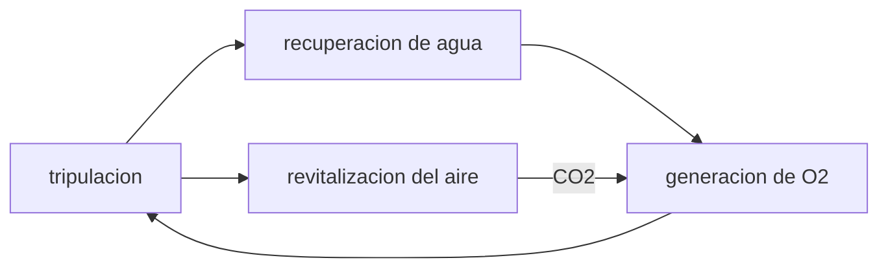

# B106-C09 — Sistemas ECLSS

<!-- nav:top -->
[🏠 Programa](../../../../README.md) · [📚 Bloque B106](../../../tronco-comun/B106-habitats-espaciales-y-soporte-vital.md) · [← Anterior: B106-C08 — Control térmico interior](../B106-C08-control-termico-interior/CLASE.md) · [Siguiente: B106-C10 — Gestión de residuos humanos →](../B106-C10-gestion-de-residuos-humanos/CLASE.md)
<!-- /nav -->

## 1. Ubicación, nivel y alcance

Clase 9 del bloque B106 (hábitats espaciales y soporte vital). Nivel N3. Mira el ECLSS completo como un conjunto de lazos acoplados (aire, agua, oxígeno) con fracciones de cierre, y calcula qué hay que reponer en tres arquitecturas. Todos los datos del laboratorio son **sintéticos o ilustrativos** y se rotulan como tales; solo se tratan como consultados los valores de la sección 11 que dicen «Consultada».

## 2. Por qué esta clase existe

Cada subsistema recicla una parte y deja un resto; el resto, sumado, es lo que hay que lanzar. La decisión central: **¿qué lazos cerrar primero y cuánto reduce cada uno la reposición total?**

## 3. Lo que podrás hacer al terminar

1. Describir los tres subsistemas del ECLSS consultados y sus flujos.
2. Calcular la reposición diaria de tres arquitecturas (almacenado, agua reciclada con electrólisis, con Sabatier).
3. Obtener la reducción de masa y el punto de equilibrio entre arquitecturas.
4. Calcular la sensibilidad de la reposición a la recuperación de agua.
5. Verificar el balance de masa del oxígeno.
6. Rotular que la demanda y la masa de hardware son ilustrativas.

La evidencia es la **diagrama de lazos con balance de reposición** del ejercicio 12 (sección 20).

## 4. Con qué llegas y cómo comprobarlo

1. ¿Cuáles son los tres subsistemas del ECLSS citados por la NASA?
2. ¿Qué es un lazo cerrado?
3. ¿Qué es una sensibilidad?
4. ¿Qué hace el reactor Sabatier?
5. ¿Qué es un punto de equilibrio?

<details>
<summary>Ver respuestas</summary>

1. Recuperación de agua, revitalización del aire y generación de oxígeno. 2. Un sistema que reutiliza sus salidas como entradas. 3. La derivada de un resultado frente a un parámetro. 4. Convierte CO₂ e H₂ en metano y agua (C05). 5. El tiempo en que dos opciones cuestan lo mismo.
</details>

Con cuatro o cinco aciertos, sigue; si no, repasa los prerrequisitos.

## 5. Un caso de contexto y casos de referencia

Para 4 personas y 180 días, la arquitectura **A** (todo almacenado) pesa **7755 kg**; la **B** (agua reciclada al 90 % y O₂ por electrólisis) repone 7,47 kg/día de agua y pesa **1945 kg** con 600 kg de hardware ilustrativo; la **C** (con Sabatier) repone 5,74 kg/día y pesa 1933 kg. B ahorra el 75 % frente a A y se amortiza en 16,8 días; C solo ahorra 13 kg más que B porque su hardware es mayor.

## 6. Vocabulario

**ECLSS:** sistema de control ambiental y soporte vital. **Arquitectura:** combinación de subsistemas. **Cierre:** fracción reciclada. **Reposición:** masa nueva por día. **Sensibilidad:** cambio de la reposición por unidad de recuperación.

## 7. Modelo mental



*Descripción textual:* la tripulación consume O₂ y agua y emite CO₂ y agua usada; los tres subsistemas cierran los lazos y la reposición es el resto.

Analogía: tres tinas conectadas con fugas; cada válvula cerrada reduce lo que hay que rellenar desde afuera. Límite: los lazos se acoplan (la electrólisis consume agua).

## 8. La explicación, paso a paso

### 8.1 Qué hace cada subsistema

La página consultada de la NASA describe el ECLSS como tres subsistemas: **recuperación de agua** (reciclaje con lechos de filtración y oxidación catalítica), **revitalización del aire** (CO₂ por tamices moleculares, trazas por carbón activado y oxidador catalítico) y **generación de oxígeno** (electrólisis y Sabatier).

### 8.2 Tres arquitecturas

A almacena 3,084 kg/día de O₂ y 40 de agua. B recicla el 90 % del agua, pero la electrólisis consume agua: repone `4 + 3,47 = 7,47 kg/día`. C devuelve parte del agua por Sabatier: 5,74 kg/día.

### 8.3 Totales y ahorro

Total con hardware a 180 días: A 7755 kg, B 1945 kg, C 1933 kg. B ahorra 75 %; C mejora 12 kg a 180 días, y a 900 días la diferencia crece (el hardware es fijo).

### 8.4 Sensibilidad

`d(reposición B)/dr = -40 kg/día` por unidad de `r`: cada 0,05 de recuperación quita 2 kg/día. El agua es la palanca dominante.

### 8.5 Control

El O₂ producido por electrólisis iguala al consumido (3,084 kg/día).

## 9. Magnitudes, símbolos y unidades

| Símbolo | Qué es | Unidad | Valor / nota |
|---|---|---|---|
| `r` | recuperación de agua | — | 0,9 (consultado ~90 %) |
| `m_rep` | reposición diaria | kg/día | A 43,1; B 7,47; C 5,74 |
| `M_hw` | masa de hardware | kg | 0; 600; 900 (ilustrativo) |
| `T_eq` | equilibrio B frente a A | días | 16,8 |
| `dm/dr` | sensibilidad | kg/día | -40 |

## 10. Convenciones y referencias

4 personas, 180 días; O₂ de 0,771 kg/día por persona; agua de 10 kg/día por persona (ilustrativo); electrólisis de 2 mol de agua por mol de O₂; Sabatier limitado por el H₂ (C05). Tolerancias: O₂ producido igual al consumido (1e-12). Numpy y Python: ver la primera línea de la salida del laboratorio (Python 3.12.9, numpy 2.4.4 en la ejecución del 2026-11-10).

## 11. De dónde sale lo que afirmamos

| ID | Fuente | Localizador | Respalda | Estado |
|---|---|---|---|---|
| S1 | NASA, «Environmental Control and Life Support Systems (ECLSS)» — https://www.nasa.gov/reference/environmental-control-and-life-support-systems-eclss/ (consultada 2026-11-10; la página indica actualización del 4 de abril de 2025) | descripción general y de subsistemas | tres subsistemas (recuperación de agua, revitalización del aire, generación de oxígeno); ~90 % de agua; carbón activado, oxidador catalítico y tamices moleculares; electrólisis y Sabatier | Consultada |
| S2 | NASA, Oficina del Jefe de Salud y Medicina (OCHMO), OCHMO-TB-002 rev. B (14 de noviembre de 2023), «Environmental Control & Life Support System (ECLSS): Human-Centered Approach», resumen técnico derivado de NASA-STD-3001 vol. 2 rev. D — https://www.nasa.gov/wp-content/uploads/2023/12/ochmo-tb-002-eclss.pdf (consultada 2026-11-10; PDF leído con PyMuPDF) | figura de subsistemas y requisitos V2 | el ECLSS gestiona calidad de aire y agua, residuos, parámetros atmosféricos y respuesta a emergencias | Consultada (resumen técnico) |
| — | Balance de masa de lazos | — | lo verifica el laboratorio | No consultada en una fuente concreta |

Límites: las masas de hardware y la demanda de agua son ilustrativas; no se consultaron datos de un ECLSS real ni de su masa equivalente de sistema.

## 12. Cómo ver el resultado

| Resultado | Valor |
|---|---|
| Total A / B / C a 180 días | 7755 / 1945 / 1933 kg |
| Reposición de agua B / C | 7,47 / 5,74 kg/día |
| Ahorro de B frente a A | 75 % |
| Equilibrio de B frente a A | 16,8 días |
| Sensibilidad a `r` | -40 kg/día por unidad |

Descripción larga: cerrar el lazo del agua da casi todo el ahorro; los lazos adicionales mejoran poco a 180 días y pesan más.

## 13. Ejemplo trabajado: reposición de la arquitectura B

**Paso 1.** Agua de uso: `40 kg/día`; reciclada al 90 %: reposición `4 kg/día`.

**Paso 2.** Electrólisis: `4·0,771/0,032 = 96,4 mol de O₂`; agua `2·96,4·0,018015 = 3,47 kg/día`.

**Paso 3.** Reposición total de agua: `4 + 3,47 = 7,47 kg/día`.

**Paso 4.** A 180 días: `7,47·180 = 1345 kg`; con 600 kg de hardware, 1945 kg.

## 14. Distintas formas de describir el problema

**Por diagrama:** lazos. **Por tabla:** arquitecturas. **Por derivada:** sensibilidad. **Por tiempo:** equilibrio. **Por balance:** O₂ producido y consumido.

## 15. Práctica guiada

**Ejercicio 1 · con los pasos indicados.** Calcula la reposición de agua de B con `r = 0,8`. *Pasos:* `0,2·40 + 3,47`.

<details><summary>Solución comentada</summary>

`8 + 3,47 = 11,47 kg/día`.
</details>

**Ejercicio 2 · con una pista.** Calcula el ahorro de B frente a A a 180 días. *Pista:* `1 − 1945/7755`.

<details><summary>Solución comentada</summary>

`75 %`.
</details>

**Ejercicio 3 · casi autónomo.** ¿Cuánto consume la electrólisis de agua al día para 4 personas? *Pista:* 0,868 kg por persona.

<details><summary>Solución comentada</summary>

`4·0,868 = 3,47 kg/día`.
</details>

## 16. Práctica autónoma, transferencia e integrador

**Ejercicio 4 · autónomo.** ¿Cuánto repone B con `r = 0,95`?

<details><summary>Solución comentada</summary>

`2 + 3,47 = 5,47 kg/día`.
</details>

**Ejercicio 5 · autónomo.** ¿Cuántos días hacen falta para que C supere a B si C pesa 300 kg más y ahorra 1,74 kg/día?

<details><summary>Solución comentada</summary>

`300/1,74 = 172 días`.
</details>

**Ejercicio 6 · autónomo.** ¿Qué pasa con la reposición si la tripulación pasa a 6 personas y todo escala?

<details><summary>Solución comentada</summary>

Aumenta un 50 %.
</details>

**Ejercicio 7 · autónomo.** ¿Qué lazo tiene mayor sensibilidad?

<details><summary>Solución comentada</summary>

El del agua: −40 kg/día por unidad de `r`.
</details>

**Ejercicio 8 · autónomo.** ¿Por qué el O₂ producido debe igualar al consumido?

<details><summary>Solución comentada</summary>

Es un balance de masa; si no, la cabina se enriquece o empobrece.
</details>

**Ejercicio 9 · transferencia.** Una misión de 900 días: ¿cuál de A, B, C elegirías con este modelo?

<details><summary>Solución comentada</summary>

C, porque el hardware extra se amortiza y B queda más cerca; la fiabilidad (C18) puede cambiar la decisión.
</details>

**Ejercicio 10 · transferencia.** Se pierde un procesador de orina. ¿Cómo cambia `r`?

<details><summary>Solución comentada</summary>

Baja; en C27 se ve que sin salmuera la recuperación está limitada por la química.
</details>

**Ejercicio 11 · transferencia.** ¿Qué falta en el modelo para decidir una arquitectura real?

<details><summary>Solución comentada</summary>

Energía, volumen, repuestos, fiabilidad y seguridad; en ingeniería se resumen en una masa equivalente de sistema (no consultada).
</details>

**Ejercicio 12 · integrador.** Elabora tu *diagrama de lazos con balance de reposición*: diagrama de subsistemas, tabla A/B/C con reposición y total, sensibilidad, equilibrio, control de masa de O₂ y qué es consultado o ilustrativo.

<details><summary>Solución comentada</summary>

Secciones 8.1–8.5 y la salida del laboratorio.
</details>

## 17. Laboratorio: lazos del ECLSS y reposición

El script [lazos_eclss.py](lazos_eclss.py) calcula la reposición y el total con hardware de tres arquitecturas, la sensibilidad a la recuperación de agua y el balance de O₂ (**comprueba** el balance de O₂ y el orden de los totales).

**Datos:** modelo **propio** con demanda y hardware **ilustrativos**; cifras de O₂ y ~90 % **consultadas**; sin aleatoriedad. **Predice antes de ejecutar:** ¿Cuál de las tres arquitecturas pesa más a 180 días? (A, con unos 7755 kg). **Ejecución del 2026-11-10 (Python 3.12.9):**

```text
Python 3.12.9; numpy 2.4.4
DATOS: modelo de flujos con demanda y masas de hardware ILUSTRATIVAS; cifras de O2 y ~90 % de agua consultadas
4 personas, 180 dias. Reposicion diaria [kg/dia] y total con hardware [kg]:
  arq   O2 almacenado  agua repuesta   total reposicion [kg]   hardware [kg]   total con hardware [kg]
   A          3.084         40.000               7755                0                 7755
   B          0.000          7.472               1345              600                 1945
   C          0.000          5.736               1033              900                 1933
Sensibilidad de la reposicion de B a la recuperacion de agua r:
   r = 0.80: agua repuesta 11.47 kg/dia
   r = 0.90: agua repuesta 7.47 kg/dia
   r = 0.95: agua repuesta 5.47 kg/dia
Control: O2 producido 3.084 kg/dia frente a O2 consumido 3.084 kg/dia
Punto de equilibrio de B frente a A: 16.8 dias
Pruebas superadas.
```

```bash
python programa/clases/B106/B106-C09-sistemas-eclss/lazos_eclss.py
```

**Límites:** tres arquitecturas simplificadas, sin energía, sin repuestos ni fallas, con hardware inventado; Sabatier limitado por el H₂.

## 18. Errores frecuentes y cómo corregirlos

**Ignorar el agua que consume la electrólisis.** Incluye el término (8.2).

**Comparar solo reposición, no hardware.** Compara totales (8.3).

**Suponer cierre del 100 %.** Es imposible; calcula el resto.

**Presentar masas de hardware ilustrativas como datos.** Rotula.

## 19. Cómo sabrás que vas bien

Tras la sección 8: ¿cuánto repone cada arquitectura y cuál es la palanca dominante? Si dudas, repasa el ejemplo 13. Tras el laboratorio: ¿qué comprueba? (ver la sección 17).

## 20. Qué entregas y cómo se evalúa

El producto es tu **diagrama de lazos con balance de reposición** (ejercicio 12).

| Criterio | Inicial | En desarrollo | Logrado | Destacado |
|---|---|---|---|---|
| Conceptos | Confunde las magnitudes | Parciales | Explica lazos, cierre y reposición | Explica los supuestos y sus límites |
| Cálculo | Sin unidades | Con errores | Calcula con unidades y cifras coherentes | Calcula casos nuevos y los verifica |
| Numérico | Sin comprobación | Un caso | Compara con el control del laboratorio | Interpreta la sensibilidad |
| Fuentes | Sin fuente | Sin fecha | Fuentes con fecha y estado | Declara lo ilustrativo y lo no consultado |
| Límites | No los nombra | Uno | Tres | Discute qué falta para un hábitat real |

**Condiciones críticas (no se compensan con promedio):** rotular los datos como sintéticos o ilustrativos; no presentar un valor ilustrativo como límite de una norma; citar solo lo consultado; no usar la clase como consejo médico ni operativo.

## 21. Ética, seguridad y límites

Clase **educativa**: no da consejo médico ni operativo y no sirve para decidir la atmósfera, el agua, la exposición ni la respuesta ante una emergencia de un hábitat o de una persona reales. No es un diseño de ECLSS: faltan energía, fiabilidad, volumen y seguridad. Accesibilidad: tablas equivalentes a las gráficas, fórmulas en texto, ejercicios sin conexión.

## 22. Para cerrar y seguir

El ECLSS se entiende como lazos con cierre parcial: cerrar el agua da casi todo el ahorro (de 7755 a 1945 kg a 180 días en el modelo) y los lazos adicionales mejoran poco. Siguen los riesgos y la fiabilidad.

**Glosario español–inglés.** arquitectura · *architecture*; reposición · *makeup/resupply*; cierre del lazo · *loop closure*; sensibilidad · *sensitivity*; revitalización del aire · *air revitalization*.

**Continuidad.** Sigue con la clase siguiente del bloque (enlace en la navegación) o vuelve al [bloque B106](../../../tronco-comun/B106-habitats-espaciales-y-soporte-vital.md).

**Referencias:** ver sección 11.

<!-- nav:bottom -->
---

[← Anterior: B106-C08 — Control térmico interior](../B106-C08-control-termico-interior/CLASE.md) · [📚 Bloque B106](../../../tronco-comun/B106-habitats-espaciales-y-soporte-vital.md) · [Siguiente: B106-C10 — Gestión de residuos humanos →](../B106-C10-gestion-de-residuos-humanos/CLASE.md)
<!-- /nav -->
