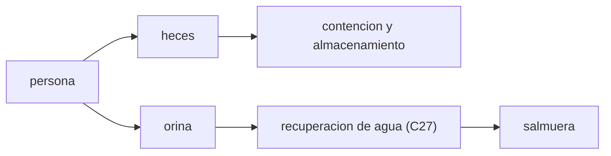

# B106-C10 — Gestión de residuos humanos

<!-- nav:top -->
[🏠 Programa](../../../../README.md) · [📚 Bloque B106](../../../tronco-comun/B106-habitats-espaciales-y-soporte-vital.md) · [← Anterior: B106-C09 — Sistemas ECLSS](../B106-C09-sistemas-eclss/CLASE.md) · [Siguiente: B106-C11 — Almacenamiento de alimentos →](../B106-C11-almacenamiento-de-alimentos/CLASE.md)
<!-- /nav -->

## 1. Ubicación, nivel y alcance

Clase 10 del bloque B106 (hábitats espaciales y soporte vital). Nivel N3. Cuantifica la corriente que alimenta los lazos de agua y de materia: los residuos humanos. Usa los máximos de diseño del resumen consultado y un Monte Carlo para ver cuánto margen tienen. Todos los datos del laboratorio son **sintéticos o ilustrativos** y se rotulan como tales; solo se tratan como consultados los valores de la sección 11 que dicen «Consultada».

## 2. Por qué esta clase existe

Los residuos no desaparecen: hay que contenerlos, almacenarlos o procesarlos. La decisión central: **¿qué masa y volumen de residuos hay que contener en una misión y cuánto margen tiene el máximo de diseño sobre el uso típico?**

## 3. Lo que podrás hacer al terminar

1. Convertir los máximos de diseño consultados a kg/día y L/día por persona.
2. Calcular masa y volumen de residuos de una misión en los casos máximo y típico.
3. Estimar masa seca y masa con envases.
4. Simular con Poisson el percentil 95 de la masa y compararlo con el máximo.
5. Estimar el agua recuperable de la orina y la salmuera restante.
6. Rotular los valores típicos como ilustrativos.

La evidencia es la **presupuesto de residuos de la misión** del ejercicio 12 (sección 20).

## 4. Con qué llegas y cómo comprobarlo

1. ¿Cuántos kg son 1,1 lb?
2. ¿Qué es una distribución de Poisson?
3. ¿Qué es un percentil 95?
4. ¿Qué es la masa seca?
5. ¿Qué es una salmuera?

<details>
<summary>Ver respuestas</summary>

1. 0,499 kg (1 lb = 0,45359 kg). 2. La del número de eventos independientes en un intervalo. 3. El valor bajo el cual cae el 95 % de los resultados. 4. La masa sin agua. 5. Un líquido concentrado en sales.
</details>

Con cuatro o cinco aciertos, sigue; si no, repasa los prerrequisitos.

## 5. Un caso de contexto y casos de referencia

El resumen consultado fija máximos promedio de **2 eventos de 1,1 lb** de heces y **7 eventos de 1 L** de orina por persona y día: 0,998 kg y 7 L. Una misión de 4 personas y 30 días contiene en el máximo **119,7 kg** de heces y 840 L de orina; con valores típicos ilustrativos, 17,3 kg y 180 L. El percentil 95 simulado (19,7 kg) queda 6,1 veces por debajo del máximo de diseño.

## 6. Vocabulario

**Máximo promedio de diseño:** cota usada para dimensionar. **Evento:** una defecación o micción. **Contención:** guardar sin fugas ni olores. **Masa seca:** sin agua. **Salmuera:** residuo líquido concentrado de la orina.

## 7. Modelo mental



*Descripción textual:* las heces se contienen y almacenan; la orina va a recuperación de agua y deja salmuera.

Analogía: dimensionar un almacén por el día de más ventas. Límite: el máximo de diseño es una cota promedio, no un evento puntual.

## 8. La explicación, paso a paso

### 8.1 Máximos consultados

Heces: `2·1,1 lb = 2,2 lb = 0,998 kg/día`; orina `7·1 L = 7 L/día`. Son máximos promedio de diseño del resumen consultado (requisito citado V2 7102).

### 8.2 Una misión de 4 personas y 30 días

Máximo: 119,7 kg de heces (29,9 kg secas con 75 % de agua, valor ilustrativo), 840 L de orina y 131,7 kg con 10 % de envases. Típico (ilustrativo): 17,3 kg y 180 L.

### 8.3 Margen

El Monte Carlo (20 000 misiones, semilla 106) da mediana 17,3 kg y percentil 95 19,7 kg: el máximo de diseño es 6,1 veces mayor, un margen amplio que cubre variaciones de dieta y de salud.

### 8.4 Orina y agua

Con 85 % de recuperación (ilustrativo; C27 muestra el límite químico) la orina típica devuelve 153 L y deja 27 L de salmuera.

## 9. Magnitudes, símbolos y unidades

| Símbolo | Qué es | Unidad | Valor / nota |
|---|---|---|---|
| `f_max` | máximo de heces | kg/persona/día | 0,998 (consultado) |
| `u_max` | máximo de orina | L/persona/día | 7 (consultado) |
| `F` | masa de heces de la misión | kg | 119,7 (máx.) |
| `p95` | percentil 95 simulado | kg | 19,7 |
| `r_u` | recuperación de orina | — | 0,85 (ilustrativo) |

## 10. Convenciones y referencias

4 personas, 30 días, densidad 1000 kg/m³; 1 lb = 0,45359237 kg; típicos de 1,2 eventos/día de 0,12 kg y 5 eventos/día de 0,3 L; semilla 106; Poisson. Tolerancia: `f_max` dentro de 1e-3 de 0,998 kg y mediana < p95 < máximo. Numpy y Python: ver la primera línea de la salida del laboratorio (Python 3.12.9, numpy 2.4.4 en la ejecución del 2026-11-10).

## 11. De dónde sale lo que afirmamos

| ID | Fuente | Localizador | Respalda | Estado |
|---|---|---|---|---|
| S2 | NASA, Oficina del Jefe de Salud y Medicina (OCHMO), OCHMO-TB-002 rev. B (14 de noviembre de 2023), «Environmental Control & Life Support System (ECLSS): Human-Centered Approach», resumen técnico derivado de NASA-STD-3001 vol. 2 rev. D — https://www.nasa.gov/wp-content/uploads/2023/12/ochmo-tb-002-eclss.pdf (consultada 2026-11-10; PDF leído con PyMuPDF) | figura de entradas y salidas humanas | heces: máximo promedio de 2 eventos de 1,1 lb por persona y día; orina: máximo promedio de 7 eventos de 1 L por persona y día; lista de requisitos de manejo de residuos corporales (V2 7020 y 7025) | Consultada (resumen técnico) |
| — | Valores típicos, contenido de agua, envases, Poisson | — | ilustrativos y verificados por el laboratorio | No consultada en una fuente concreta |

Límites: el resumen OCHMO sobre gestión de residuos (TB-042) **no se consultó** (no se halló); los valores típicos son ilustrativos y no representan a ninguna tripulación.

## 12. Cómo ver el resultado

| Resultado | Valor |
|---|---|
| Máximos por persona y día | 0,998 kg; 7 L |
| Heces máx. / típicas (4 pers., 30 d) | 119,7 / 17,3 kg |
| Orina máx. / típica | 840 / 180 L |
| Percentil 95 simulado | 19,7 kg |
| Margen del máximo | 6,1 veces |

Descripción larga: el máximo de diseño de los residuos es varias veces el uso típico; la orina es el mayor volumen y alimenta el lazo del agua.

## 13. Ejemplo trabajado: residuos de una misión

**Paso 1.** Heces máximas: `4·30·0,998 = 119,7 kg`.

**Paso 2.** Con 10 % de envases: `119,7·1,10 = 131,7 kg`.

**Paso 3.** Orina máxima: `4·30·7 = 840 L`.

**Paso 4.** Típico: `4·30·0,144 = 17,3 kg` de heces y `4·30·1,5 = 180 L` de orina.

## 14. Distintas formas de describir el problema

**Por masa:** kg. **Por volumen:** L. **Por escenario:** máximo, típico. **Por probabilidad:** percentil. **Por destino:** almacenar o procesar.

## 15. Práctica guiada

**Ejercicio 1 · con los pasos indicados.** Calcula los kg máximos de heces de 6 personas en 60 días. *Pasos:* `6·60·0,998`.

<details><summary>Solución comentada</summary>

`359 kg`.
</details>

**Ejercicio 2 · con una pista.** Calcula la orina máxima de 6 personas en 60 días. *Pista:* 7 L.

<details><summary>Solución comentada</summary>

`2520 L`.
</details>

**Ejercicio 3 · casi autónomo.** Calcula la masa seca de 100 kg de heces al 75 % de agua. *Pista:* `1 − 0,75`.

<details><summary>Solución comentada</summary>

`25 kg`.
</details>

## 16. Práctica autónoma, transferencia e integrador

**Ejercicio 4 · autónomo.** ¿Cuánta salmuera deja 840 L de orina con 85 % de recuperación?

<details><summary>Solución comentada</summary>

`126 L`.
</details>

**Ejercicio 5 · autónomo.** Con el típico de 0,144 kg/día, ¿cuánto en 180 días para 4 personas?

<details><summary>Solución comentada</summary>

`4·180·0,144 = 104 kg`.
</details>

**Ejercicio 6 · autónomo.** ¿Por qué el máximo es tan alto frente al típico?

<details><summary>Solución comentada</summary>

Es una cota de diseño que cubre dieta, salud y variación entre personas.
</details>

**Ejercicio 7 · autónomo.** Si la mediana es 17,3 y el p95 19,7, ¿cuál es la dispersión relativa?

<details><summary>Solución comentada</summary>

`2,4/17,3 = 14 %`.
</details>

**Ejercicio 8 · autónomo.** ¿Qué pasa si el contenido de agua real es 70 %?

<details><summary>Solución comentada</summary>

La masa seca sube a 30 %: +20 %.
</details>

**Ejercicio 9 · transferencia.** Una misión de 900 días con 4 personas: ¿masa de heces típica?

<details><summary>Solución comentada</summary>

`4·900·0,144 = 518 kg`; hace falta procesar, no solo almacenar.
</details>

**Ejercicio 10 · transferencia.** ¿Qué le pasa al volumen si se compacta la masa seca al doble de densidad?

<details><summary>Solución comentada</summary>

Se reduce a la mitad del volumen seco.
</details>

**Ejercicio 11 · transferencia.** ¿Cómo se relaciona la orina con el límite de agua de C06?

<details><summary>Solución comentada</summary>

Es la corriente que recupera la mayor parte del agua; su recuperación limita `r`.
</details>

**Ejercicio 12 · integrador.** Elabora tu *presupuesto de residuos de la misión*: máximos consultados, tabla máximo y típico para masa y volumen, masa seca y envases, percentil 95 por Monte Carlo, salmuera y qué es consultado o ilustrativo.

<details><summary>Solución comentada</summary>

Secciones 8.1–8.4 y la salida del laboratorio.
</details>

## 17. Laboratorio: presupuesto de residuos

El script [residuos.py](residuos.py) convierte los máximos consultados, calcula masa y volumen de una misión, simula con Poisson el percentil 95 y estima el agua recuperable (**comprueba** que 1,1 lb×2 son 0,998 kg y que mediana < p95 < máximo).

**Datos:** máximos **consultados**; típicos y Monte Carlo **sintéticos** (semilla 106); no representan a una tripulación. **Predice antes de ejecutar:** ¿Cuántos kg de heces da el máximo de 4 personas en 30 días? (unos 120). **Ejecución del 2026-11-10 (Python 3.12.9):**

```text
Python 3.12.9; numpy 2.4.4
DATOS: maximos de diseno consultados (OCHMO-TB-002); valores tipicos y Monte Carlo SINTETICOS (semilla 106)
Maximos consultados por persona y dia: heces 0.998 kg (2 x 1.1 lb); orina 7.0 L (7 x 1 L)
Mision de 4 personas y 30 dias:
   caso            heces [kg]   orina [L]   heces secas [kg]   volumen de heces [L]
   diseno maximo         119.7         840             29.9              119.7
   tipico (ilustr.)       17.3         180              4.3               17.3
Con 10 % de bolsas y envases, el diseno maximo de heces pesa 131.7 kg
Monte Carlo (Poisson, 20000 misiones): masa de heces mediana 17.3 kg, percentil 95 19.7 kg; diseno maximo 119.7 kg
El diseno maximo es 6.1 veces el percentil 95 simulado (margen de diseno)
Con 85 % de recuperacion (ilustrativo, ver C27), la orina tipica devuelve 153 L y deja 27 L de salmuera
Pruebas superadas.
```

```bash
python programa/clases/B106/B106-C10-gestion-de-residuos-humanos/residuos.py
```

**Límites:** eventos independientes, sin variación entre personas ni de dieta, contenido de agua fijo, sin procesos de tratamiento.

## 18. Errores frecuentes y cómo corregirlos

**Confundir lb con kg.** 1 lb = 0,454 kg (8.1).

**Dimensionar con el uso típico.** Usa el máximo (8.3).

**Olvidar los envases.** Añade el 10 % (8.2).

**Presentar el Monte Carlo como medición.** Es sintético.

## 19. Cómo sabrás que vas bien

Tras la sección 8: ¿qué masa de heces y qué volumen de orina da el máximo de 4 personas en 30 días? Si dudas, repasa el ejemplo 13. Tras el laboratorio: ¿qué comprueba? (ver la sección 17).

## 20. Qué entregas y cómo se evalúa

El producto es tu **presupuesto de residuos de la misión** (ejercicio 12).

| Criterio | Inicial | En desarrollo | Logrado | Destacado |
|---|---|---|---|---|
| Conceptos | Confunde las magnitudes | Parciales | Explica máximos, escenarios y margen | Explica los supuestos y sus límites |
| Cálculo | Sin unidades | Con errores | Calcula con unidades y cifras coherentes | Calcula casos nuevos y los verifica |
| Numérico | Sin comprobación | Un caso | Compara con el control del laboratorio | Interpreta la sensibilidad |
| Fuentes | Sin fuente | Sin fecha | Fuentes con fecha y estado | Declara lo ilustrativo y lo no consultado |
| Límites | No los nombra | Uno | Tres | Discute qué falta para un hábitat real |

**Condiciones críticas (no se compensan con promedio):** rotular los datos como sintéticos o ilustrativos; no presentar un valor ilustrativo como límite de una norma; citar solo lo consultado; no usar la clase como consejo médico ni operativo.

## 21. Ética, seguridad y límites

Clase **educativa**: no da consejo médico ni operativo y no sirve para decidir la atmósfera, el agua, la exposición ni la respuesta ante una emergencia de un hábitat o de una persona reales. Los residuos son una corriente de riesgo biológico; esta clase no es un procedimiento de manejo. Accesibilidad: tablas equivalentes a las gráficas, fórmulas en texto, ejercicios sin conexión.

## 22. Para cerrar y seguir

Los máximos del resumen consultado (0,998 kg y 7 L por persona y día) llevan a unos 120 kg de heces y 840 L de orina en 30 días para 4 personas, con mucho margen sobre el uso típico. Siguen los alimentos.

**Glosario español–inglés.** residuo · *waste*; heces · *feces*; orina · *urine*; contención · *containment*; percentil · *percentile*.

**Continuidad.** Sigue con la clase siguiente del bloque (enlace en la navegación) o vuelve al [bloque B106](../../../tronco-comun/B106-habitats-espaciales-y-soporte-vital.md).

**Referencias:** ver sección 11.

<!-- nav:bottom -->
---

[← Anterior: B106-C09 — Sistemas ECLSS](../B106-C09-sistemas-eclss/CLASE.md) · [📚 Bloque B106](../../../tronco-comun/B106-habitats-espaciales-y-soporte-vital.md) · [Siguiente: B106-C11 — Almacenamiento de alimentos →](../B106-C11-almacenamiento-de-alimentos/CLASE.md)
<!-- /nav -->
