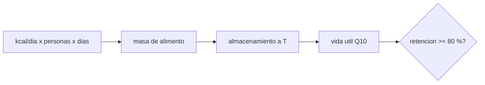

# B106-C11 — Almacenamiento de alimentos

<!-- nav:top -->
[🏠 Programa](../../../../README.md) · [📚 Bloque B106](../../../tronco-comun/B106-habitats-espaciales-y-soporte-vital.md) · [← Anterior: B106-C10 — Gestión de residuos humanos](../B106-C10-gestion-de-residuos-humanos/CLASE.md) · [Siguiente: B106-C12 — Agricultura en ambiente controlado →](../B106-C12-agricultura-en-ambiente-controlado/CLASE.md)
<!-- /nav -->

## 1. Ubicación, nivel y alcance

Clase 11 del bloque B106 (hábitats espaciales y soporte vital). Nivel N3. Cuantifica el alimento que hay que lanzar y cuánto tiempo conserva sus propiedades. Retoma la ingesta consultada de 3035 kcal/día (C01) y la usa para dimensionar misiones de distinta duración. Todos los datos del laboratorio son **sintéticos o ilustrativos** y se rotulan como tales; solo se tratan como consultados los valores de la sección 11 que dicen «Consultada».

## 2. Por qué esta clase existe

El alimento es la única entrada del balance humano que aún se lanza casi por completo, y se degrada con el tiempo y la temperatura. La decisión central: **¿cuánta masa de alimento y con qué margen de vida útil hay que embarcar para una misión dada?**

## 3. Lo que podrás hacer al terminar

1. Calcular la masa diaria de alimento envasado a partir de la ingesta y de una densidad energética.
2. Dimensionar la masa total de tres misiones con margen.
3. Aplicar la regla de Q10 para estimar la vida útil según la temperatura.
4. Calcular la retención de un nutriente con cinética de primer orden.
5. Detectar alimento que supera su vida útil por almacenamiento previo.
6. Rotular que densidad, envase, vida útil y Q10 son ilustrativos.

La evidencia es la **plan de alimentos con vida útil** del ejercicio 12 (sección 20).

## 4. Con qué llegas y cómo comprobarlo

1. ¿Cuánta energía son 3035 kcal en MJ?
2. ¿Qué es una cinética de primer orden?
3. ¿Qué es el Q10?
4. ¿Qué es el margen?
5. ¿Qué es un valor ilustrativo?

<details>
<summary>Ver respuestas</summary>

1. `3035·4,184/1000 = 12,7 MJ`. 2. Una pérdida proporcional a la cantidad presente: `exp(−k t)`. 3. El factor por el que cambia una velocidad al subir 10 °C. 4. Una masa extra para cubrir incertidumbre. 5. Uno inventado que se rotula como tal.
</details>

Con cuatro o cinco aciertos, sigue; si no, repasa los prerrequisitos.

## 5. Un caso de contexto y casos de referencia

Con 3,5 kcal/g (ilustrativo) una persona necesita 867 g de alimento al día y 0,997 kg con 15 % de envase. Una misión de 4 personas y 180 días pesa **790 kg** con 10 % de margen; una a Marte de 6 personas y 900 días, **5923 kg**. Con vida útil de 24 meses a 21 °C y `Q10 = 2`, el alimento almacenado a 31 °C dura 12 meses; uno que espera 24 meses y se consume 30 meses después retiene **0,605**, por debajo del 80 %.

## 6. Vocabulario

**Densidad energética:** kcal por gramo de alimento. **Vida útil:** tiempo hasta un criterio de calidad (aquí 80 % de retención). **Q10:** factor por 10 °C. **Retención:** fracción que queda de un nutriente. **Margen:** masa de seguridad.

## 7. Modelo mental



*Descripción textual:* la energía requerida fija la masa; el almacenamiento a una temperatura fija la vida útil y esta decide si el alimento sigue siendo aceptable al consumirlo.

Analogía: la despensa de un barco. Límite: aquí un solo nutriente representa toda la calidad; en alimentos reales hay textura, sabor, seguridad microbiológica y varios nutrientes.

## 8. La explicación, paso a paso

### 8.1 Masa de alimento

`m = c·d·(kcal/ρ_e)(1 + envase)(1 + margen)`. Con 3035 kcal, 3,5 kcal/g: 867 g/día y 0,997 kg con envase. Para 4 personas y 365 días: 1602 kg; para 6 y 900 días: 5923 kg.

### 8.2 Vida útil y temperatura

`t(T) = t_ref Q10^((T_ref − T)/10)`. A 4 °C, 78 meses; a 21 °C, 24; a 31 °C, 12; a 41 °C, 6. Cada 10 °C divide la vida útil por 2.

### 8.3 Retención

`ret = exp(−k t)` con `k = −ln 0,8/t_vida`. A 21 °C: 0,894 a 12 meses y 0,716 a 36; a 31 °C, 0,512 a 36.

### 8.4 Almacenamiento previo

Un alimento que espera 24 meses antes de un viaje de 30 meses llega a 54 meses de edad: retención 0,605. El almacenamiento largo exige temperatura baja o reposición.

## 9. Magnitudes, símbolos y unidades

| Símbolo | Qué es | Unidad | Valor / nota |
|---|---|---|---|
| `ρ_e` | densidad energética | kcal/g | 3,5 (ilustrativo) |
| `m_dia` | masa envasada por persona y día | kg | 0,997 |
| `t_vida` | vida útil a 21 °C | meses | 24 (ilustrativo) |
| `Q10` | factor por 10 °C | — | 2 (ilustrativo) |
| `ret` | retención de un nutriente | — | 0,605 (54 meses, 21 °C) |

## 10. Convenciones y referencias

Ingesta consultada de 3035 kcal/día; densidad, envase del 15 %, margen del 10 %, 24 meses a 21 °C y Q10 = 2 ilustrativos; un nutriente representativo. Tolerancias: retención de 0,80 a `t_vida` (1e-12) y vida a +10 °C dividida por Q10 (1e-12). Numpy y Python: ver la primera línea de la salida del laboratorio (Python 3.12.9, numpy 2.4.4 en la ejecución del 2026-11-10).

## 11. De dónde sale lo que afirmamos

| ID | Fuente | Localizador | Respalda | Estado |
|---|---|---|---|---|
| S2 | NASA, Oficina del Jefe de Salud y Medicina (OCHMO), OCHMO-TB-002 rev. B (14 de noviembre de 2023), «Environmental Control & Life Support System (ECLSS): Human-Centered Approach», resumen técnico derivado de NASA-STD-3001 vol. 2 rev. D — https://www.nasa.gov/wp-content/uploads/2023/12/ochmo-tb-002-eclss.pdf (consultada 2026-11-10; PDF leído con PyMuPDF) | figura de entradas humanas y lista de requisitos (V2 7110, alimentos y su impacto en sistemas ambientales) | ingesta media de 3035 kcal/día por persona | Consultada (resumen técnico; no se consultó el contenido del requisito V2 7110) |
| — | Regla de Q10, cinética de primer orden, densidad energética | — | ilustrativos y verificados por el laboratorio | No consultada en una fuente concreta |

Límites: no se consultó ninguna fuente sobre sistemas de alimentos espaciales, empaques ni vida útil real; los resúmenes OCHMO de nutrición **no se consultaron**.

## 12. Cómo ver el resultado

| Resultado | Valor |
|---|---|
| Alimento por persona y día | 867 g (0,997 kg envasado) |
| Misión 4 personas, 180 d / 365 d | 790 / 1602 kg |
| Misión 6 personas, 900 d | 5923 kg |
| Vida útil a 4 / 21 / 31 °C | 78 / 24 / 12 meses |
| Retención a 54 meses (21 °C) | 0,605 |

Descripción larga: la masa de alimento crece linealmente con personas y días, pero la vida útil cae por mitades con cada 10 °C: la logística de una misión larga depende de la temperatura de almacenamiento.

## 13. Ejemplo trabajado: masa de alimento y vida útil

**Paso 1.** `3035/3,5 = 867 g/día`; con envase, `0,867·1,15 = 0,997 kg`.

**Paso 2.** Misión de 6 personas, 900 días: `6·900·0,997 = 5384 kg`; con 10 % de margen, `5923 kg`.

**Paso 3.** Vida útil a 31 °C: `24·2^((21−31)/10) = 12 meses`.

**Paso 4.** Retención a 36 meses a 31 °C: `k = 0,2231/12`; `exp(−0,01859·36) = 0,512`.

## 14. Distintas formas de describir el problema

**Por masa:** kg. **Por energía:** kcal. **Por tiempo:** vida útil. **Por temperatura:** Q10. **Por retención:** exponencial.

## 15. Práctica guiada

**Ejercicio 1 · con los pasos indicados.** Calcula la masa diaria con 4,0 kcal/g y 10 % de envase. *Pasos:* g, envase.

<details><summary>Solución comentada</summary>

`3035/4 = 759 g`; `·1,10 = 0,835 kg`.
</details>

**Ejercicio 2 · con una pista.** Calcula la masa de 4 personas durante 100 días con 0,997 kg/día y 10 % de margen. *Pista:* multiplica.

<details><summary>Solución comentada</summary>

`4·100·0,997·1,10 = 439 kg`.
</details>

**Ejercicio 3 · casi autónomo.** ¿Qué vida útil tiene a 11 °C? *Pista:* `24·2^((21−11)/10)`.

<details><summary>Solución comentada</summary>

`48 meses`.
</details>

## 16. Práctica autónoma, transferencia e integrador

**Ejercicio 4 · autónomo.** ¿Qué retención hay a 12 meses a 41 °C?

<details><summary>Solución comentada</summary>

`0,640`.
</details>

**Ejercicio 5 · autónomo.** ¿A qué temperatura dura 12 meses el alimento?

<details><summary>Solución comentada</summary>

A 31 °C.
</details>

**Ejercicio 6 · autónomo.** Un alimento de 24 meses a 21 °C, ¿cuánto dura a 26 °C?

<details><summary>Solución comentada</summary>

`24·2^(−0,5) = 17,0 meses`.
</details>

**Ejercicio 7 · autónomo.** Si la densidad energética es 3,0 kcal/g, ¿cuánto sube la masa diaria?

<details><summary>Solución comentada</summary>

Un 16,7 %.
</details>

**Ejercicio 8 · autónomo.** ¿Por qué la regla de Q10 no sirve fuera de un rango de temperatura?

<details><summary>Solución comentada</summary>

Porque los mecanismos de degradación cambian (congelación, cambios de fase).
</details>

**Ejercicio 9 · transferencia.** Se pre-posiciona alimento para Marte 26 meses antes de la llegada. ¿Cuál es el efecto a 21 °C y a 4 °C?

<details><summary>Solución comentada</summary>

Retención a 54 meses de edad: 0,605 a 21 °C; a 4 °C, `exp(−0,2231·54/78) = 0,857`: la temperatura salva el alimento.
</details>

**Ejercicio 10 · transferencia.** ¿Cómo cambia la masa si una parte se cultiva (C12)?

<details><summary>Solución comentada</summary>

Baja en proporción a las kcal aportadas, a costa de área, luz y mano de obra.
</details>

**Ejercicio 11 · transferencia.** ¿Qué falta para un plan real de alimentos?

<details><summary>Solución comentada</summary>

Nutrición completa, seguridad microbiológica, aceptabilidad, variedad y envases con barrera; ver OCHMO.
</details>

**Ejercicio 12 · integrador.** Elabora tu *plan de alimentos con vida útil*: masa por persona, tabla de tres misiones con margen, vida útil y retención según la temperatura, caso de almacenamiento previo y qué es consultado o ilustrativo.

<details><summary>Solución comentada</summary>

Secciones 8.1–8.4 y la salida del laboratorio.
</details>

## 17. Laboratorio: masa de alimento y vida útil

El script [alimentos.py](alimentos.py) calcula la masa de alimento de tres misiones, la vida útil con Q10 y la retención con cinética de primer orden (**comprueba** el 0,80 a `t_vida` y que +10 °C divide la vida útil por Q10).

**Datos:** ingesta **consultada**; resto **ilustrativo**; sin aleatoriedad. **Predice antes de ejecutar:** ¿Cuántos meses dura el alimento a 31 °C si dura 24 a 21 °C con `Q10 = 2`? (12). **Ejecución del 2026-11-10 (Python 3.12.9):**

```text
Python 3.12.9; numpy 2.4.4
DATOS: ingesta consultada (3035 kcal/dia); densidad energetica, envase, vida util y Q10 ILUSTRATIVOS; sin datos de alimentos reales
Alimento por persona y dia: 867 g de alimento + 15 % de envase = 0.997 kg
Misiones (con 10 % de margen):
   mision               personas  dias   masa total [kg]
   orbita baja               4    180            790
   Luna superficie           4    365           1602
   Marte ida y vuelta        6    900           5923
Vida util (80 % de retencion) segun la temperatura de almacenamiento (Q10 = 2.0):
   T [C]   vida util [meses]   retencion a 12 m   retencion a 36 m
     4.0              78.0            0.966            0.902
    21.0              24.0            0.894            0.716
    31.0              12.0            0.800            0.512
    41.0               6.0            0.640            0.262
Alimento almacenado 24 meses antes y consumido hasta 30 meses despues (54 m) a 21 C: retencion 0.605 (bajo el 80 %)
Alimento a 31 C: retencion a 36 m 0.512 frente a 0.716 a 21 C
Pruebas superadas.
```

```bash
python programa/clases/B106/B106-C11-almacenamiento-de-alimentos/alimentos.py
```

**Límites:** un nutriente representa la calidad, Q10 constante, temperatura constante, sin seguridad microbiológica ni aceptabilidad.

## 18. Errores frecuentes y cómo corregirlos

**Olvidar el envase.** Añade su masa (8.1).

**Aplicar Q10 sin comprobar el rango.** Ver ejercicio 8.

**Suponer que el alimento no se degrada.** Calcula la retención (8.3).

**Presentar un valor ilustrativo como dato de alimentos espaciales.** Rotula.

## 19. Cómo sabrás que vas bien

Tras la sección 8: ¿cuánta masa de alimento y qué retención tiene un alimento de 54 meses a 21 °C? Si dudas, repasa el ejemplo 13. Tras el laboratorio: ¿qué comprueba? (ver la sección 17).

## 20. Qué entregas y cómo se evalúa

El producto es tu **plan de alimentos con vida útil** (ejercicio 12).

| Criterio | Inicial | En desarrollo | Logrado | Destacado |
|---|---|---|---|---|
| Conceptos | Confunde las magnitudes | Parciales | Explica masa, Q10 y retención | Explica los supuestos y sus límites |
| Cálculo | Sin unidades | Con errores | Calcula con unidades y cifras coherentes | Calcula casos nuevos y los verifica |
| Numérico | Sin comprobación | Un caso | Compara con el control del laboratorio | Interpreta la sensibilidad |
| Fuentes | Sin fuente | Sin fecha | Fuentes con fecha y estado | Declara lo ilustrativo y lo no consultado |
| Límites | No los nombra | Uno | Tres | Discute qué falta para un hábitat real |

**Condiciones críticas (no se compensan con promedio):** rotular los datos como sintéticos o ilustrativos; no presentar un valor ilustrativo como límite de una norma; citar solo lo consultado; no usar la clase como consejo médico ni operativo.

## 21. Ética, seguridad y límites

Clase **educativa**: no da consejo médico ni operativo y no sirve para decidir la atmósfera, el agua, la exposición ni la respuesta ante una emergencia de un hábitat o de una persona reales. Los plazos de vida útil son del modelo; la seguridad alimentaria real exige ensayos microbiológicos y sensoriales. Accesibilidad: tablas equivalentes a las gráficas, fórmulas en texto, ejercicios sin conexión.

## 22. Para cerrar y seguir

Una persona necesita unos 1,0 kg de alimento envasado al día y la temperatura de almacenamiento decide si llega bien tras años: cada 10 °C divide la vida útil por 2. La clase siguiente pregunta qué parte puede cultivarse.

**Glosario español–inglés.** vida útil · *shelf life*; retención · *retention*; densidad energética · *energy density*; envase · *packaging*; margen · *margin*.

**Continuidad.** Sigue con la clase siguiente del bloque (enlace en la navegación) o vuelve al [bloque B106](../../../tronco-comun/B106-habitats-espaciales-y-soporte-vital.md).

**Referencias:** ver sección 11.

<!-- nav:bottom -->
---

[← Anterior: B106-C10 — Gestión de residuos humanos](../B106-C10-gestion-de-residuos-humanos/CLASE.md) · [📚 Bloque B106](../../../tronco-comun/B106-habitats-espaciales-y-soporte-vital.md) · [Siguiente: B106-C12 — Agricultura en ambiente controlado →](../B106-C12-agricultura-en-ambiente-controlado/CLASE.md)
<!-- /nav -->
