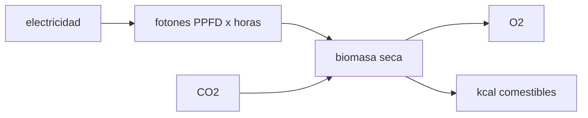

# B106-C12 — Agricultura en ambiente controlado

<!-- nav:top -->
[🏠 Programa](../../../../README.md) · [📚 Bloque B106](../../../tronco-comun/B106-habitats-espaciales-y-soporte-vital.md) · [← Anterior: B106-C11 — Almacenamiento de alimentos](../B106-C11-almacenamiento-de-alimentos/CLASE.md) · [Siguiente: B106-C13 — Iluminación y ciclos circadianos →](../B106-C13-iluminacion-y-ciclos-circadianos/CLASE.md)
<!-- /nav -->

## 1. Ubicación, nivel y alcance

Clase 12 del bloque B106 (hábitats espaciales y soporte vital). Nivel N3. Mira el cultivo como un sistema físico con un presupuesto de fotones, no como biología detallada: cuánta luz, área y energía eléctrica da qué parte de las calorías, del oxígeno y del CO₂ de una persona. Todos los parámetros del cultivo son ilustrativos. Todos los datos del laboratorio son **sintéticos o ilustrativos** y se rotulan como tales; solo se tratan como consultados los valores de la sección 11 que dicen «Consultada».

## 2. Por qué esta clase existe

Cultivar reduce la masa de alimento a lanzar y devuelve oxígeno, pero cuesta mucha área y electricidad. La decisión central: **¿qué fracción de la dieta compensa cultivar dado el costo en área y energía?**

## 3. Lo que podrás hacer al terminar

1. Calcular la integral diaria de luz (DLI) y la potencia eléctrica de las lámparas.
2. Estimar la biomasa, el comestible y las kcal por metro cuadrado.
3. Calcular el O₂ liberado y el CO₂ fijado con la estequiometría de la biomasa.
4. Dimensionar el área por persona para una fracción de la dieta.
5. Verificar la conservación de masa de la fotosíntesis.
6. Rotular que todos los parámetros del cultivo son ilustrativos.

La evidencia es la **dimensionado de un cultivo con su consumo eléctrico** del ejercicio 12 (sección 20).

## 4. Con qué llegas y cómo comprobarlo

1. ¿Qué es el PPFD?
2. ¿Qué es una eficiencia de uso de la luz?
3. ¿Qué libera la fotosíntesis?
4. ¿Qué es la fracción comestible?
5. ¿Cuántos g pesa un mol de CH₂O?

<details>
<summary>Ver respuestas</summary>

1. La densidad de flujo de fotones fotosintéticos (µmol/m²/s). 2. Biomasa producida por mol de fotones. 3. O₂, y fija CO₂ en biomasa. 4. La parte de la biomasa que se come. 5. 30,03 g.
</details>

Con cuatro o cinco aciertos, sigue; si no, repasa los prerrequisitos.

## 5. Un caso de contexto y casos de referencia

Con 300 µmol/(m² s) durante 16 h, la DLI es **17,28 mol/(m² día)** y las lámparas consumen 80 W/m² en promedio. Por m² y día, el cultivo ilustrativo da 25,9 g de biomasa seca, **44 kcal** comestibles, 27,6 g de O₂ y fija 38,0 g de CO₂. Cubrir el 100 % de las calorías de una persona exigiría **68,5 m²** y 5,48 kW; el O₂ de una persona saldría de 27,9 m². Cifras inventadas para enseñar el cálculo.

## 6. Vocabulario

**PPFD:** flujo de fotones útiles. **DLI:** mol de fotones por m² y día. **Eficacia de la lámpara:** µmol por julio. **Eficiencia de uso de la luz:** g de biomasa por mol de fotones. **Fracción comestible:** parte aprovechada. **Biomasa seca:** masa sin agua.

## 7. Modelo mental



*Descripción textual:* la electricidad se convierte en fotones; con CO₂ y agua dan biomasa, O₂ y calorías comestibles.

Analogía: una fábrica de calorías cuyo combustible es la luz. Límite: aquí la planta se reduce a una eficiencia fija; la real depende de la especie, la edad, el CO₂, la temperatura y el estrés.

## 8. La explicación, paso a paso

### 8.1 Presupuesto de luz

`DLI = PPFD·10⁻⁶·horas·3600 = 17,28 mol/(m² día)`. Con 2,5 µmol/J, `300/2,5 = 120 W/m²` encendida y 80 W/m² promedio en 16 de 24 h.

### 8.2 Biomasa y calorías

`biomasa = DLI·LUE = 25,9 g/(m² día)`; comestible `·0,45`; kcal `·3,8 = 44 kcal/(m² día)`.

### 8.3 Gases

La biomasa como CH₂O (30,03 g/mol) libera 1 mol de O₂ por mol de CO₂ fijado: 27,6 g de O₂ y 38,0 g de CO₂ por m² y día. Control de masa: `CO₂ + H₂O → CH₂O + O₂` conserva 62,03 g/mol.

### 8.4 Área por persona

Para 3035 kcal: 68,5 m² y 5,48 kW. Para 25 % de las kcal: 17,1 m². Para el O₂ de una persona (771 g): 27,9 m²; para el CO₂ (901 g): 23,7 m².

### 8.5 Un resultado que sorprende

Si el área da el 100 % de las kcal, el cultivo libera 2,45 veces el O₂ que consume una persona: en este modelo la comida, no el aire, fija el área.

## 9. Magnitudes, símbolos y unidades

| Símbolo | Qué es | Unidad | Valor / nota |
|---|---|---|---|
| DLI | integral diaria de luz | mol/(m² día) | 17,28 |
| `P_el` | potencia eléctrica promedio | W/m² | 80 |
| `A_kcal` | área para el 100 % de las kcal | m²/persona | 68,5 |
| `A_O₂` | área para todo el O₂ | m²/persona | 27,9 |
| LUE | eficiencia de uso de la luz | g/mol | 1,5 (ilustrativo) |

## 10. Convenciones y referencias

PPFD 300 µmol/(m² s); 16 h de luz; 2,5 µmol/J; LUE 1,5 g/mol; fracción comestible 0,45; 3,8 kcal/g; biomasa como CH₂O con 1 mol de O₂ por mol de CO₂. Todo ilustrativo. Tolerancia: conservación de masa de la reacción dentro de 0,01 g/mol. Numpy y Python: ver la primera línea de la salida del laboratorio (Python 3.12.9, numpy 2.4.4 en la ejecución del 2026-11-10).

## 11. De dónde sale lo que afirmamos

| ID | Fuente | Localizador | Respalda | Estado |
|---|---|---|---|---|
| S2 | NASA, Oficina del Jefe de Salud y Medicina (OCHMO), OCHMO-TB-002 rev. B (14 de noviembre de 2023), «Environmental Control & Life Support System (ECLSS): Human-Centered Approach», resumen técnico derivado de NASA-STD-3001 vol. 2 rev. D — https://www.nasa.gov/wp-content/uploads/2023/12/ochmo-tb-002-eclss.pdf (consultada 2026-11-10; PDF leído con PyMuPDF) | figura de entradas y salidas humanas | 3035 kcal/día, 0,771 kg de O₂ y CO₂ asociado por persona (C01) | Consultada (resumen técnico) |
| — | Fotosíntesis, DLI y eficiencias del cultivo | — | ilustrativos; el laboratorio verifica la aritmética y la masa | No consultada: no se consultó ninguna fuente de agricultura espacial |

Límites: ningún parámetro del cultivo (PPFD, LUE, fracción comestible) procede de una fuente consultada; los resúmenes OCHMO y publicaciones de plantas **no se consultaron**. No se modelan nutrientes, agua ni seguridad de los cultivos.

## 12. Cómo ver el resultado

| Resultado | Valor |
|---|---|
| DLI | 17,28 mol/(m² día) |
| kcal comestibles por m² y día | 44 |
| O₂ liberado por m² y día | 27,6 g |
| Área para el 100 % de las kcal | 68,5 m² (5,48 kW) |
| Área para el O₂ de una persona | 27,9 m² |

Descripción larga: alimentar a una persona con luz artificial exige decenas de metros cuadrados y kilovatios; el oxígeno es un subproducto menor que la comida.

## 13. Ejemplo trabajado: área para una fracción de la dieta

**Paso 1.** DLI: `300·10⁻⁶·16·3600 = 17,28 mol/(m² día)`.

**Paso 2.** Biomasa: `17,28·1,5 = 25,9 g`; comestible `11,7 g`; `·3,8 = 44 kcal`.

**Paso 3.** Para el 25 %: `0,25·3035/44,4 = 17,1 m²`.

**Paso 4.** Potencia: `17,1·80 = 1,37 kW`.

## 14. Distintas formas de describir el problema

**Por fotones:** DLI. **Por biomasa:** LUE. **Por calorías:** kcal/m². **Por gases:** estequiometría. **Por área y potencia:** por persona.

## 15. Práctica guiada

**Ejercicio 1 · con los pasos indicados.** Calcula la DLI con 200 µmol/(m² s) y 12 h. *Pasos:* `PPFD·h·3600`.

<details><summary>Solución comentada</summary>

`200·10⁻⁶·12·3600 = 8,64 mol/(m² día)`.
</details>

**Ejercicio 2 · con una pista.** Calcula la potencia encendida con 2,0 µmol/J y 300 µmol/(m² s). *Pista:* `PPFD/eficacia`.

<details><summary>Solución comentada</summary>

`150 W/m²`.
</details>

**Ejercicio 3 · casi autónomo.** ¿Cuánta biomasa da la DLI de 17,28 con LUE 1,0? *Pista:* producto.

<details><summary>Solución comentada</summary>

`17,3 g/(m² día)`.
</details>

## 16. Práctica autónoma, transferencia e integrador

**Ejercicio 4 · autónomo.** ¿Cuántos g de O₂ libera 1 m² con 25,9 g de biomasa?

<details><summary>Solución comentada</summary>

`25,9/30,03·32,0 = 27,6 g`.
</details>

**Ejercicio 5 · autónomo.** ¿Cuánto sube el área para el 100 % de las kcal si LUE baja a 1,0?

<details><summary>Solución comentada</summary>

A 1,5 veces: 102,8 m².
</details>

**Ejercicio 6 · autónomo.** ¿Y la potencia con eficacia de 2,0 µmol/J?

<details><summary>Solución comentada</summary>

Sube a `5,48·2,5/2,0 = 6,85 kW`.
</details>

**Ejercicio 7 · autónomo.** ¿Cuántos m² cubren el 10 % de las kcal de 4 personas?

<details><summary>Solución comentada</summary>

`0,10·4·68,5 = 27,4 m²`.
</details>

**Ejercicio 8 · autónomo.** ¿Por qué el CO₂ fijado supera al O₂ liberado en masa?

<details><summary>Solución comentada</summary>

Porque `44,01 > 32,00` g/mol con un mol por mol.
</details>

**Ejercicio 9 · transferencia.** Se dispone de 20 m² de cultivo para 4 personas. ¿Qué fracción de las kcal cubre?

<details><summary>Solución comentada</summary>

`20/(4·68,5) = 7,3 %`.
</details>

**Ejercicio 10 · transferencia.** El cultivo reduce el alimento a lanzar en la misión de 900 días en 7,3 %. ¿Cuánto es de 5923 kg?

<details><summary>Solución comentada</summary>

`432 kg`, que hay que comparar con la masa del invernadero y su energía.
</details>

**Ejercicio 11 · transferencia.** ¿Para qué sirve entonces cultivar aunque aporte poco?

<details><summary>Solución comentada</summary>

Variedad, frescura y bienestar psicológico (no cuantificados aquí), y como lazo biológico para investigación.
</details>

**Ejercicio 12 · integrador.** Elabora tu *dimensionado de un cultivo con su consumo eléctrico*: DLI y potencia, rendimiento por m², área por persona para cuatro fracciones, gases, control de masa y qué es ilustrativo.

<details><summary>Solución comentada</summary>

Secciones 8.1–8.5 y la salida del laboratorio.
</details>

## 17. Laboratorio: dimensionado de un cultivo

El script [cultivo_controlado.py](cultivo_controlado.py) calcula la DLI, el rendimiento por m², el área y la potencia para varias fracciones de la dieta y comprueba la conservación de masa de la fotosíntesis (**comprueba** el balance de masa y que el área de las kcal supera la del O₂).

**Datos:** **todos los parámetros del cultivo son ilustrativos**; demanda de C01; sin aleatoriedad. **Predice antes de ejecutar:** ¿Qué área da el 25 % de las kcal de una persona? (unos 17 m²). **Ejecución del 2026-11-10 (Python 3.12.9):**

```text
Python 3.12.9; numpy 2.4.4
DATOS: TODOS los parametros del cultivo son ILUSTRATIVOS; demanda por persona de C01 (consultada/calculada)
Luz: PPFD 300 umol/(m2 s) x 16 h = 17.28 mol/(m2 dia); potencia electrica 120 W/m2 encendida, 80 W/m2 en promedio
Por m2 y dia: biomasa seca 25.9 g; comestible 11.7 g = 44 kcal; O2 liberado 27.6 g; CO2 fijado 38.0 g
Area de cultivo por persona para cubrir cada necesidad por separado:
   100 % de las kcal: 68.5 m2 (5.48 kW promedio); todo el O2: 27.9 m2; todo el CO2: 23.7 m2
   fraccion de las kcal   area [m2/persona]   potencia [kW/persona]   O2 liberado [g/dia]
                 0.05               3.4                  0.27                  95
                 0.25              17.1                  1.37                 473
                 0.50              34.2                  2.74                 946
                 1.00              68.5                  5.48                1891
Control de masa de CO2 + H2O -> CH2O + O2: 62.025 g/mol entran, 62.024 g/mol salen (diferencia -0.001)
Si se cultivara el area que da el 100 % de las kcal, el O2 liberado seria 2.45 veces el consumo de una persona
Pruebas superadas.
```

```bash
python programa/clases/B106/B106-C12-agricultura-en-ambiente-controlado/cultivo_controlado.py
```

**Límites:** cultivo único con eficiencia fija, sin ciclo de vida, sin nutrientes ni agua, sin evaporación ni CO₂ limitante.

## 18. Errores frecuentes y cómo corregirlos

**Tomar el cultivo ilustrativo como datos reales.** Rotula (sección 10).

**Olvidar el fotoperiodo.** Promedia la potencia (8.1).

**Pensar que el cultivo cierra el lazo del O₂.** Ver 8.5.

**Ignorar la electricidad.** Calcula kW por persona.

## 19. Cómo sabrás que vas bien

Tras la sección 8: ¿qué área y qué potencia dan el 25 % de las kcal de una persona? Si dudas, repasa el ejemplo 13. Tras el laboratorio: ¿qué comprueba? (ver la sección 17).

## 20. Qué entregas y cómo se evalúa

El producto es tu **dimensionado de un cultivo con su consumo eléctrico** (ejercicio 12).

| Criterio | Inicial | En desarrollo | Logrado | Destacado |
|---|---|---|---|---|
| Conceptos | Confunde las magnitudes | Parciales | Explica fotones, biomasa y gases | Explica los supuestos y sus límites |
| Cálculo | Sin unidades | Con errores | Calcula con unidades y cifras coherentes | Calcula casos nuevos y los verifica |
| Numérico | Sin comprobación | Un caso | Compara con el control del laboratorio | Interpreta la sensibilidad |
| Fuentes | Sin fuente | Sin fecha | Fuentes con fecha y estado | Declara lo ilustrativo y lo no consultado |
| Límites | No los nombra | Uno | Tres | Discute qué falta para un hábitat real |

**Condiciones críticas (no se compensan con promedio):** rotular los datos como sintéticos o ilustrativos; no presentar un valor ilustrativo como límite de una norma; citar solo lo consultado; no usar la clase como consejo médico ni operativo.

## 21. Ética, seguridad y límites

Clase **educativa**: no da consejo médico ni operativo y no sirve para decidir la atmósfera, el agua, la exposición ni la respuesta ante una emergencia de un hábitat o de una persona reales. No hay datos de seguridad alimentaria de los cultivos; esta clase no evalúa nutrición. Accesibilidad: tablas equivalentes a las gráficas, fórmulas en texto, ejercicios sin conexión.

## 22. Para cerrar y seguir

Con los parámetros ilustrativos, el 100 % de las calorías de una persona pediría unos 69 m² y 5,5 kW de luz: cultivar es caro en energía y se justifica por más que las calorías. La clase siguiente trata la luz y el ritmo de sueño.

**Glosario español–inglés.** fotoperiodo · *photoperiod*; biomasa · *biomass*; integral diaria de luz · *daily light integral*; eficacia · *efficacy*; fracción comestible · *edible fraction*.

**Continuidad.** Sigue con la clase siguiente del bloque (enlace en la navegación) o vuelve al [bloque B106](../../../tronco-comun/B106-habitats-espaciales-y-soporte-vital.md).

**Referencias:** ver sección 11.

<!-- nav:bottom -->
---

[← Anterior: B106-C11 — Almacenamiento de alimentos](../B106-C11-almacenamiento-de-alimentos/CLASE.md) · [📚 Bloque B106](../../../tronco-comun/B106-habitats-espaciales-y-soporte-vital.md) · [Siguiente: B106-C13 — Iluminación y ciclos circadianos →](../B106-C13-iluminacion-y-ciclos-circadianos/CLASE.md)
<!-- /nav -->
