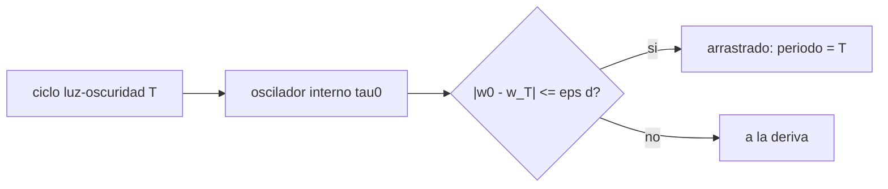

# B106-C13 — Iluminación y ciclos circadianos

<!-- nav:top -->
[🏠 Programa](../../../../README.md) · [📚 Bloque B106](../../../tronco-comun/B106-habitats-espaciales-y-soporte-vital.md) · [← Anterior: B106-C12 — Agricultura en ambiente controlado](../B106-C12-agricultura-en-ambiente-controlado/CLASE.md) · [Siguiente: B106-C14 — Protección contra radiación →](../B106-C14-proteccion-contra-radiacion/CLASE.md)
<!-- /nav -->

## 1. Ubicación, nivel y alcance

Clase 13 del bloque B106 (hábitats espaciales y soporte vital). Nivel N3. Aborda la luz como señal biológica: un oscilador sencillo para ver cuándo el ciclo luz-oscuridad arrastra al ritmo circadiano y qué pasa si el día dura 24,65 h como un sol marciano. Todos los datos del laboratorio son **sintéticos o ilustrativos** y se rotulan como tales; solo se tratan como consultados los valores de la sección 11 que dicen «Consultada».

## 2. Por qué esta clase existe

El reloj interno no mide exactamente 24 h; la luz lo corrige. Un hábitat con otra duración de día pide programar la luz. La decisión central: **¿para qué duraciones de día y con qué intensidad de señal queda la tripulación sincronizada?**

## 3. Lo que podrás hacer al terminar

1. Describir el arrastre de un oscilador por una señal periódica (ecuación de Adler).
2. Simular el oscilador y medir su periodo promedio.
3. Calcular el rango de arrastre y comprobarlo con la simulación.
4. Interpretar el resultado consultado de arrastre a 24,65 h y a 23,5 h.
5. Calcular el retraso acumulado de un sol marciano.
6. Rotular que el modelo y sus parámetros son ilustrativos y que no sustituyen al de la fuente.

La evidencia es la **mapa de arrastre frente a la duración del día** del ejercicio 12 (sección 20).

## 4. Con qué llegas y cómo comprobarlo

1. ¿Qué es un oscilador?
2. ¿Qué es el arrastre?
3. ¿Qué es un sol marciano?
4. ¿Qué es el lux?
5. ¿Qué es un modelo ilustrativo?

<details>
<summary>Ver respuestas</summary>

1. Un sistema con variación periódica. 2. La sincronización de un oscilador con una señal externa. 3. El día solar de Marte: 24 h 39 min 35 s. 4. Unidad de iluminancia. 5. Un modelo simple que enseña un mecanismo sin reproducir datos.
</details>

Con cuatro o cinco aciertos, sigue; si no, repasa los prerrequisitos.

## 5. Un caso de contexto y casos de referencia

Un oscilador con periodo intrínseco de 24,2 h (ilustrativo) y luz durante 16 de cada 24 h se arrastra a días de **22,47 a 26,22 h** según la teoría de Adler; la simulación lo confirma en 9 de 9 casos: arrastra a 24,65 h y 23,5 h (como el estudio consultado de Scheer et al., 2007, con unos 450 lux) y falla a 22 h y 27 h. El sol marciano mide **24,6597 h** y acumula 19,8 h de retraso en 30 días si no hay ajuste. El modelo no reproduce el del estudio; solo ilustra el mecanismo.

## 6. Vocabulario

**Ritmo circadiano:** oscilación de unas 24 h de procesos fisiológicos. **Periodo intrínseco:** periodo sin señal. **Arrastre:** sincronización con la luz. **Sol marciano:** día solar de Marte. **Ecuación de Adler:** `dδ/dt = Δω − ε sin δ`.

## 7. Modelo mental



*Descripción textual:* la señal de luz de periodo `T` fuerza al oscilador; si la diferencia de frecuencias cabe en el acoplamiento, el periodo iguala a `T`.

Analogía: empujar un columpio a un ritmo ligeramente distinto del propio; si el empuje es lo bastante fuerte, el columpio sigue el ritmo. Límite: el reloj humano responde a la fase, la intensidad y el espectro de la luz, y varía entre personas.

## 8. La explicación, paso a paso

### 8.1 El modelo

`dφ/dt = ω₀ − ε L(t) sin(φ − 2πt/T)` con `ω₀ = 2π/24,2` y `L = 1` durante las primeras 16 h de cada día de duración `T`. Sin luz el periodo es 24,2 h (control).

### 8.2 Teoría de Adler

El arrastre ocurre si `|ω₀ − 2π/T| ≤ ε d` con `d = 2/3`: `T ∈ [22,47, 26,22] h`. Los bordes dependen de `ε`, que aquí es ilustrativo.

### 8.3 Simulación

Con integración de Euler (`dt = 0,01 h`), 150 días de calentamiento y 100 de medida: periodo igual a `T` entre 23 y 26 h; a 22 h el periodo es 23,377 h y a 27 h, 25,026 h (a la deriva). Los dos coinciden con Adler en 9 de 9 casos.

### 8.4 Qué dice la fuente

Scheer et al. (2007) encontraron que luz moderada (unos 450 lux, ~1,2 W/m²) en la primera o segunda mitad del episodio de vigilia arrastró a los participantes a 24,65 h y a 23,5 h, y que el periodo intrínseco medido fue algo más largo tras el entrenamiento a 24,65 h que tras el de 23,5 h (diferencias de 0,05 a 0,14 h según el marcador). Que el modelo arrastre a esas duraciones **no lo valida**: el parámetro `ε` se eligió para eso.

### 8.5 El sol marciano

24 h 39 min 35 s = 24,6597 h: 39,6 min más que un día terrestre. Sin ajuste, el reloj se retrasa casi 20 h en 30 días.

## 9. Magnitudes, símbolos y unidades

| Símbolo | Qué es | Unidad | Valor / nota |
|---|---|---|---|
| `τ₀` | periodo intrínseco | h | 24,2 (ilustrativo) |
| `T` | duración del día | h | 22 a 27 |
| `ε` | acoplamiento a la luz | rad/h | 0,03 (ilustrativo) |
| `d` | fracción de luz | — | 2/3 |
| `T_arr` | rango de arrastre | h | 22,47 a 26,22 |

## 10. Convenciones y referencias

Euler con `dt = 0,01 h`; 150 días de calentamiento y 100 de medida; tolerancia de arrastre 0,01 h; `ε`, `τ₀` y la forma de la respuesta son ilustrativos y no los del estudio citado. Sol marciano: 24 h 39 min 35 s (ver los límites de la sección 11). Numpy y Python: ver la primera línea de la salida del laboratorio (Python 3.12.9, numpy 2.4.4 en la ejecución del 2026-11-10).

## 11. De dónde sale lo que afirmamos

| ID | Fuente | Localizador | Respalda | Estado |
|---|---|---|---|---|
| S6 | Scheer, F. A. J. L., Wright, K. P. Jr., Kronauer, R. E. y Czeisler, C. A., «Plasticity of the Intrinsic Period of the Human Circadian Timing System», PLoS ONE 2(8): e721 (2007) — https://pmc.ncbi.nlm.nih.gov/articles/PMC1934931/ (consultada 2026-11-10; resumen y resultados principales) | resumen y resultados principales | luz moderadamente brillante (~450 lux, ~1,2 W/m²) en la primera o segunda mitad del episodio de vigilia arrastró a 24,65 h y a 23,5 h; el periodo intrínseco fue significativamente más largo tras el entrenamiento a 24,65 h que a 23,5 h (diferencias de 0,05 a 0,14 h) | Consultada (resumen y resultados) |
| — | Teoría de Adler, modelo del oscilador | — | ilustrativos y verificados por el laboratorio | No consultada en una fuente concreta |

Límites: solo se consultaron el resumen y los resultados principales del artículo; el modelo del laboratorio no es el suyo. El valor exacto del sol marciano (24 h 39 min 35 s) se tomó de un resultado de búsqueda de una nota de prensa y no de una fuente primaria de la NASA: **no se consultó una fuente primaria**.

## 12. Cómo ver el resultado

| Resultado | Valor |
|---|---|
| Periodo sin luz | 24,200 h |
| Rango de arrastre (Adler) | 22,47 a 26,22 h |
| Arrastre a 24,65 h y 23,5 h | sí y sí |
| Periodo a 22 h y 27 h | 23,377 h y 25,026 h (deriva) |
| Sol marciano | 24,6597 h |

Descripción larga: un día entre unas 22,5 y 26 h arrastra al oscilador ilustrativo; fuera de ese rango el reloj deriva y la tripulación se desfasa.

## 13. Ejemplo trabajado: arrastre y retraso

**Paso 1.** `ω₀ = 2π/24,2 = 0,2596 rad/h`.

**Paso 2.** Con `ε d = 0,03·2/3 = 0,02`: `T_hi = 2π/(0,2596 − 0,02) = 26,2 h`.

**Paso 3.** `T = 24,65` está dentro: arrastra.

**Paso 4.** Retraso de un sol marciano sin ajuste: `0,66 h/día`; en 30 días, `19,8 h`.

## 14. Distintas formas de describir el problema

**Por ecuación:** Adler. **Por simulación:** periodo medio. **Por mapa:** `T` frente a arrastre. **Por fuente:** 24,65 h y 23,5 h. **Por retraso:** h acumuladas.

## 15. Práctica guiada

**Ejercicio 1 · con los pasos indicados.** Calcula `ω₀` para `τ₀ = 24,0 h`. *Pasos:* `2π/24`.

<details><summary>Solución comentada</summary>

`0,2618 rad/h`.
</details>

**Ejercicio 2 · con una pista.** Calcula el borde `T_lo` con `ε d = 0,02` y `τ₀ = 24,2`. *Pista:* `2π/(ω₀ + 0,02)`.

<details><summary>Solución comentada</summary>

`2π/0,2796 = 22,5 h`.
</details>

**Ejercicio 3 · casi autónomo.** ¿Cuánto retraso acumula un sol marciano en 10 días? *Pista:* 0,66 h/día.

<details><summary>Solución comentada</summary>

`6,6 h`.
</details>

## 16. Práctica autónoma, transferencia e integrador

**Ejercicio 4 · autónomo.** Si `ε` se reduce a la mitad, ¿cómo cambia el rango?

<details><summary>Solución comentada</summary>

Se estrecha a unas 23,3–25,2 h (bordes con `ε d = 0,01`).
</details>

**Ejercicio 5 · autónomo.** ¿Qué periodo mostró el oscilador con un día de 22 h?

<details><summary>Solución comentada</summary>

23,377 h: sin arrastre, el periodo queda entre `τ₀` y `T`.
</details>

**Ejercicio 6 · autónomo.** ¿Qué fracción de luz `d` da `ε d = 0,02` con `ε = 0,03`?

<details><summary>Solución comentada</summary>

`2/3`.
</details>

**Ejercicio 7 · autónomo.** ¿Qué ocurre con `d` menor (menos horas de luz)?

<details><summary>Solución comentada</summary>

El rango de arrastre se estrecha.
</details>

**Ejercicio 8 · autónomo.** ¿Por qué el arrastre del modelo a 24,65 h no valida el estudio?

<details><summary>Solución comentada</summary>

Porque `ε` se escogió ilustrativamente; la fuente lo midió en personas.
</details>

**Ejercicio 9 · transferencia.** Un hábitat marciano programa luz de 24 h. ¿Qué pasa con el reloj interno si el día es de 24,65 h?

<details><summary>Solución comentada</summary>

Con luz a 24,65 h el modelo arrastra; con luz fija a 24 h y trabajo a 24,65 h hay conflicto de fase y desfase acumulado.
</details>

**Ejercicio 10 · transferencia.** ¿Qué variable de diseño fijarías: intensidad, duración de la luz o espectro?

<details><summary>Solución comentada</summary>

Las tres influyen; esta clase solo modela la duración y la intensidad como `ε d`.
</details>

**Ejercicio 11 · transferencia.** ¿Qué datos necesitarías para validar el modelo?

<details><summary>Solución comentada</summary>

Registros de fase (melatonina, temperatura) en personas expuestas; ver la fuente.
</details>

**Ejercicio 12 · integrador.** Elabora tu *mapa de arrastre frente a la duración del día*: modelo, rango de Adler, tabla de periodos simulados para nueve duraciones, lectura de la fuente, retraso del sol marciano y qué es ilustrativo.

<details><summary>Solución comentada</summary>

Secciones 8.1–8.5 y la salida del laboratorio.
</details>

## 17. Laboratorio: oscilador circadiano arrastrado por la luz

El script [ritmo_circadiano.py](ritmo_circadiano.py) integra el oscilador de fase para nueve duraciones de día y compara con el rango de arrastre de Adler (**comprueba** el periodo de 24,2 h sin luz, el acuerdo con Adler y el arrastre a 24,65 h y 23,5 h).

**Datos:** modelo **ilustrativo propio**; resultado de arrastre **consultado** como referencia; sin aleatoriedad. **Predice antes de ejecutar:** ¿Se arrastra el oscilador a 24,65 h? (sí, con `ε` ilustrativo). **Ejecución del 2026-11-10 (Python 3.12.9):**

```text
Python 3.12.9; numpy 2.4.4
DATOS: modelo propio ILUSTRATIVO (periodo 24.2 h, eps 0.03 rad/h); el arrastre a 24.65 h y 23.5 h es el resultado CONSULTADO de Scheer et al. (2007)
Sin luz (eps = 0): periodo 24.200 h
Adler: arrastre esperado para T entre 22.47 h y 26.22 h (ancho 3.75 h)
   T [h]   periodo simulado [h]   arrastrado   (Adler)
   22.00               23.377          no   no
   23.00               23.000          si   si
   23.50               23.500          si   si
   24.00               24.000          si   si
   24.20               24.200          si   si
   24.65               24.650          si   si
   25.50               25.500          si   si
   26.00               26.000          si   si
   27.00               25.026          no   no
Coincidencia simulacion-Adler en 9 de 9 casos
Sol marciano: 24.6597 h (39.6 min mas que 24 h); retraso acumulado en 30 dias: 19.8 h
Pruebas superadas.
```

```bash
python programa/clases/B106/B106-C13-iluminacion-y-ciclos-circadianos/ritmo_circadiano.py
```

**Límites:** un oscilador de fase con una sola variable, luz de dos niveles, acoplamiento constante, sin dependencia de la hora de exposición ni del espectro ni entre personas.

## 18. Errores frecuentes y cómo corregirlos

**Tomar `ε` ilustrativo como dato.** Rotula.

**Confundir duración de la luz con intensidad.** Ver 8.2.

**Presentar el modelo como el de la fuente.** No lo es (8.4).

**Ignorar el retraso del sol marciano.** Ver 8.5.

## 19. Cómo sabrás que vas bien

Tras la sección 8: ¿para qué duraciones de día se arrastra el oscilador y cuánto retraso da un sol marciano? Si dudas, repasa el ejemplo 13. Tras el laboratorio: ¿qué comprueba? (ver la sección 17).

## 20. Qué entregas y cómo se evalúa

El producto es tu **mapa de arrastre frente a la duración del día** (ejercicio 12).

| Criterio | Inicial | En desarrollo | Logrado | Destacado |
|---|---|---|---|---|
| Conceptos | Confunde las magnitudes | Parciales | Explica oscilador, arrastre y rango | Explica los supuestos y sus límites |
| Cálculo | Sin unidades | Con errores | Calcula con unidades y cifras coherentes | Calcula casos nuevos y los verifica |
| Numérico | Sin comprobación | Un caso | Compara con el control del laboratorio | Interpreta la sensibilidad |
| Fuentes | Sin fuente | Sin fecha | Fuentes con fecha y estado | Declara lo ilustrativo y lo no consultado |
| Límites | No los nombra | Uno | Tres | Discute qué falta para un hábitat real |

**Condiciones críticas (no se compensan con promedio):** rotular los datos como sintéticos o ilustrativos; no presentar un valor ilustrativo como límite de una norma; citar solo lo consultado; no usar la clase como consejo médico ni operativo.

## 21. Ética, seguridad y límites

Clase **educativa**: no da consejo médico ni operativo y no sirve para decidir la atmósfera, el agua, la exposición ni la respuesta ante una emergencia de un hábitat o de una persona reales. Esta clase no da recomendaciones de sueño ni de iluminación; los horarios reales se diseñan con médicos del sueño. Accesibilidad: tablas equivalentes a las gráficas, fórmulas en texto, ejercicios sin conexión.

## 22. Para cerrar y seguir

El arrastre depende de `|ω₀ − 2π/T| ≤ ε d`: un día de 22,5 a 26 h es seguible en el modelo y 24,65 h entra con holgura, en línea con lo que midió el estudio consultado. La clase siguiente trata la radiación que atraviesa las paredes.

**Glosario español–inglés.** ritmo circadiano · *circadian rhythm*; arrastre · *entrainment*; oscilador · *oscillator*; sol marciano · *sol*; fotoperiodo · *photoperiod*.

**Continuidad.** Sigue con la clase siguiente del bloque (enlace en la navegación) o vuelve al [bloque B106](../../../tronco-comun/B106-habitats-espaciales-y-soporte-vital.md).

**Referencias:** ver sección 11.

<!-- nav:bottom -->
---

[← Anterior: B106-C12 — Agricultura en ambiente controlado](../B106-C12-agricultura-en-ambiente-controlado/CLASE.md) · [📚 Bloque B106](../../../tronco-comun/B106-habitats-espaciales-y-soporte-vital.md) · [Siguiente: B106-C14 — Protección contra radiación →](../B106-C14-proteccion-contra-radiacion/CLASE.md)
<!-- /nav -->
