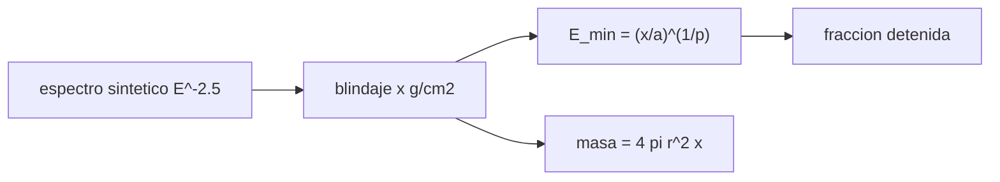

# B106-C14 — Protección contra radiación

<!-- nav:top -->
[🏠 Programa](../../../../README.md) · [📚 Bloque B106](../../../tronco-comun/B106-habitats-espaciales-y-soporte-vital.md) · [← Anterior: B106-C13 — Iluminación y ciclos circadianos](../B106-C13-iluminacion-y-ciclos-circadianos/CLASE.md) · [Siguiente: B106-C15 — Protección frente a micrometeoritos →](../B106-C15-proteccion-frente-a-micrometeoritos/CLASE.md)
<!-- /nav -->

## 1. Ubicación, nivel y alcance

Clase 14 del bloque B106 (hábitats espaciales y soporte vital). Nivel N3. Introduce la protección contra radiación solo como un problema de alcance de partículas: cuánto espesor detiene a un protón de cierta energía y qué fracción de un espectro sintético queda detenida. No calcula dosis. Todos los datos del laboratorio son **sintéticos o ilustrativos** y se rotulan como tales; solo se tratan como consultados los valores de la sección 11 que dicen «Consultada».

## 2. Por qué esta clase existe

Las paredes y el regolito detienen partículas, pero con límites: la masa es costosa y las partículas secundarias complican el panorama. La decisión central: **¿cuánta masa por área detiene qué parte de las partículas, y dónde el modelo deja de valer?**

## 3. Lo que podrás hacer al terminar

1. Calcular el alcance de un protón con la regla de Bragg–Kleeman y su energía mínima para atravesar un espesor.
2. Calcular la fracción de un espectro de ley de potencias detenida por un blindaje.
3. Estimar la masa de un blindaje esférico y de una cubierta de regolito.
4. Reconocer el rango de validez del modelo y los fenómenos que deja fuera.
5. Explicar por qué una atenuación exponencial ingenua no sirve.
6. Rotular que el espectro es sintético y que no se calcula dosis.

La evidencia es la **ficha de blindaje con sus límites** del ejercicio 12 (sección 20).

## 4. Con qué llegas y cómo comprobarlo

1. ¿Qué es el alcance de una partícula?
2. ¿Qué es un g/cm²?
3. ¿Qué es un espectro de ley de potencias?
4. ¿Qué es una partícula secundaria?
5. ¿Qué es una dosis?

<details>
<summary>Ver respuestas</summary>

1. La distancia que recorre en un material antes de detenerse. 2. Una masa por área (espesor × densidad). 3. Uno cuyo flujo cae como `E^−γ`. 4. Una partícula producida cuando la primaria choca con el material. 5. La energía absorbida por masa (Gy); no se calcula aquí.
</details>

Con cuatro o cinco aciertos, sigue; si no, repasa los prerrequisitos.

## 5. Un caso de contexto y casos de referencia

Con la regla de Bragg–Kleeman (de manual, no consultada), un protón de 100 MeV tiene un alcance de **7,63 g/cm²** en agua (~7,7 de tablas de manual). Para atravesar 10 g/cm² hacen falta 116,5 MeV y ese espesor detiene el **97,6 %** de un espectro sintético `E^−2,5` de 10 a 1000 MeV; una esfera de 2 m de radio con ese espesor pesa **5027 kg**. Un metro de regolito (150 g/cm²) exigiría más de 538 MeV, fuera del rango de validez. No es una dosis ni un riesgo.

## 6. Vocabulario

**Alcance CSDA:** distancia media recorrida frenándose de forma continua. **Espesor másico:** densidad × espesor (g/cm²). **Espectro sintético:** distribución de energías inventada. **Partícula secundaria:** producida en el blindaje. **Rango de validez:** intervalo donde vale el modelo.

## 7. Modelo mental



*Descripción textual:* el espesor fija la energía mínima que lo atraviesa; con el espectro sintético se obtiene la fracción detenida y con la geometría, la masa.

Analogía: una pared contra balas de distinta velocidad; las lentas se detienen, las rápidas pasan. Límite: en radiación espacial las rápidas producen secundarias, de modo que más pared no siempre baja el efecto proporcionalmente.

## 8. La explicación, paso a paso

### 8.1 Alcance

`R = a E^p` con `a = 0,0022 g/cm²/MeV^p`, `p = 1,77` para agua. A 100 MeV, 7,63 g/cm². Inversamente, `E_min = (x/a)^(1/p)` (control: `E_min(R(E)) = E` a 1e-9).

### 8.2 Fracción detenida

Con `dN/dE ∝ E^−2,5` entre 10 y 1000 MeV, la fracción de protones con `E < E_min` es `(10^−1,5 − E^−1,5)/(10^−1,5 − 1000^−1,5)`. 1 g/cm²: 82,4 %; 10 g/cm²: 97,6 %; 30 g/cm²: 99,1 %. Con un espectro blando, un blindaje delgado detiene casi todo, pero la parte dura es la que importa.

### 8.3 Masa

Una esfera de 2 m de radio con 10 g/cm² (100 kg/m²) pesa 5027 kg; con 30 g/cm², 15 080 kg. Por eso se prefiere usar agua, residuos o regolito que ya están en la misión.

### 8.4 Regolito y el límite del modelo

Un metro de regolito de 1,5 g/cm³ son 150 g/cm² y el modelo daría 538 MeV, por encima de su rango (~250 MeV): el resultado es solo orientativo. Los rayos cósmicos galácticos, los núcleos pesados y las secundarias requieren códigos de transporte (no consultados).

### 8.5 Por qué no una exponencial

Una atenuación `exp(−x/λ)` da 0,223 a 30 g/cm² con `λ = 20`; no representa la física de las secundarias y no se usa. El laboratorio lo muestra solo como advertencia.

## 9. Magnitudes, símbolos y unidades

| Símbolo | Qué es | Unidad | Valor / nota |
|---|---|---|---|
| `R` | alcance de un protón en agua | g/cm² | 7,63 a 100 MeV |
| `x` | espesor másico | g/cm² | 1 a 30 |
| `E_min` | energía mínima para atravesar `x` | MeV | 116,5 (10 g/cm²) |
| `f` | fracción detenida del espectro sintético | — | 0,9758 (10 g/cm²) |
| `m` | masa de la esfera de 2 m | kg | 5027 (10 g/cm²) |

## 10. Convenciones y referencias

Bragg–Kleeman con `a = 0,0022`, `p = 1,77` (agua); espectro sintético `E^−2,5` de 10 a 1000 MeV; densidades ilustrativas (agua 1,0; regolito 1,5 g/cm³); radio de 2 m. Tolerancias: `E_min(R(E)) = E` a 1e-9 y fracción creciente con el espesor. Numpy y Python: ver la primera línea de la salida del laboratorio (Python 3.12.9, numpy 2.4.4 en la ejecución del 2026-11-10).

## 11. De dónde sale lo que afirmamos

| ID | Fuente | Localizador | Respalda | Estado |
|---|---|---|---|---|
| S8 | NIST, programa PSTAR (poder de frenado y alcance de protones) — https://physics.nist.gov/PhysRefData/Star/Text/PSTAR.html (consultada 2026-11-10; solo la página de presentación, sin tablas) | página de presentación del programa PSTAR | PSTAR calcula tablas de poder de frenado y de alcance (CSDA y proyectado) de protones en materiales de H a U, agua líquida, aire, polietileno, plomo, de 0,001 a 10 000 MeV | Consultada (solo la página de presentación, sin tablas) |
| — | Regla de Bragg–Kleeman, espectro sintético, alcance de 7,7 g/cm² a 100 MeV | — | de manual; el laboratorio verifica la aritmética (7,63 frente a ~7,7) | No consultada en una fuente concreta |

Límites: no se consultaron tablas de PSTAR, límites de dosis (NCRP, ICRP) ni espectros reales de tormentas solares o de rayos cósmicos. La clase **no calcula dosis ni riesgo**. El valor de 7,7 g/cm² es de manual.

## 12. Cómo ver el resultado

| Resultado | Valor |
|---|---|
| Alcance de 100 MeV en agua | 7,63 g/cm² |
| Energía mínima para 10 g/cm² | 116,5 MeV |
| Fracción detenida (1 / 10 / 30 g/cm²) | 82,4 / 97,6 / 99,1 % |
| Masa de la esfera a 10 g/cm² | 5027 kg |
| Regolito de 1 m | 538 MeV (fuera del rango) |

Descripción larga: un espesor modesto detiene casi todo un espectro blando, pero la masa crece linealmente y el modelo deja de valer donde importan las partículas energéticas.

## 13. Ejemplo trabajado: energía mínima y masa de un blindaje

**Paso 1.** Espesor: `x = 10 g/cm²`.

**Paso 2.** `E_min = (10/0,0022)^(1/1,77) = 4545^0,565 = 116,5 MeV`.

**Paso 3.** Fracción detenida: `(10^−1,5 − 116,5^−1,5)/(10^−1,5 − 1000^−1,5) = 0,9758`.

**Paso 4.** Masa de la esfera: `4π·2²·100 kg/m² = 5027 kg`.

## 14. Distintas formas de describir el problema

**Por alcance:** `R(E)`. **Por espectro:** fracción detenida. **Por masa:** kg. **Por material:** g/cm² equivalente. **Por límite:** rango de validez.

## 15. Práctica guiada

**Ejercicio 1 · con los pasos indicados.** Calcula `R` a 50 MeV. *Pasos:* `aE^p`.

<details><summary>Solución comentada</summary>

`0,0022·50^1,77 = 2,2 g/cm²`.
</details>

**Ejercicio 2 · con una pista.** Calcula la energía para atravesar 2 g/cm². *Pista:* `(x/a)^(1/p)`.

<details><summary>Solución comentada</summary>

`(909)^0,565 = 47,7 MeV`.
</details>

**Ejercicio 3 · casi autónomo.** ¿Cuántos g/cm² son 20 cm de agua? *Pista:* ρ = 1.

<details><summary>Solución comentada</summary>

`20 g/cm²`.
</details>

## 16. Práctica autónoma, transferencia e integrador

**Ejercicio 4 · autónomo.** ¿Cuánto pesa una esfera de 3 m de radio con 10 g/cm²?

<details><summary>Solución comentada</summary>

`4π·9·100 = 11 310 kg`.
</details>

**Ejercicio 5 · autónomo.** ¿Qué fracción detiene 5 g/cm²?

<details><summary>Solución comentada</summary>

`0,9557`.
</details>

**Ejercicio 6 · autónomo.** Con regolito de 1,5 g/cm³, ¿cuántos cm equivalen a 10 g/cm²?

<details><summary>Solución comentada</summary>

6,7 cm.
</details>

**Ejercicio 7 · autónomo.** ¿Por qué el modelo no se usa a 500 MeV?

<details><summary>Solución comentada</summary>

Porque Bragg–Kleeman es aproximada hasta unos 250 MeV y a mayor energía dominan las interacciones nucleares.
</details>

**Ejercicio 8 · autónomo.** ¿Por qué no vale `exp(−x/λ)`?

<details><summary>Solución comentada</summary>

Las secundarias hacen que la dosis no baje de forma exponencial con el espesor.
</details>

**Ejercicio 9 · transferencia.** Se propone un refugio de agua de 20 g/cm² alrededor de una zona de descanso. ¿Qué masa tiene si es una esfera de 1 m de radio?

<details><summary>Solución comentada</summary>

`4π·1²·200 = 2513 kg`; menor que cubrir todo el hábitat.
</details>

**Ejercicio 10 · transferencia.** Las tormentas solares duran horas o días. ¿Qué ventaja tiene un refugio pequeño?

<details><summary>Solución comentada</summary>

Concentra la masa en una región; la tripulación se resguarda mientras dura el evento (concepto, no procedimiento).
</details>

**Ejercicio 11 · transferencia.** ¿Qué necesitarías para pasar de la fracción detenida a una dosis?

<details><summary>Solución comentada</summary>

Un espectro real, transporte de partículas con secundarias, un maniquí y factores de calidad; no consultados aquí.
</details>

**Ejercicio 12 · integrador.** Elabora tu *ficha de blindaje con sus límites*: modelo y rango de validez, tabla de espesor, energía mínima, fracción detenida y masa, caso del regolito, advertencia sobre secundarias y qué es de manual o sintético.

<details><summary>Solución comentada</summary>

Secciones 8.1–8.5 y la salida del laboratorio.
</details>

## 17. Laboratorio: alcance de protones y blindaje

El script [blindaje_radiacion.py](blindaje_radiacion.py) calcula alcance, energía mínima, fracción detenida de un espectro sintético y masa de blindajes (**comprueba** la inversión del alcance y que la fracción crece con el espesor).

**Datos:** espectro **sintético inventado**; Bragg–Kleeman de **manual no consultada**; sin aleatoriedad; **no es una dosis**. **Predice antes de ejecutar:** ¿Detiene un espesor de 10 g/cm² de agua más del 90 % de un espectro blando? (sí, 97,6 %). **Ejecución del 2026-11-10 (Python 3.12.9):**

```text
Python 3.12.9; numpy 2.4.4
DATOS: espectro SINTETICO e inventado; regla de Bragg-Kleeman de manual NO consultada; NO es una dosis ni una evaluacion de riesgo
Alcance de un proton de 100 MeV en agua: 7.63 g/cm2 (valor de tablas de manual, no consultado: ~7.7)
   espesor [g/cm2]   energia minima [MeV]   fraccion del espectro sintetico detenida   masa de una esfera de r = 2 m [kg]
               1                 31.7                                 0.8239                              503
               5                 78.8                                 0.9557                             2513
              10                116.5                                 0.9758                             5027
              20                172.4                                 0.9870                            10053
              30                216.8                                 0.9911                            15080
Regolito (1.5 g/cm3), cubierta sobre el habitat: espesor equivalente y limite del modelo
   0.5 m ->     75 g/cm2: E_min = 364 MeV (FUERA del rango de validez, solo orientativo)
   1.0 m ->    150 g/cm2: E_min = 538 MeV (FUERA del rango de validez, solo orientativo)
   2.0 m ->    300 g/cm2: E_min = 796 MeV (FUERA del rango de validez, solo orientativo)
   3.0 m ->    450 g/cm2: E_min = 1001 MeV (FUERA del rango de validez, solo orientativo)
Aviso: una atenuacion exponencial ingenua exp(-x/20) daria 0.223 a 30 g/cm2; no representa la fisica de las secundarias y NO se usa en este laboratorio
Pruebas superadas.
```

```bash
python programa/clases/B106/B106-C14-proteccion-contra-radiacion/blindaje_radiacion.py
```

**Límites:** solo protones, sin secundarias ni núcleos pesados, ley de potencias inventada, agua como material, rango de validez hasta ~250 MeV, sin geometría real.

## 18. Errores frecuentes y cómo corregirlos

**Presentar la fracción detenida como dosis.** No es una dosis (8.2).

**Usar el modelo fuera de su rango.** Ver 8.4.

**Suponer atenuación exponencial.** Ver 8.5.

**Tomar el espectro sintético como real.** Es inventado (sección 10).

## 19. Cómo sabrás que vas bien

Tras la sección 8: ¿qué energía mínima atraviesa 10 g/cm² de agua y qué fracción del espectro sintético detiene? Si dudas, repasa el ejemplo 13. Tras el laboratorio: ¿qué comprueba? (ver la sección 17).

## 20. Qué entregas y cómo se evalúa

El producto es tu **ficha de blindaje con sus límites** (ejercicio 12).

| Criterio | Inicial | En desarrollo | Logrado | Destacado |
|---|---|---|---|---|
| Conceptos | Confunde las magnitudes | Parciales | Explica alcance, espectro y límites | Explica los supuestos y sus límites |
| Cálculo | Sin unidades | Con errores | Calcula con unidades y cifras coherentes | Calcula casos nuevos y los verifica |
| Numérico | Sin comprobación | Un caso | Compara con el control del laboratorio | Interpreta la sensibilidad |
| Fuentes | Sin fuente | Sin fecha | Fuentes con fecha y estado | Declara lo ilustrativo y lo no consultado |
| Límites | No los nombra | Uno | Tres | Discute qué falta para un hábitat real |

**Condiciones críticas (no se compensan con promedio):** rotular los datos como sintéticos o ilustrativos; no presentar un valor ilustrativo como límite de una norma; citar solo lo consultado; no usar la clase como consejo médico ni operativo.

## 21. Ética, seguridad y límites

Clase **educativa**: no da consejo médico ni operativo y no sirve para decidir la atmósfera, el agua, la exposición ni la respuesta ante una emergencia de un hábitat o de una persona reales. **No** se calcula ninguna dosis ni riesgo; los límites de exposición de la tripulación los fijan organismos como NCRP o ICRP (**no consultados**) y la protección real requiere códigos de transporte y validación. Accesibilidad: tablas equivalentes a las gráficas, fórmulas en texto, ejercicios sin conexión.

## 22. Para cerrar y seguir

El alcance de un protón crece como `E^1,77` y 10 g/cm² de agua detienen a los de menos de unos 117 MeV, pero el modelo no cubre las energías duras ni las secundarias. Es una base conceptual, no una dosis. La clase siguiente trata otro riesgo: los impactos.

**Glosario español–inglés.** alcance · *range*; blindaje · *shielding*; espectro · *spectrum*; partícula secundaria · *secondary particle*; espesor másico · *areal density*.

**Continuidad.** Sigue con la clase siguiente del bloque (enlace en la navegación) o vuelve al [bloque B106](../../../tronco-comun/B106-habitats-espaciales-y-soporte-vital.md).

**Referencias:** ver sección 11.

<!-- nav:bottom -->
---

[← Anterior: B106-C13 — Iluminación y ciclos circadianos](../B106-C13-iluminacion-y-ciclos-circadianos/CLASE.md) · [📚 Bloque B106](../../../tronco-comun/B106-habitats-espaciales-y-soporte-vital.md) · [Siguiente: B106-C15 — Protección frente a micrometeoritos →](../B106-C15-proteccion-frente-a-micrometeoritos/CLASE.md)
<!-- /nav -->
