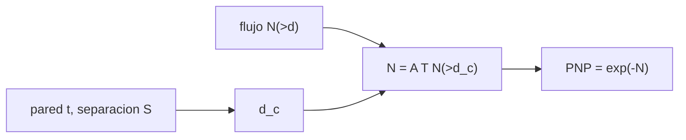

# B106-C15 — Protección frente a micrometeoritos

<!-- nav:top -->
[🏠 Programa](../../../../README.md) · [📚 Bloque B106](../../../tronco-comun/B106-habitats-espaciales-y-soporte-vital.md) · [← Anterior: B106-C14 — Protección contra radiación](../B106-C14-proteccion-contra-radiacion/CLASE.md) · [Siguiente: B106-C16 — Ergonomía en microgravedad →](../B106-C16-ergonomia-en-microgravedad/CLASE.md)
<!-- /nav -->

## 1. Ubicación, nivel y alcance

Clase 15 del bloque B106 (hábitats espaciales y soporte vital). Nivel N3. Trata la protección contra micrometeoroides y desechos como una cuestión de probabilidad: impactos como eventos de Poisson, penetración por un diámetro crítico y efecto de un parachoques. Flujo y escudo son sintéticos. Todos los datos del laboratorio son **sintéticos o ilustrativos** y se rotulan como tales; solo se tratan como consultados los valores de la sección 11 que dicen «Consultada».

## 2. Por qué esta clase existe

Los impactos son raros pero catastróficos; el diseño elige espesor y separación para una probabilidad de no penetración. La decisión central: **¿qué pared y qué separación dan una probabilidad objetivo en la duración y la superficie de la misión?**

## 3. Lo que podrás hacer al terminar

1. Modelar los impactos penetrantes como un proceso de Poisson y calcular `P = exp(−N)`.
2. Calcular el número esperado con un flujo de ley de potencias y un diámetro crítico.
3. Comparar pared simple y pared con parachoques.
4. Verificar el cálculo con un Monte Carlo y su incertidumbre binomial.
5. Obtener el espesor o la separación para una probabilidad objetivo.
6. Rotular que flujo y escudo son sintéticos y que no describen un vehículo real.

La evidencia es la **ficha de riesgo de impacto con intervalo** del ejercicio 12 (sección 20).

## 4. Con qué llegas y cómo comprobarlo

1. ¿Qué es un proceso de Poisson?
2. ¿Cuál es la probabilidad de 0 eventos si se esperan `N`?
3. ¿Qué es un parachoques (Whipple)?
4. ¿Qué es una ley de potencias?
5. ¿Qué es un intervalo binomial?

<details>
<summary>Ver respuestas</summary>

1. Eventos independientes con tasa constante. 2. `exp(−N)`. 3. Una pared delgada separada que fragmenta el proyectil antes de la pared principal. 4. Una función `d^−b`. 5. La incertidumbre de una proporción medida: `√(f(1−f)/M)`.
</details>

Con cuatro o cinco aciertos, sigue; si no, repasa los prerrequisitos.

## 5. Un caso de contexto y casos de referencia

Con un flujo sintético `N(>d) = 10⁻⁴ (d/1 mm)^−2,5` por m² y año, 100 m² y una pared de 2 mm con diámetro crítico ilustrativo de 0,60 mm, se esperan 0,036 impactos penetrantes al año: **P(sin penetración) = 0,9648** el primer año y 0,8359 en 5 años. Un parachoques a 10 cm eleva el diámetro crítico a 3,60 mm y la probabilidad a 0,99959. El Monte Carlo (0,83537 ± 0,00083) confirma el 0,83585 analítico. Valores inventados.

## 6. Vocabulario

**Micrometeoroide:** partícula natural de polvo; **desecho orbital:** fragmento artificial. **Diámetro crítico:** el menor proyectil que penetra. **Parachoques:** pared de sacrificio. **Probabilidad de no penetración (PNP):** `exp(−N)`. **Flujo:** impactos por m² y año.

## 7. Modelo mental



*Descripción textual:* el flujo, la superficie y el tiempo dan el número esperado de impactos sobre el diámetro crítico, que fija la pared y la separación; de ahí sale la PNP.

Analogía: llover sobre un techo; cuanto más grande es la gota mínima que lo perfora, menos probable es que alguna caiga. Límite: la penetración real depende de velocidad, ángulo, densidad y de la forma del escudo.

## 8. La explicación, paso a paso

### 8.1 Diámetro crítico y número esperado

`d_c = α t (1 + S/S₀)` con `α = 0,3` y `S₀ = 2 cm` (ilustrativos); `N = A T N₀ d_c^−b`. Para `t = 2 mm`, `S = 0`: `d_c = 0,60 mm`, `N = 0,036` al año.

### 8.2 Probabilidad

`P = exp(−N)`: 0,9648 en 1 año y 0,8359 en 5 años. Con 10 cm de separación: 0,99959 en 1 año.

### 8.3 Monte Carlo

Con 200 000 misiones de 5 años (semilla 106) la frecuencia de cero impactos es 0,83537 ± 0,00083, dentro de 4 desviaciones del 0,83585 analítico.

### 8.4 Cómo conseguir 0,99 en 5 años

Sin parachoques hace falta una pared de **6,34 mm**; con pared de 2 mm basta una separación de **4,35 cm**. La separación es mucho más eficiente que el espesor en masa.

### 8.5 Qué falta

El flujo real, la distribución de velocidades, los ángulos y las ecuaciones de penetración validadas (no consultadas) cambian estas cifras de forma radical.

## 9. Magnitudes, símbolos y unidades

| Símbolo | Qué es | Unidad | Valor / nota |
|---|---|---|---|
| `N₀` | flujo a 1 mm | 1/(m² año) | 10⁻⁴ (sintético) |
| `b` | exponente del flujo | — | 2,5 (sintético) |
| `d_c` | diámetro crítico | mm | 0,60 (2 mm, sin parachoques) |
| `N` | impactos penetrantes esperados | — | 0,036 por año |
| PNP | probabilidad de no penetración | — | 0,9648 (1 año) |

## 10. Convenciones y referencias

Superficie de 100 m²; `α = 0,3`, `S₀ = 2 cm`; semilla 106; 200 000 repeticiones; tolerancia del Monte Carlo de 4 desviaciones binomiales. Todo sintético e ilustrativo. Numpy y Python: ver la primera línea de la salida del laboratorio (Python 3.12.9, numpy 2.4.4 en la ejecución del 2026-11-10).

## 11. De dónde sale lo que afirmamos

| ID | Fuente | Localizador | Respalda | Estado |
|---|---|---|---|---|
| — | Proceso de Poisson, ley de potencias, Monte Carlo | — | los verifica el laboratorio; el flujo y el escudo son inventados | No consultada: la página de la NASA sobre desechos orbitales devolvió error 404 |

Límites: **ninguna fuente sobre flujos de micrometeoroides y desechos ni sobre ecuaciones de penetración se consultó**; el flujo, el diámetro crítico y el efecto del parachoques son inventados para enseñar el cálculo. No se usan para evaluar ningún vehículo.

## 12. Cómo ver el resultado

| Resultado | Valor |
|---|---|
| `d_c` sin / con parachoques de 10 cm | 0,60 / 3,60 mm |
| Impactos esperados (2 mm, 1 año) | 0,036 |
| PNP 1 año / 5 años (sin parachoques) | 0,9648 / 0,8359 |
| PNP 1 año con parachoques | 0,99959 |
| Pared / separación para 0,99 en 5 años | 6,34 mm / 4,35 cm |

Descripción larga: la probabilidad de no penetración cae con la superficie y el tiempo y sube con el diámetro crítico; la separación es la palanca más eficaz del modelo.

## 13. Ejemplo trabajado: probabilidad de no penetración

**Paso 1.** `d_c = 0,3·2·(1 + 0) = 0,6 mm`.

**Paso 2.** `N = 100·1·10⁻⁴·0,6^−2,5 = 100·10⁻⁴·3,586 = 0,0359`.

**Paso 3.** `P = exp(−0,0359) = 0,9648`.

**Paso 4.** En 5 años, `exp(−0,1793) = 0,8359`.

## 14. Distintas formas de describir el problema

**Por proceso:** Poisson. **Por probabilidad:** `exp(−N)`. **Por diseño:** `t`, `S`. **Por simulación:** Monte Carlo. **Por incertidumbre:** binomial.

## 15. Práctica guiada

**Ejercicio 1 · con los pasos indicados.** Calcula `d_c` para `t = 3 mm` y `S = 4 cm`. *Pasos:* fórmula.

<details><summary>Solución comentada</summary>

`0,3·3·(1 + 2) = 2,7 mm`.
</details>

**Ejercicio 2 · con una pista.** Calcula `P` con `N = 0,05`. *Pista:* `exp(−N)`.

<details><summary>Solución comentada</summary>

`0,951`.
</details>

**Ejercicio 3 · casi autónomo.** Calcula `N` para 5 años con 0,0359/año. *Pista:* escala.

<details><summary>Solución comentada</summary>

`0,179`.
</details>

## 16. Práctica autónoma, transferencia e integrador

**Ejercicio 4 · autónomo.** ¿Cuánto vale `N` si la superficie se duplica a 200 m²?

<details><summary>Solución comentada</summary>

Se duplica: 0,0717.
</details>

**Ejercicio 5 · autónomo.** ¿Y `P` en 1 año?

<details><summary>Solución comentada</summary>

`exp(−0,0717) = 0,931`.
</details>

**Ejercicio 6 · autónomo.** Si el flujo real es 10 veces mayor, ¿qué `P` da la pared de 2 mm en 1 año?

<details><summary>Solución comentada</summary>

`exp(−0,359) = 0,698`.
</details>

**Ejercicio 7 · autónomo.** ¿Qué incertidumbre binomial tiene `f = 0,835` con 200 000 repeticiones?

<details><summary>Solución comentada</summary>

`√(0,835·0,165/200 000) = 0,00083`.
</details>

**Ejercicio 8 · autónomo.** ¿Por qué la separación pesa menos que el espesor?

<details><summary>Solución comentada</summary>

Porque con el mismo efecto sobre `d_c` añade casi nada de masa (solo estructura).
</details>

**Ejercicio 9 · transferencia.** Un módulo de 100 m² pasa de 1 a 10 años. ¿Cómo cambia la PNP sin parachoques?

<details><summary>Solución comentada</summary>

`exp(−0,359) = 0,70`: de 0,965 a 0,698.
</details>

**Ejercicio 10 · transferencia.** El diseño pide 0,99 en 10 años con pared de 2 mm. ¿Qué separación?

<details><summary>Solución comentada</summary>

Unos 6,4 cm con el modelo (resolver `N = 0,01` da `d_c = 2,51 mm`).
</details>

**Ejercicio 11 · transferencia.** Un impacto no penetrante puede dañar un sistema. ¿Qué haría falta considerar?

<details><summary>Solución comentada</summary>

Fallas secundarias (desprendimiento de la pared interior, daño a ductos); no modeladas.
</details>

**Ejercicio 12 · integrador.** Elabora tu *ficha de riesgo de impacto con intervalo*: flujo, diámetro crítico, tabla de cuatro diseños, Monte Carlo con su incertidumbre, diseño para 0,99 y qué es sintético.

<details><summary>Solución comentada</summary>

Secciones 8.1–8.5 y la salida del laboratorio.
</details>

## 17. Laboratorio: impactos de Poisson y parachoques

El script [micrometeoritos.py](micrometeoritos.py) calcula `N` y `PNP` de cuatro diseños, verifica con 200 000 simulaciones y busca el espesor y la separación para 0,99 (**comprueba** que el Monte Carlo coincide con `exp(−N)` y que más espesor o separación sube la PNP).

**Datos:** flujo y escudo **sintéticos e inventados**; semilla 106; **no son datos reales**. **Predice antes de ejecutar:** ¿Cuál de los cuatro diseños da la PNP más alta? (pared de 4 mm con parachoques de 10 cm). **Ejecución del 2026-11-10 (Python 3.12.9):**

```text
Python 3.12.9; numpy 2.4.4
DATOS: flujo y escudo SINTETICOS e inventados (no consultados); NO describen el riesgo de un vehiculo real
Superficie 100 m2; flujo N(>d) = 1e-04 (d/1 mm)^-2.5 /m2/ano
  pared t [mm]  separacion [cm]  d_critico [mm]  impactos esperados en 1 ano  P(sin penetracion) 1 ano  5 anos
          2.0             0.0            0.60                   3.586e-02                  0.964774  0.835851
          2.0            10.0            3.60                   4.067e-04                  0.999593  0.997969
          4.0             0.0            1.20                   6.339e-03                  0.993681  0.968800
          4.0            10.0            7.20                   7.189e-05                  0.999928  0.999641
Monte Carlo (5 anos, pared 2 mm sin parachoques, 200000 misiones): P(sin penetracion) = 0.83537 +- 0.00083; analitico 0.83585
Espesor de pared sin parachoques para P >= 0.99 en 5 anos: 6.34 mm
Separacion con pared de 2 mm para P >= 0.99 en 5 anos: 4.35 cm
Pruebas superadas.
```

```bash
python programa/clases/B106/B106-C15-proteccion-frente-a-micrometeoritos/micrometeoritos.py
```

**Límites:** un solo flujo de ley de potencias, un diámetro crítico inventado, impactos independientes, sin velocidad ni ángulo, sin daños secundarios.

## 18. Errores frecuentes y cómo corregirlos

**Presentar el flujo sintético como real.** Es inventado (sección 10).

**Sumar probabilidades en lugar de números esperados.** Suma `N` y luego `exp(−N)`.

**Olvidar el área y el tiempo.** `N = A T N(>d_c)`.

**Usar un solo diseño sin incertidumbre.** Calcula el intervalo (8.3).

## 19. Cómo sabrás que vas bien

Tras la sección 8: ¿cuál es la PNP de una pared de 2 mm sin parachoques en 1 año y cómo mejora con 10 cm de separación? Si dudas, repasa el ejemplo 13. Tras el laboratorio: ¿qué comprueba? (ver la sección 17).

## 20. Qué entregas y cómo se evalúa

El producto es tu **ficha de riesgo de impacto con intervalo** (ejercicio 12).

| Criterio | Inicial | En desarrollo | Logrado | Destacado |
|---|---|---|---|---|
| Conceptos | Confunde las magnitudes | Parciales | Explica Poisson, diámetro crítico y diseño | Explica los supuestos y sus límites |
| Cálculo | Sin unidades | Con errores | Calcula con unidades y cifras coherentes | Calcula casos nuevos y los verifica |
| Numérico | Sin comprobación | Un caso | Compara con el control del laboratorio | Interpreta la sensibilidad |
| Fuentes | Sin fuente | Sin fecha | Fuentes con fecha y estado | Declara lo ilustrativo y lo no consultado |
| Límites | No los nombra | Uno | Tres | Discute qué falta para un hábitat real |

**Condiciones críticas (no se compensan con promedio):** rotular los datos como sintéticos o ilustrativos; no presentar un valor ilustrativo como límite de una norma; citar solo lo consultado; no usar la clase como consejo médico ni operativo.

## 21. Ética, seguridad y límites

Clase **educativa**: no da consejo médico ni operativo y no sirve para decidir la atmósfera, el agua, la exposición ni la respuesta ante una emergencia de un hábitat o de una persona reales. Estas cifras no sirven para evaluar un vehículo: el riesgo real exige flujos medidos y ecuaciones de penetración validadas. Accesibilidad: tablas equivalentes a las gráficas, fórmulas en texto, ejercicios sin conexión.

## 22. Para cerrar y seguir

Los impactos se modelan con `P = exp(−N)`; en el modelo sintético una pared de 2 mm da 0,965 al año y un parachoques a 10 cm, 0,9996. La clase siguiente pasa del hábitat al cuerpo que lo usa.

**Glosario español–inglés.** micrometeoroide · *micrometeoroid*; desecho orbital · *orbital debris*; parachoques · *bumper*; diámetro crítico · *critical diameter*; proceso de Poisson · *Poisson process*.

**Continuidad.** Sigue con la clase siguiente del bloque (enlace en la navegación) o vuelve al [bloque B106](../../../tronco-comun/B106-habitats-espaciales-y-soporte-vital.md).

**Referencias:** ver sección 11.

<!-- nav:bottom -->
---

[← Anterior: B106-C14 — Protección contra radiación](../B106-C14-proteccion-contra-radiacion/CLASE.md) · [📚 Bloque B106](../../../tronco-comun/B106-habitats-espaciales-y-soporte-vital.md) · [Siguiente: B106-C16 — Ergonomía en microgravedad →](../B106-C16-ergonomia-en-microgravedad/CLASE.md)
<!-- /nav -->
