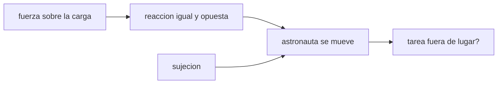

# B106-C16 — Ergonomía en microgravedad

<!-- nav:top -->
[🏠 Programa](../../../../README.md) · [📚 Bloque B106](../../../tronco-comun/B106-habitats-espaciales-y-soporte-vital.md) · [← Anterior: B106-C15 — Protección frente a micrometeoritos](../B106-C15-proteccion-frente-a-micrometeoritos/CLASE.md) · [Siguiente: B106-C17 — Prevención y respuesta a incendios →](../B106-C17-prevencion-y-respuesta-a-incendios/CLASE.md)
<!-- /nav -->

## 1. Ubicación, nivel y alcance

Clase 16 del bloque B106 (hábitats espaciales y soporte vital). Nivel N3. Aplica la mecánica de Newton a una tarea cotidiana de microgravedad: empujar y apretar sin punto de apoyo. Es una clase de ergonomía vista desde la conservación del momento, no de antropometría. Todos los datos del laboratorio son **sintéticos o ilustrativos** y se rotulan como tales; solo se tratan como consultados los valores de la sección 11 que dicen «Consultada».

## 2. Por qué esta clase existe

Sin peso ni fricción, toda fuerza tiene una reacción que mueve al operario o a la carga; un diseño de herramientas y de superficies que lo ignore produce maniobras inseguras. La decisión central: **¿qué sujeciones y qué límites de par o de empuje evitan que la reacción mueva al astronauta fuera de la tarea?**

## 3. Lo que podrás hacer al terminar

1. Aplicar la conservación del momento lineal a un empujón entre astronauta y carga.
2. Calcular velocidades y distancias tras un impulso.
3. Calcular el giro libre al aplicar un par sin sujeción y compararlo con una sujeción elástica.
4. Estimar el tiempo de un desplazamiento y la fuerza de frenado sobre un asidero.
5. Comprobar la conservación del momento total.
6. Rotular que masas, inercia y rigidez son ilustrativas.

La evidencia es la **ficha de reacciones con la maniobra corregida** del ejercicio 12 (sección 20).

## 4. Con qué llegas y cómo comprobarlo

1. ¿Qué es el momento lineal?
2. ¿Qué es un impulso?
3. ¿Qué es un momento de inercia?
4. ¿Qué dice la tercera ley de Newton?
5. ¿Qué es una sujeción?

<details>
<summary>Ver respuestas</summary>

1. `p = m v`; se conserva si no hay fuerzas externas. 2. Fuerza por tiempo: `J = F t = Δp`. 3. La resistencia a girar: `I`; `α = τ/I`. 4. A cada fuerza corresponde una reacción igual y opuesta. 5. Un apoyo (pies, manos) que reacciona al par o al empuje.
</details>

Con cuatro o cinco aciertos, sigue; si no, repasa los prerrequisitos.

## 5. Un caso de contexto y casos de referencia

Un astronauta de 75 kg que empuja 50 N durante 0,5 s un estante libre de 100 kg le da **0,250 m/s** y sale despedido a **-0,333 m/s** (momento total nulo); a los 5 s se ha alejado 1,67 m. Al apretar un tornillo con 10 N·m sin sujeción, con `I = 1,5 kg·m²`, gira 47,7° en 0,5 s (30° en 0,40 s); con una sujeción de pies de 60 N·m/rad, solo 9,5°. Valores ilustrativos, no antropométricos.

## 6. Vocabulario

**Impulso:** `F·t`. **Conservación del momento:** la suma `Σ m v` no cambia sin fuerzas externas. **Momento de inercia `I`:** resistencia a girar. **Par `τ`:** fuerza por brazo. **Sujeción:** apoyo que reacciona. **Asidero:** punto de agarre.

## 7. Modelo mental



*Descripción textual:* la fuerza que se aplica a una carga produce una reacción sobre el cuerpo; una sujeción absorbe esa reacción y mantiene la tarea en su sitio.

Analogía: patinar sobre hielo y empujar a otra persona; ambos se alejan. Límite: en el hábitat hay aire, que amortigua poco, y superficies cercanas con las que chocar.

## 8. La explicación, paso a paso

### 8.1 Empujón

Impulso `J = F t = 25,0 N·s`. Estante: `+J/100 = 0,250 m/s`; astronauta: `−J/75 = -0,333 m/s`; `Σ p = 0` (control exacto). A los 2 s, 0,50 m y 0,67 m; a los 5 s, 1,25 m y 1,67 m.

### 8.2 Contra la estación

Empujar la pared de un módulo de unos 4,2·10⁵ kg da a la estación 6·10⁻⁵ m/s (despreciable) y el astronauta sale a 0,333 m/s: la reacción afecta al ligero, no al pesado.

### 8.3 Par sin sujeción

`α = τ/I = 6,67 rad/s²`; `θ = ½ α t²` da 47,7° a 0,5 s. Con 2 N·m el giro es de 9,5° y con 5 N·m de 23,9°. Con sujeción elástica, `θ = τ/k = 9,5°` (equilibrio).

### 8.4 Desplazarse y frenar

Cruzar 5 m a 0,3 m/s toma 16,7 s; frenar `75·0,3 = 22,5 N·s` en 0,3 s exige 75 N sobre un asidero. Los asideros deben soportar esa fuerza y estar al alcance del brazo.

## 9. Magnitudes, símbolos y unidades

| Símbolo | Qué es | Unidad | Valor / nota |
|---|---|---|---|
| `J` | impulso | N·s | 25,0 |
| `v` | velocidad tras el impulso | m/s | 0,250 (estante); -0,333 (astronauta) |
| `I` | momento de inercia | kg·m² | 1,5 (ilustrativo) |
| `α` | aceleración angular | rad/s² | 6,67 |
| `k` | rigidez de la sujeción | N·m/rad | 60 (ilustrativo) |

## 10. Convenciones y referencias

Cuerpo rígido de 75 kg; `I = 1,5 kg·m²`; estante de 100 kg; estación de 4,2·10⁵ kg; empujón de 50 N durante 0,5 s; par de 10 N·m; `k = 60 N·m/rad`. Todo ilustrativo. Tolerancia: momento total nulo (1e-12); giro libre igual a `½ α t²` (1e-12). Numpy y Python: ver la primera línea de la salida del laboratorio (Python 3.12.9, numpy 2.4.4 en la ejecución del 2026-11-10).

## 11. De dónde sale lo que afirmamos

| ID | Fuente | Localizador | Respalda | Estado |
|---|---|---|---|---|
| — | Conservación del momento, momento de inercia, impulso | — | los verifica el laboratorio con mecánica de Newton | No consultada en una fuente concreta |

Límites: ningún dato antropométrico ni norma de factores humanos (NASA-STD-3001 vol. 1 o 2, tablas de alcance) se consultó; los valores son ilustrativos y la clase **no** da criterios de diseño.

## 12. Cómo ver el resultado

| Resultado | Valor |
|---|---|
| Velocidad del estante / astronauta | 0,250 / -0,333 m/s |
| Distancia del astronauta a los 5 s | 1,67 m |
| Giro libre con 10 N·m en 0,5 s | 47,7° |
| Giro con sujeción de pies | 9,5° |
| Fuerza de frenado sobre un asidero | 75 N |

Descripción larga: la reacción de una tarea sencilla es suficiente para sacar al astronauta de su sitio; una sujeción convierte ese giro libre en una deflexión pequeña y estable.

## 13. Ejemplo trabajado: empuje y reacción

**Paso 1.** Impulso: `50·0,5 = 25 N·s`.

**Paso 2.** Estante: `25/100 = 0,25 m/s`; astronauta: `−25/75 = −0,333 m/s`.

**Paso 3.** Control: `100·0,25 + 75·(−0,333) = 0`.

**Paso 4.** Par de 10 N·m sin sujeción: `α = 10/1,5 = 6,67 rad/s²`; `θ = ½·6,67·0,25 = 0,833 rad = 47,7°`.

## 14. Distintas formas de describir el problema

**Por impulso:** `Δp`. **Por energía:** cinética de cada cuerpo. **Por giro:** `α`, `θ`. **Por sujeción:** `τ/k`. **Por tiempo:** `L/v`.

## 15. Práctica guiada

**Ejercicio 1 · con los pasos indicados.** Calcula la velocidad de un estante de 200 kg tras 25 N·s. *Pasos:* `J/m`.

<details><summary>Solución comentada</summary>

`0,125 m/s`.
</details>

**Ejercicio 2 · con una pista.** Calcula la velocidad de retroceso del astronauta de 75 kg. *Pista:* `J/m`.

<details><summary>Solución comentada</summary>

`0,333 m/s`.
</details>

**Ejercicio 3 · casi autónomo.** Calcula `α` con 5 N·m e `I = 1,5`. *Pista:* `τ/I`.

<details><summary>Solución comentada</summary>

`3,33 rad/s²`.
</details>

## 16. Práctica autónoma, transferencia e integrador

**Ejercicio 4 · autónomo.** ¿Cuánto gira en 0,5 s con 5 N·m?

<details><summary>Solución comentada</summary>

`23,9°`.
</details>

**Ejercicio 5 · autónomo.** ¿Qué par produce un giro de 10° con sujeción de 60 N·m/rad?

<details><summary>Solución comentada</summary>

`60·0,1745 = 10,5 N·m`.
</details>

**Ejercicio 6 · autónomo.** ¿Cuánto tarda en cruzar 8 m a 0,25 m/s?

<details><summary>Solución comentada</summary>

`32 s`.
</details>

**Ejercicio 7 · autónomo.** Si el astronauta pesa 90 kg, ¿cuánto retrocede con 25 N·s?

<details><summary>Solución comentada</summary>

`0,278 m/s`.
</details>

**Ejercicio 8 · autónomo.** ¿Por qué el efecto sobre la estación es despreciable?

<details><summary>Solución comentada</summary>

Su masa es unas 5600 veces mayor que la del astronauta.
</details>

**Ejercicio 9 · transferencia.** Para apretar un perno con 20 N·m, ¿qué hace falta?

<details><summary>Solución comentada</summary>

Una sujeción que reaccione 20 N·m; sin ella el giro libre sería de 95° en 0,5 s.
</details>

**Ejercicio 10 · transferencia.** Se diseña un panel con asideros cada 0,5 m. ¿Qué otro parámetro debe fijarse?

<details><summary>Solución comentada</summary>

La fuerza que soporta cada asidero (≥ 75 N en el modelo) y su orientación.
</details>

**Ejercicio 11 · transferencia.** ¿Cómo se usa esta clase en el diseño de un puesto de trabajo?

<details><summary>Solución comentada</summary>

Para decidir sujeciones y límites de par; los valores reales requieren datos antropométricos y pruebas.
</details>

**Ejercicio 12 · integrador.** Elabora tu *ficha de reacciones con la maniobra corregida*: impulso y velocidades, giro con y sin sujeción para tres pares, tiempo y fuerza de desplazamiento, control del momento y qué es ilustrativo.

<details><summary>Solución comentada</summary>

Secciones 8.1–8.4 y la salida del laboratorio.
</details>

## 17. Laboratorio: reacciones en microgravedad

El script [ergonomia_microgravedad.py](ergonomia_microgravedad.py) calcula las velocidades tras un empujón, el giro libre al aplicar un par con y sin sujeción y la fuerza de frenado sobre un asidero (**comprueba** el momento total nulo, el giro libre contra `½ α t²` y que la sujeción reduce el giro).

**Datos:** mecánica de Newton con valores **ilustrativos**; sin aleatoriedad. **Predice antes de ejecutar:** ¿Hacia dónde se mueve el astronauta si empuja un estante hacia adelante? (hacia atrás, a 0,333 m/s). **Ejecución del 2026-11-10 (Python 3.12.9):**

```text
Python 3.12.9; numpy 2.4.4
DATOS: mecanica de Newton con valores ILUSTRATIVOS; sin datos de personas ni equipos reales
Empujon de 50 N durante 0.5 s a un estante libre de 100 kg: impulso 25.0 N s; estante +0.250 m/s; astronauta -0.333 m/s; momento total +0.0e+00
   a los 2 s: estante a 0.50 m, astronauta a 0.67 m en sentido contrario
   a los 5 s: estante a 1.25 m, astronauta a 1.67 m en sentido contrario
Empujon contra la estacion (4.2e+05 kg): velocidad de la estacion 5.95e-05 m/s (despreciable); el astronauta sale a 0.333 m/s
Tornillo con par de 10 N m sin sujecion (I = 1.5 kg m2): alpha = 6.67 rad/s2; en 0.5 s gira 47.7 grados; 30 grados en 0.40 s
Con sujecion de pies (k = 60 N m/rad): giro 9.5 grados (equilibrio) frente a giro libre creciente
   par  2.0 N m: giro libre en 0.5 s =   9.5 grados
   par  5.0 N m: giro libre en 0.5 s =  23.9 grados
   par 10.0 N m: giro libre en 0.5 s =  47.7 grados
Cruzar 5 m a 0.3 m/s: 16.7 s; frenar al final en 0.3 s exige 75 N sobre un asidero
Pruebas superadas.
```

```bash
python programa/clases/B106/B106-C16-ergonomia-en-microgravedad/ergonomia_microgravedad.py
```

**Límites:** cuerpo rígido, un eje de giro, sin aire, sin elasticidad del cuerpo ni geometría real; masas e inercias ilustrativas.

## 18. Errores frecuentes y cómo corregirlos

**Creer que la reacción solo existe con cargas grandes.** Ver 8.1.

**Olvidar el giro.** Calcula `α` (8.3).

**Usar la masa de la estación como si el efecto fuera nulo en todo.** Solo es despreciable para la estación.

**Tomar valores ilustrativos como datos de ergonomía.** Rotula.

## 19. Cómo sabrás que vas bien

Tras la sección 8: ¿cuánto retrocede un astronauta de 75 kg al dar 25 N·s y cuánto gira con 10 N·m sin sujeción? Si dudas, repasa el ejemplo 13. Tras el laboratorio: ¿qué comprueba? (ver la sección 17).

## 20. Qué entregas y cómo se evalúa

El producto es tu **ficha de reacciones con la maniobra corregida** (ejercicio 12).

| Criterio | Inicial | En desarrollo | Logrado | Destacado |
|---|---|---|---|---|
| Conceptos | Confunde las magnitudes | Parciales | Explica impulso, giro y sujeción | Explica los supuestos y sus límites |
| Cálculo | Sin unidades | Con errores | Calcula con unidades y cifras coherentes | Calcula casos nuevos y los verifica |
| Numérico | Sin comprobación | Un caso | Compara con el control del laboratorio | Interpreta la sensibilidad |
| Fuentes | Sin fuente | Sin fecha | Fuentes con fecha y estado | Declara lo ilustrativo y lo no consultado |
| Límites | No los nombra | Uno | Tres | Discute qué falta para un hábitat real |

**Condiciones críticas (no se compensan con promedio):** rotular los datos como sintéticos o ilustrativos; no presentar un valor ilustrativo como límite de una norma; citar solo lo consultado; no usar la clase como consejo médico ni operativo.

## 21. Ética, seguridad y límites

Clase **educativa**: no da consejo médico ni operativo y no sirve para decidir la atmósfera, el agua, la exposición ni la respuesta ante una emergencia de un hábitat o de una persona reales. No es una guía de diseño de puestos de trabajo ni de procedimientos de actividad en una estación. Accesibilidad: tablas equivalentes a las gráficas, fórmulas en texto, ejercicios sin conexión.

## 22. Para cerrar y seguir

Cada acción tiene reacción: 25 N·s mueven a 0,33 m/s al astronauta, y 10 N·m sin sujeción lo giran casi 48° en medio segundo. Las sujeciones y los asideros son parte del balance del hábitat. La clase siguiente trata el riesgo de incendio.

**Glosario español–inglés.** impulso · *impulse*; momento de inercia · *moment of inertia*; sujeción · *restraint*; asidero · *handrail*; par · *torque*.

**Continuidad.** Sigue con la clase siguiente del bloque (enlace en la navegación) o vuelve al [bloque B106](../../../tronco-comun/B106-habitats-espaciales-y-soporte-vital.md).

**Referencias:** ver sección 11.

<!-- nav:bottom -->
---

[← Anterior: B106-C15 — Protección frente a micrometeoritos](../B106-C15-proteccion-frente-a-micrometeoritos/CLASE.md) · [📚 Bloque B106](../../../tronco-comun/B106-habitats-espaciales-y-soporte-vital.md) · [Siguiente: B106-C17 — Prevención y respuesta a incendios →](../B106-C17-prevencion-y-respuesta-a-incendios/CLASE.md)
<!-- /nav -->
