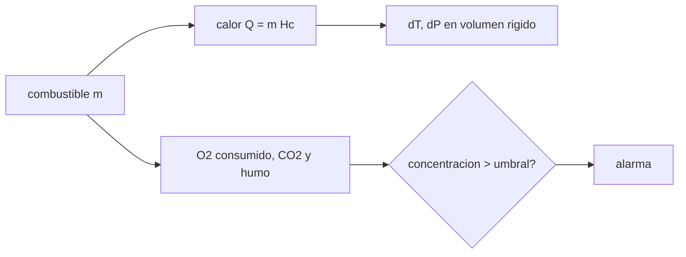

# B106-C17 — Prevención y respuesta a incendios

<!-- nav:top -->
[🏠 Programa](../../../../README.md) · [📚 Bloque B106](../../../tronco-comun/B106-habitats-espaciales-y-soporte-vital.md) · [← Anterior: B106-C16 — Ergonomía en microgravedad](../B106-C16-ergonomia-en-microgravedad/CLASE.md) · [Siguiente: B106-C18 — Fiabilidad y redundancia →](../B106-C18-fiabilidad-y-redundancia/CLASE.md)
<!-- /nav -->

## 1. Ubicación, nivel y alcance

Clase 17 del bloque B106 (hábitats espaciales y soporte vital). Nivel N3. Aborda el incendio como balance de energía y de masa en una cabina cerrada, más el problema de detectarlo. Es un modelo mínimo y educativo, no un procedimiento de respuesta. Todos los datos del laboratorio son **sintéticos o ilustrativos** y se rotulan como tales; solo se tratan como consultados los valores de la sección 11 que dicen «Consultada».

## 2. Por qué esta clase existe

Un incendio en una cabina cerrada no puede salir al exterior: calienta, sube la presión, consume oxígeno y produce CO₂ y humo. La decisión central: **¿qué efectos tiene una cantidad dada de combustible y con qué tiempo y ventilación se puede detectar?**

## 3. Lo que podrás hacer al terminar

1. Escribir la reacción de combustión de la celulosa y comprobar la conservación de masa.
2. Calcular el calor liberado, el aumento de temperatura y de presión en un volumen rígido.
3. Calcular el oxígeno consumido y el CO₂ producido y compararlos con los límites.
4. Estimar el tiempo de alarma de un detector con ventilación y su dilución.
5. Explicar por qué la ubicación y la ventilación importan.
6. Rotular que el combustible, las pérdidas y el umbral son ilustrativos.

La evidencia es la **ficha de escenario de incendio con tiempos** del ejercicio 12 (sección 20).

## 4. Con qué llegas y cómo comprobarlo

1. ¿Qué es el calor de combustión?
2. ¿Qué es un volumen rígido?
3. ¿Qué es la dilución?
4. ¿Cuál es la masa molar del CO₂?
5. ¿Qué es un detector de humo?

<details>
<summary>Ver respuestas</summary>

1. La energía liberada por kilogramo de combustible quemado. 2. Uno que no cambia de tamaño; al calentar, sube la presión. 3. La reducción de concentración al mezclar con más aire. 4. 44,01 g/mol. 5. Un sensor que alarma al pasar un umbral de partículas.
</details>

Con cuatro o cinco aciertos, sigue; si no, repasa los prerrequisitos.

## 5. Un caso de contexto y casos de referencia

Medio kilogramo de celulosa (16 MJ/kg, de manual) libera 8 MJ en 100 m³: sin pérdidas, la temperatura sube **92,5 K** y la presión **32,0 kPa** (cota superior); el O₂ baja solo **2,12 %** de su masa, pero el CO₂ sube **3,38 mmHg**, más que el límite consultado de 3 mmHg. Con 0,6 m³/s de ventilación y 2 mg/s de humo, una alarma de 1 mg/m³ suena en **59 s**; con más de 2,0 m³/s el humo se diluye bajo el umbral y no suena. Un estudio consultado (Yang et al., 2018) halló que ningún detector espacial evaluado reconoció todo el humo.

## 6. Vocabulario

**Calor de combustión:** energía por kg quemado. **Volumen rígido:** `ΔP/P = ΔT/T`. **Dilución:** menor concentración por más caudal. **Umbral de alarma:** concentración que activa el detector. **Humo:** partículas de la pirólisis o la combustión.

## 7. Modelo mental



*Descripción textual:* el combustible libera calor, produce gases y humo; el humo se diluye con la ventilación y suena la alarma si supera el umbral.

Analogía: una estufa en una habitación cerrada. Límite: en microgravedad no hay convección natural; la llama y el humo se comportan distinto y el humo no sube al techo.

## 8. La explicación, paso a paso

### 8.1 Masa y reacción

`C₆H₁₀O₅ + 6 O₂ → 6 CO₂ + 5 H₂O`: 354,128 g/mol entran y 354,135 salen (diferencia por redondeo). Por kg de combustible: 1,184 kg de O₂ consumidos y 1,629 kg de CO₂ producidos.

### 8.2 Calor, temperatura y presión

`Q = m H_c`; en una cabina de 100 m³ (120,4 kg de aire, `c_v = 718 J/(kg K)`), `ΔT = Q/(m_aire c_v)`. Para 0,05 kg: 9,3 K y 3,2 kPa; para 0,5 kg: 92,5 K y 32,0 kPa, que baja a 64,8 K si las paredes absorben el 30 %. `ΔP/P = ΔT/T` en volumen constante. Son cotas: el calor se pierde y la cabina tiene válvulas.

### 8.3 Oxígeno y CO₂

0,5 kg consumen 0,59 kg de O₂ (2,12 % de los 27,9 kg de la cabina) y producen 0,81 kg de CO₂, que suben la ppCO₂ en 3,38 mmHg: el efecto sobre el CO₂ (límite consultado de 3 mmHg) es mayor que sobre el O₂.

### 8.4 Detección

Con mezcla perfecta, `C(t) = (ṁ/Q)(1 − e^{−Q t/V})`; la alarma suena en `t = −(V/Q) ln(1 − C_u Q/ṁ)`. Con 0,6 m³/s: 59 s (más 50 s de transporte hasta un detector a 10 m). Con 0,1 m³/s: 51 s; con 1,5 m³/s: 92 s; con 2,5 m³/s, nunca. Mayor ventilación diluye.

### 8.5 Lo que dice la fuente

Yang et al. (2018) midieron en la ISS el humo de cinco materiales espaciales y dos detectores: ninguno detectó todos los humos, de modo que los detectores futuros deben probarse con humo de materiales reales de uso espacial.

## 9. Magnitudes, símbolos y unidades

| Símbolo | Qué es | Unidad | Valor / nota |
|---|---|---|---|
| `H_c` | calor de combustión | MJ/kg | 16 (manual) |
| `ΔT` | aumento de temperatura | K | 92,5 (0,5 kg) |
| `ΔP` | aumento de presión (cota) | kPa | 32,0 |
| `ΔppCO₂` | aumento de CO₂ | mmHg | 3,38 |
| `t_alarm` | tiempo de alarma | s | 59 (0,6 m³/s) |

## 10. Convenciones y referencias

Celulosa `C₆H₁₀O₅`; cabina rígida de 100 m³, 293,15 K y 101,325 kPa; humo de 2 mg/s, umbral 1 mg/m³, mezcla perfecta; 30 % de absorción en paredes en el caso moderado. Tolerancia: conservación de masa 0,05 g/mol y cotas sin pérdidas como límites superiores. Numpy y Python: ver la primera línea de la salida del laboratorio (Python 3.12.9, numpy 2.4.4 en la ejecución del 2026-11-10).

## 11. De dónde sale lo que afirmamos

| ID | Fuente | Localizador | Respalda | Estado |
|---|---|---|---|---|
| S7 | Yang, J. C. et al., «Evaluation of spacecraft smoke detector performance in the low-gravity environment», Fire Safety Journal 98 (2018) — https://www.nist.gov/publications/evaluation-spacecraft-smoke-detector-performance-low-gravity-environment (consultada 2026-11-10; solo la ficha y el resumen en el sitio del NIST) | ficha y resumen en el sitio del NIST | experimento en la ISS con humo de cinco materiales espaciales; ningún detector de los dos evaluados identificó todos los tipos de humo; los detectores de próxima generación deben probarse con humo de materiales usados en el espacio | Consultada (solo ficha y resumen) |
| S4 | NASA OCHMO, OCHMO-TB-004, «Carbon Dioxide (CO2)», resumen técnico derivado de NASA-STD-3001 vol. 2 rev. D — https://www.nasa.gov/wp-content/uploads/2023/12/ochmo-tb-004-carbon-dioxide.pdf (consultada 2026-11-10; PDF leído con PyMuPDF) | texto sobre ppCO₂ | límite de 3 mmHg para la ppCO₂ de 1 h | Consultada (resumen técnico) |
| — | Calor de combustión, `c_v`, estequiometría, dilución | — | valores de manual y verificación del laboratorio | No consultada en una fuente concreta |

Límites: el resumen OCHMO sobre protección contra incendios (TB-008) **no se consultó** (no se halló); los procedimientos de respuesta y los agentes extintores **no se consultaron**. Combustible, pérdidas y umbral son ilustrativos.

## 12. Cómo ver el resultado

| Resultado | Valor |
|---|---|
| Calor y ΔT (0,5 kg, sin pérdidas) | 8,0 MJ; 92,5 K |
| ΔP (cota superior) | 32,0 kPa |
| O₂ consumido / ΔppCO₂ | 2,12 % / 3,38 mmHg |
| Alarma con 0,6 m³/s | 59 s |
| Caudal que impide la alarma | > 2,0 m³/s |

Descripción larga: un incendio pequeño en una cabina cerrada afecta más por el calor, la presión y el CO₂ que por el oxígeno que consume; detectarlo depende del caudal de ventilación y de la ubicación del sensor.

## 13. Ejemplo trabajado: efectos de 0,5 kg de combustible

**Paso 1.** `Q = 0,5·16 = 8 MJ`.

**Paso 2.** `ΔT = 8·10⁶/(120,4·718) = 92,5 K`; `ΔP = 101,3·92,5/293,15 = 32,0 kPa`.

**Paso 3.** O₂: `0,5·1,184 = 0,59 kg` de 27,9 kg: 2,12 %.

**Paso 4.** CO₂: `0,5·1,629 = 0,81 kg = 18,5 mol`; `18,5/4157 = 0,44 %`; `0,0044·760 = 3,38 mmHg`.

## 14. Distintas formas de describir el problema

**Por energía:** `Q`. **Por presión:** `ΔT/T`. **Por masa:** estequiometría. **Por tiempo:** alarma. **Por ventilación:** dilución.

## 15. Práctica guiada

**Ejercicio 1 · con los pasos indicados.** Calcula `Q` de 0,2 kg de celulosa. *Pasos:* `m H_c`.

<details><summary>Solución comentada</summary>

`3,2 MJ`.
</details>

**Ejercicio 2 · con una pista.** Calcula el O₂ consumido por 0,2 kg. *Pista:* 1,184 kg/kg.

<details><summary>Solución comentada</summary>

`0,237 kg`.
</details>

**Ejercicio 3 · casi autónomo.** Calcula `ΔT` sin pérdidas en 100 m³ con 3,2 MJ. *Pista:* `Q/(m c_v)`.

<details><summary>Solución comentada</summary>

`37 K`.
</details>

## 16. Práctica autónoma, transferencia e integrador

**Ejercicio 4 · autónomo.** ¿Cuánto CO₂ produce 0,2 kg?

<details><summary>Solución comentada</summary>

`0,326 kg`.
</details>

**Ejercicio 5 · autónomo.** ¿Y en mol?

<details><summary>Solución comentada</summary>

`7,4 mol`.
</details>

**Ejercicio 6 · autónomo.** ¿Cuánto sube la ppCO₂ en 100 m³?

<details><summary>Solución comentada</summary>

`7,4/4157·760 = 1,35 mmHg`.
</details>

**Ejercicio 7 · autónomo.** ¿Qué alarma da `ṁ = 5 mg/s` con `Q = 0,6`?

<details><summary>Solución comentada</summary>

`t = −167·ln(1 − 0,12) = 21 s`.
</details>

**Ejercicio 8 · autónomo.** ¿Por qué la alarma no suena con ventilación muy alta?

<details><summary>Solución comentada</summary>

El humo se diluye bajo el umbral (8.4).
</details>

**Ejercicio 9 · transferencia.** Se pone un detector en el retorno de ventilación. ¿Qué ventaja tiene en microgravedad?

<details><summary>Solución comentada</summary>

Allí converge el aire de la cabina y el humo llega sin depender de la convección natural (concepto del modelo).
</details>

**Ejercicio 10 · transferencia.** Una cabina de 400 m³ con la misma cantidad de combustible, ¿cómo cambia `ΔP`?

<details><summary>Solución comentada</summary>

Baja a un cuarto (volumen mayor).
</details>

**Ejercicio 11 · transferencia.** ¿Qué falta para estimar riesgo real?

<details><summary>Solución comentada</summary>

Propagación de la llama en microgravedad, combustibles reales y agentes extintores; no modelados.
</details>

**Ejercicio 12 · integrador.** Elabora tu *ficha de escenario de incendio con tiempos*: reacción, calor, ΔT, ΔP, O₂ y CO₂ para dos masas, tiempo de alarma con tres ventilaciones, límites del modelo y qué es consultado o ilustrativo.

<details><summary>Solución comentada</summary>

Secciones 8.1–8.5 y la salida del laboratorio.
</details>

## 17. Laboratorio: escenario de incendio y detección

El script [incendio_en_cabina.py](incendio_en_cabina.py) calcula el calor, la temperatura, la presión, el O₂ consumido, el CO₂ producido y el tiempo de alarma para varias ventilaciones (**comprueba** la conservación de masa de la reacción, que la ppCO₂ del caso de 0,5 kg supera 3 mmHg y el orden de los tiempos).

**Datos:** valores de manual **no consultados** e **ilustrativos**; ningún incendio real. **Predice antes de ejecutar:** ¿Qué sube más en un incendio en cabina cerrada: la ppCO₂ o la caída de O₂? (la ppCO₂, en relación con su límite). **Ejecución del 2026-11-10 (Python 3.12.9):**

```text
Python 3.12.9; numpy 2.4.4
DATOS: valores de manual NO consultados e ILUSTRATIVOS; la limitacion de los detectores es el resultado CONSULTADO de Yang et al. (2018); ningun incendio real
Control de masa: C6H10O5 + 6 O2 -> 6 CO2 + 5 H2O : entran 354.128 g/mol, salen 354.135 g/mol (diferencia -0.007)
Por kg de combustible: consume 1.184 kg de O2, produce 1.629 kg de CO2 y 0.556 kg de H2O
Cabina: 120.4 kg de aire, 4157 mol, 27.93 kg de O2
   combustible [kg]   Q [MJ]   dT sin perdidas [K]   dP [kPa]   dT con 30 % a paredes [K]   O2 consumido [%]   dppCO2 [mmHg]
              0.05      0.8                   9.3        3.2                        6.5              0.21           0.34
              0.50      8.0                  92.5       32.0                       64.8              2.12           3.38
Deteccion (humo de mezcla perfecta, 2.0 mg/s, umbral 1.0 mg/m3): con 0.6 m3/s, tau = 167 s y la alarma llega en 59 s; el transporte de 10 m a 0.2 m/s suma 50 s
   caudal de ventilacion [m3/s]   concentracion maxima [mg/m3]   tiempo de alarma [s]
                          0.1                          20.00                   51
                          0.3                           6.67                   54
                          0.6                           3.33                   59
                          1.5                           1.33                   92
                          2.5                           0.80   nunca (diluido bajo el umbral)
Con esta tasa de humo, ventilar a mas de 2.0 m3/s diluye el humo por debajo del umbral y la alarma no suena
Pruebas superadas.
```

```bash
python programa/clases/B106/B106-C17-prevencion-y-respuesta-a-incendios/incendio_en_cabina.py
```

**Límites:** mezcla perfecta, combustible único, sin llama en microgravedad ni propagación, sin pérdidas (cota) y sin extintores; no es un procedimiento.

## 18. Errores frecuentes y cómo corregirlos

**Considerar solo el O₂ consumido.** Mira también el CO₂ y el calor (8.3).

**Tratar `ΔP` como real.** Es una cota (8.2).

**Subir la ventilación sin pensar en la detección.** Ver 8.4.

**Usar la clase como procedimiento de emergencia.** Es un modelo educativo.

## 19. Cómo sabrás que vas bien

Tras la sección 8: ¿cuánto sube la presión y el CO₂ con 0,5 kg de combustible y cuándo suena una alarma? Si dudas, repasa el ejemplo 13. Tras el laboratorio: ¿qué comprueba? (ver la sección 17).

## 20. Qué entregas y cómo se evalúa

El producto es tu **ficha de escenario de incendio con tiempos** (ejercicio 12).

| Criterio | Inicial | En desarrollo | Logrado | Destacado |
|---|---|---|---|---|
| Conceptos | Confunde las magnitudes | Parciales | Explica calor, gases y detección | Explica los supuestos y sus límites |
| Cálculo | Sin unidades | Con errores | Calcula con unidades y cifras coherentes | Calcula casos nuevos y los verifica |
| Numérico | Sin comprobación | Un caso | Compara con el control del laboratorio | Interpreta la sensibilidad |
| Fuentes | Sin fuente | Sin fecha | Fuentes con fecha y estado | Declara lo ilustrativo y lo no consultado |
| Límites | No los nombra | Uno | Tres | Discute qué falta para un hábitat real |

**Condiciones críticas (no se compensan con promedio):** rotular los datos como sintéticos o ilustrativos; no presentar un valor ilustrativo como límite de una norma; citar solo lo consultado; no usar la clase como consejo médico ni operativo.

## 21. Ética, seguridad y límites

Clase **educativa**: no da consejo médico ni operativo y no sirve para decidir la atmósfera, el agua, la exposición ni la respuesta ante una emergencia de un hábitat o de una persona reales. No es un procedimiento de respuesta ante incendios: los planes reales los fijan normas y entrenamiento específicos, que no se consultaron. Accesibilidad: tablas equivalentes a las gráficas, fórmulas en texto, ejercicios sin conexión.

## 22. Para cerrar y seguir

Un incendio en una cabina cerrada se entiende como un balance de energía y de masa: 0,5 kg elevan unos 92 K y 32 kPa en el límite sin pérdidas y el CO₂ supera su límite antes de que el O₂ importe; la ventilación decide si el humo se detecta. La clase siguiente pone cifras a la fiabilidad.

**Glosario español–inglés.** incendio · *fire*; calor de combustión · *heat of combustion*; detector de humo · *smoke detector*; dilución · *dilution*; volumen rígido · *constant volume*.

**Continuidad.** Sigue con la clase siguiente del bloque (enlace en la navegación) o vuelve al [bloque B106](../../../tronco-comun/B106-habitats-espaciales-y-soporte-vital.md).

**Referencias:** ver sección 11.

<!-- nav:bottom -->
---

[← Anterior: B106-C16 — Ergonomía en microgravedad](../B106-C16-ergonomia-en-microgravedad/CLASE.md) · [📚 Bloque B106](../../../tronco-comun/B106-habitats-espaciales-y-soporte-vital.md) · [Siguiente: B106-C18 — Fiabilidad y redundancia →](../B106-C18-fiabilidad-y-redundancia/CLASE.md)
<!-- /nav -->
