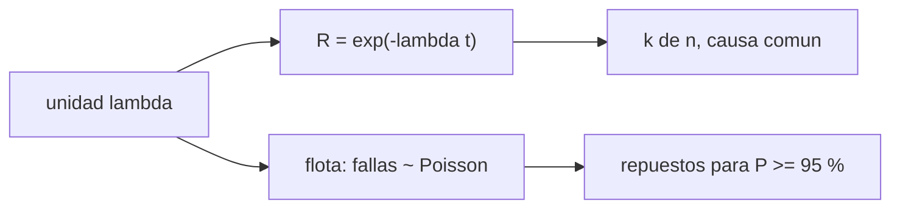

# B106-C18 — Fiabilidad y redundancia

<!-- nav:top -->
[🏠 Programa](../../../../README.md) · [📚 Bloque B106](../../../tronco-comun/B106-habitats-espaciales-y-soporte-vital.md) · [← Anterior: B106-C17 — Prevención y respuesta a incendios](../B106-C17-prevencion-y-respuesta-a-incendios/CLASE.md) · [Siguiente: B106-C19 — Arquitectura de asentamiento lunar conceptual →](../B106-C19-arquitectura-de-asentamiento-lunar-conceptual/CLASE.md)
<!-- /nav -->

## 1. Ubicación, nivel y alcance

Clase 18 del bloque B106 (hábitats espaciales y soporte vital). Nivel N3. Cuantifica cuánta redundancia y cuántos repuestos necesita un sistema de soporte vital para una misión larga. Usa fiabilidad exponencial y el modelo de Poisson, verificados con Monte Carlo. Todos los datos del laboratorio son **sintéticos o ilustrativos** y se rotulan como tales; solo se tratan como consultados los valores de la sección 11 que dicen «Consultada».

## 2. Por qué esta clase existe

Ningún equipo es perfecto y una misión larga no se puede reparar con repuestos de la Tierra. La decisión central: **¿qué configuración redundante y cuántos repuestos dan una probabilidad objetivo de cumplir la misión?**

## 3. Lo que podrás hacer al terminar

1. Calcular la fiabilidad exponencial `R = e^(−λt)` de una unidad.
2. Calcular la fiabilidad de configuraciones 1 de 2, 1 de 3 y 2 de 3.
3. Incluir la causa común (factor β) y un conmutador imperfecto en la espera fría.
4. Verificar las fórmulas por Monte Carlo con su incertidumbre.
5. Calcular repuestos para una flota con la distribución de Poisson.
6. Rotular que tasas de falla, β y conmutador son ilustrativos.

La evidencia es la **diagrama de fiabilidad con repuestos** del ejercicio 12 (sección 20).

## 4. Con qué llegas y cómo comprobarlo

1. ¿Qué es una tasa de falla?
2. ¿Qué es la redundancia?
3. ¿Qué es una causa común?
4. ¿Qué es la distribución de Poisson?
5. ¿Qué es un MTBF?

<details>
<summary>Ver respuestas</summary>

1. La probabilidad de falla por unidad de tiempo, constante en el modelo exponencial. 2. Disponer de más unidades de las necesarias. 3. Una falla que afecta a varias unidades a la vez. 4. La del número de fallas independientes en un intervalo. 5. El tiempo medio entre fallas, `1/λ`.
</details>

Con cuatro o cinco aciertos, sigue; si no, repasa los prerrequisitos.

## 5. Un caso de contexto y casos de referencia

Una unidad con `λ = 10⁻⁵ /h` (MTBF de 100 000 h, ilustrativo) tiene **0,8057** de fiabilidad en una misión de 900 días (21 600 h). Con redundancia 1 de 2 sube a **0,9623**, con 1 de 3 a 0,9927, y con 2 de 3 (votación) baja a 0,9014. Con una causa común del 10 %, el 1 de 2 queda en 0,9481. Una flota de 12 unidades espera 2,59 fallas y necesita **5 repuestos** para un 95 % de confianza y 7 para 99 %.

## 6. Vocabulario

**Fiabilidad:** probabilidad de funcionar durante la misión. **Tasa de falla `λ`:** fallas por hora. **Redundancia k de n:** funciona si funcionan `k` de `n`. **Causa común (β):** fracción de fallas que afecta a todos. **Repuesto:** unidad de reemplazo. **Espera fría:** unidad apagada que se conecta al fallar la principal.

## 7. Modelo mental



*Descripción textual:* la tasa de falla da la fiabilidad de una unidad; la redundancia la mejora y la flota esperada de fallas fija los repuestos.

Analogía: llevar una rueda de repuesto. Límite: aquí las fallas son independientes y constantes en el tiempo; en la realidad hay desgaste, mortalidad infantil y fallas de modo común.

## 8. La explicación, paso a paso

### 8.1 Una unidad

`R = exp(−λ t) = exp(−0,216) = 0,80574`.

### 8.2 Redundancia

1 de 2: `1 − (1 − R)² = 0,96226`; 1 de 3: 0,99267; 2 de 3: `3R² − 2R³ = 0,90145`. La votación 2 de 3 detecta y enmascara fallas, pero es menos fiable que el 1 de 2 porque exige que dos funcionen.

### 8.3 Causa común y conmutador

Con `β = 0,1`: 0,94809. La espera fría perfecta da 0,97977 y con conmutador de 0,95, 0,97107: el conmutador limita la mejora.

### 8.4 Monte Carlo

Con 200 000 repeticiones (semilla 106): una unidad 0,80608 ± 0,00088, 1 de 2 0,96293 ± 0,00042 y 2 de 3 0,90248 ± 0,00066, dentro de 4 desviaciones de las fórmulas.

### 8.5 Repuestos

Las fallas de la flota de 12 unidades en la misión siguen `Poisson(2,59)`; la probabilidad de cero fallas es 0,0749. Con 5 repuestos la cobertura es 0,9515 y con 7, 0,9948.

## 9. Magnitudes, símbolos y unidades

| Símbolo | Qué es | Unidad | Valor / nota |
|---|---|---|---|
| `λ` | tasa de falla | 1/h | 10⁻⁵ (ilustrativo) |
| `R` | fiabilidad de una unidad | — | 0,8057 |
| `β` | fracción de causa común | — | 0,1 (ilustrativo) |
| `μ` | fallas esperadas de la flota | — | 2,59 |
| `s` | repuestos para 95 % | unidades | 5 |

## 10. Convenciones y referencias

Modelo exponencial; misión de 21 600 h; 12 unidades; β = 0,1; conmutador de 0,95; semilla 106; 200 000 repeticiones; tolerancia del Monte Carlo de 4 desviaciones binomiales. Todo ilustrativo. Numpy y Python: ver la primera línea de la salida del laboratorio (Python 3.12.9, numpy 2.4.4 en la ejecución del 2026-11-10).

## 11. De dónde sale lo que afirmamos

| ID | Fuente | Localizador | Respalda | Estado |
|---|---|---|---|---|
| — | Fiabilidad exponencial, k de n, causa común y Poisson | — | las verifica el laboratorio con fórmulas y Monte Carlo | No consultada en una fuente concreta |

Límites: ninguna tasa de falla procede de una fuente consultada y no se consultaron estándares de fiabilidad (por ejemplo ECSS) ni datos de componentes de soporte vital; los valores son ilustrativos.

## 12. Cómo ver el resultado

| Resultado | Valor |
|---|---|
| Fiabilidad 1 unidad / 1 de 2 | 0,8057 / 0,9623 |
| 1 de 3 / 2 de 3 | 0,9927 / 0,9014 |
| 1 de 2 con causa común | 0,9481 |
| Fallas esperadas de la flota | 2,59 |
| Repuestos para 95 % / 99 % | 5 / 7 |

Descripción larga: la redundancia mejora mucho la fiabilidad, pero la causa común y un conmutador imperfecto limitan la mejora; los repuestos se dimensionan con la distribución de fallas.

## 13. Ejemplo trabajado: fiabilidad y repuestos

**Paso 1.** `λ t = 10⁻⁵·21 600 = 0,216`; `R = e^(−0,216) = 0,8057`.

**Paso 2.** 1 de 2: `1 − 0,1943² = 0,9623`.

**Paso 3.** Fallas de la flota: `12·0,216 = 2,59`.

**Paso 4.** Repuestos: la menor `s` con `P(X ≤ s) ≥ 0,95` es `5` (0,9515).

## 14. Distintas formas de describir el problema

**Por fórmula:** `e^(−λt)`. **Por esquema:** diagrama de bloques. **Por simulación:** Monte Carlo. **Por Poisson:** repuestos. **Por tabla:** configuraciones.

## 15. Práctica guiada

**Ejercicio 1 · con los pasos indicados.** Calcula `R` con `λ = 2·10⁻⁵` y 10 000 h. *Pasos:* `e^(−λt)`.

<details><summary>Solución comentada</summary>

`e^(−0,2) = 0,8187`.
</details>

**Ejercicio 2 · con una pista.** Calcula el 1 de 2 con ese `R`. *Pista:* `1 − (1 − R)²`.

<details><summary>Solución comentada</summary>

`1 − 0,1813² = 0,9671`.
</details>

**Ejercicio 3 · casi autónomo.** Calcula `μ` para 5 unidades con `λ t = 0,2`. *Pista:* producto.

<details><summary>Solución comentada</summary>

`1,0`.
</details>

## 16. Práctica autónoma, transferencia e integrador

**Ejercicio 4 · autónomo.** ¿Cuál es la fiabilidad de una cadena en serie de 3 unidades con `R = 0,9`?

<details><summary>Solución comentada</summary>

`0,729`.
</details>

**Ejercicio 5 · autónomo.** ¿Y de 2 de 3 con `R = 0,9`?

<details><summary>Solución comentada</summary>

`3·0,81 − 2·0,729 = 0,972`.
</details>

**Ejercicio 6 · autónomo.** ¿Cuánto vale `P(X = 0)` con `μ = 2,59`?

<details><summary>Solución comentada</summary>

`0,0749`.
</details>

**Ejercicio 7 · autónomo.** Si `β = 0,2`, ¿baja o sube la fiabilidad del 1 de 2?

<details><summary>Solución comentada</summary>

Baja: más causa común (hay que recalcularla).
</details>

**Ejercicio 8 · autónomo.** ¿Por qué el conmutador es un punto débil?

<details><summary>Solución comentada</summary>

Si no actúa, la espera no sirve: limita la fiabilidad a 0,971.
</details>

**Ejercicio 9 · transferencia.** Un lazo de agua con 12 unidades críticas y 900 días: ¿cuántos repuestos para 99 %?

<details><summary>Solución comentada</summary>

7 (0,9948).
</details>

**Ejercicio 10 · transferencia.** Se pasa a una misión de 1800 días. ¿Qué pasa con `μ`?

<details><summary>Solución comentada</summary>

Se duplica a 5,18 y los repuestos para 95 % suben a unos 9.
</details>

**Ejercicio 11 · transferencia.** ¿Qué mejoraría más la fiabilidad: duplicar unidades o reducir `β`?

<details><summary>Solución comentada</summary>

Con `β` alto, reducir `β` (diversidad, separación física) puede valer más que añadir una unidad idéntica.
</details>

**Ejercicio 12 · integrador.** Elabora tu *diagrama de fiabilidad con repuestos*: esquema, tabla de siete configuraciones, Monte Carlo con incertidumbre, repuestos para 95 % y 99 % y qué es ilustrativo.

<details><summary>Solución comentada</summary>

Secciones 8.1–8.5 y la salida del laboratorio.
</details>

## 17. Laboratorio: fiabilidad, redundancia y repuestos

El script [fiabilidad_redundancia.py](fiabilidad_redundancia.py) calcula la fiabilidad de siete configuraciones, la verifica por Monte Carlo y dimensiona repuestos por Poisson (**comprueba** el orden de las configuraciones y el acuerdo con el Monte Carlo).

**Datos:** parámetros **ilustrativos**; Monte Carlo **sintético** (semilla 106). **Predice antes de ejecutar:** ¿Es más fiable un 2 de 3 o un 1 de 2? (el 1 de 2, aunque el 2 de 3 detecta fallas). **Ejecución del 2026-11-10 (Python 3.12.9):**

```text
Python 3.12.9; numpy 2.4.4
DATOS: tasa de falla, beta y conmutador ILUSTRATIVOS; Monte Carlo SINTETICO (semilla 106); sin datos de componentes reales
Mision de 21600 h con lambda = 1e-05/h: lambda t = 0.216
   configuracion                      fiabilidad
   1 unidad                           0.80574
   1 de 2 (calor)                     0.96226
   1 de 3 (calor)                     0.99267
   2 de 3 (votacion)                  0.90145
   1 de 2 con causa comun             0.94809
   espera fria (conm. perfecto)       0.97977
   espera fria (conm. 0.95)           0.97107
Monte Carlo frente a formula:
   1 unidad             MC 0.80608 +- 0.00088; formula 0.80574
   1 de 2 (calor)       MC 0.96293 +- 0.00042; formula 0.96226
   2 de 3 (votacion)    MC 0.90248 +- 0.00066; formula 0.90145
Flota de 12 unidades: fallas esperadas 2.59; repuestos para 95 %: 5 (P = 0.9515); para 99 %: 7 (P = 0.9948)
Sin repuestos, P(ninguna falla en la flota) = 0.0749
Pruebas superadas.
```

```bash
python programa/clases/B106/B106-C18-fiabilidad-y-redundancia/fiabilidad_redundancia.py
```

**Límites:** fallas exponenciales independientes, sin reparación, sin desgaste, sin modos de falla distintos, sin diagnóstico imperfecto.

## 18. Errores frecuentes y cómo corregirlos

**Creer que redundar siempre da fiabilidad perfecta.** La causa común lo limita (8.3).

**Olvidar el conmutador.** Ver 8.3.

**Tomar `λ` ilustrativo como dato.** Rotula.

**Dimensionar repuestos con la media.** Usa el percentil de Poisson (8.5).

## 19. Cómo sabrás que vas bien

Tras la sección 8: ¿qué fiabilidad da un 1 de 2 y cuántos repuestos hacen falta para 95 %? Si dudas, repasa el ejemplo 13. Tras el laboratorio: ¿qué comprueba? (ver la sección 17).

## 20. Qué entregas y cómo se evalúa

El producto es tu **diagrama de fiabilidad con repuestos** (ejercicio 12).

| Criterio | Inicial | En desarrollo | Logrado | Destacado |
|---|---|---|---|---|
| Conceptos | Confunde las magnitudes | Parciales | Explica fiabilidad, redundancia y repuestos | Explica los supuestos y sus límites |
| Cálculo | Sin unidades | Con errores | Calcula con unidades y cifras coherentes | Calcula casos nuevos y los verifica |
| Numérico | Sin comprobación | Un caso | Compara con el control del laboratorio | Interpreta la sensibilidad |
| Fuentes | Sin fuente | Sin fecha | Fuentes con fecha y estado | Declara lo ilustrativo y lo no consultado |
| Límites | No los nombra | Uno | Tres | Discute qué falta para un hábitat real |

**Condiciones críticas (no se compensan con promedio):** rotular los datos como sintéticos o ilustrativos; no presentar un valor ilustrativo como límite de una norma; citar solo lo consultado; no usar la clase como consejo médico ni operativo.

## 21. Ética, seguridad y límites

Clase **educativa**: no da consejo médico ni operativo y no sirve para decidir la atmósfera, el agua, la exposición ni la respuesta ante una emergencia de un hábitat o de una persona reales. No son cifras de ningún componente real; la fiabilidad de un sistema de soporte vital exige datos de ensayo y estándares. Accesibilidad: tablas equivalentes a las gráficas, fórmulas en texto, ejercicios sin conexión.

## 22. Para cerrar y seguir

La redundancia sube una fiabilidad de 0,81 a 0,96 con dos unidades, la causa común la recorta y 5 repuestos cubren al 95 % una flota de 12 unidades en 900 días. La clase siguiente aplica este razonamiento a un asentamiento conceptual.

**Glosario español–inglés.** fiabilidad · *reliability*; redundancia · *redundancy*; causa común · *common cause*; repuesto · *spare*; tasa de falla · *failure rate*.

**Continuidad.** Sigue con la clase siguiente del bloque (enlace en la navegación) o vuelve al [bloque B106](../../../tronco-comun/B106-habitats-espaciales-y-soporte-vital.md).

**Referencias:** ver sección 11.

<!-- nav:bottom -->
---

[← Anterior: B106-C17 — Prevención y respuesta a incendios](../B106-C17-prevencion-y-respuesta-a-incendios/CLASE.md) · [📚 Bloque B106](../../../tronco-comun/B106-habitats-espaciales-y-soporte-vital.md) · [Siguiente: B106-C19 — Arquitectura de asentamiento lunar conceptual →](../B106-C19-arquitectura-de-asentamiento-lunar-conceptual/CLASE.md)
<!-- /nav -->
