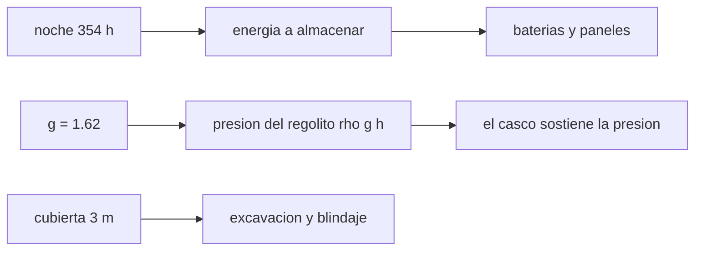

# B106-C19 — Arquitectura de asentamiento lunar conceptual

<!-- nav:top -->
[🏠 Programa](../../../../README.md) · [📚 Bloque B106](../../../tronco-comun/B106-habitats-espaciales-y-soporte-vital.md) · [← Anterior: B106-C18 — Fiabilidad y redundancia](../B106-C18-fiabilidad-y-redundancia/CLASE.md) · [Siguiente: B106-C20 — Proyecto de balance ambiental de hábitat →](../B106-C20-proyecto-de-balance-ambiental-de-habitat/CLASE.md)
<!-- /nav -->

## 1. Ubicación, nivel y alcance

Clase 19 del bloque B106 (hábitats espaciales y soporte vital). Nivel N3. Reúne cuatro números de un asentamiento lunar conceptual: noche, energía, presión frente a peso del regolito y excavación. Es un ejercicio de órdenes de magnitud, no un diseño. Todos los datos del laboratorio son **sintéticos o ilustrativos** y se rotulan como tales; solo se tratan como consultados los valores de la sección 11 que dicen «Consultada».

## 2. Por qué esta clase existe

La Luna cambia las reglas: noches de dos semanas, gravedad de un sexto y un regolito que protege pero no contiene la presión. La decisión central: **¿qué recursos (energía, masa de cubierta, esfuerzo de excavación) exige un asentamiento enterrado y qué parte soporta cada elemento?**

## 3. Lo que podrás hacer al terminar

1. Calcular la duración de la noche lunar y la energía que hay que almacenar.
2. Estimar la masa de baterías y el área de paneles solares.
3. Calcular la presión del regolito `ρ g h` y compararla con la presión interior.
4. Calcular el volumen de cubierta y el tiempo de excavación.
5. Relacionar el espesor másico con el modelo de blindaje (C14).
6. Rotular que todos los valores son conceptuales e ilustrativos.

La evidencia es la **dimensionado conceptual de un asentamiento** del ejercicio 12 (sección 20).

## 4. Con qué llegas y cómo comprobarlo

1. ¿Qué es el mes sinodico?
2. ¿Qué es `ρ g h`?
3. ¿Qué es la profundidad de descarga de una batería?
4. ¿Qué es la gravedad lunar?
5. ¿Qué es la constante solar?

<details>
<summary>Ver respuestas</summary>

1. El tiempo entre fases iguales de la Luna: 29,53 días. 2. La presión de una columna de material de altura `h`. 3. La fracción de su capacidad que se usa. 4. 1,62 m/s², un sexto de la terrestre. 5. 1361 W/m² a 1 UA.
</details>

Con cuatro o cinco aciertos, sigue; si no, repasa los prerrequisitos.

## 5. Un caso de contexto y casos de referencia

En un sitio ecuatorial ilustrativo, la noche dura **354,4 h**; a 15 kW exige **5315 kWh** almacenados, unas **36,9 t** de baterías (200 Wh/kg, ilustrativo) y 88 m² de paneles. Tres metros de regolito ejercen apenas **7,3 kPa**, por lo que el casco sostiene casi toda la presión (se necesitarían 41,7 m para equilibrar 101,3 kPa). La cubierta de un habitat de 5 m de radio y 20 m de largo mide 2450 m³ (3,68 kt) y 245 h de excavación a 10 m³/h. Es un ejercicio conceptual.

## 6. Vocabulario

**Noche lunar:** mitad del mes sinodico sin Sol (en un sitio ecuatorial sin sombras). **Regolito:** material suelto de la superficie. **Cubierta:** capa de regolito sobre el habitat. **Espesor másico:** densidad por espesor (g/cm²). **Profundidad de descarga:** fracción usada de una batería.

## 7. Modelo mental



*Descripción textual:* la noche fija la energía almacenada; la gravedad baja la presión que ejerce el regolito, de modo que el casco sostiene la presión interior y la cubierta se reserva para blindaje y estabilidad térmica.

Analogía: enterrar una bolsa de aire en arena fina; la arena abriga, pero no la sostiene. Límite: el regolito real tiene cohesión y un ángulo de reposo que condicionan las excavaciones.

## 8. La explicación, paso a paso

### 8.1 Noche y energía

Noche = mitad del mes: `29,53·12 = 354,4 h`. Energía: `15 kW·354,4 h = 5315 kWh`. Baterías: `E/(200·0,8·0,9) = 36,9 t`.

### 8.2 Paneles

Para cargar de día a la vez que se consume hay que generar el doble (30 kW): `30 000/(1361·0,25) = 88 m²` con Sol perpendicular. El Sol rasante, el polvo y la temperatura reducen el rendimiento: es una cota inferior.

### 8.3 Presión del regolito

`P = ρ g h = 1500·1,62·h`: 1 m, 2,4 kPa; 3 m, 7,3 kPa; 10 m, 24,3 kPa. Para equilibrar 101,3 kPa hacen falta 41,7 m y para 70,3 kPa, 28,9 m. El casco sigue sosteniendo 94,0 kPa con 3 m de cubierta.

### 8.4 Cubierta y excavación

`V = [π(r + c)² − π r²]·L = (201,06 − 78,54)·20 = 2450 m³`; masa 3676 t; a 10 m³/h, 245 h. Espesor másico `1500·3/10 = 450 g/cm²`.

### 8.5 Relación con el blindaje

Con 450 g/cm² el modelo de protones de C14 queda fuera de su rango de validez: la protección real requiere códigos de transporte (no consultados).

## 9. Magnitudes, símbolos y unidades

| Símbolo | Qué es | Unidad | Valor / nota |
|---|---|---|---|
| `t_noche` | duración de la noche | h | 354,4 |
| `E` | energía de la noche | kWh | 5315 |
| `m_bat` | masa de baterías | t | 36,9 |
| `P_reg` | presión de 3 m de regolito | kPa | 7,3 |
| `V_cub` | volumen de la cubierta | m³ | 2450 |

## 10. Convenciones y referencias

Mes sinodico de 29,53 d; `g = 1,62 m/s²`; constante solar 1361 W/m²; 15 kW; baterías de 200 Wh/kg, DOD 0,8, eficiencia 0,9; paneles al 25 %; regolito de 1500 kg/m³; habitat cilíndrico de 5 m de radio y 20 m de largo con 3 m de cubierta; excavadora de 10 m³/h. Todo conceptual. Tolerancia: noche = mitad del mes y volumen contra la fórmula (1e-9). Numpy y Python: ver la primera línea de la salida del laboratorio (Python 3.12.9, numpy 2.4.4 en la ejecución del 2026-11-10).

## 11. De dónde sale lo que afirmamos

| ID | Fuente | Localizador | Respalda | Estado |
|---|---|---|---|---|
| — | Mes sinodico, `ρ g h`, `E = P t`, constante solar | — | los verifica el laboratorio con constantes de manual | No consultada en una fuente concreta |

Límites: no se consultó ninguna fuente sobre arquitectura de asentamientos lunares, ciclo día-noche de sitios concretos ni propiedades del regolito; los demás resúmenes de la NASA (HRP, SYSTEMS) solo se citan como orientativos en la guía. Todo es ilustrativo.

## 12. Cómo ver el resultado

| Resultado | Valor |
|---|---|
| Noche lunar | 354,4 h |
| Energía de la noche a 15 kW | 5315 kWh |
| Baterías / paneles | 36,9 t / 88 m² |
| Presión de 3 m de regolito | 7,3 kPa |
| Cubierta: volumen / excavación | 2450 m³ / 245 h |

Descripción larga: la noche lunar domina el presupuesto de energía; el regolito protege pero apenas contiene presión; excavar y mover una cubierta de miles de toneladas es una tarea de cientos de horas.

## 13. Ejemplo trabajado: noche, energía y cubierta

**Paso 1.** Noche: `29,53·24/2 = 354,4 h`.

**Paso 2.** Energía: `15·354,4 = 5316 kWh`; baterías `5316·10³/(200·0,72) = 36,9 t`.

**Paso 3.** Presión de 3 m: `1500·1,62·3 = 7,3 kPa`.

**Paso 4.** Cubierta: `(π·64 − π·25)·20 = 2450 m³`; excavación `245 h`.

## 14. Distintas formas de describir el problema

**Por energía:** kWh. **Por masa:** t. **Por presión:** `ρ g h`. **Por volumen:** `π(r + c)² − π r²`. **Por tiempo:** h de excavación.

## 15. Práctica guiada

**Ejercicio 1 · con los pasos indicados.** Calcula la energía de una noche a 10 kW. *Pasos:* `P·t`.

<details><summary>Solución comentada</summary>

`10·354,4 = 3544 kWh`.
</details>

**Ejercicio 2 · con una pista.** Calcula la presión de 2 m de regolito. *Pista:* `1500·1,62·2`.

<details><summary>Solución comentada</summary>

`4,9 kPa`.
</details>

**Ejercicio 3 · casi autónomo.** Calcula el volumen para `r = 4`, `c = 2`, `L = 10`. *Pista:* diferencia de áreas.

<details><summary>Solución comentada</summary>

`(π·36 − π·16)·10 = 628 m³`.
</details>

## 16. Práctica autónoma, transferencia e integrador

**Ejercicio 4 · autónomo.** ¿Cuánto pesan baterías de 400 Wh/kg para la misma energía?

<details><summary>Solución comentada</summary>

La mitad: 18,4 t.
</details>

**Ejercicio 5 · autónomo.** ¿Qué área de paneles con 30 % de eficiencia?

<details><summary>Solución comentada</summary>

`30 000/(1361·0,30) = 73 m²`.
</details>

**Ejercicio 6 · autónomo.** ¿Cuántas horas tarda en excavar 2450 m³ con dos excavadoras?

<details><summary>Solución comentada</summary>

`122 h`.
</details>

**Ejercicio 7 · autónomo.** ¿Cuánto cambia `P` en Marte (3,71 m/s²) con 3 m?

<details><summary>Solución comentada</summary>

`1500·3,71·3 = 16,7 kPa`: 2,3 veces más.
</details>

**Ejercicio 8 · autónomo.** ¿Por qué no conviene que el regolito sostenga la presión?

<details><summary>Solución comentada</summary>

Porque harían falta unos 42 m de espesor.
</details>

**Ejercicio 9 · transferencia.** Una ubicación polar con luz casi continua cambia la noche a unas horas. ¿Qué cambia en el presupuesto?

<details><summary>Solución comentada</summary>

Baja la energía a almacenar y la masa de baterías; sube la importancia de la orientación y de la sombra.
</details>

**Ejercicio 10 · transferencia.** ¿Qué ventajas térmicas aporta enterrar el habitat?

<details><summary>Solución comentada</summary>

Amortigua oscilaciones de temperatura y protege de impactos y radiación; no cuantificado aquí.
</details>

**Ejercicio 11 · transferencia.** ¿Qué datos necesitarías para pasar del concepto al diseño?

<details><summary>Solución comentada</summary>

Sitio, propiedades del regolito, flujo de impactos, espectro de radiación, cargas de lanzamiento y normas; no consultados.
</details>

**Ejercicio 12 · integrador.** Elabora tu *dimensionado conceptual de un asentamiento*: noche, energía, baterías y paneles, presión del regolito, cubierta y excavación, relación con el blindaje y qué es ilustrativo.

<details><summary>Solución comentada</summary>

Secciones 8.1–8.5 y la salida del laboratorio.
</details>

## 17. Laboratorio: dimensionado de un asentamiento lunar

El script [asentamiento_lunar.py](asentamiento_lunar.py) calcula la noche lunar, la energía, la masa de baterías, el área de paneles, la presión del regolito y el volumen de la cubierta (**comprueba** la noche igual a la mitad del mes y el volumen contra la fórmula).

**Datos:** constantes de manual **no consultadas** y valores **ilustrativos**; sin aleatoriedad. **Predice antes de ejecutar:** ¿Cuántos metros de regolito equilibrarían 101,3 kPa en la Luna? (unos 42). **Ejecución del 2026-11-10 (Python 3.12.9):**

```text
Python 3.12.9; numpy 2.4.4
DATOS: constantes de manual NO consultadas y valores ILUSTRATIVOS; ejercicio conceptual, NO un diseno
Mes sinodico 29.53 dias: noche de 354.4 h (14.77 dias)
Energia de la noche a 15 kW: 5315 kWh = 5.32 MWh; baterias (200 Wh/kg, DOD 0.8, eficiencia 0.9): 36.9 t
Paneles: de dia deben dar 30 kW (carga + consumo): 88 m2 con 25 % de eficiencia y sol perpendicular
Presion frente a peso del regolito (rho g h, rho = 1500 kg/m3, g = 1.62 m/s2):
   espesor [m]   presion del regolito [kPa]   fraccion de 101.3 kPa
         1.0                        2.4                  0.024
         3.0                        7.3                  0.072
        10.0                       24.3                  0.240
Espesor para equilibrar 101.3 kPa con solo regolito: 41.7 m; para 70.3 kPa: 28.9 m (el casco debe resistir la traccion)
Habitat de r = 5 m y L = 20 m cubierto por 3 m: volumen de regolito 2450 m3, 3676 t; excavadora de 10 m3/h: 245 h
Espesor masico de la cubierta: 450 g/cm2 (ver C14: fuera del rango de validez del modelo de protones)
Carga neta hacia afuera sobre el casco con 3 m de cubierta: 94.0 kPa (101.3 - 7.3); el casco sigue sosteniendo casi toda la presion
Pruebas superadas.
```

```bash
python programa/clases/B106/B106-C19-arquitectura-de-asentamiento-lunar-conceptual/asentamiento_lunar.py
```

**Límites:** sitio ecuatorial ideal, potencia constante, sin sombras, regolito homogéneo, geometría simple; no es un diseño.

## 18. Errores frecuentes y cómo corregirlos

**Confundir noche con día lunar.** Ambos duran la mitad del mes (8.1).

**Suponer que el regolito contiene la presión.** Ver 8.3.

**Dimensionar sin margen de baterías.** Aplica la profundidad de descarga.

**Presentar el ejercicio como un diseño.** Es conceptual.

## 19. Cómo sabrás que vas bien

Tras la sección 8: ¿cuántos kWh y qué masa de baterías pide la noche lunar a 15 kW y cuánto sostiene 3 m de regolito? Si dudas, repasa el ejemplo 13. Tras el laboratorio: ¿qué comprueba? (ver la sección 17).

## 20. Qué entregas y cómo se evalúa

El producto es tu **dimensionado conceptual de un asentamiento** (ejercicio 12).

| Criterio | Inicial | En desarrollo | Logrado | Destacado |
|---|---|---|---|---|
| Conceptos | Confunde las magnitudes | Parciales | Explica noche, presión y cubierta | Explica los supuestos y sus límites |
| Cálculo | Sin unidades | Con errores | Calcula con unidades y cifras coherentes | Calcula casos nuevos y los verifica |
| Numérico | Sin comprobación | Un caso | Compara con el control del laboratorio | Interpreta la sensibilidad |
| Fuentes | Sin fuente | Sin fecha | Fuentes con fecha y estado | Declara lo ilustrativo y lo no consultado |
| Límites | No los nombra | Uno | Tres | Discute qué falta para un hábitat real |

**Condiciones críticas (no se compensan con promedio):** rotular los datos como sintéticos o ilustrativos; no presentar un valor ilustrativo como límite de una norma; citar solo lo consultado; no usar la clase como consejo médico ni operativo.

## 21. Ética, seguridad y límites

Clase **educativa**: no da consejo médico ni operativo y no sirve para decidir la atmósfera, el agua, la exposición ni la respuesta ante una emergencia de un hábitat o de una persona reales. No es un diseño ni una recomendación de arquitectura; los sitios y las cargas reales exigen datos que esta clase no usa. Accesibilidad: tablas equivalentes a las gráficas, fórmulas en texto, ejercicios sin conexión.

## 22. Para cerrar y seguir

Una noche lunar a 15 kW pide unos 5,3 MWh y decenas de toneladas de baterías; 3 m de regolito pesan 7 kPa y el casco sostiene casi todo. La clase final integra el balance ambiental.

**Glosario español–inglés.** noche lunar · *lunar night*; regolito · *regolith*; mes sinodico · *synodic month*; cubierta · *overburden*; profundidad de descarga · *depth of discharge*.

**Continuidad.** Sigue con la clase siguiente del bloque (enlace en la navegación) o vuelve al [bloque B106](../../../tronco-comun/B106-habitats-espaciales-y-soporte-vital.md).

**Referencias:** ver sección 11.

<!-- nav:bottom -->
---

[← Anterior: B106-C18 — Fiabilidad y redundancia](../B106-C18-fiabilidad-y-redundancia/CLASE.md) · [📚 Bloque B106](../../../tronco-comun/B106-habitats-espaciales-y-soporte-vital.md) · [Siguiente: B106-C20 — Proyecto de balance ambiental de hábitat →](../B106-C20-proyecto-de-balance-ambiental-de-habitat/CLASE.md)
<!-- /nav -->
