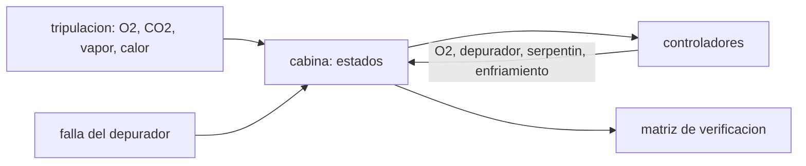

# B106-C20 — Proyecto de balance ambiental de hábitat

<!-- nav:top -->
[🏠 Programa](../../../../README.md) · [📚 Bloque B106](../../../tronco-comun/B106-habitats-espaciales-y-soporte-vital.md) · [← Anterior: B106-C19 — Arquitectura de asentamiento lunar conceptual](../B106-C19-arquitectura-de-asentamiento-lunar-conceptual/CLASE.md) · [Siguiente: B106-C21 — Depuración de trazas gaseosas de la atmósfera de cabina →](../../../tronco-comun/B106-habitats-espaciales-y-soporte-vital.md#b106-c21)
<!-- /nav -->

## 1. Ubicación, nivel y alcance

Clase 20 del bloque B106 (hábitats espaciales y soporte vital). Nivel N3. Clase integradora del bloque: una simulación de 30 días de una cabina con 4 personas que une O₂, CO₂, humedad y temperatura con controladores y una falla. Reúne C01–C08 y la fiabilidad de C18 en un informe con matriz de verificación. Todos los datos del laboratorio son **sintéticos o ilustrativos** y se rotulan como tales; solo se tratan como consultados los valores de la sección 11 que dicen «Consultada».

## 2. Por qué esta clase existe

Los balances de cada clase son sencillos; lo difícil es que actúan a la vez y que fallan. La decisión central: **¿cumple el hábitat sus criterios durante la misión, con y sin una falla, y qué respaldo los salva?**

## 3. Lo que podrás hacer al terminar

1. Plantear el balance de una cabina con generación, controladores y falla.
2. Simular 30 días con paso de 60 s y registrar PIO₂, ppCO₂, humedad y temperatura.
3. Evaluar una matriz de verificación contra los criterios consultados.
4. Comparar un escenario nominal con una falla sin y con respaldo.
5. Comprobar la conservación de masa del oxígeno.
6. Rotular que modelo, parámetros y controladores son ilustrativos.

La evidencia es la **informe de balance ambiental con matriz de verificación** del ejercicio 12 (sección 20).

## 4. Con qué llegas y cómo comprobarlo

1. ¿Qué es una simulación a paso fijo?
2. ¿Qué es un controlador con histéresis?
3. ¿Qué es una matriz de verificación?
4. ¿Qué es un escenario nominal?
5. ¿Qué criterio de CO₂ consultamos?

<details>
<summary>Ver respuestas</summary>

1. Integrar las ecuaciones avanzando un intervalo constante. 2. Uno que enciende y apaga con dos umbrales distintos. 3. Una tabla de requisitos, criterios y resultados. 4. El caso sin fallas. 5. ppCO₂ medio de 1 h < 3 mmHg (C04).
</details>

Con cuatro o cinco aciertos, sigue; si no, repasa los prerrequisitos.

## 5. Un caso de contexto y casos de referencia

En 150 m³ con 4 personas (O₂ de 0,771 kg/día cada una, RQ 0,85, 147 W y 1,5 kg/día de vapor), electrolizador, depurador de 10 L/s y serpentín, la simulación de 30 días da en el caso **nominal**: PIO₂ entre 146,9 y 152,1 mmHg, ppCO₂ máxima **2,50 mmHg**, humedad 40–50 % y temperatura 22,1–23,2 °C. Si el depurador se apaga 6 h el día 10, la ppCO₂ llega a **5,02 mmHg** y pasa 14 h sobre 3 mmHg; con un respaldo tras 20 min llega a 2,62 mmHg. Es un modelo sintético.

## 6. Vocabulario

**Balance ambiental:** suma de generaciones, retiros y acumulación de cada magnitud. **Controlador:** lazo que enciende o apaga un equipo. **Histéresis:** dos umbrales para evitar oscilar. **Matriz de verificación:** requisito, criterio, resultado. **Escenario:** conjunto de supuestos y fallas.

## 7. Modelo mental



*Descripción textual:* la tripulación genera O₂ (consumo), CO₂, vapor y calor; los controladores actúan sobre la cabina; la matriz compara los extremos con los criterios; una falla perturba el sistema.

Analogía: un termostato que además regula oxígeno, CO₂ y humedad. Límite: aquí hay mezcla perfecta y controladores ideales; en el sistema real hay retardos, fallas parciales y operadores.

## 8. La explicación, paso a paso

### 8.1 El modelo

Estados: moles de O₂, CO₂, N₂ y vapor, y la temperatura. Generación de la tripulación de C01; depurador `k = ηQ/V` (C04); serpentín que condensa si HR > 50 % hasta 40 % (C07); enfriamiento con ganancia 3000 W/K y capacidad de 2·10⁶ J/K (C08); electrolizador que repone O₂ si `PIO₂ < 147` hasta 152 mmHg (C03, C05).

### 8.2 Escenario nominal

PIO₂ 146,9–152,1 mmHg (criterio 145–155), ppCO₂ máxima 2,50 (criterio < 3), HR 40,0–50,1 %, T 22,1–23,2 °C. O₂ repuesto en 30 días: 91,78 kg; condensado: 180,1 kg (6 kg/día).

### 8.3 Falla sin respaldo (A)

Depurador apagado de las 240 h a las 246 h: ppCO₂ máxima 5,02 mmHg y 14 muestras horarias sobre 3 mmHg (incluye la recuperación). PIO₂, HR y T no se ven afectadas.

### 8.4 Falla con respaldo (B)

Un depurador de respaldo que arranca 20 min después limita la ppCO₂ a 2,62 mmHg: pasa el criterio, aunque con menos holgura. El respaldo equivale a la redundancia 1 de 2 de C18.

### 8.5 Matriz y conservación

La matriz (nominal / A / B): PIO₂ pasa / pasa / pasa; ppCO₂ pasa / **falla** / pasa; HR pasa / pasa / pasa; T pasa / pasa / pasa. El balance de O₂ (inicial + repuesto − consumido − final) es 9·10⁻¹¹ kg. La ppCO₂ se muestrea cada hora, lo que aproxima el promedio de 1 h del criterio.

## 9. Magnitudes, símbolos y unidades

| Símbolo | Qué es | Unidad | Valor / nota |
|---|---|---|---|
| PIO₂ | presión parcial inspirada de O₂ | mmHg | 146,9–152,1 |
| ppCO₂ | CO₂ máximo | mmHg | 2,50 / 5,02 (A) / 2,62 (B) |
| HR | humedad relativa | % | 40,0–50,1 |
| `T` | temperatura | °C | 22,1–23,2 |
| `m_O₂` | O₂ repuesto en 30 días | kg | 91,78 |

## 10. Convenciones y referencias

150 m³, 101,325 kPa, 4 personas, paso de 60 s, 30 días; depurador de 10 L/s con η = 0,7; falla de 6 h el día 10; respaldo tras 20 min; controladores con histéresis; todo ilustrativo salvo los criterios y la generación humana. Tolerancia: balance de O₂ dentro de 1e-6 kg. Numpy y Python: ver la primera línea de la salida del laboratorio (Python 3.12.9, numpy 2.4.4 en la ejecución del 2026-11-10).

## 11. De dónde sale lo que afirmamos

| ID | Fuente | Localizador | Respalda | Estado |
|---|---|---|---|---|
| S3 | NASA OCHMO, OCHMO-TB-003, «Habitable Atmosphere», resumen técnico derivado de NASA-STD-3001 vol. 2 rev. D — https://www.nasa.gov/wp-content/uploads/2023/12/ochmo-tb-003-habitable-atmosphere.pdf (consultada 2026-11-10; PDF leído con PyMuPDF) | requisito V2 6003 y sección de normoxia | normoxia de 145 a 155 mmHg | Consultada (resumen técnico) |
| S4 | NASA OCHMO, OCHMO-TB-004, «Carbon Dioxide (CO2)», resumen técnico derivado de NASA-STD-3001 vol. 2 rev. D — https://www.nasa.gov/wp-content/uploads/2023/12/ochmo-tb-004-carbon-dioxide.pdf (consultada 2026-11-10; PDF leído con PyMuPDF) | requisito V2 6004 | ppCO₂ medio de 1 h < 3 mmHg | Consultada (resumen técnico) |
| S2 | NASA, Oficina del Jefe de Salud y Medicina (OCHMO), OCHMO-TB-002 rev. B (14 de noviembre de 2023), «Environmental Control & Life Support System (ECLSS): Human-Centered Approach», resumen técnico derivado de NASA-STD-3001 vol. 2 rev. D — https://www.nasa.gov/wp-content/uploads/2023/12/ochmo-tb-002-eclss.pdf (consultada 2026-11-10; PDF leído con PyMuPDF) | temperatura y humedad; entradas y salidas | zonas de salud (18–27 °C, 25–75 %) y de desempeño (20–25 °C, 30–60 %); O₂ de 0,771 kg/día y RQ 0,85 por persona | Consultada (resumen técnico) |
| — | Simulación a paso fijo, controladores, serpentín | — | ilustrativos y verificados por la conservación de masa | No consultada en una fuente concreta |

Límites: los controladores, el volumen, los caudales y la falla son ilustrativos; no se consultaron datos de un hábitat real. El muestreo horario aproxima el promedio de 1 h del criterio de CO₂.

## 12. Cómo ver el resultado

| Resultado | Valor |
|---|---|
| PIO₂ nominal | 146,9–152,1 mmHg |
| ppCO₂ máxima nominal / A / B | 2,50 / 5,02 / 2,62 mmHg |
| Horas sobre 3 mmHg (A / B) | 14 / 0 |
| HR y T nominales | 40–50 %; 22,1–23,2 °C |
| O₂ repuesto (30 días) | 91,78 kg |

Descripción larga: el escenario nominal cumple todos los criterios; la falla del depurador rompe solo el criterio de CO₂ y un respaldo con 20 min de retraso lo restituye.

## 13. Ejemplo trabajado: lectura de la matriz de verificación

**Paso 1.** Criterio de CO₂: `ppCO₂ < 3 mmHg`.

**Paso 2.** Nominal: `2,50 < 3`: pasa.

**Paso 3.** Escenario A: `5,02 > 3`: falla; 14 muestras horarias sobre el límite.

**Paso 4.** Escenario B: `2,62 < 3`: pasa; el respaldo evita la violación.

## 14. Distintas formas de describir el problema

**Por estados:** O₂, CO₂, vapor, T. **Por controlador:** histéresis. **Por escenario:** nominal, A, B. **Por matriz:** requisito–resultado. **Por conservación:** balance de masa.

## 15. Práctica guiada

**Ejercicio 1 · con los pasos indicados.** Lee en la matriz el resultado de PIO₂ en el escenario A. *Pasos:* criterio 145–155.

<details><summary>Solución comentada</summary>

Pasa: 146,9–152,1 mmHg.
</details>

**Ejercicio 2 · con una pista.** ¿Qué escenario viola el criterio de CO₂? *Pista:* compara con 3 mmHg.

<details><summary>Solución comentada</summary>

El A (5,02 mmHg).
</details>

**Ejercicio 3 · casi autónomo.** ¿Cuánto condensado se recoge en 30 días? *Pista:* 6 kg/día.

<details><summary>Solución comentada</summary>

`180 kg`.
</details>

## 16. Práctica autónoma, transferencia e integrador

**Ejercicio 4 · autónomo.** ¿Cuántos kg de O₂ consume la tripulación en 30 días?

<details><summary>Solución comentada</summary>

`4·0,771·30 = 92,5 kg` (la reposición fue 91,78 porque la cabina parte con un inventario).
</details>

**Ejercicio 5 · autónomo.** ¿Qué hace la histéresis del serpentín?

<details><summary>Solución comentada</summary>

Evita que se encienda y apague continuamente entre 40 y 50 % de HR.
</details>

**Ejercicio 6 · autónomo.** ¿Por qué B no iguala al nominal?

<details><summary>Solución comentada</summary>

Hay 20 min sin depurador: la ppCO₂ sube antes de que arranque el respaldo.
</details>

**Ejercicio 7 · autónomo.** Si el respaldo tardara 3 h, ¿qué esperarías?

<details><summary>Solución comentada</summary>

Una ppCO₂ máxima de unos 3,7 mmHg (2,5 + 0,42·3) y falla del criterio.
</details>

**Ejercicio 8 · autónomo.** ¿Qué magnitud no se ve afectada por la falla del depurador?

<details><summary>Solución comentada</summary>

PIO₂, HR y T.
</details>

**Ejercicio 9 · transferencia.** La matriz pasa nominal y B. ¿Basta eso para aprobar el diseño?

<details><summary>Solución comentada</summary>

No: faltan fallas de otros equipos, fallas múltiples y datos reales; es una verificación del modelo.
</details>

**Ejercicio 10 · transferencia.** ¿Qué ensayo añadirías para validar el modelo?

<details><summary>Solución comentada</summary>

Medir en un banco el decaimiento real de CO₂ y la constante de tiempo del depurador.
</details>

**Ejercicio 11 · transferencia.** ¿Cómo usarías C18 para decidir el respaldo?

<details><summary>Solución comentada</summary>

La fiabilidad de 1 de 2 con causa común da la probabilidad de que el respaldo exista al fallar el principal.
</details>

**Ejercicio 12 · integrador.** Elabora tu *informe de balance ambiental con matriz de verificación*: modelo y supuestos, tabla de tres escenarios, matriz con los criterios consultados, interpretación de la falla y del respaldo, conservación de masa y qué es ilustrativo.

<details><summary>Solución comentada</summary>

Secciones 8.1–8.5 y la salida del laboratorio.
</details>

## 17. Laboratorio: simulación del balance ambiental de un habitat

El script [balance_ambiental.py](balance_ambiental.py) simula 30 días de una cabina de 4 personas con controladores y una falla del depurador, sin y con respaldo, y evalúa una matriz de verificación (**comprueba** el balance de masa de O₂, que el nominal cumple y que la falla sin respaldo supera 3 mmHg).

**Datos:** simulación **sintética** con parámetros **ilustrativos**; criterios **consultados**; sin aleatoriedad. **Predice antes de ejecutar:** ¿Qué criterio rompe la falla de 6 h del depurador sin respaldo? (el de CO₂). **Ejecución del 2026-11-10 (Python 3.12.9):**

```text
Python 3.12.9; numpy 2.4.4
DATOS: simulacion SINTETICA con controladores y parametros ILUSTRATIVOS; criterios consultados; NO es un habitat real
Criterios: PIO2 145-155 mmHg; ppCO2 < 3 mmHg; HR 25-75 % (salud) y 30-60 % (desempeno); T 18-27 C (salud) y 20-25 C (desempeno)
   escenario               PIO2 min/max   ppCO2 max   horas >= 3 mmHg   HR min/max   T min/max   O2 repuesto [kg]   condensado [kg]
   nominal                 146.9/152.1       2.50               0   40.0/50.1   22.1/23.2             91.78            180.1
   A: falla sin respaldo   146.9/152.1       5.02              14   40.0/50.1   22.1/23.2             91.80            180.1
   B: falla con respaldo   146.9/152.1       2.62               0   40.0/50.1   22.1/23.2             91.78            180.1
Matriz de verificacion (nominal / A / B):
   PIO2 en 145-155 mmHg                 pasa /   pasa /   pasa
   ppCO2 < 3 mmHg (muestreo horario)    pasa /  FALLA /   pasa
   HR en 25-75 %                        pasa /   pasa /   pasa
   T en 18-27 C                         pasa /   pasa /   pasa
Balance de masa de O2 (nominal): inicial + repuesto - consumido - final = 9.16e-11 kg
Pruebas superadas.
```

```bash
python programa/clases/B106/B106-C20-proyecto-de-balance-ambiental-de-habitat/balance_ambiental.py
```

**Límites:** mezcla perfecta, controladores ideales, un solo volumen, un solo tipo de falla, muestreo horario, sin fugas ni operadores.

## 18. Errores frecuentes y cómo corregirlos

**Aprobar el diseño con una sola simulación.** Es una verificación del modelo (ej. 10).

**Olvidar la falla.** Simula A y B (8.3–8.4).

**Comparar con criterios no consultados.** Cita solo los de la sección 11.

**Presentar la simulación como datos.** Es sintética.

## 19. Cómo sabrás que vas bien

Tras la sección 8: ¿qué criterios cumple el escenario nominal y cuál rompe la falla sin respaldo? Si dudas, repasa el ejemplo 13. Tras el laboratorio: ¿qué comprueba? (ver la sección 17).

## 20. Qué entregas y cómo se evalúa

El producto es tu **informe de balance ambiental con matriz de verificación** (ejercicio 12).

| Criterio | Inicial | En desarrollo | Logrado | Destacado |
|---|---|---|---|---|
| Conceptos | Confunde las magnitudes | Parciales | Explica estados, controladores y matriz | Explica los supuestos y sus límites |
| Cálculo | Sin unidades | Con errores | Calcula con unidades y cifras coherentes | Calcula casos nuevos y los verifica |
| Numérico | Sin comprobación | Un caso | Compara con el control del laboratorio | Interpreta la sensibilidad |
| Fuentes | Sin fuente | Sin fecha | Fuentes con fecha y estado | Declara lo ilustrativo y lo no consultado |
| Límites | No los nombra | Uno | Tres | Discute qué falta para un hábitat real |

**Condiciones críticas (no se compensan con promedio):** rotular los datos como sintéticos o ilustrativos; no presentar un valor ilustrativo como límite de una norma; citar solo lo consultado; no usar la clase como consejo médico ni operativo.

## 21. Ética, seguridad y límites

Clase **educativa**: no da consejo médico ni operativo y no sirve para decidir la atmósfera, el agua, la exposición ni la respuesta ante una emergencia de un hábitat o de una persona reales. Esta simulación no valida ningún hábitat: una verificación real exige datos de ensayo, fallas múltiples y revisión independiente. Accesibilidad: tablas equivalentes a las gráficas, fórmulas en texto, ejercicios sin conexión.

## 22. Para cerrar y seguir

Un balance ambiental integrado cumple los criterios en el caso nominal, rompe el de CO₂ si falla el depurador seis horas y lo recupera con un respaldo a los 20 minutos: el diseño se juzga por sus fallas, no por su promedio. Con esto se cierra el bloque: de lo que necesita una persona a un hábitat que lo mantiene, con margen y con respaldo.

**Glosario español–inglés.** balance ambiental · *environmental balance*; matriz de verificación · *verification matrix*; histéresis · *hysteresis*; escenario nominal · *nominal scenario*; respaldo · *backup*.

**Continuidad.** Sigue con la clase siguiente del bloque (enlace en la navegación) o vuelve al [bloque B106](../../../tronco-comun/B106-habitats-espaciales-y-soporte-vital.md).

**Referencias:** ver sección 11.

<!-- nav:bottom -->
---

[← Anterior: B106-C19 — Arquitectura de asentamiento lunar conceptual](../B106-C19-arquitectura-de-asentamiento-lunar-conceptual/CLASE.md) · [📚 Bloque B106](../../../tronco-comun/B106-habitats-espaciales-y-soporte-vital.md) · [Siguiente: B106-C21 — Depuración de trazas gaseosas de la atmósfera de cabina →](../../../tronco-comun/B106-habitats-espaciales-y-soporte-vital.md#b106-c21)
<!-- /nav -->
