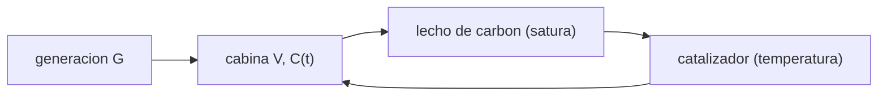

# B106-C21 — Depuración de trazas gaseosas de la atmósfera de cabina

<!-- nav:top -->
[🏠 Programa](../../../../README.md) · [📚 Bloque B106](../../../tronco-comun/B106-habitats-espaciales-y-soporte-vital.md) · [← Anterior: B106-C20 — Proyecto de balance ambiental de hábitat](../B106-C20-proyecto-de-balance-ambiental-de-habitat/CLASE.md) · [Siguiente: B106-C22 — Fuentes e identificación de contaminantes del aire de cabina →](../B106-C22-fuentes-e-identificacion-de-contaminantes-del-aire-de-cabina/CLASE.md)
<!-- /nav -->

## 1. Ubicación, nivel y alcance

Clase 21 del bloque B106 (hábitats espaciales y soporte vital). Nivel N3. Abre el tramo de calidad del aire con la depuración de contaminantes gaseosos en trazas: un balance de cabina, la saturación de un lecho de carbón activado y la conversión de un catalizador. Complementa C03 y C04 (composición y CO₂). Todos los datos del laboratorio son **sintéticos o ilustrativos** y se rotulan como tales; solo se tratan como consultados los valores de la sección 11 que dicen «Consultada».

## 2. Por qué esta clase existe

Una cabina cerrada acumula trazas que no son CO₂ ni agua; hay que retirarlas con lechos y catalizadores que se saturan o dependen de la temperatura. La decisión central: **¿cuánto dura un lecho, a qué temperatura debe operar el catalizador y qué concentración queda en la cabina?**

## 3. Lo que podrás hacer al terminar

1. Plantear el balance de un contaminante traza con generación y depurador.
2. Calcular el tiempo de saturación de un lecho por balance de masa `τ = W q/(Q C₀)`.
3. Usar el modelo de Yoon–Nelson para el tiempo al 10 % y 90 % de ruptura.
4. Calcular la conversión de un catalizador con Arrhenius y su dependencia de la temperatura.
5. Combinar lecho y catalizador en una eficiencia total.
6. Rotular que todos los parámetros son ilustrativos y el contaminante, genérico.

La evidencia es la **ficha de depuración con vida del lecho** del ejercicio 12 (sección 20).

## 4. Con qué llegas y cómo comprobarlo

1. ¿Qué es la adsorción?
2. ¿Qué es la ecuación de Arrhenius?
3. ¿Qué es una curva de ruptura?
4. ¿Qué es un catalizador?
5. ¿Qué es una eficiencia combinada?

<details>
<summary>Ver respuestas</summary>

1. La adhesión de moléculas a la superficie de un sólido (carbón activado). 2. `k = A exp(−E_a/(R T))`: la velocidad de reacción crece con la temperatura. 3. La concentración de salida de un lecho frente al tiempo. 4. Una sustancia que acelera una reacción sin consumirse. 5. `1 − Π(1 − ηᵢ)`.
</details>

Con cuatro o cinco aciertos, sigue; si no, repasa los prerrequisitos.

## 5. Un caso de contexto y casos de referencia

Un contaminante genérico que se genera a 5 mg/h en 100 m³ y se retira con un lecho de 10 L/s y 95 % de eficiencia queda en **0,146 mg/m³** en estado estacionario (tiempo de respuesta 2,9 h). Un lecho de 5 kg con capacidad de 0,05 g/g se satura en **289 días** con 1 mg/m³ y en 28,9 días con 10 mg/m³. Un catalizador con `E_a = 60 kJ/mol` convierte el 14,7 % a 330 K, el 42,6 % a 350 K y casi todo a 400 K. Todo ilustrativo; los métodos (carbón activado, oxidador catalítico) son los de la página consultada de la NASA.

## 6. Vocabulario

**Traza:** contaminante a concentración muy baja. **Adsorción:** retención en la superficie de un sólido. **Ruptura:** momento en que el lecho deja pasar el contaminante. **Yoon–Nelson:** modelo de la curva de ruptura. **Oxidador catalítico:** reactor que oxida trazas con un catalizador a alta temperatura.

## 7. Modelo mental



*Descripción textual:* la generación de traza entra a la cabina; el aire pasa por el lecho de carbón, que se satura, y por el catalizador, cuya conversión depende de la temperatura, y vuelve a la cabina.

Analogía: una esponja que se llena (lecho) y un horno que quema (catalizador). Límite: las trazas reales son mezclas con distintas afinidades y la humedad compite por el carbón.

## 8. La explicación, paso a paso

### 8.1 Balance de cabina

`V dC/dt = G − η Q C`, estacionario `C = G/(ηQ) = (5/3600)/(0,95·0,01) = 0,146 mg/m³`; la integración a 14 días da 0,146. Tiempo de respuesta `V/(ηQ) = 2,9 h`.

### 8.2 Vida del lecho

Capacidad `W q = 5000·0,05 = 250 g`; carga `Q C₀`. `τ = W q/(Q C₀)`: con 0,1 mg/m³, 2894 días; con 1, 289; con 10, 28,9. La vida es inversamente proporcional a la concentración.

### 8.3 Yoon–Nelson

`C/C₀ = 1/(1 + exp(k(τ − t)))` con `k = 2·10⁻⁶ s⁻¹`: el 10 % ocurre 12,7 días antes de `τ` (a 276,6 días con 1 mg/m³). En `t = τ` la ruptura vale 0,5 (control).

### 8.4 Catalizador

`X = 1 − exp(−k t_res)` con `k = A e^{−E_a/(R T)}`, `A = 10⁹ s⁻¹`, `t_res = 0,5 s`: 14,7 % a 330 K, 42,6 % a 350 K, 94,1 % a 380 K y 99,93 % a 400 K. Una pequeña caída de temperatura baja mucho la conversión.

### 8.5 Tren combinado

Lecho (0,95) y catalizador a 350 K: `1 − 0,05·0,574 = 0,9713`, estacionario 0,143 mg/m³.

## 9. Magnitudes, símbolos y unidades

| Símbolo | Qué es | Unidad | Valor / nota |
|---|---|---|---|
| `G` | generación de traza | mg/h | 5 (ilustrativo) |
| `C_ss` | concentración estacionaria | mg/m³ | 0,146 |
| `τ` | tiempo de saturación del lecho | días | 289 (1 mg/m³) |
| `X` | conversión del catalizador | — | 0,426 (350 K) |
| `η_tot` | eficiencia combinada | — | 0,9713 |

## 10. Convenciones y referencias

Cabina de 100 m³; Q = 10 L/s; η = 0,95; lecho de 5 kg con 0,05 g/g; `k_YN = 2·10⁻⁶ s⁻¹`; Arrhenius con `A = 10⁹ s⁻¹`, `E_a = 60 kJ/mol`; `t_res = 0,5 s`. Todo ilustrativo. Tolerancias: integración dentro del 1 % del estacionario; ruptura de 0,5 en `t = τ` (1e-12). Numpy y Python: ver la primera línea de la salida del laboratorio (Python 3.12.9, numpy 2.4.4 en la ejecución del 2026-11-10).

## 11. De dónde sale lo que afirmamos

| ID | Fuente | Localizador | Respalda | Estado |
|---|---|---|---|---|
| S1 | NASA, «Environmental Control and Life Support Systems (ECLSS)» — https://www.nasa.gov/reference/environmental-control-and-life-support-systems-eclss/ (consultada 2026-11-10; la página indica actualización del 4 de abril de 2025) | párrafo de aire y CO₂ | los contaminantes traza se retiran con carbón activado, un oxidador catalítico y un lecho de hidróxido de litio | Consultada |
| S2 | NASA, Oficina del Jefe de Salud y Medicina (OCHMO), OCHMO-TB-002 rev. B (14 de noviembre de 2023), «Environmental Control & Life Support System (ECLSS): Human-Centered Approach», resumen técnico derivado de NASA-STD-3001 vol. 2 rev. D — https://www.nasa.gov/wp-content/uploads/2023/12/ochmo-tb-002-eclss.pdf (consultada 2026-11-10; PDF leído con PyMuPDF) | lista de requisitos V2 6023 y V2 6050 | existen requisitos de monitoreo de trazas y de límite de contaminación atmosférica (sin valores en el resumen) | Consultada (solo los títulos de requisito) |
| — | Balance de masa, Yoon–Nelson, Arrhenius | — | los verifica el laboratorio | No consultada en una fuente concreta |

Límites: no se consultó ningún dato de capacidad de lechos, cinéticas de catalizadores ni lista de contaminantes reales; el contaminante es genérico y todos los parámetros son ilustrativos. Los límites reales (SMAC) **no se consultaron** (ver C24).

## 12. Cómo ver el resultado

| Resultado | Valor |
|---|---|
| Concentración estacionaria | 0,146 mg/m³ |
| Saturación del lecho (1 / 10 mg/m³) | 289 / 28,9 días |
| Conversión a 330 / 350 / 380 K | 14,7 / 42,6 / 94,1 % |
| Eficiencia del tren a 350 K | 0,9713 |
| Estacionario del tren | 0,143 mg/m³ |

Descripción larga: el lecho dura mientras no se sature y su vida cae con la concentración; el catalizador depende de la temperatura de manera fuerte y la eficiencia combinada es mayor que la de cada uno.

## 13. Ejemplo trabajado: vida del lecho

**Paso 1.** Capacidad: `5000 g·0,05 = 250 g = 250 000 mg`.

**Paso 2.** Carga con 1 mg/m³ y 0,01 m³/s: `0,01 mg/s`.

**Paso 3.** `τ = 250 000/0,01 = 2,5·10⁷ s = 289 días`.

**Paso 4.** Con 10 mg/m³ la carga es 10 veces mayor y `τ = 28,9 días`.

## 14. Distintas formas de describir el problema

**Por balance:** `G/(ηQ)`. **Por masa:** `W q/(Q C₀)`. **Por curva:** Yoon–Nelson. **Por temperatura:** Arrhenius. **Por tren:** `1 − Π(1 − ηᵢ)`.

## 15. Práctica guiada

**Ejercicio 1 · con los pasos indicados.** Calcula el estacionario con `G = 10 mg/h` y los mismos `Q`, `η`. *Pasos:* escala.

<details><summary>Solución comentada</summary>

El doble: `0,292 mg/m³`.
</details>

**Ejercicio 2 · con una pista.** Calcula `τ` con 5 kg a 0,03 g/g y 0,5 mg/m³. *Pista:* `W q/(Q C₀)`.

<details><summary>Solución comentada</summary>

`150 000/(0,01·0,5) = 3·10⁷ s = 347 días`.
</details>

**Ejercicio 3 · casi autónomo.** ¿Cuánto vale `X` con `k = 2 s⁻¹` y 0,5 s? *Pista:* `1 − e^(−kt)`.

<details><summary>Solución comentada</summary>

`1 − e^(−1) = 0,632`.
</details>

## 16. Práctica autónoma, transferencia e integrador

**Ejercicio 4 · autónomo.** ¿Cuánto tarda en estabilizarse la cabina?

<details><summary>Solución comentada</summary>

Unas 3 constantes de tiempo: `3·2,9 = 8,7 h`.
</details>

**Ejercicio 5 · autónomo.** Si el caudal sube al doble, ¿cómo cambia el estacionario?

<details><summary>Solución comentada</summary>

Baja a la mitad.
</details>

**Ejercicio 6 · autónomo.** ¿Cuánto duran los lechos de 10 kg con 10 mg/m³?

<details><summary>Solución comentada</summary>

El doble que uno de 5 kg: 57,9 días.
</details>

**Ejercicio 7 · autónomo.** ¿Qué `E_a` daría la misma conversión a 330 K que a 350 K ahora?

<details><summary>Solución comentada</summary>

Una menor energía de activación.
</details>

**Ejercicio 8 · autónomo.** ¿Por qué conviene un catalizador además del lecho?

<details><summary>Solución comentada</summary>

Destruye lo que el lecho no retiene bien (como el monóxido de carbono) y no se satura.
</details>

**Ejercicio 9 · transferencia.** La humedad de la cabina compite por el carbón y baja `q` a la mitad. ¿Qué pasa con la vida?

<details><summary>Solución comentada</summary>

Baja a la mitad (144 días con 1 mg/m³).
</details>

**Ejercicio 10 · transferencia.** Un incendio libera un pico de trazas (C17). ¿Qué dimensionaría el sistema?

<details><summary>Solución comentada</summary>

La capacidad para un pico, no para el promedio.
</details>

**Ejercicio 11 · transferencia.** ¿Qué mides para decidir el cambio del lecho?

<details><summary>Solución comentada</summary>

La concentración a la salida (ruptura) y la caída de presión; en el modelo, el 10 % de `C₀`.
</details>

**Ejercicio 12 · integrador.** Elabora tu *ficha de depuración con vida del lecho*: balance de cabina, tabla de vida del lecho para tres concentraciones, conversión del catalizador frente a la temperatura, eficiencia del tren y qué es ilustrativo.

<details><summary>Solución comentada</summary>

Secciones 8.1–8.5 y la salida del laboratorio.
</details>

## 17. Laboratorio: depuración de trazas en una cabina

El script [depuracion_de_trazas.py](depuracion_de_trazas.py) calcula el estacionario, la vida de un lecho (con Yoon–Nelson), la conversión de un catalizador frente a la temperatura y el tren combinado (**comprueba** el estacionario contra la integración y el 0,5 de la ruptura en `τ`).

**Datos:** contaminante **genérico** y parámetros **ilustrativos**; sin aleatoriedad. **Predice antes de ejecutar:** ¿Cómo cambia la vida del lecho si la concentración se multiplica por 10? (se divide por 10). **Ejecución del 2026-11-10 (Python 3.12.9):**

```text
Python 3.12.9; numpy 2.4.4
DATOS: contaminante generico y parametros ILUSTRATIVOS; los metodos de depuracion son los de la pagina de la NASA (consultada)
Balance de cabina: G = 5.0 mg/h, caudal 10 L/s, eficiencia 0.95: estacionario 0.146 mg/m3 (integracion a 14 dias: 0.146)
Tiempo de respuesta V/(eta Q) = 2.9 h
Vida del lecho (balance de masa: tau = W q / (Q C0)), W = 5 kg, q = 0.05 g/g = 250 g de capacidad:
   C0 [mg/m3]   tau [dias]   t10 % [dias]   t90 % [dias]
          0.1       2893.5         2880.8         2906.2
          1.0        289.4          276.6          302.1
         10.0         28.9           16.2           41.7
Catalizador (conversion X = 1 - exp(-k t_res), k = A exp(-Ea/(R T)), t_res = 0.5 s):
   T [K]    k [1/s]    conversion
     330       0.318     0.14718
     350       1.111     0.42618
     380       5.657     0.94090
     400      14.620     0.99933
Tren lecho + catalizador a 350 K: eficiencia combinada 0.97131; estacionario 0.143 mg/m3
Pruebas superadas.
```

```bash
python programa/clases/B106/B106-C21-depuracion-de-trazas-gaseosas-de-la-atmosfera-de-cabina/depuracion_de_trazas.py
```

**Límites:** un contaminante, lecho sin competencia de humedad, catalizador isotermo, mezcla perfecta; sin datos reales.

## 18. Errores frecuentes y cómo corregirlos

**Dimensionar con la concentración media.** Usa el pico (ej. 14).

**Olvidar la temperatura del catalizador.** Ver 8.4.

**Suponer que el lecho dura indefinidamente.** Calcula `τ` (8.2).

**Tomar el contaminante genérico como real.** Es ilustrativo.

## 19. Cómo sabrás que vas bien

Tras la sección 8: ¿cuánto dura un lecho de 5 kg con 1 mg/m³ y qué conversión da el catalizador a 350 K? Si dudas, repasa el ejemplo 13. Tras el laboratorio: ¿qué comprueba? (ver la sección 17).

## 20. Qué entregas y cómo se evalúa

El producto es tu **ficha de depuración con vida del lecho** (ejercicio 12).

| Criterio | Inicial | En desarrollo | Logrado | Destacado |
|---|---|---|---|---|
| Conceptos | Confunde las magnitudes | Parciales | Explica balance, saturación y catalizador | Explica los supuestos y sus límites |
| Cálculo | Sin unidades | Con errores | Calcula con unidades y cifras coherentes | Calcula casos nuevos y los verifica |
| Numérico | Sin comprobación | Un caso | Compara con el control del laboratorio | Interpreta la sensibilidad |
| Fuentes | Sin fuente | Sin fecha | Fuentes con fecha y estado | Declara lo ilustrativo y lo no consultado |
| Límites | No los nombra | Uno | Tres | Discute qué falta para un hábitat real |

**Condiciones críticas (no se compensan con promedio):** rotular los datos como sintéticos o ilustrativos; no presentar un valor ilustrativo como límite de una norma; citar solo lo consultado; no usar la clase como consejo médico ni operativo.

## 21. Ética, seguridad y límites

Clase **educativa**: no da consejo médico ni operativo y no sirve para decidir la atmósfera, el agua, la exposición ni la respuesta ante una emergencia de un hábitat o de una persona reales. Los valores no sirven para dimensionar un sistema real ni para fijar límites de exposición. Accesibilidad: tablas equivalentes a las gráficas, fórmulas en texto, ejercicios sin conexión.

## 22. Para cerrar y seguir

Las trazas se controlan con un balance (`G/(ηQ)`), un lecho que se satura (`W q/(Q C₀)`) y un catalizador sensible a la temperatura; el lecho de 5 kg del modelo dura unos 289 días a 1 mg/m³ y solo 29 a 10 mg/m³. La clase siguiente pregunta de dónde vienen esas trazas.

**Glosario español–inglés.** traza · *trace contaminant*; adsorción · *adsorption*; carbón activado · *activated charcoal*; ruptura · *breakthrough*; oxidador catalítico · *catalytic oxidizer*.

**Continuidad.** Sigue con la clase siguiente del bloque (enlace en la navegación) o vuelve al [bloque B106](../../../tronco-comun/B106-habitats-espaciales-y-soporte-vital.md).

**Referencias:** ver sección 11.

<!-- nav:bottom -->
---

[← Anterior: B106-C20 — Proyecto de balance ambiental de hábitat](../B106-C20-proyecto-de-balance-ambiental-de-habitat/CLASE.md) · [📚 Bloque B106](../../../tronco-comun/B106-habitats-espaciales-y-soporte-vital.md) · [Siguiente: B106-C22 — Fuentes e identificación de contaminantes del aire de cabina →](../B106-C22-fuentes-e-identificacion-de-contaminantes-del-aire-de-cabina/CLASE.md)
<!-- /nav -->
