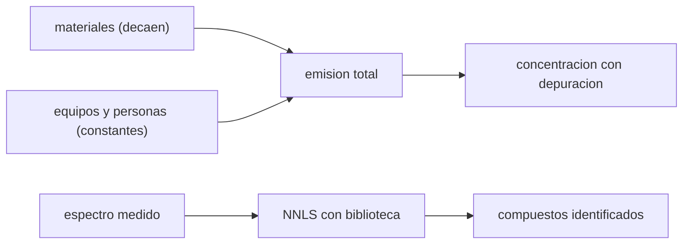

# B106-C22 — Fuentes e identificación de contaminantes del aire de cabina

<!-- nav:top -->
[🏠 Programa](../../../../README.md) · [📚 Bloque B106](../../../tronco-comun/B106-habitats-espaciales-y-soporte-vital.md) · [← Anterior: B106-C21 — Depuración de trazas gaseosas de la atmósfera de cabina](../B106-C21-depuracion-de-trazas-gaseosas-de-la-atmosfera-de-cabina/CLASE.md) · [Siguiente: B106-C23 — Control de partículas y polvo respirable en cabina →](../B106-C23-control-de-particulas-y-polvo-respirable-en-cabina/CLASE.md)
<!-- /nav -->

## 1. Ubicación, nivel y alcance

Clase 22 del bloque B106 (hábitats espaciales y soporte vital). Nivel N3. Enseña de dónde vienen los contaminantes de una cabina cerrada (materiales, equipos, metabolismo) y cómo se identifica una mezcla a partir de un espectro. Los espectros de la biblioteca son sintéticos e inventados. Todos los datos del laboratorio son **sintéticos o ilustrativos** y se rotulan como tales; solo se tratan como consultados los valores de la sección 11 que dicen «Consultada».

## 2. Por qué esta clase existe

Nada sale al exterior de una cabina cerrada: los materiales emiten gases durante meses, los equipos liberan trazas y las personas emiten vapor y CO₂. La decisión central: **¿qué fuentes dominan en cada momento y cómo se identifican los compuestos para decidir qué retirar?**

## 3. Lo que podrás hacer al terminar

1. Modelar la emisión de un material como un decaimiento exponencial y calcular la emisión acumulada.
2. Calcular la concentración estacionaria con depuración y ver cómo cambia la fuente dominante.
3. Identificar los componentes de una mezcla con una biblioteca de espectros por mínimos cuadrados no negativos.
4. Comparar el NNLS con la similitud coseno y ver por qué esta no basta.
5. Verificar el modelo contra la integral analítica.
6. Rotular que emisiones y espectros son sintéticos.

La evidencia es la **inventario de fuentes con identificación** del ejercicio 12 (sección 20).

## 4. Con qué llegas y cómo comprobarlo

1. ¿Qué es la desgasificación?
2. ¿Qué es un espectro de masas?
3. ¿Qué son los mínimos cuadrados no negativos?
4. ¿Qué es la similitud coseno?
5. ¿Qué es una constante de decaimiento `τ`?

<details>
<summary>Ver respuestas</summary>

1. La liberación de gases por un material. 2. La intensidad de iones por relación masa/carga. 3. Un ajuste lineal con pesos que no pueden ser negativos. 4. El coseno del ángulo entre dos vectores. 5. El tiempo en que una cantidad cae a `1/e`.
</details>

Con cuatro o cinco aciertos, sigue; si no, repasa los prerrequisitos.

## 5. Un caso de contexto y casos de referencia

Con dos materiales sintéticos (A: 50 mg/h, `τ = 100 h`; B: 10 mg/h, `τ = 2000 h`) y una fuente constante de 1 mg/h, la emisión de A cae de 39,3 mg/h el día 1 a 0,04 mg/h el día 30, mientras que B baja de 9,9 a 6,98: la fuente dominante cambia de A a B y la concentración estacionaria pasa de **1,468** a **0,234 mg/m³**. Un NNLS recupera los pesos de una mezcla de tres compuestos con un error máximo de **0,008**. Todo sintético.

## 6. Vocabulario

**Desgasificación:** emisión de gases de un material. **Fuente metabólica:** CO₂, vapor y trazas de las personas. **Espectro de masas:** huella de un compuesto. **Biblioteca:** conjunto de espectros de referencia. **NNLS:** ajuste con pesos no negativos.

## 7. Modelo mental



*Descripción textual:* las fuentes suman una emisión; con depuración dan una concentración; el espectro medido se descompone con una biblioteca para identificar los compuestos.

Analogía: descomponer un acorde en notas. Límite: una biblioteca incompleta o espectros que se solapan dan identificaciones erradas.

## 8. La explicación, paso a paso

### 8.1 Emisión de materiales

`E(t) = E₀ e^{−t/τ}`; acumulada `E₀ τ (1 − e^{−t/τ})`. A 30 días: A 5,0 g y B 6,0 g. El control suma la emisión hora a hora y coincide con la integral dentro del 0,1 %.

### 8.2 Fuente dominante

Con `Q = 0,0095 m³/s` de depuración, `C = E/(3600 Q)`: 1,468 mg/m³ el día 1 (dominante A) y 0,234 el día 30 (dominante B). Un material de decaimiento lento domina cuando el rápido se agota: los materiales de larga emisión deben controlarse desde la selección.

### 8.3 Identificación

La mezcla `y = L w + ruido` con 6 espectros sintéticos de 24 canales y pesos `(0; 3; 0; 1,2; 0; 0,6)`: el NNLS da `(0; 3,008; 0,006; 1,196; 0,003; 0,592)` con error máximo 0,008. La similitud coseno da 0,936 para el compuesto 2 pero también 0,705 para el 1 (ausente) y 0,576 para el 4 (presente): no distingue presencia de solapamiento.

### 8.4 Fuentes metabólicas

Las personas emiten CO₂ (C04) y vapor (C07) de forma constante; no decaen y fijan el piso de la depuración.

## 9. Magnitudes, símbolos y unidades

| Símbolo | Qué es | Unidad | Valor / nota |
|---|---|---|---|
| `E₀` | emisión inicial | mg/h | 50 (A); 10 (B) |
| `τ` | constante de decaimiento | h | 100 (A); 2000 (B) |
| `C` | concentración estacionaria | mg/m³ | 1,468 → 0,234 |
| `w` | pesos de la mezcla | — | NNLS |
| cos | similitud coseno | — | 0,42–0,94 |

## 10. Convenciones y referencias

Volumen de 100 m³; caudal de depuración 0,0095 m³/s; 6 espectros inventados de 24 canales; ruido de 0,02; semilla 106; NNLS por descenso por coordenadas (3000 iteraciones). Tolerancias: acumulada contra suma horaria 1e-3; error de pesos < 0,15; ausentes < 0,1. Numpy y Python: ver la primera línea de la salida del laboratorio (Python 3.12.9, numpy 2.4.4 en la ejecución del 2026-11-10).

## 11. De dónde sale lo que afirmamos

| ID | Fuente | Localizador | Respalda | Estado |
|---|---|---|---|---|
| S2 | NASA, Oficina del Jefe de Salud y Medicina (OCHMO), OCHMO-TB-002 rev. B (14 de noviembre de 2023), «Environmental Control & Life Support System (ECLSS): Human-Centered Approach», resumen técnico derivado de NASA-STD-3001 vol. 2 rev. D — https://www.nasa.gov/wp-content/uploads/2023/12/ochmo-tb-002-eclss.pdf (consultada 2026-11-10; PDF leído con PyMuPDF) | lista de requisitos V2 6023, 6024, 6025 y 6050 | existen requisitos de monitoreo de trazas, de combustión y de contaminación y un límite de contaminación atmosférica (sin valores) | Consultada (solo los títulos de requisito) |
| — | Decaimiento exponencial, NNLS, similitud coseno | — | los verifica el laboratorio con datos sintéticos | No consultada en una fuente concreta |

Límites: no se consultó ningún inventario real de emisiones de materiales ni espectros de compuestos reales; los espectros son inventados y el resumen OCHMO de toxicología espacial (TB-015) **no se consultó**.

## 12. Cómo ver el resultado

| Resultado | Valor |
|---|---|
| Emisión de A día 1 / día 30 | 39,3 / 0,04 mg/h |
| Emisión de B día 30 | 6,98 mg/h |
| Concentración día 1 / día 30 | 1,468 / 0,234 mg/m³ |
| Error máximo del NNLS | 0,008 |
| Cos del compuesto ausente 1 | 0,705 |

Descripción larga: la fuente dominante cambia con el tiempo y la identificación por descomposición es más fiable que la comparación por similitud.

## 13. Ejemplo trabajado: emisión acumulada

**Paso 1.** `E₀ = 50 mg/h`, `τ = 100 h`, `t = 720 h`.

**Paso 2.** `E₀ τ = 5000 mg`; `1 − e^{−7,2} = 0,99925`.

**Paso 3.** Acumulada `= 4996 mg ≈ 5,0 g`.

**Paso 4.** Emisión final: `50 e^{−7,2} = 0,04 mg/h`.

## 14. Distintas formas de describir el problema

**Por decaimiento:** `E₀ e^{−t/τ}`. **Por inventario:** suma de fuentes. **Por concentración:** `E/Q`. **Por espectro:** NNLS. **Por similitud:** coseno.

## 15. Práctica guiada

**Ejercicio 1 · con los pasos indicados.** Calcula la emisión de B a 100 h. *Pasos:* `10 e^(−100/2000)`.

<details><summary>Solución comentada</summary>

`9,51 mg/h`.
</details>

**Ejercicio 2 · con una pista.** Calcula `C` con 6 mg/h y 0,0095 m³/s. *Pista:* `E/(3600 Q)`.

<details><summary>Solución comentada</summary>

`0,175 mg/m³`.
</details>

**Ejercicio 3 · casi autónomo.** ¿Cuál es la emisión acumulada de B a 30 días? *Pista:* `E₀ τ (1 − e^(−t/τ))`.

<details><summary>Solución comentada</summary>

`6,0 g`.
</details>

## 16. Práctica autónoma, transferencia e integrador

**Ejercicio 4 · autónomo.** ¿Cuándo iguala A a B?

<details><summary>Solución comentada</summary>

`50 e^(−t/100) = 10 e^(−t/2000)`: `t ≈ 169 h` (≈ 7 días).
</details>

**Ejercicio 5 · autónomo.** ¿Cuánta emisión total sumaría A en un año?

<details><summary>Solución comentada</summary>

Casi `E₀ τ = 5 g`.
</details>

**Ejercicio 6 · autónomo.** Si se duplica el caudal de depuración, ¿qué pasa con `C`?

<details><summary>Solución comentada</summary>

Se reduce a la mitad.
</details>

**Ejercicio 7 · autónomo.** ¿Qué pasaría si la biblioteca no contiene un compuesto de la mezcla?

<details><summary>Solución comentada</summary>

El NNLS reparte su señal entre otros compuestos y el residuo no baja.
</details>

**Ejercicio 8 · autónomo.** ¿Por qué el coseno es engañoso?

<details><summary>Solución comentada</summary>

Los espectros solapados dan similitud alta para compuestos ausentes.
</details>

**Ejercicio 9 · transferencia.** Se cambia un material A por otro con `τ = 1000 h`. ¿Cómo cambia la emisión a 30 días?

<details><summary>Solución comentada</summary>

`50 e^(−0,72) = 24,3 mg/h` frente a 0,04: es mucho peor.
</details>

**Ejercicio 10 · transferencia.** ¿Qué harías antes del vuelo con los materiales?

<details><summary>Solución comentada</summary>

Acondicionarlos (ventilarlos) para agotar la emisión rápida; es una práctica de ingeniería de materiales, no consultada aquí.
</details>

**Ejercicio 11 · transferencia.** ¿Qué falta para identificar compuestos reales?

<details><summary>Solución comentada</summary>

Una biblioteca real, calibración, resolución y confirmación independiente.
</details>

**Ejercicio 12 · integrador.** Elabora tu *inventario de fuentes con identificación*: tabla de emisiones a tres tiempos, concentración y fuente dominante, identificación de una mezcla con NNLS y coseno, límites y qué es sintético.

<details><summary>Solución comentada</summary>

Secciones 8.1–8.4 y la salida del laboratorio.
</details>

## 17. Laboratorio: fuentes de contaminantes e identificación espectral

El script [fuentes_y_contaminantes.py](fuentes_y_contaminantes.py) calcula emisión y concentración de tres fuentes en tres momentos y descompone una mezcla con NNLS sobre una biblioteca sintética (**comprueba** la emisión acumulada contra la suma y el error de los pesos).

**Datos:** emisiones y espectros **sintéticos e inventados** (semilla 106). **Predice antes de ejecutar:** ¿Qué material domina a los 30 días: el de emisión inicial alta o el de decaimiento lento? (el lento). **Ejecución del 2026-11-10 (Python 3.12.9):**

```text
Python 3.12.9; numpy 2.4.4
DATOS: emisiones y espectros SINTETICOS e inventados (semilla 106); no corresponden a ningun material ni compuesto real
Emision [mg/h] en el tiempo y concentracion estacionaria con depuracion Q = 0.0095 m3/s:
   fuente        t = 1 d   t = 30 d   t = 180 d   acumulada 30 d [g]
   material A      39.33       0.04        0.00              5.0
   material B       9.88       6.98        1.15              6.0
   equipos (cte)     1.00       1.00        1.00              0.7
Concentracion estacionaria total (mg/m3): dia 1 1.468; dia 30 0.234  -> la fuente dominante cambia de A a B
Dominante el dia 1: material A; el dia 30: material B
Identificacion de una mezcla (biblioteca de 6 espectros inventados, 24 canales, ruido 0.02):
   compuesto   peso verdadero   peso NNLS   similitud coseno con la mezcla
           1             0.00       0.000                          0.705
           2             3.00       3.008                          0.936
           3             0.00       0.006                          0.510
           4             1.20       1.196                          0.576
           5             0.00       0.003                          0.421
           6             0.60       0.592                          0.488
Error maximo de los pesos: 0.008
Pruebas superadas.
```

```bash
python programa/clases/B106/B106-C22-fuentes-e-identificacion-de-contaminantes-del-aire-de-cabina/fuentes_y_contaminantes.py
```

**Límites:** mezcla perfecta, tres fuentes, espectros inventados de 24 canales, ruido gaussiano, sin interferencias reales.

## 18. Errores frecuentes y cómo corregirlos

**Usar la emisión inicial como la de toda la misión.** Decae (8.1).

**Identificar solo por similitud.** Descompón con NNLS (8.3).

**Presentar espectros inventados como reales.** Son sintéticos.

**Olvidar las fuentes constantes.** Fijan el piso (8.4).

## 19. Cómo sabrás que vas bien

Tras la sección 8: ¿cuándo cambia la fuente dominante y por qué el NNLS identifica mejor que el coseno? Si dudas, repasa el ejemplo 13. Tras el laboratorio: ¿qué comprueba? (ver la sección 17).

## 20. Qué entregas y cómo se evalúa

El producto es tu **inventario de fuentes con identificación** (ejercicio 12).

| Criterio | Inicial | En desarrollo | Logrado | Destacado |
|---|---|---|---|---|
| Conceptos | Confunde las magnitudes | Parciales | Explica fuentes, decaimiento e identificación | Explica los supuestos y sus límites |
| Cálculo | Sin unidades | Con errores | Calcula con unidades y cifras coherentes | Calcula casos nuevos y los verifica |
| Numérico | Sin comprobación | Un caso | Compara con el control del laboratorio | Interpreta la sensibilidad |
| Fuentes | Sin fuente | Sin fecha | Fuentes con fecha y estado | Declara lo ilustrativo y lo no consultado |
| Límites | No los nombra | Uno | Tres | Discute qué falta para un hábitat real |

**Condiciones críticas (no se compensan con promedio):** rotular los datos como sintéticos o ilustrativos; no presentar un valor ilustrativo como límite de una norma; citar solo lo consultado; no usar la clase como consejo médico ni operativo.

## 21. Ética, seguridad y límites

Clase **educativa**: no da consejo médico ni operativo y no sirve para decidir la atmósfera, el agua, la exposición ni la respuesta ante una emergencia de un hábitat o de una persona reales. No identifica contaminantes reales ni sirve para evaluar materiales de vuelo. Accesibilidad: tablas equivalentes a las gráficas, fórmulas en texto, ejercicios sin conexión.

## 22. Para cerrar y seguir

Las fuentes cambian en el tiempo: A domina el primer día y B el día 30, y una mezcla se descompone mejor con NNLS (error de 0,008) que por similitud. La clase siguiente trata las partículas.

**Glosario español–inglés.** desgasificación · *outgassing*; espectro de masas · *mass spectrum*; biblioteca · *library*; mínimos cuadrados no negativos · *non-negative least squares*; fuente dominante · *dominant source*.

**Continuidad.** Sigue con la clase siguiente del bloque (enlace en la navegación) o vuelve al [bloque B106](../../../tronco-comun/B106-habitats-espaciales-y-soporte-vital.md).

**Referencias:** ver sección 11.

<!-- nav:bottom -->
---

[← Anterior: B106-C21 — Depuración de trazas gaseosas de la atmósfera de cabina](../B106-C21-depuracion-de-trazas-gaseosas-de-la-atmosfera-de-cabina/CLASE.md) · [📚 Bloque B106](../../../tronco-comun/B106-habitats-espaciales-y-soporte-vital.md) · [Siguiente: B106-C23 — Control de partículas y polvo respirable en cabina →](../B106-C23-control-de-particulas-y-polvo-respirable-en-cabina/CLASE.md)
<!-- /nav -->
