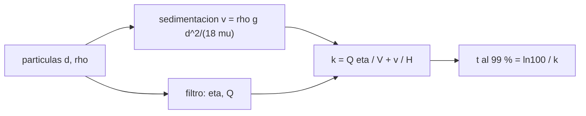

# B106-C23 — Control de partículas y polvo respirable en cabina

<!-- nav:top -->
[🏠 Programa](../../../../README.md) · [📚 Bloque B106](../../../tronco-comun/B106-habitats-espaciales-y-soporte-vital.md) · [← Anterior: B106-C22 — Fuentes e identificación de contaminantes del aire de cabina](../B106-C22-fuentes-e-identificacion-de-contaminantes-del-aire-de-cabina/CLASE.md) · [Siguiente: B106-C24 — Calidad del aire y límites de exposición en cabina →](../B106-C24-calidad-del-aire-y-limites-de-exposicion-en-cabina/CLASE.md)
<!-- /nav -->

## 1. Ubicación, nivel y alcance

Clase 23 del bloque B106 (hábitats espaciales y soporte vital). Nivel N3. Mira el aire de la cabina como una suspensión de partículas: cómo sedimentan según la gravedad y cuánto tarda un filtro de alta eficiencia en limpiarlas. Es el complemento de C21 para aerosoles y polvo. Todos los datos del laboratorio son **sintéticos o ilustrativos** y se rotulan como tales; solo se tratan como consultados los valores de la sección 11 que dicen «Consultada».

## 2. Por qué esta clase existe

En 1 g las partículas grandes caen al suelo; en microgravedad no, y en gravedad parcial caen más despacio. La decisión central: **¿qué eficiencia de filtro y qué caudal limpian la cabina en un tiempo dado según la gravedad y el tamaño?**

## 3. Lo que podrás hacer al terminar

1. Calcular la velocidad de caída de Stokes y el tiempo para caer una altura según la gravedad y el diámetro.
2. Comprobar la validez de Stokes con el número de Reynolds.
3. Calcular la tasa de limpieza combinada de filtro y sedimentación.
4. Calcular el tiempo para reducir al 1 % la concentración.
5. Comparar microgravedad, Luna y 1 g, y un filtro de 99,97 % frente a uno de 90 %.
6. Rotular que las relaciones son de manual y los parámetros ilustrativos.

La evidencia es la **ficha de partículas con tiempo de limpieza** del ejercicio 12 (sección 20).

## 4. Con qué llegas y cómo comprobarlo

1. ¿Qué es la viscosidad?
2. ¿Qué es el número de Reynolds?
3. ¿Qué es una constante de limpieza `k`?
4. ¿Qué es un filtro HEPA?
5. ¿Qué son los cambios de aire por hora?

<details>
<summary>Ver respuestas</summary>

1. La resistencia de un fluido a fluir (Pa·s). 2. `ρ v d/μ`; Stokes vale si `Re < 1`. 3. La tasa de decaimiento exponencial de la concentración. 4. Un filtro de alta eficiencia (≥ 99,97 % a 0,3 µm en la definición usual). 5. Caudal por hora dividido por el volumen.
</details>

Con cuatro o cinco aciertos, sigue; si no, repasa los prerrequisitos.

## 5. Un caso de contexto y casos de referencia

Una partícula de 10 µm y 1500 kg/m³ cae en aire a **4,52 mm/s** en 1 g, es decir 2 m en 7,4 min; en la Luna (1,62 m/s²) tarda 44,7 min y, en microgravedad, no cae. Una de 50 µm cae 2 m en 0,3 min. Un filtro de 99,97 % con 0,6 m³/s en 100 m³ da `k = 0,00600 s⁻¹` y reduce la concentración al 1 % en **12,8 min** (21,6 cambios de aire por hora); en 1 g la sedimentación añade y baja el tiempo a 9,3 min; con filtro de 90 %, 14,2 min.

## 6. Vocabulario

**Velocidad de Stokes:** velocidad terminal de una esfera pequeña en un fluido viscoso. **Aerosol:** partículas en suspensión. **HEPA:** filtro de alta eficiencia. **Cambios de aire por hora:** `3600 Q/V`. **Polvo respirable:** partículas que llegan al pulmón.

## 7. Modelo mental



*Descripción textual:* la sedimentación (que depende de `g`) y el filtro suman sus tasas de limpieza; de la tasa total sale el tiempo para llegar al 1 %.

Analogía: lluvia (sedimentación) más un trapeador (filtro). Límite: sin gravedad solo queda el trapeador, y las partículas pueden acumularse en rincones donde el flujo no llega.

## 8. La explicación, paso a paso

### 8.1 Stokes

`v = ρ_p g d²/(18 μ)` con `ρ_p = 1500`, `μ = 1,81·10⁻⁵`. A 1 g: 1 µm, 0,045 mm/s; 10 µm, 4,52 mm/s; 50 µm, 112,9 mm/s (`Re = 0,37 < 1`). Escala con `g` y con `d²` (control del laboratorio): en la Luna, `1,62/9,81` de la velocidad de 1 g (0,746 mm/s a 10 µm).

### 8.2 Tiempo para caer 2 m

10 µm: 7,4 min a 1 g, 19,5 min en Marte (3,71 m/s²) y 44,7 min en la Luna; 1 µm: 738 min a 1 g. En microgravedad, infinito.

### 8.3 Limpieza

`C/C₀ = exp(−k t)`, `k = Q η/V + v/H`. Filtro de 99,97 %: `k = 0,00600 s⁻¹` y 12,8 min al 1 %; con sedimentación de 10 µm a 1 g, `k = 0,00826`, 9,3 min; en la Luna, 12,0 min; con filtro de 90 %, 14,2 min. El filtro domina cuando hay caudal alto; la sedimentación importa para partículas grandes en 1 g.

### 8.4 Qué falta

No se corrige por Cunningham (partículas < 1 µm), ni se modelan la resuspensión, la adhesión a superficies ni la electrostática del polvo lunar.

## 9. Magnitudes, símbolos y unidades

| Símbolo | Qué es | Unidad | Valor / nota |
|---|---|---|---|
| `v` | velocidad de Stokes | mm/s | 4,52 (10 µm, 1 g) |
| `t_caída` | tiempo para caer 2 m | min | 7,4 (10 µm, 1 g) |
| `k` | tasa de limpieza del filtro | 1/s | 0,00600 |
| `t₉₉` | tiempo al 1 % | min | 12,8 |
| ACH | cambios de aire por hora | 1/h | 21,6 |

## 10. Convenciones y referencias

`ρ_p = 1500 kg/m³`, `μ = 1,81·10⁻⁵ Pa·s`, `ρ_aire = 1,2 kg/m³`, altura 2 m, volumen 100 m³, caudal 0,6 m³/s; `g = 9,81; 3,71; 1,62 m/s²`; sin corrección de Cunningham. Tolerancias: `Re < 1`; velocidad proporcional a `g` (1e-12) y a `d²` (1e-9). Numpy y Python: ver la primera línea de la salida del laboratorio (Python 3.12.9, numpy 2.4.4 en la ejecución del 2026-11-10).

## 11. De dónde sale lo que afirmamos

| ID | Fuente | Localizador | Respalda | Estado |
|---|---|---|---|---|
| S2 | NASA, Oficina del Jefe de Salud y Medicina (OCHMO), OCHMO-TB-002 rev. B (14 de noviembre de 2023), «Environmental Control & Life Support System (ECLSS): Human-Centered Approach», resumen técnico derivado de NASA-STD-3001 vol. 2 rev. D — https://www.nasa.gov/wp-content/uploads/2023/12/ochmo-tb-002-eclss.pdf (consultada 2026-11-10; PDF leído con PyMuPDF) | lista de requisitos V2 6052, 6053 y 6153 | existen requisitos de material particulado, de polvo lunar y de monitoreo de polvo celeste (sin valores en el resumen) | Consultada (solo los títulos de requisito) |
| — | Stokes, definición usual de HEPA, decaimiento exponencial | — | de manual; el laboratorio verifica la aritmética | No consultada en una fuente concreta |

Límites: no se consultó ningún dato de polvo lunar, de concentraciones en estaciones ni de la definición formal de HEPA (el 99,97 % a 0,3 µm es de manual); los valores son ilustrativos.

## 12. Cómo ver el resultado

| Resultado | Valor |
|---|---|
| Velocidad de 10 µm a 1 g | 4,52 mm/s |
| Tiempo de caída de 2 m (10 µm): 1 g / Luna | 7,4 / 44,7 min |
| Tiempo al 1 %: solo filtro / con 1 g | 12,8 / 9,3 min |
| Filtro de 90 % | 14,2 min |
| Cambios de aire por hora | 21,6 |

Descripción larga: la gravedad ayuda a limpiar las partículas grandes; en microgravedad todo depende del caudal y del filtro.

## 13. Ejemplo trabajado: velocidad de caída y limpieza

**Paso 1.** `v = 1500·9,81·(10⁻⁵)²/(18·1,81·10⁻⁵) = 4,52·10⁻³ m/s`.

**Paso 2.** Tiempo para caer 2 m: `2/4,52·10⁻³ = 443 s = 7,4 min`.

**Paso 3.** Limpieza por filtro: `k = 0,6·0,9997/100 = 0,0060 s⁻¹`.

**Paso 4.** `t₉₉ = ln 100/0,0060 = 768 s = 12,8 min`.

## 14. Distintas formas de describir el problema

**Por velocidad:** Stokes. **Por tiempo:** `H/v`. **Por tasa:** `k`. **Por tiempo de limpieza:** `ln 100/k`. **Por gravedad:** comparar.

## 15. Práctica guiada

**Ejercicio 1 · con los pasos indicados.** Calcula `v` de 5 µm a 1 g. *Pasos:* Stokes.

<details><summary>Solución comentada</summary>

`1,13 mm/s`.
</details>

**Ejercicio 2 · con una pista.** Calcula `k` con 0,3 m³/s, `η = 0,9997` y 100 m³. *Pista:* `Q η/V`.

<details><summary>Solución comentada</summary>

`0,003 s⁻¹`.
</details>

**Ejercicio 3 · casi autónomo.** ¿Cuánto tarda en llegar al 1 %? *Pista:* `ln 100/k`.

<details><summary>Solución comentada</summary>

`1535 s = 25,6 min`.
</details>

## 16. Práctica autónoma, transferencia e integrador

**Ejercicio 4 · autónomo.** ¿Cuánto tarda una de 50 µm en caer 2 m en la Luna?

<details><summary>Solución comentada</summary>

1,8 min.
</details>

**Ejercicio 5 · autónomo.** ¿Cuánto cambia `v` si `d` se duplica?

<details><summary>Solución comentada</summary>

Se multiplica por 4.
</details>

**Ejercicio 6 · autónomo.** ¿Cuántos cambios por hora tiene 0,3 m³/s en 100 m³?

<details><summary>Solución comentada</summary>

10,8.
</details>

**Ejercicio 7 · autónomo.** ¿Cuál es el `Re` de 50 µm a 1 g?

<details><summary>Solución comentada</summary>

0,37 (< 1, Stokes vale).
</details>

**Ejercicio 8 · autónomo.** ¿Por qué no cae el polvo en microgravedad?

<details><summary>Solución comentada</summary>

No hay peso: la velocidad terminal es cero y solo la retiran el flujo y el filtro.
</details>

**Ejercicio 9 · transferencia.** El polvo lunar se adhiere a trajes y entra al hábitat. ¿Qué pasa con los tiempos de limpieza?

<details><summary>Solución comentada</summary>

En 0,165 g las partículas grandes sedimentan despacio (44 min por 2 m a 10 µm); se necesita filtración y no solo gravedad.
</details>

**Ejercicio 10 · transferencia.** Se pasa a un filtro de 90 %. ¿Cuánto sube el tiempo al 1 %?

<details><summary>Solución comentada</summary>

De 12,8 a 14,2 min en el modelo; pero en la práctica el 0,03 % que pasa importa para partículas finas.
</details>

**Ejercicio 11 · transferencia.** ¿Qué medirías para validar?

<details><summary>Solución comentada</summary>

Concentración de partículas en el tiempo tras una inyección conocida.
</details>

**Ejercicio 12 · integrador.** Elabora tu *ficha de partículas con tiempo de limpieza*: tabla de velocidad y tiempo de caída para cuatro diámetros y tres gravedades, tasas de limpieza para cuatro casos, comprobación de Stokes y qué es de manual o ilustrativo.

<details><summary>Solución comentada</summary>

Secciones 8.1–8.4 y la salida del laboratorio.
</details>

## 17. Laboratorio: sedimentación y filtrado de partículas

El script [particulas_y_polvo.py](particulas_y_polvo.py) calcula la velocidad de Stokes, el tiempo de caída para tres gravedades y el tiempo de limpieza con filtro y sedimentación (**comprueba** `Re < 1`, la proporcionalidad con `g` y con `d²` y el orden de los tiempos).

**Datos:** relaciones de **manual no consultadas** y parámetros **ilustrativos**; sin aleatoriedad. **Predice antes de ejecutar:** ¿Cae el polvo en microgravedad? (no). **Ejecución del 2026-11-10 (Python 3.12.9):**

```text
Python 3.12.9; numpy 2.4.4
DATOS: relaciones de manual NO consultadas y valores ILUSTRATIVOS; sin mediciones de polvo real
Velocidad de caida de Stokes [mm/s] y tiempo para caer 2 m, segun gravedad y diametro:
   d [um]   g = 9.81 mm/s   t [min]    g = 3.71 mm/s   t [min]   g = 1.62 mm/s   t [min]   Re(9.81)
        1         0.0452      738.0          0.0171     1951.5          0.0075     4469.1     0.0000
        5         1.1291       29.5          0.4270       78.1          0.1865      178.8     0.0004
       10         4.5166        7.4          1.7081       19.5          0.7459       44.7     0.0030
       50       112.9144        0.3         42.7026        0.8         18.6464        1.8     0.3743
En microgravedad (g ~ 0) la velocidad de Stokes tiende a 0: las particulas no sedimentan y solo las retira el flujo y el filtro
Limpieza de la cabina (concentracion C/C0 = exp(-k t)), k = Q eta / V + v / H:
   caso                         k [1/s]   t al 99 % [min]
   microgravedad (solo filtro)           0.00600         12.8
   1 g, 10 um (filtro + sedimentacion)   0.00826          9.3
   Luna, 10 um                           0.00637         12.0
   microgravedad, filtro de 90 %         0.00540         14.2
Cambios de aire por hora a traves del filtro: 21.6; fraccion que pasa el filtro en cada paso: 0.0003
Pruebas superadas.
```

```bash
python programa/clases/B106/B106-C23-control-de-particulas-y-polvo-respirable-en-cabina/particulas_y_polvo.py
```

**Límites:** una sola densidad y altura, sin Cunningham, sin resuspensión ni adhesión, mezcla perfecta, filtro con eficiencia constante.

## 18. Errores frecuentes y cómo corregirlos

**Usar Stokes con `Re` alto.** Verifica `Re` (8.1).

**Ignorar la gravedad parcial.** Compara casos (8.2).

**Olvidar la fracción que pasa el filtro.** Cuenta `1 − η`.

**Tomar la definición de HEPA como consultada.** Es de manual.

## 19. Cómo sabrás que vas bien

Tras la sección 8: ¿cuánto tarda una partícula de 10 µm en caer 2 m en la Luna y cuánto tarda el filtro en limpiar al 99 %? Si dudas, repasa el ejemplo 13. Tras el laboratorio: ¿qué comprueba? (ver la sección 17).

## 20. Qué entregas y cómo se evalúa

El producto es tu **ficha de partículas con tiempo de limpieza** (ejercicio 12).

| Criterio | Inicial | En desarrollo | Logrado | Destacado |
|---|---|---|---|---|
| Conceptos | Confunde las magnitudes | Parciales | Explica Stokes, filtro y gravedad | Explica los supuestos y sus límites |
| Cálculo | Sin unidades | Con errores | Calcula con unidades y cifras coherentes | Calcula casos nuevos y los verifica |
| Numérico | Sin comprobación | Un caso | Compara con el control del laboratorio | Interpreta la sensibilidad |
| Fuentes | Sin fuente | Sin fecha | Fuentes con fecha y estado | Declara lo ilustrativo y lo no consultado |
| Límites | No los nombra | Uno | Tres | Discute qué falta para un hábitat real |

**Condiciones críticas (no se compensan con promedio):** rotular los datos como sintéticos o ilustrativos; no presentar un valor ilustrativo como límite de una norma; citar solo lo consultado; no usar la clase como consejo médico ni operativo.

## 21. Ética, seguridad y límites

Clase **educativa**: no da consejo médico ni operativo y no sirve para decidir la atmósfera, el agua, la exposición ni la respuesta ante una emergencia de un hábitat o de una persona reales. No hay valores de exposición a polvo; los límites de material particulado reales no se consultaron. Accesibilidad: tablas equivalentes a las gráficas, fórmulas en texto, ejercicios sin conexión.

## 22. Para cerrar y seguir

En microgravedad solo el flujo y el filtro limpian el aire: 0,6 m³/s con 99,97 % reducen el polvo al 1 % en unos 13 minutos en una cabina de 100 m³, y la gravedad acelera la limpieza de las partículas grandes. La clase siguiente fija cuándo el aire es saludable.

**Glosario español–inglés.** sedimentación · *settling*; aerosol · *aerosol*; filtro HEPA · *HEPA filter*; polvo respirable · *respirable dust*; viscosidad · *viscosity*.

**Continuidad.** Sigue con la clase siguiente del bloque (enlace en la navegación) o vuelve al [bloque B106](../../../tronco-comun/B106-habitats-espaciales-y-soporte-vital.md).

**Referencias:** ver sección 11.

<!-- nav:bottom -->
---

[← Anterior: B106-C22 — Fuentes e identificación de contaminantes del aire de cabina](../B106-C22-fuentes-e-identificacion-de-contaminantes-del-aire-de-cabina/CLASE.md) · [📚 Bloque B106](../../../tronco-comun/B106-habitats-espaciales-y-soporte-vital.md) · [Siguiente: B106-C24 — Calidad del aire y límites de exposición en cabina →](../B106-C24-calidad-del-aire-y-limites-de-exposicion-en-cabina/CLASE.md)
<!-- /nav -->
