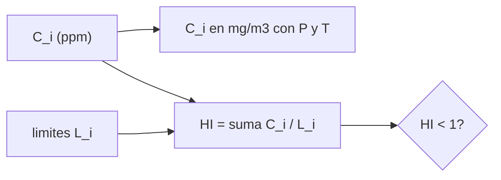

# B106-C24 — Calidad del aire y límites de exposición en cabina

<!-- nav:top -->
[🏠 Programa](../../../../README.md) · [📚 Bloque B106](../../../tronco-comun/B106-habitats-espaciales-y-soporte-vital.md) · [← Anterior: B106-C23 — Control de partículas y polvo respirable en cabina](../B106-C23-control-de-particulas-y-polvo-respirable-en-cabina/CLASE.md) · [Siguiente: B106-C25 — Sensores de presión, gases y humedad para monitoreo de hábitat →](../B106-C25-sensores-de-presion-gases-y-humedad-para-monitoreo-de-habitat/CLASE.md)
<!-- /nav -->

## 1. Ubicación, nivel y alcance

Clase 24 del bloque B106 (hábitats espaciales y soporte vital). Nivel N3. Convierte unidades de concentración y evalúa una mezcla de contaminantes con un índice aditivo frente a límites de exposición. Los límites del laboratorio son inventados: los valores reales de los SMAC **no se consultaron**. Todos los datos del laboratorio son **sintéticos o ilustrativos** y se rotulan como tales; solo se tratan como consultados los valores de la sección 11 que dicen «Consultada».

## 2. Por qué esta clase existe

Evaluar el aire exige límites y una regla para combinar contaminantes; ninguno basta por sí solo. La decisión central: **¿cumple una mezcla de contaminantes su límite combinado y qué compuesto la domina?**

## 3. Lo que podrás hacer al terminar

1. Convertir ppm a mg/m³ con la ley de los gases ideales y ver el efecto de la presión.
2. Definir un índice de riesgo aditivo `HI = Σ Cᵢ/Lᵢ`.
3. Evaluar una tabla de contaminantes y reconocer el dominante.
4. Ver que una mezcla puede incumplir aunque cada compuesto cumpla.
5. Distinguir un SMAC consultado en su existencia de un límite ilustrativo.
6. Rotular la tabla como sintética.

La evidencia es la **informe de calidad del aire con índice** del ejercicio 12 (sección 20).

## 4. Con qué llegas y cómo comprobarlo

1. ¿Qué es ppm?
2. ¿Qué es un límite de exposición?
3. ¿Qué es un efecto aditivo?
4. ¿Qué es la masa molar?
5. ¿Qué es un SMAC?

<details>
<summary>Ver respuestas</summary>

1. Partes por millón en volumen. 2. Una concentración máxima aceptable para una duración dada. 3. Cuando los efectos de varios contaminantes se suman. 4. Masa de un mol en g/mol. 5. Una concentración máxima permitida en nave espacial, fijada por toxicólogos del JSC.
</details>

Con cuatro o cinco aciertos, sigue; si no, repasa los prerrequisitos.

## 5. Un caso de contexto y casos de referencia

La NASA publica los SMAC (concentraciones máximas permitidas en el aire de naves) en JSC 20584, fijados por toxicólogos del JSC con el comité de toxicología del NRC; **sus valores no se consultaron**. Con límites **inventados**, la tabla sintética de seis compuestos da `HI = 0,693` (dominante: compuesto E, 0,214), y duplicando E y triplicando D, `HI = 1,007 > 1` aunque ninguno supera su límite por separado. 1 ppm de CO vale **1,1449 mg/m³** a 101,3 kPa y 0,623 mg/m³ a 8 psia.

## 6. Vocabulario

**SMAC:** concentración máxima permitida en nave. **SWEG:** guía de agua potable. **Índice de riesgo aditivo:** suma de razones concentración/límite. **ppm:** partes por millón en volumen. **mg/m³:** masa por volumen de aire.

## 7. Modelo mental



*Descripción textual:* cada concentración se compara con su límite y las razones se suman; el índice debe quedar bajo 1.

Analogía: varios gastos con presupuestos separados; aunque cada uno cumpla, la suma puede pasar el presupuesto total. Límite: la suma supone efectos aditivos; en toxicología real depende del órgano diana.

## 8. La explicación, paso a paso

### 8.1 Unidades

`C [mg/m³] = ppm·10⁻⁶·(P/(R T))·M·10³`. Para CO (`M = 28,01 g/mol`) a 25 °C y 101,325 kPa: 1,1449 mg/m³ (~1,145 de manual). A 55,2 kPa: 0,623 mg/m³: la fracción en volumen es la misma, pero la masa por metro cúbico baja con la presión.

### 8.2 Índice aditivo

`HI = Σ Cᵢ/Lᵢ`. La tabla sintética: A 0,075; B 0,120; C 0,133; D 0,050; E 0,214; F 0,100; `HI = 0,693`. El compuesto E domina.

### 8.3 La mezcla incumple

Con E ×2 y D ×3: E 0,429 y D 0,150; `HI = 1,007`. Ninguna razón supera 1, pero la suma sí.

### 8.4 Qué es y qué no es un SMAC

La página consultada dice qué son los SMAC y quién los fija; no da valores (los oficiales están en JSC 20584 y los de agua, SWEG, en JSC 63414). Los límites de la tabla son inventados y no deben usarse como SMAC.

## 9. Magnitudes, símbolos y unidades

| Símbolo | Qué es | Unidad | Valor / nota |
|---|---|---|---|
| `C` | concentración | ppm o mg/m³ | 1 ppm CO = 1,1449 mg/m³ |
| `L` | límite ilustrativo | ppm | tabla inventada |
| `HI` | índice de riesgo aditivo | — | 0,693 |
| `M` | masa molar | g/mol | 28,01 (CO) |
| `P` | presión de cabina | kPa | 101,3 / 55,2 |

## 10. Convenciones y referencias

Gas ideal a 25 °C; límites y concentraciones sintéticos; efecto aditivo supuesto; índice < 1 como criterio de este ejercicio. Tolerancias: 1 ppm de CO = 1,145 ± 0,002 mg/m³; conversión proporcional a `P` (1e-12). Numpy y Python: ver la primera línea de la salida del laboratorio (Python 3.12.9, numpy 2.4.4 en la ejecución del 2026-11-10).

## 11. De dónde sale lo que afirmamos

| ID | Fuente | Localizador | Respalda | Estado |
|---|---|---|---|---|
| S5 | NASA, «Exposure Guidelines: SMACs & SWEGs» — https://www.nasa.gov/feature/exposure-guidelines-smacs-swegs (consultada 2026-11-10) | texto de la página | los SMAC son límites de contaminantes en el aire de naves fijados por toxicólogos del JSC con el comité de toxicología del NRC; los SWEG son los del agua; los valores oficiales están en JSC 20584 (SMAC) y JSC 63414 (SWEG); los toxicólogos fijan valores provisionales de 7 días | Consultada (solo la existencia y la autoría; **no se consultaron los valores**) |
| S2 | NASA, Oficina del Jefe de Salud y Medicina (OCHMO), OCHMO-TB-002 rev. B (14 de noviembre de 2023), «Environmental Control & Life Support System (ECLSS): Human-Centered Approach», resumen técnico derivado de NASA-STD-3001 vol. 2 rev. D — https://www.nasa.gov/wp-content/uploads/2023/12/ochmo-tb-002-eclss.pdf (consultada 2026-11-10; PDF leído con PyMuPDF) | lista de requisitos V2 6050 | existe un límite de contaminación atmosférica | Consultada (solo el título) |
| — | Gas ideal y suma de razones | — | las verifica el laboratorio | No consultada en una fuente concreta |

Límites: el documento JSC 20584 y sus valores **no se consultaron**: un listado de búsqueda confirmó su existencia. Los límites usados son inventados. La suposición de aditividad es didáctica y no una regla de toxicología.

## 12. Cómo ver el resultado

| Resultado | Valor |
|---|---|
| 1 ppm de CO a 101,3 / 55,2 kPa | 1,1449 / 0,623 mg/m³ |
| `HI` de la tabla | 0,693 |
| Dominante | compuesto E |
| `HI` con E×2 y D×3 | 1,007 |
| Compuestos sobre su límite en ese caso | 0 |

Descripción larga: un aire puede incumplir como mezcla sin que ningún compuesto supere su límite; la presión de cabina cambia la masa por metro cúbico pero no la fracción.

## 13. Ejemplo trabajado: conversión e índice

**Paso 1.** `P/(R T) = 101 325/(8,314462·298,15) = 40,87 mol/m³`.

**Paso 2.** 1 ppm de CO: `10⁻⁶·40,87·28,01·10³ = 1,145 mg/m³`.

**Paso 3.** `HI` de la tabla: `0,075 + 0,120 + 0,133 + 0,050 + 0,214 + 0,100 = 0,693`.

**Paso 4.** Con E ×2 y D ×3: `0,693 + 0,214 + 0,100 = 1,007`.

## 14. Distintas formas de describir el problema

**Por unidad:** ppm y mg/m³. **Por razón:** `C/L`. **Por suma:** `HI`. **Por dominante:** máximo. **Por presión:** escala.

## 15. Práctica guiada

**Ejercicio 1 · con los pasos indicados.** Convierte 5 ppm de un gas de 44 g/mol a mg/m³ a 25 °C y 1 atm. *Pasos:* `M/24,47`.

<details><summary>Solución comentada</summary>

`8,99 mg/m³`.
</details>

**Ejercicio 2 · con una pista.** Calcula la razón con 2 ppm y límite 15 ppm. *Pista:* `C/L`.

<details><summary>Solución comentada</summary>

`0,133`.
</details>

**Ejercicio 3 · casi autónomo.** Suma 0,2; 0,3 y 0,4. *Pista:* `HI`.

<details><summary>Solución comentada</summary>

`0,9`: cumple.
</details>

## 16. Práctica autónoma, transferencia e integrador

**Ejercicio 4 · autónomo.** ¿Cuánto vale 1 ppm de CO a 34,6 kPa?

<details><summary>Solución comentada</summary>

`0,391 mg/m³`.
</details>

**Ejercicio 5 · autónomo.** ¿Qué razón máxima tiene el compuesto F con 3 ppm y límite 30?

<details><summary>Solución comentada</summary>

`0,100`.
</details>

**Ejercicio 6 · autónomo.** Si E se triplica, ¿cuánto sube `HI`?

<details><summary>Solución comentada</summary>

`+0,428`: 1,121.
</details>

**Ejercicio 7 · autónomo.** ¿Qué pasa si los efectos no son aditivos?

<details><summary>Solución comentada</summary>

El índice sobrestima el riesgo; hay que evaluar por órgano diana.
</details>

**Ejercicio 8 · autónomo.** ¿Por qué convertir con la presión de cabina?

<details><summary>Solución comentada</summary>

Porque un límite en mg/m³ depende de `P` y uno en ppm no.
</details>

**Ejercicio 9 · transferencia.** Un límite se da en mg/m³ para 101 kPa y la cabina está a 55 kPa. ¿Cómo se interpreta?

<details><summary>Solución comentada</summary>

A 55 kPa la misma masa por m³ equivale a casi el doble de ppm: hay que convertir.
</details>

**Ejercicio 10 · transferencia.** Se detecta un compuesto sin límite conocido. ¿Qué haces?

<details><summary>Solución comentada</summary>

Pedir una evaluación toxicológica (JSC) y mientras tanto reducir su fuente; el índice no lo cubre.
</details>

**Ejercicio 11 · transferencia.** ¿Qué escala de tiempo falta en este índice?

<details><summary>Solución comentada</summary>

La duración de la exposición (1 h, 24 h, 7 días...), que sí tienen los límites reales; no modelada.
</details>

**Ejercicio 12 · integrador.** Elabora tu *informe de calidad del aire con índice*: conversión de unidades con el efecto de la presión, tabla de seis contaminantes con razones, `HI`, escenario de incumplimiento, y qué es consultado (existencia de SMAC) o inventado.

<details><summary>Solución comentada</summary>

Secciones 8.1–8.4 y la salida del laboratorio.
</details>

## 17. Laboratorio: unidades e índice de riesgo aditivo

El script [calidad_del_aire.py](calidad_del_aire.py) convierte ppm a mg/m³ con la presión, calcula el índice de una tabla sintética y un escenario de incumplimiento (**comprueba** el 1,145 de manual, la proporcionalidad con la presión y que el índice suma las razones).

**Datos:** límites **inventados** y concentraciones **sintéticas**; **valores reales no consultados**. **Predice antes de ejecutar:** ¿Puede incumplir una mezcla aunque cada compuesto cumpla? (sí). **Ejecución del 2026-11-10 (Python 3.12.9):**

```text
Python 3.12.9; numpy 2.4.4
DATOS: limites INVENTADOS (ilustrativos) y concentraciones SINTETICAS; los valores reales de JSC 20584 NO se consultaron; no son SMAC
Control: 1 ppm de CO (28.01 g/mol) a 25 C y 101.325 kPa = 1.1449 mg/m3 (valor de manual ~1.145)
   1 ppm de CO a 101.3 kPa: 1.1449 mg/m3 (la fraccion en volumen es la misma; la masa por m3 baja con P)
   1 ppm de CO a 55.2 kPa (8 psia): 0.6232 mg/m3 (la fraccion en volumen es la misma; la masa por m3 baja con P)
   1 ppm de CO a 34.6 kPa: 0.3914 mg/m3 (la fraccion en volumen es la misma; la masa por m3 baja con P)
Indice de riesgo aditivo HI = suma(C_i / L_i) con limites ILUSTRATIVOS (HI < 1 aceptable en este ejercicio):
   compuesto      M [g/mol]  C [ppm]  C [mg/m3]  L [ppm]   C/L
   compuesto A      44.05     0.30      0.540     4.00   0.075
   compuesto B      58.08     1.20      2.849    10.00   0.120
   compuesto C      28.01     2.00      2.290    15.00   0.133
   compuesto D      78.11     0.05      0.160     1.00   0.050
   compuesto E      17.03     1.50      1.044     7.00   0.214
   compuesto F      46.07     3.00      5.649    30.00   0.100
HI = 0.693; compuesto dominante: compuesto E (0.214); cumple el ejercicio
Escenario: E x2 y D x3 -> HI = 1.007; NO cumple aunque cada compuesto por separado quede bajo su limite: True
Pruebas superadas.
```

```bash
python programa/clases/B106/B106-C24-calidad-del-aire-y-limites-de-exposicion-en-cabina/calidad_del_aire.py
```

**Límites:** efectos aditivos, un solo tiempo de exposición, límites inventados, seis compuestos, gas ideal.

## 18. Errores frecuentes y cómo corregirlos

**Tomar los límites del laboratorio como SMAC.** Son inventados.

**Evaluar solo cada compuesto.** Suma las razones (8.3).

**Olvidar la presión de cabina.** Ver 8.1.

**Citar JSC 20584 como consultada.** Solo se consultó su existencia.

## 19. Cómo sabrás que vas bien

Tras la sección 8: ¿cuánto vale 1 ppm de CO en mg/m³ y cómo se evalúa una mezcla? Si dudas, repasa el ejemplo 13. Tras el laboratorio: ¿qué comprueba? (ver la sección 17).

## 20. Qué entregas y cómo se evalúa

El producto es tu **informe de calidad del aire con índice** (ejercicio 12).

| Criterio | Inicial | En desarrollo | Logrado | Destacado |
|---|---|---|---|---|
| Conceptos | Confunde las magnitudes | Parciales | Explica unidades, índice y límites | Explica los supuestos y sus límites |
| Cálculo | Sin unidades | Con errores | Calcula con unidades y cifras coherentes | Calcula casos nuevos y los verifica |
| Numérico | Sin comprobación | Un caso | Compara con el control del laboratorio | Interpreta la sensibilidad |
| Fuentes | Sin fuente | Sin fecha | Fuentes con fecha y estado | Declara lo ilustrativo y lo no consultado |
| Límites | No los nombra | Uno | Tres | Discute qué falta para un hábitat real |

**Condiciones críticas (no se compensan con promedio):** rotular los datos como sintéticos o ilustrativos; no presentar un valor ilustrativo como límite de una norma; citar solo lo consultado; no usar la clase como consejo médico ni operativo.

## 21. Ética, seguridad y límites

Clase **educativa**: no da consejo médico ni operativo y no sirve para decidir la atmósfera, el agua, la exposición ni la respuesta ante una emergencia de un hábitat o de una persona reales. Los límites del laboratorio son inventados: no evalúan la salubridad de ningún aire real; los SMAC oficiales deben consultarse en su versión vigente. Accesibilidad: tablas equivalentes a las gráficas, fórmulas en texto, ejercicios sin conexión.

## 22. Para cerrar y seguir

Un índice aditivo evalúa mezclas: la tabla sintética da 0,69 y pasa a 1,007 con dos compuestos aumentados, sin que ninguno exceda su límite. Los valores oficiales (SMAC) hay que consultarlos aparte. La clase siguiente trata los sensores que miden todo esto.

**Glosario español–inglés.** límite de exposición · *exposure limit*; SMAC · *spacecraft maximum allowable concentration*; índice de riesgo · *hazard index*; ppm · *parts per million*; calidad del aire · *air quality*.

**Continuidad.** Sigue con la clase siguiente del bloque (enlace en la navegación) o vuelve al [bloque B106](../../../tronco-comun/B106-habitats-espaciales-y-soporte-vital.md).

**Referencias:** ver sección 11.

<!-- nav:bottom -->
---

[← Anterior: B106-C23 — Control de partículas y polvo respirable en cabina](../B106-C23-control-de-particulas-y-polvo-respirable-en-cabina/CLASE.md) · [📚 Bloque B106](../../../tronco-comun/B106-habitats-espaciales-y-soporte-vital.md) · [Siguiente: B106-C25 — Sensores de presión, gases y humedad para monitoreo de hábitat →](../B106-C25-sensores-de-presion-gases-y-humedad-para-monitoreo-de-habitat/CLASE.md)
<!-- /nav -->
