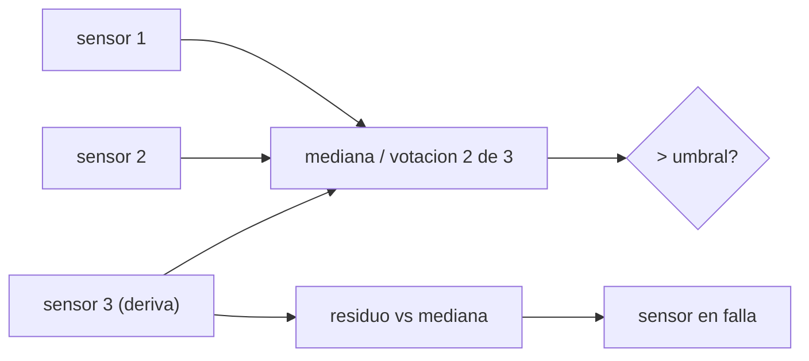

# B106-C25 — Sensores de presión, gases y humedad para monitoreo de hábitat

<!-- nav:top -->
[🏠 Programa](../../../../README.md) · [📚 Bloque B106](../../../tronco-comun/B106-habitats-espaciales-y-soporte-vital.md) · [← Anterior: B106-C24 — Calidad del aire y límites de exposición en cabina](../B106-C24-calidad-del-aire-y-limites-de-exposicion-en-cabina/CLASE.md) · [Siguiente: B106-C26 — Tratamiento de aguas grises en hábitats →](../../../tronco-comun/B106-habitats-espaciales-y-soporte-vital.md#b106-c26)
<!-- /nav -->

## 1. Ubicación, nivel y alcance

Clase 25 del bloque B106 (hábitats espaciales y soporte vital). Nivel N3. Cierra el tramo de aire con el instrumento que lo mide: calibración, deriva, votación 2 de 3 y el principio de absorción. Los sensores y sus datos son sintéticos. Todos los datos del laboratorio son **sintéticos o ilustrativos** y se rotulan como tales; solo se tratan como consultados los valores de la sección 11 que dicen «Consultada».

## 2. Por qué esta clase existe

Un control sin medición fiable es ciego: un sensor con deriva puede ocultar una subida de CO₂ o disparar falsas alarmas. La decisión central: **¿cómo se calibra, se vota y se vigila la deriva para que la medición sea fiable durante la misión?**

## 3. Lo que podrás hacer al terminar

1. Calibrar un sensor lineal con patrones por mínimos cuadrados.
2. Calcular la sensibilidad de un sensor de absorción (Beer–Lambert).
3. Calcular y verificar por Monte Carlo la tasa de falsas alarmas de un sensor y de una votación 2 de 3.
4. Detectar una deriva por residuo contra la mediana.
5. Ver cómo la mediana protege la lectura.
6. Rotular que todos los datos son sintéticos.

La evidencia es la **ficha de sensores con falsas alarmas** del ejercicio 12 (sección 20).

## 4. Con qué llegas y cómo comprobarlo

1. ¿Qué es una calibración?
2. ¿Qué es la deriva?
3. ¿Qué es una falsa alarma?
4. ¿Qué es la mediana?
5. ¿Qué es la ley de Beer–Lambert?

<details>
<summary>Ver respuestas</summary>

1. Ajustar la relación entre la lectura y el valor verdadero con patrones. 2. El cambio lento de la respuesta de un sensor. 3. Una alarma sin condición real. 4. El valor central de un conjunto. 5. `I = I₀ exp(−k c L)`: absorción exponencial.
</details>

Con cuatro o cinco aciertos, sigue; si no, repasa los prerrequisitos.

## 5. Un caso de contexto y casos de referencia

Un sensor sintético de ganancia 1,07 y desplazamiento −0,12 mmHg se calibra con 4 patrones y 25 lecturas cada uno: ganancia **1,0715** y desplazamiento **-0,1301**. Con la verdad en 2,5 mmHg y un umbral de 3, la falsa alarma de un sensor es 0,00043 por lectura y la votación 2 de 3 la baja a 0,00000055; con la verdad en 2,8, de 0,0912 a 0,0234 (el Monte Carlo coincide). Un sensor con deriva de 0,02 mmHg/día se detecta el día **19** y, a los 90 días, la mediana lee 2,62 frente a 4,35 del sensor con deriva. Todo sintético.

## 6. Vocabulario

**Calibración:** ajuste de ganancia y desplazamiento con patrones. **Deriva:** variación lenta. **Votación 2 de 3:** se acepta lo que coincide en dos sensores. **Residuo:** diferencia contra una referencia (la mediana). **Beer–Lambert:** absorción exponencial con la concentración.

## 7. Modelo mental



*Descripción textual:* tres sensores alimentan una votación; el residuo de cada uno contra la mediana detecta al que deriva.

Analogía: tres relojes; si uno se adelanta, la mediana sigue acertando y la diferencia lo delata. Límite: si dos fallan igual (causa común, C18), la votación no ayuda.

## 8. La explicación, paso a paso

### 8.1 Calibración

`y = g x + o` con `x ∈ {0, 1, 2, 4}`: mínimos cuadrados dan `g = 1,0715`, `o = -0,1301`. Sin calibrar a 2,5 mmHg lee 2,555 (+0,055); calibrado, 2,506.

### 8.2 Absorción

`I/I₀ = exp(−k L c)` con `kL = 0,2/mmHg`: 0,8187 a 1 mmHg, 0,5488 a 3 y 0,4066 a 4,5. La sensibilidad `dI/dc = −kL·I` baja con la concentración (−0,164 a 1 mmHg y −0,081 a 4,5): el sensor es menos sensible en el extremo alto.

### 8.3 Falsas alarmas

Con ruido de 0,15 mmHg y umbral 3: a 2,5 mmHg `p = Q((3 − 2,5)/0,15) = 0,00043` (MC 0,00046); votación `3p² − 2p³ = 0,00000055`. A 2,8 mmHg `p = 0,0912` y votación 0,0234 (MC 0,0230). La votación reduce las falsas alarmas, pero también retrasa la alarma real.

### 8.4 Deriva

Con el sensor 3 a +0,02 mmHg/día, la media móvil de 7 días del residuo contra la mediana supera 0,3 mmHg el día 19 (sesgo de 0,38 mmHg). A 90 días la mediana lee 2,62 y el sensor con deriva, 4,35.

## 9. Magnitudes, símbolos y unidades

| Símbolo | Qué es | Unidad | Valor / nota |
|---|---|---|---|
| `g`, `o` | ganancia y desplazamiento | —; mmHg | 1,0715; -0,1301 |
| `kL` | absorción por mmHg | 1/mmHg | 0,2 (ilustrativo) |
| `σ` | ruido del sensor | mmHg | 0,15 |
| `p` | falsa alarma por lectura | — | 0,00043 (2,5 mmHg) |
| `d_det` | día de detección de la deriva | días | 19 |

## 10. Convenciones y referencias

Tres sensores; ruido gaussiano de 0,15 mmHg; umbral 3 mmHg; patrones 0, 1, 2 y 4 mmHg con 25 lecturas; deriva de 0,02 mmHg/día; semilla 106; 400 000 lecturas. Todo sintético. Tolerancias: ganancia ±0,02 y desplazamiento ±0,06; Monte Carlo dentro de 4 desviaciones binomiales. Numpy y Python: ver la primera línea de la salida del laboratorio (Python 3.12.9, numpy 2.4.4 en la ejecución del 2026-11-10).

## 11. De dónde sale lo que afirmamos

| ID | Fuente | Localizador | Respalda | Estado |
|---|---|---|---|---|
| S2 | NASA, Oficina del Jefe de Salud y Medicina (OCHMO), OCHMO-TB-002 rev. B (14 de noviembre de 2023), «Environmental Control & Life Support System (ECLSS): Human-Centered Approach», resumen técnico derivado de NASA-STD-3001 vol. 2 rev. D — https://www.nasa.gov/wp-content/uploads/2023/12/ochmo-tb-002-eclss.pdf (consultada 2026-11-10; PDF leído con PyMuPDF) | lista de requisitos V2 6020, 6021, 6022 y 6023 | existen requisitos de registro, visualización y alerta de datos atmosféricos y de monitoreo de trazas | Consultada (solo los títulos de requisito) |
| S4 | NASA OCHMO, OCHMO-TB-004, «Carbon Dioxide (CO2)», resumen técnico derivado de NASA-STD-3001 vol. 2 rev. D — https://www.nasa.gov/wp-content/uploads/2023/12/ochmo-tb-004-carbon-dioxide.pdf (consultada 2026-11-10; PDF leído con PyMuPDF) | requisito V2 6004 | ppCO₂ medio de 1 h < 3 mmHg | Consultada (resumen técnico) |
| — | Mínimos cuadrados, votación 2 de 3, Beer–Lambert | — | los verifica el laboratorio con datos sintéticos | No consultada en una fuente concreta |

Límites: no se consultó ningún dato de sensores espaciales (NDIR, espectrometría de masas) ni de su deriva real; los sensores son sintéticos.

## 12. Cómo ver el resultado

| Resultado | Valor |
|---|---|
| Ganancia / desplazamiento calibrados | 1,0715 / -0,1301 mmHg |
| Falsa alarma a 2,5 mmHg (1 / 2 de 3) | 0,00043 / 0,00000055 |
| Falsa alarma a 2,8 mmHg (1 / 2 de 3) | 0,0912 / 0,0234 |
| Detección de la deriva | día 19 |
| Lectura a 90 días (mediana / con deriva) | 2,62 / 4,35 mmHg |

Descripción larga: la calibración y la votación hacen fiable una medición ruidosa y con deriva; el residuo contra la mediana revela al sensor que se desvía.

## 13. Ejemplo trabajado: votación 2 de 3

**Paso 1.** Falsa alarma de un sensor: `p = Q(0,5/0,15) = Q(3,33) = 4,3·10⁻⁴`.

**Paso 2.** Votación: `3p² − 2p³ ≈ 3·(4,3·10⁻⁴)² = 5,5·10⁻⁷`.

**Paso 3.** Reducción: `p/p₃ ≈ 780`.

**Paso 4.** Costo: la alarma real también exige que dos de tres coincidan.

## 14. Distintas formas de describir el problema

**Por calibración:** `g`, `o`. **Por física:** Beer–Lambert. **Por probabilidad:** `p`, `3p² − 2p³`. **Por residuo:** deriva. **Por mediana:** votación.

## 15. Práctica guiada

**Ejercicio 1 · con los pasos indicados.** Calibra con lecturas 0,1; 1,2; 2,3 para 0, 1, 2. *Pasos:* recta.

<details><summary>Solución comentada</summary>

`o = 0,1`; `g = 1,1`.
</details>

**Ejercicio 2 · con una pista.** Calcula `I/I₀` con `kL = 0,2` y `c = 2`. *Pista:* `e^(−0,4)`.

<details><summary>Solución comentada</summary>

`0,670`.
</details>

**Ejercicio 3 · casi autónomo.** Calcula `3p² − 2p³` con `p = 0,1`. *Pista:* fórmula.

<details><summary>Solución comentada</summary>

`0,028`.
</details>

## 16. Práctica autónoma, transferencia e integrador

**Ejercicio 4 · autónomo.** ¿Cuánto vale `p` a 2,9 mmHg con ruido de 0,15?

<details><summary>Solución comentada</summary>

`Q(0,667) = 0,2525`.
</details>

**Ejercicio 5 · autónomo.** ¿Y la votación?

<details><summary>Solución comentada</summary>

`3·0,0638 − 2·0,0161 = 0,159`.
</details>

**Ejercicio 6 · autónomo.** ¿Cuánta deriva se acumula en 30 días a 0,02 mmHg/día?

<details><summary>Solución comentada</summary>

`0,6 mmHg`.
</details>

**Ejercicio 7 · autónomo.** ¿Qué pasa si dos de tres sensores derivan juntos?

<details><summary>Solución comentada</summary>

La mediana también deriva (causa común).
</details>

**Ejercicio 8 · autónomo.** ¿Por qué baja la sensibilidad de un sensor de absorción a alta concentración?

<details><summary>Solución comentada</summary>

`dI/dc = −kL I` y `I` decae.
</details>

**Ejercicio 9 · transferencia.** Una alarma con umbral 3 y lecturas de 2,9 mmHg: ¿qué sensor y qué votación eliges?

<details><summary>Solución comentada</summary>

Con 2,9 mmHg el sensor único alarma el 25 % de las veces: hay que reducir ruido o usar votación y filtro temporal.
</details>

**Ejercicio 10 · transferencia.** ¿Cuánto debe durar un intervalo de recalibración con deriva de 0,02 mmHg/día y tolerancia de 0,3 mmHg?

<details><summary>Solución comentada</summary>

Unos 15 días (`0,3/0,02`).
</details>

**Ejercicio 11 · transferencia.** ¿Qué falla de los sensores sería más peligrosa?

<details><summary>Solución comentada</summary>

Una deriva a la baja que oculte una subida del CO₂.
</details>

**Ejercicio 12 · integrador.** Elabora tu *ficha de sensores con falsas alarmas*: calibración con su error, sensibilidad de Beer–Lambert, falsas alarmas de uno y de 2 de 3 con Monte Carlo, detección de deriva y qué es sintético.

<details><summary>Solución comentada</summary>

Secciones 8.1–8.4 y la salida del laboratorio.
</details>

## 17. Laboratorio: calibración, votación y deriva de sensores

El script [sensores_de_habitat.py](sensores_de_habitat.py) calibra un sensor por mínimos cuadrados, calcula la sensibilidad de Beer–Lambert, las falsas alarmas de un sensor y de una votación 2 de 3 (con Monte Carlo) y detecta una deriva (**comprueba** la calibración, la concordancia con el Monte Carlo y la detección de la deriva).

**Datos:** sensores **sintéticos** con parámetros **ilustrativos** (semilla 106). **Predice antes de ejecutar:** ¿Reduce la votación 2 de 3 las falsas alarmas? (sí, mucho). **Ejecución del 2026-11-10 (Python 3.12.9):**

```text
Python 3.12.9; numpy 2.4.4
DATOS: sensores SINTETICOS (semilla 106) con parametros ILUSTRATIVOS; sin datos de sensores reales
Calibracion con patrones [0.0, 1.0, 2.0, 4.0] mmHg (25 lecturas cada uno): ganancia 1.0715 (verdadera 1.07), desplazamiento -0.1301 (verdadero -0.12)
Lectura sin calibrar a 2.5 mmHg: 2.555 (error +0.055); calibrada: 2.506
Absorcion (Beer-Lambert) I/I0 = exp(-kL c): sensibilidad dI/dc = -kL I
   c = 0.0 mmHg: I/I0 = 1.0000; dI/dc = -0.2000 por mmHg
   c = 1.0 mmHg: I/I0 = 0.8187; dI/dc = -0.1637 por mmHg
   c = 3.0 mmHg: I/I0 = 0.5488; dI/dc = -0.1098 por mmHg
   c = 4.5 mmHg: I/I0 = 0.4066; dI/dc = -0.0813 por mmHg
Falsas alarmas por lectura con la verdad en 2.5 mmHg y umbral 3.0: un sensor 0.00043 (MC 0.00046); votacion 2 de 3 5.52e-07 (MC 0.00e+00)
Falsas alarmas por lectura con la verdad en 2.8 mmHg y umbral 3.0: un sensor 0.09121 (MC 0.09160); votacion 2 de 3 2.34e-02 (MC 2.30e-02)
Deriva de 0.02 mmHg/dia en el sensor 3: la media movil de 7 dias del residuo contra la mediana supera 0.3 mmHg el dia 19 (sesgo acumulado 0.38 mmHg)
Con votacion por mediana, la lectura a 90 dias vale 2.62 frente a 4.35 del sensor con deriva
Pruebas superadas.
```

```bash
python programa/clases/B106/B106-C25-sensores-de-presion-gases-y-humedad-para-monitoreo-de-habitat/sensores_de_habitat.py
```

**Límites:** ruido gaussiano independiente, deriva lineal en un solo sensor, umbral único, sin causa común ni fallas bruscas.

## 18. Errores frecuentes y cómo corregirlos

**Confiar en un solo sensor.** Usa varios (8.3).

**No recalibrar.** Ver 8.4.

**Ignorar la causa común.** La votación no la cubre.

**Presentar datos sintéticos como medidos.** Son sintéticos.

## 19. Cómo sabrás que vas bien

Tras la sección 8: ¿cuánto reduce la votación las falsas alarmas y cuándo se detecta la deriva? Si dudas, repasa el ejemplo 13. Tras el laboratorio: ¿qué comprueba? (ver la sección 17).

## 20. Qué entregas y cómo se evalúa

El producto es tu **ficha de sensores con falsas alarmas** (ejercicio 12).

| Criterio | Inicial | En desarrollo | Logrado | Destacado |
|---|---|---|---|---|
| Conceptos | Confunde las magnitudes | Parciales | Explica calibración, votación y deriva | Explica los supuestos y sus límites |
| Cálculo | Sin unidades | Con errores | Calcula con unidades y cifras coherentes | Calcula casos nuevos y los verifica |
| Numérico | Sin comprobación | Un caso | Compara con el control del laboratorio | Interpreta la sensibilidad |
| Fuentes | Sin fuente | Sin fecha | Fuentes con fecha y estado | Declara lo ilustrativo y lo no consultado |
| Límites | No los nombra | Uno | Tres | Discute qué falta para un hábitat real |

**Condiciones críticas (no se compensan con promedio):** rotular los datos como sintéticos o ilustrativos; no presentar un valor ilustrativo como límite de una norma; citar solo lo consultado; no usar la clase como consejo médico ni operativo.

## 21. Ética, seguridad y límites

Clase **educativa**: no da consejo médico ni operativo y no sirve para decidir la atmósfera, el agua, la exposición ni la respuesta ante una emergencia de un hábitat o de una persona reales. Los resultados no validan ningún sensor ni un esquema de alarmas reales. Accesibilidad: tablas equivalentes a las gráficas, fórmulas en texto, ejercicios sin conexión.

## 22. Para cerrar y seguir

Un sensor se hace fiable calibrándolo, votándolo y vigilando su deriva: la votación 2 de 3 reduce las falsas alarmas por cientos y la mediana protege la lectura cuando uno deriva. Termina el tramo de aire; sigue el del agua.

**Glosario español–inglés.** calibración · *calibration*; deriva · *drift*; votación · *voting*; falsa alarma · *false alarm*; residuo · *residual*.

**Continuidad.** Sigue con la clase siguiente del bloque (enlace en la navegación) o vuelve al [bloque B106](../../../tronco-comun/B106-habitats-espaciales-y-soporte-vital.md).

**Referencias:** ver sección 11.

<!-- nav:bottom -->
---

[← Anterior: B106-C24 — Calidad del aire y límites de exposición en cabina](../B106-C24-calidad-del-aire-y-limites-de-exposicion-en-cabina/CLASE.md) · [📚 Bloque B106](../../../tronco-comun/B106-habitats-espaciales-y-soporte-vital.md) · [Siguiente: B106-C26 — Tratamiento de aguas grises en hábitats →](../../../tronco-comun/B106-habitats-espaciales-y-soporte-vital.md#b106-c26)
<!-- /nav -->
