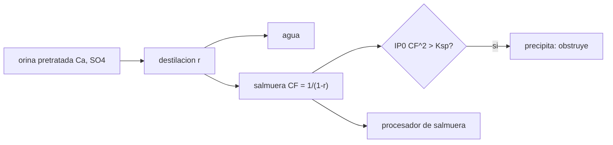

# B106-C27 — Tratamiento de orina y recuperación de agua

<!-- nav:top -->
[🏠 Programa](../../../../README.md) · [📚 Bloque B106](../../../tronco-comun/B106-habitats-espaciales-y-soporte-vital.md) · [← Anterior: B106-C26 — Tratamiento de aguas grises en hábitats](../B106-C26-tratamiento-de-aguas-grises-en-habitats/CLASE.md) · [Siguiente: B106-C28 — Monitoreo microbiológico de agua y superficies del hábitat →](../B106-C28-monitoreo-microbiologico-de-agua-y-superficies-del-habitat/CLASE.md)
<!-- /nav -->

## 1. Ubicación, nivel y alcance

Clase 27 del bloque B106 (hábitats espaciales y soporte vital). Nivel N3. Explica por qué la recuperación de agua de la orina tiene un límite químico (sulfato de calcio) y cómo una segunda etapa lo supera. Usa el caso del procesador de orina de la ISS descrito en el resumen consultado. Todos los datos del laboratorio son **sintéticos o ilustrativos** y se rotulan como tales; solo se tratan como consultados los valores de la sección 11 que dicen «Consultada».

## 2. Por qué esta clase existe

Evaporar la orina concentra sales hasta que precipitan y obstruyen el equipo; el límite lo fija la química, no la termodinámica del agua. La decisión central: **¿hasta qué fracción se puede recuperar el agua antes de precipitar y cómo se supera ese límite?**

## 3. Lo que podrás hacer al terminar

1. Calcular el factor de concentración `CF = 1/(1 − r)` y el producto iónico `IP₀ CF²`.
2. Obtener la recuperación máxima `r_max = 1 − √(IP₀/K_sp)`.
3. Ver cómo el pretratamiento y el calcio cambian ese límite.
4. Calcular la recuperación de dos etapas en serie.
5. Estimar la energía de destilación con y sin recuperación de calor.
6. Rotular los valores como ilustrativos y el caso de la ISS como consultado.

La evidencia es la **ficha de recuperación de orina con su límite** del ejercicio 12 (sección 20).

## 4. Con qué llegas y cómo comprobarlo

1. ¿Qué es el producto de solubilidad?
2. ¿Qué es el factor de concentración?
3. ¿Qué es una salmuera?
4. ¿Cuál es el calor latente del agua?
5. ¿Qué hace la compresión de vapor?

<details>
<summary>Ver respuestas</summary>

1. El valor de `[Ca][SO₄]` a partir del cual precipita la sal. 2. `1/(1 − r)`: cuántas veces se concentra el residuo. 3. El residuo concentrado. 4. Unos 2,26 MJ/kg a 100 °C. 5. Reutiliza el calor del vapor para evaporar más agua.
</details>

Con cuatro o cinco aciertos, sigue; si no, repasa los prerrequisitos.

## 5. Un caso de contexto y casos de referencia

El resumen consultado cuenta que el procesador de orina de la ISS acumuló sulfato de calcio (más calcio urinario en microgravedad), que se redujo la recuperación, se cambió el pretratamiento y un procesador de salmuera permitió recuperar más del 90 %. En el modelo ilustrativo (calcio 2 mmol/L, sulfato 3 mmol/L, `K_sp = 3,1·10⁻⁵`) la recuperación máxima es **0,560**; con menos sulfato sube a 0,746, con calcio y sulfato bajos a 0,902 y con calcio doble baja a 0,378. Dos etapas (0,746 y 0,65 sobre la salmuera) llegan a **91,1 %** de 6 L/día de orina. Evaporar 1 kg cuesta 628 Wh sin recuperar calor y 63 Wh con factor 10.

## 6. Vocabulario

**Orina pretratada:** orina con aditivos que estabilizan. **Producto iónico (IP):** `[Ca][SO₄]`. **`K_sp`:** producto de solubilidad. **Salmuera:** residuo concentrado. **Compresión de vapor:** destilación con reutilización de calor.

## 7. Modelo mental



*Descripción textual:* la destilación recupera agua y concentra la salmuera; si el producto iónico supera el de solubilidad, la sal precipita y obstruye; una segunda etapa trata la salmuera.

Analogía: evaporar agua de mar hasta que aparece la sal. Límite: la solubilidad real depende de la temperatura, el pH, la fuerza iónica y otras sales (aquí se ignoran los coeficientes de actividad).

## 8. La explicación, paso a paso

### 8.1 El límite químico

Si la fracción recuperada es `r`, el residuo se concentra `CF = 1/(1 − r)` veces y el producto iónico crece `CF²`. Precipita cuando `IP₀ CF² > K_sp`, es decir `r > r_max = 1 − √(IP₀/K_sp)`. Con `IP₀ = 6·10⁻⁶`, `r_max = 0,560`; a `r = 0,9` el cociente `IP/K_sp` sería 19,35.

### 8.2 Efecto de la química

Menos sulfato (1 mmol/L): `r_max = 0,746`. Calcio y sulfato bajos (0,5 y 0,6): 0,902. Calcio de 4 mmol/L: 0,378. Es la lógica del resumen consultado: el calcio extra de la microgravedad exigió reducir la recuperación y cambiar el pretratamiento.

### 8.3 Dos etapas

Primera etapa con `r₁ = 0,746` y segunda sobre la salmuera con `r₂ = 0,65`: `r = 0,746 + 0,254·0,65 = 0,911`. De 6 L/día: 4,48 L + 0,99 L = 5,47 L de agua y 0,53 L de salmuera final. La masa se conserva.

### 8.4 Energía

`2,26·10⁶ J/kg = 628 Wh/kg`; con un factor de recuperación de calor de 10, 63 Wh/kg. Para 5,47 kg/día: 14,3 W con recuperación y 143 W sin ella.

## 9. Magnitudes, símbolos y unidades

| Símbolo | Qué es | Unidad | Valor / nota |
|---|---|---|---|
| `r` | fracción de agua recuperada | — | 0,560 (máx., caso base) |
| CF | factor de concentración | — | `1/(1 − r)` |
| `K_sp` | producto de solubilidad | mol²/L² | 3,1·10⁻⁵ (manual) |
| `r_total` | recuperación de dos etapas | — | 0,911 |
| `E` | energía por kg evaporado | Wh/kg | 628 (63 con COP 10) |

## 10. Convenciones y referencias

Calcio 2 mmol/L y sulfato 3 mmol/L (ilustrativos); `K_sp = 3,1·10⁻⁵` (manual, sin actividades); orina de 6 L/día para 4 personas; `L_v = 2,26 MJ/kg`; factor de recuperación de calor de 10. Tolerancias: `IP(r_max) = K_sp` (1e-9) y masa conservada (1e-9). Numpy y Python: ver la primera línea de la salida del laboratorio (Python 3.12.9, numpy 2.4.4 en la ejecución del 2026-11-10).

## 11. De dónde sale lo que afirmamos

| ID | Fuente | Localizador | Respalda | Estado |
|---|---|---|---|---|
| S2 | NASA, Oficina del Jefe de Salud y Medicina (OCHMO), OCHMO-TB-002 rev. B (14 de noviembre de 2023), «Environmental Control & Life Support System (ECLSS): Human-Centered Approach», resumen técnico derivado de NASA-STD-3001 vol. 2 rev. D — https://www.nasa.gov/wp-content/uploads/2023/12/ochmo-tb-002-eclss.pdf (consultada 2026-11-10; PDF leído con PyMuPDF) | recuadro «Calcium deposits affect Urine Processing Assembly (UPA)» | el aumento de calcio urinario por el recambio óseo en microgravedad produjo acumulación de sulfato de calcio en el ensamble de destilación; se redujo la tasa de recuperación, se cambiaron los químicos de pretratamiento para recuperar más y el procesador de salmuera (BPA) permitió recuperar más del 90 % | Consultada (resumen técnico) |
| S1 | NASA, «Environmental Control and Life Support Systems (ECLSS)» — https://www.nasa.gov/reference/environmental-control-and-life-support-systems-eclss/ (consultada 2026-11-10; la página indica actualización del 4 de abril de 2025) | párrafo de agua | el sistema recupera cerca del 90 % del agua de la estación | Consultada |
| — | Producto de solubilidad, calor latente, compresión de vapor | — | valores de manual, ilustrativos | No consultada en una fuente concreta |

Límites: las concentraciones, `K_sp`, el factor de calor y las recuperaciones de etapa son ilustrativos y no reproducen el equipo de la ISS; el resumen no da cifras de las etapas. No se consultaron datos reales del procesador de orina.

## 12. Cómo ver el resultado

| Resultado | Valor |
|---|---|
| `r_max` base (Ca 2, SO₄ 3) | 0,560 |
| `r_max` con menos sulfato / calcio y sulfato bajos | 0,746 / 0,902 |
| `IP/K_sp` a `r = 0,9` (caso base) | 19,35 |
| Recuperación de dos etapas | 91,1 % |
| Potencia con y sin recuperación de calor | 14,3 W / 143 W |

Descripción larga: la recuperación está limitada por la química del residuo y no por la energía; cambiar el pretratamiento o añadir una etapa de salmuera mueve el límite.

## 13. Ejemplo trabajado: recuperación máxima

**Paso 1.** `IP₀ = 2·10⁻³·3·10⁻³ = 6·10⁻⁶`.

**Paso 2.** `IP₀/K_sp = 0,194`; `√ = 0,440`.

**Paso 3.** `r_max = 1 − 0,440 = 0,560`.

**Paso 4.** Control: `CF = 2,27`; `IP = 6·10⁻⁶·5,17 = 3,1·10⁻⁵ = K_sp`.

## 14. Distintas formas de describir el problema

**Por solubilidad:** `IP vs K_sp`. **Por concentración:** CF. **Por etapas:** `r₁ + (1 − r₁) r₂`. **Por energía:** Wh/kg. **Por química:** pretratamiento.

## 15. Práctica guiada

**Ejercicio 1 · con los pasos indicados.** Calcula `r_max` con calcio 1 y sulfato 1 mmol/L. *Pasos:* `IP₀`, raíz.

<details><summary>Solución comentada</summary>

`IP₀ = 10⁻⁶`; `r_max = 1 − 0,180 = 0,820`.
</details>

**Ejercicio 2 · con una pista.** Calcula CF para `r = 0,75`. *Pista:* `1/(1 − r)`.

<details><summary>Solución comentada</summary>

`4`.
</details>

**Ejercicio 3 · casi autónomo.** Calcula el agua recuperada de 6 L con `r = 0,56`. *Pista:* producto.

<details><summary>Solución comentada</summary>

`3,36 L`.
</details>

## 16. Práctica autónoma, transferencia e integrador

**Ejercicio 4 · autónomo.** ¿Qué recuperación total dan `r₁ = 0,56` y `r₂ = 0,5`?

<details><summary>Solución comentada</summary>

`0,56 + 0,44·0,5 = 0,78`.
</details>

**Ejercicio 5 · autónomo.** ¿Qué pasa con `r_max` si el calcio se duplica?

<details><summary>Solución comentada</summary>

Baja a `1 − √(2)·0,440 = 0,378` (valor del laboratorio).
</details>

**Ejercicio 6 · autónomo.** ¿Cuánta energía necesita evaporar 5 kg con COP 10?

<details><summary>Solución comentada</summary>

`5·63 = 314 Wh`.
</details>

**Ejercicio 7 · autónomo.** ¿Por qué el calcio sube en microgravedad?

<details><summary>Solución comentada</summary>

El resumen consultado lo atribuye al recambio óseo.
</details>

**Ejercicio 8 · autónomo.** ¿Cuánto vale `IP/K_sp` a `r = 0,75` en el caso base?

<details><summary>Solución comentada</summary>

`0,194·16 = 3,1`: precipita.
</details>

**Ejercicio 9 · transferencia.** Una tripulación con más calcio urinario. ¿Qué haces con el pretratamiento?

<details><summary>Solución comentada</summary>

Reducir el sulfato (o el calcio) para subir `r_max`; es lo que describe el resumen para la ISS.
</details>

**Ejercicio 10 · transferencia.** Una segunda etapa supera el límite de la primera. ¿Qué cuesta?

<details><summary>Solución comentada</summary>

Más hardware, energía y una salmuera final más concentrada; hay que comparar con la masa de agua ahorrada (C06).
</details>

**Ejercicio 11 · transferencia.** ¿Qué pasa si el equipo se obstruye?

<details><summary>Solución comentada</summary>

Se pierde la recuperación y baja `r` global; la fiabilidad (C18) importa.
</details>

**Ejercicio 12 · integrador.** Elabora tu *ficha de recuperación de orina con su límite*: modelo, tabla de `r_max` para cuatro composiciones, curva de `IP/K_sp`, dos etapas, energía, lectura del caso consultado y qué es ilustrativo.

<details><summary>Solución comentada</summary>

Secciones 8.1–8.4 y la salida del laboratorio.
</details>

## 17. Laboratorio: límite químico de la recuperación de orina

El script [orina_y_recuperacion.py](orina_y_recuperacion.py) calcula la recuperación máxima para cuatro composiciones, la curva del producto iónico, dos etapas en serie y la energía de destilación (**comprueba** `IP(r_max) = K_sp`, la conservación de masa y que dos etapas superan el 90 %).

**Datos:** concentraciones y constantes **ilustrativas**; caso de la ISS **consultado**; sin aleatoriedad. **Predice antes de ejecutar:** ¿Qué limita la recuperación de agua de la orina: la energía o la química? (la química: precipita sulfato de calcio). **Ejecución del 2026-11-10 (Python 3.12.9):**

```text
Python 3.12.9; numpy 2.4.4
DATOS: concentraciones, Ksp y factores ILUSTRATIVOS (valores de manual no consultados); el limite por sulfato de calcio y el procesador de salmuera son los de OCHMO-TB-002 (consultado)
Recuperacion maxima antes de precipitar CaSO4 segun la composicion de la orina pretratada:
   caso                                    IP0 [mol2/L2]   IP0/Ksp   r_max
   calcio 2, sulfato 3 mmol/L                 6.00e-06     0.194    0.560
   pretratamiento con menos sulfato (1)       2.00e-06     0.065    0.746
   calcio y sulfato bajos (0.5 y 0.6)         3.00e-07     0.010    0.902
   calcio 4, sulfato 3                        1.20e-05     0.387    0.378
Evolucion del producto ionico con la recuperacion (calcio 2, sulfato 3 mmol/L): IP/Ksp = IP0 CF^2 / Ksp
   r = 0.00: CF =  1.00; IP/Ksp =    0.19 
   r = 0.30: CF =  1.43; IP/Ksp =    0.39 
   r = 0.50: CF =  2.00; IP/Ksp =    0.77 
   r = 0.56: CF =  2.27; IP/Ksp =    1.00 
   r = 0.70: CF =  3.33; IP/Ksp =    2.15 PRECIPITA
   r = 0.90: CF = 10.00; IP/Ksp =   19.35 PRECIPITA
Dos etapas en serie con 6.0 L/dia de orina: la primera (r = 0.746) recupera 4.48 L, la de salmuera (r = 0.65) 0.99 L -> total 5.47 L (91.1 %), salmuera final 0.53 L
Energia: evaporar 1 kg exige 628 Wh sin recuperar calor y 63 Wh con factor 10; para 5.47 kg/dia: 14.3 W con recuperacion y 143 W sin ella
Pruebas superadas.
```

```bash
python programa/clases/B106/B106-C27-tratamiento-de-orina-y-recuperacion-de-agua/orina_y_recuperacion.py
```

**Límites:** una sola sal, sin actividades, sin temperatura ni pH, etapas con recuperaciones inventadas, destilación ideal.

## 18. Errores frecuentes y cómo corregirlos

**Atribuir el límite a la energía.** Es la solubilidad (8.1).

**Sumar las recuperaciones de dos etapas.** Usa `r₁ + (1 − r₁) r₂`.

**Olvidar el calcio extra de microgravedad.** Ver 8.2.

**Presentar valores ilustrativos como los de la ISS.** Rotula.

## 19. Cómo sabrás que vas bien

Tras la sección 8: ¿cuál es la recuperación máxima del caso base y cómo se supera? Si dudas, repasa el ejemplo 13. Tras el laboratorio: ¿qué comprueba? (ver la sección 17).

## 20. Qué entregas y cómo se evalúa

El producto es tu **ficha de recuperación de orina con su límite** (ejercicio 12).

| Criterio | Inicial | En desarrollo | Logrado | Destacado |
|---|---|---|---|---|
| Conceptos | Confunde las magnitudes | Parciales | Explica solubilidad, concentración y etapas | Explica los supuestos y sus límites |
| Cálculo | Sin unidades | Con errores | Calcula con unidades y cifras coherentes | Calcula casos nuevos y los verifica |
| Numérico | Sin comprobación | Un caso | Compara con el control del laboratorio | Interpreta la sensibilidad |
| Fuentes | Sin fuente | Sin fecha | Fuentes con fecha y estado | Declara lo ilustrativo y lo no consultado |
| Límites | No los nombra | Uno | Tres | Discute qué falta para un hábitat real |

**Condiciones críticas (no se compensan con promedio):** rotular los datos como sintéticos o ilustrativos; no presentar un valor ilustrativo como límite de una norma; citar solo lo consultado; no usar la clase como consejo médico ni operativo.

## 21. Ética, seguridad y límites

Clase **educativa**: no da consejo médico ni operativo y no sirve para decidir la atmósfera, el agua, la exposición ni la respuesta ante una emergencia de un hábitat o de una persona reales. No describe ni valida ningún procesador de orina real. Accesibilidad: tablas equivalentes a las gráficas, fórmulas en texto, ejercicios sin conexión.

## 22. Para cerrar y seguir

La recuperación del agua de la orina tiene un techo químico (`r_max = 0,56` en el caso base) que se mueve con el pretratamiento y se supera con una etapa de salmuera, como relata el resumen de la ISS. La clase siguiente cuida que esa agua sea microbiológicamente segura.

**Glosario español–inglés.** salmuera · *brine*; producto de solubilidad · *solubility product*; factor de concentración · *concentration factor*; destilación · *distillation*; pretratamiento · *pretreatment*.

**Continuidad.** Sigue con la clase siguiente del bloque (enlace en la navegación) o vuelve al [bloque B106](../../../tronco-comun/B106-habitats-espaciales-y-soporte-vital.md).

**Referencias:** ver sección 11.

<!-- nav:bottom -->
---

[← Anterior: B106-C26 — Tratamiento de aguas grises en hábitats](../B106-C26-tratamiento-de-aguas-grises-en-habitats/CLASE.md) · [📚 Bloque B106](../../../tronco-comun/B106-habitats-espaciales-y-soporte-vital.md) · [Siguiente: B106-C28 — Monitoreo microbiológico de agua y superficies del hábitat →](../B106-C28-monitoreo-microbiologico-de-agua-y-superficies-del-habitat/CLASE.md)
<!-- /nav -->
