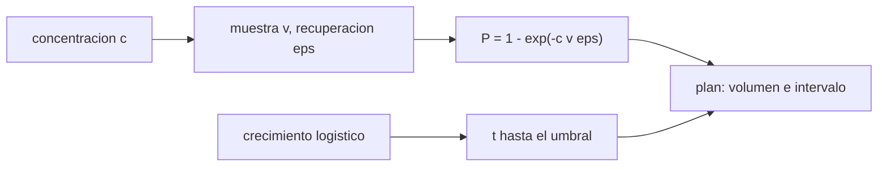

# B106-C28 — Monitoreo microbiológico de agua y superficies del hábitat

<!-- nav:top -->
[🏠 Programa](../../../../README.md) · [📚 Bloque B106](../../../tronco-comun/B106-habitats-espaciales-y-soporte-vital.md) · [← Anterior: B106-C27 — Tratamiento de orina y recuperación de agua](../B106-C27-tratamiento-de-orina-y-recuperacion-de-agua/CLASE.md) · [Siguiente: B106-C29 — Almacenamiento y distribución de agua potable en hábitats →](../B106-C29-almacenamiento-y-distribucion-de-agua-potable-en-habitats/CLASE.md)
<!-- /nav -->

## 1. Ubicación, nivel y alcance

Clase 28 del bloque B106 (hábitats espaciales y soporte vital). Nivel N3. Aplica probabilidad al control microbiológico: cuánto volumen hay que muestrear para detectar una contaminación y cada cuánto, dado que los microorganismos crecen. No define límites microbiológicos. Todos los datos del laboratorio son **sintéticos o ilustrativos** y se rotulan como tales; solo se tratan como consultados los valores de la sección 11 que dicen «Consultada».

## 2. Por qué esta clase existe

Una muestra pequeña puede no contener ningún organismo de una contaminación real, y un muestreo espaciado deja crecer la población. La decisión central: **¿qué volumen y qué intervalo de muestreo dan una confianza dada de detectar una contaminación antes de que supere el umbral de acción?**

## 3. Lo que podrás hacer al terminar

1. Modelar el conteo de organismos en una muestra como Poisson y calcular `P(detectar) = 1 − exp(−c v ε)`.
2. Calcular el volumen para una confianza de 95 % o 99 %.
3. Verificar con un Monte Carlo.
4. Incluir la recuperación del método `ε`.
5. Calcular el crecimiento logístico y el tiempo hasta el umbral de acción.
6. Rotular que los valores son ilustrativos y que no se consultaron límites.

La evidencia es la **plan de muestreo con confianza** del ejercicio 12 (sección 20).

## 4. Con qué llegas y cómo comprobarlo

1. ¿Qué es una UFC?
2. ¿Qué es Poisson?
3. ¿Qué es la recuperación de un método?
4. ¿Qué es un crecimiento logístico?
5. ¿Qué es un umbral de acción?

<details>
<summary>Ver respuestas</summary>

1. Una unidad formadora de colonia: un organismo viable que crece en un cultivo. 2. La distribución del número de eventos raros independientes. 3. La fracción de organismos que el método detecta. 4. Uno exponencial que se satura en una capacidad de carga. 5. La concentración que obliga a actuar.
</details>

Con cuatro o cinco aciertos, sigue; si no, repasa los prerrequisitos.

## 5. Un caso de contexto y casos de referencia

Con una contaminación de 0,01 UFC/mL (1 UFC por 100 mL) y una recuperación de 0,7, una muestra de 100 mL la detecta con probabilidad **0,503** y una de 1000 mL con 0,9991. Para 95 % de confianza hacen falta **428 mL** (300 mL con recuperación perfecta) y para 99 %, 658 mL. Una población que parte de 1 UFC/mL llega al umbral de 100 UFC/mL en **92,1 h**: con muestreo cada 24 h llega a 3,3 UFC/mL y cada 72 h, a 36,6, y cada 168 h supera el umbral. Valores ilustrativos; el resumen consultado no da límites.

## 6. Vocabulario

**UFC:** unidad formadora de colonia. **Recuperación `ε`:** fracción detectada. **Confianza:** probabilidad de detectar. **Crecimiento logístico:** curva en S. **Umbral de acción:** nivel que exige respuesta. **Biopelícula:** capa de microorganismos adherida a una superficie.

## 7. Modelo mental



*Descripción textual:* la probabilidad de detección depende del volumen y de la recuperación; el crecimiento fija cuánto puede esperarse entre muestreos.

Analogía: buscar una aguja con una muestra de heno; si la muestra es pequeña, puede no tener la aguja. Límite: aquí los organismos están distribuidos al azar; en la realidad se agrupan en biopelículas.

## 8. La explicación, paso a paso

### 8.1 Detección

La muestra contiene `Poisson(μ)` organismos con `μ = c v ε`; `P(detectar) = 1 − e^{−μ}`. Con `c = 0,01`, `ε = 0,7`: 10 mL, 0,068; 100 mL, 0,503; 300 mL, 0,877; 1000 mL, 0,9991. El Monte Carlo (200 000 repeticiones, semilla 106) coincide dentro de 4 desviaciones.

### 8.2 Volumen para una confianza

`v = −ln(1 − P)/(c ε)`: 95 %, 428 mL (la regla de tres es `3/(c ε)`); 99 %, 658 mL. Con recuperación 1,0 serían 300 mL: un método con baja recuperación exige más volumen. La concentración mínima detectable con 100 mL al 95 % es 0,0428 UFC/mL.

### 8.3 Crecimiento

`N(t) = K/(1 + ((K − N₀)/N₀) e^{−r t})` con `K = 10⁶`, `r = 0,05 h⁻¹`: desde 1 UFC/mL, 100 UFC/mL a las 92,1 h (3,8 días) y 10⁵ a las 232,4 h.

### 8.4 Intervalo de muestreo

Si se muestrea cada 24 h la población llega a 3,3 UFC/mL; cada 72 h, 36,6; cada 168 h, 4427, sobre el umbral. El intervalo debe ser menor que el tiempo de crecimiento hasta el umbral, con margen.

## 9. Magnitudes, símbolos y unidades

| Símbolo | Qué es | Unidad | Valor / nota |
|---|---|---|---|
| `c` | concentración verdadera | UFC/mL | 0,01 (ilustrativo) |
| `ε` | recuperación del método | — | 0,7 (ilustrativo) |
| `v₉₅` | volumen para 95 % | mL | 428 |
| `r` | tasa de crecimiento | 1/h | 0,05 (ilustrativo) |
| `t₁₀₀` | tiempo hasta 100 UFC/mL | h | 92,1 |

## 10. Convenciones y referencias

Poisson; `c = 0,01 UFC/mL`; `ε = 0,7`; logístico con `K = 10⁶ UFC/mL`, `r = 0,05 h⁻¹`; umbral 100 UFC/mL; semilla 106; 200 000 repeticiones; tolerancia de 4 desviaciones binomiales. Todo ilustrativo. Numpy y Python: ver la primera línea de la salida del laboratorio (Python 3.12.9, numpy 2.4.4 en la ejecución del 2026-11-10).

## 11. De dónde sale lo que afirmamos

| ID | Fuente | Localizador | Respalda | Estado |
|---|---|---|---|---|
| S2 | NASA, Oficina del Jefe de Salud y Medicina (OCHMO), OCHMO-TB-002 rev. B (14 de noviembre de 2023), «Environmental Control & Life Support System (ECLSS): Human-Centered Approach», resumen técnico derivado de NASA-STD-3001 vol. 2 rev. D — https://www.nasa.gov/wp-content/uploads/2023/12/ochmo-tb-002-eclss.pdf (consultada 2026-11-10; PDF leído con PyMuPDF) | lista de requisitos V2 6026, 6046, 6051 y 6059 y texto de gestión del agua | existen requisitos de calidad, monitoreo y control de contaminación del agua y de contaminación microbiana del aire; el agua debe ser microbiológicamente segura y aceptable para la tripulación (sin límites numéricos en el resumen) | Consultada (resumen técnico) |
| — | Poisson, logístico, rule of three | — | los verifica el laboratorio | No consultada en una fuente concreta |

Límites: **no se consultó ningún límite microbiológico** (ni de la NASA, ni de la OMS, ni de otra norma) y el resumen OCHMO sobre agua (TB-027) no se halló; los valores del laboratorio son ilustrativos y no definen aceptabilidad.

## 12. Cómo ver el resultado

| Resultado | Valor |
|---|---|
| P(detectar) con 100 mL / 1000 mL | 0,503 / 0,9991 |
| Volumen para 95 % / 99 % | 428 / 658 mL |
| Volumen con recuperación 1,0 (95 %) | 300 mL |
| Tiempo de 1 a 100 UFC/mL | 92,1 h |
| Población a 24 h / 72 h | 3,3 / 36,6 UFC/mL |

Descripción larga: detectar una contaminación débil pide volúmenes grandes y un método con buena recuperación; el intervalo de muestreo debe ser menor que el tiempo de crecimiento al umbral.

## 13. Ejemplo trabajado: volumen de muestra

**Paso 1.** `μ = c v ε`; para `c = 0,01`, `ε = 0,7`.

**Paso 2.** Confianza 95 %: `μ = −ln 0,05 = 2,996`.

**Paso 3.** `v = 2,996/(0,01·0,7) = 428 mL`.

**Paso 4.** Control: `P = 1 − e^{−0,01·428·0,7} = 0,95`.

## 14. Distintas formas de describir el problema

**Por probabilidad:** Poisson. **Por volumen:** `−ln(1 − P)/(cε)`. **Por simulación:** Monte Carlo. **Por tiempo:** logístico. **Por plan:** volumen + intervalo.

## 15. Práctica guiada

**Ejercicio 1 · con los pasos indicados.** Calcula `P` con 200 mL, `c = 0,01`, `ε = 0,7`. *Pasos:* `1 − e^{−μ}`.

<details><summary>Solución comentada</summary>

`μ = 1,4`; `P = 0,753`.
</details>

**Ejercicio 2 · con una pista.** Calcula `v` para 99 % con `ε = 1`. *Pista:* `−ln 0,01/c`.

<details><summary>Solución comentada</summary>

`461 mL`.
</details>

**Ejercicio 3 · casi autónomo.** ¿Cuántos organismos esperas en 1000 mL? *Pista:* `c v ε`.

<details><summary>Solución comentada</summary>

`7`.
</details>

## 16. Práctica autónoma, transferencia e integrador

**Ejercicio 4 · autónomo.** ¿Cuánto es la concentración mínima detectable con 500 mL al 95 %?

<details><summary>Solución comentada</summary>

`2,996/(500·0,7) = 0,0086 UFC/mL`.
</details>

**Ejercicio 5 · autónomo.** ¿Qué `P` da 100 mL a `c = 0,05`?

<details><summary>Solución comentada</summary>

`1 − e^{−3,5} = 0,970`.
</details>

**Ejercicio 6 · autónomo.** ¿Qué recuperación hace falta para detectar `c = 0,01` con 100 mL al 95 %?

<details><summary>Solución comentada</summary>

`ε = 2,996/(0,01·100) = 3`: imposible; hay que aumentar el volumen.
</details>

**Ejercicio 7 · autónomo.** ¿Cuánto tarda en llegar a 10 UFC/mL desde 1?

<details><summary>Solución comentada</summary>

Unas 46,1 h.
</details>

**Ejercicio 8 · autónomo.** ¿Por qué no basta una sola muestra?

<details><summary>Solución comentada</summary>

Porque la detección es probabilística y la población crece.
</details>

**Ejercicio 9 · transferencia.** El muestreo es cada 7 días. ¿Qué intervalo máximo exige el crecimiento del modelo?

<details><summary>Solución comentada</summary>

Menos de 92 h (3,8 días) si se quiere detectar antes de 100 UFC/mL desde 1 UFC/mL.
</details>

**Ejercicio 10 · transferencia.** La contaminación está en una biopelícula de la tubería. ¿Qué cambia?

<details><summary>Solución comentada</summary>

La distribución no es Poisson homogénea; hay que muestrear superficies (hisopos) y no solo el agua.
</details>

**Ejercicio 11 · transferencia.** ¿Qué datos necesitas para fijar el umbral de acción?

<details><summary>Solución comentada</summary>

Los límites de la norma vigente (no consultados) y la evaluación de riesgo.
</details>

**Ejercicio 12 · integrador.** Elabora tu *plan de muestreo con confianza*: probabilidades para cuatro volúmenes con Monte Carlo, volumen para 95 y 99 %, efecto de la recuperación, crecimiento logístico, intervalos de muestreo y qué es ilustrativo (y qué límites no se consultaron).

<details><summary>Solución comentada</summary>

Secciones 8.1–8.4 y la salida del laboratorio.
</details>

## 17. Laboratorio: muestreo microbiológico y crecimiento

El script [microbiologia_del_agua.py](microbiologia_del_agua.py) calcula la probabilidad de detección con Monte Carlo, el volumen para una confianza dada, el crecimiento logístico y el efecto del intervalo de muestreo (**comprueba** el Monte Carlo, `P(v₉₅) = 0,95` y `N(t) = umbral`).

**Datos:** parámetros **ilustrativos**; Monte Carlo **sintético** (semilla 106); **sin límites consultados**. **Predice antes de ejecutar:** ¿Detecta una muestra de 100 mL una contaminación de 1 UFC por 100 mL con certeza? (no: ~50 %). **Ejecución del 2026-11-10 (Python 3.12.9):**

```text
Python 3.12.9; numpy 2.4.4
DATOS: concentraciones, recuperacion y crecimiento ILUSTRATIVOS; Monte Carlo SINTETICO (semilla 106); sin limites microbiologicos consultados
Contaminacion verdadera de 0.01 UFC/mL (1 UFC por 100 mL), recuperacion del metodo 0.7:
   volumen [mL]   P(detectar)   Monte Carlo
             10        0.0676        0.0682
            100        0.5034        0.5018
            300        0.8775        0.8768
           1000        0.9991        0.9989
Volumen para detectar con 95 % de confianza: 428 mL (con recuperacion 1.0: 300 mL); para 99 %: 658 mL
Concentracion minima detectable con 100 mL al 95 %: 0.0428 UFC/mL
Crecimiento logistico desde 1.0 UFC/mL: llega a 100 UFC/mL en 92.1 h (3.8 dias); a 1e5 UFC/mL en 232.4 h; control N(t100) = 100.000
   si el muestreo es cada    24 h, una contaminacion de 1.0 UFC/mL llega a        3.3 UFC/mL antes del siguiente muestreo (no supera el umbral de accion)
   si el muestreo es cada    72 h, una contaminacion de 1.0 UFC/mL llega a       36.6 UFC/mL antes del siguiente muestreo (no supera el umbral de accion)
   si el muestreo es cada   168 h, una contaminacion de 1.0 UFC/mL llega a     4427.4 UFC/mL antes del siguiente muestreo (supera el umbral de accion)
Pruebas superadas.
```

```bash
python programa/clases/B106/B106-C28-monitoreo-microbiologico-de-agua-y-superficies-del-habitat/microbiologia_del_agua.py
```

**Límites:** distribución de Poisson homogénea, una especie, crecimiento logístico sin competencia ni biocida, sin biopelículas.

## 18. Errores frecuentes y cómo corregirlos

**Creer que una muestra negativa descarta la contaminación.** Calcula la probabilidad (8.1).

**Ignorar la recuperación.** Ver 8.2.

**Muestrear sin considerar el crecimiento.** Ver 8.4.

**Citar límites microbiológicos no consultados.** Declara «no consultado».

## 19. Cómo sabrás que vas bien

Tras la sección 8: ¿qué volumen detecta una contaminación de 0,01 UFC/mL al 95 % y cada cuánto hay que muestrear? Si dudas, repasa el ejemplo 13. Tras el laboratorio: ¿qué comprueba? (ver la sección 17).

## 20. Qué entregas y cómo se evalúa

El producto es tu **plan de muestreo con confianza** (ejercicio 12).

| Criterio | Inicial | En desarrollo | Logrado | Destacado |
|---|---|---|---|---|
| Conceptos | Confunde las magnitudes | Parciales | Explica Poisson, volumen y crecimiento | Explica los supuestos y sus límites |
| Cálculo | Sin unidades | Con errores | Calcula con unidades y cifras coherentes | Calcula casos nuevos y los verifica |
| Numérico | Sin comprobación | Un caso | Compara con el control del laboratorio | Interpreta la sensibilidad |
| Fuentes | Sin fuente | Sin fecha | Fuentes con fecha y estado | Declara lo ilustrativo y lo no consultado |
| Límites | No los nombra | Uno | Tres | Discute qué falta para un hábitat real |

**Condiciones críticas (no se compensan con promedio):** rotular los datos como sintéticos o ilustrativos; no presentar un valor ilustrativo como límite de una norma; citar solo lo consultado; no usar la clase como consejo médico ni operativo.

## 21. Ética, seguridad y límites

Clase **educativa**: no da consejo médico ni operativo y no sirve para decidir la atmósfera, el agua, la exposición ni la respuesta ante una emergencia de un hábitat o de una persona reales. La clase no define la potabilidad ni ningún límite microbiológico y no sustituye a un laboratorio ni a las normas vigentes. Accesibilidad: tablas equivalentes a las gráficas, fórmulas en texto, ejercicios sin conexión.

## 22. Para cerrar y seguir

Detectar una contaminación débil exige volumen (428 mL al 95 % con `ε = 0,7`) y un intervalo menor que el tiempo de crecimiento (3,8 días hasta 100 UFC/mL). La última clase de agua trata el almacenamiento y la distribución.

**Glosario español–inglés.** UFC · *CFU (colony-forming unit)*; recuperación · *recovery*; crecimiento logístico · *logistic growth*; biopelícula · *biofilm*; umbral de acción · *action level*.

**Continuidad.** Sigue con la clase siguiente del bloque (enlace en la navegación) o vuelve al [bloque B106](../../../tronco-comun/B106-habitats-espaciales-y-soporte-vital.md).

**Referencias:** ver sección 11.

<!-- nav:bottom -->
---

[← Anterior: B106-C27 — Tratamiento de orina y recuperación de agua](../B106-C27-tratamiento-de-orina-y-recuperacion-de-agua/CLASE.md) · [📚 Bloque B106](../../../tronco-comun/B106-habitats-espaciales-y-soporte-vital.md) · [Siguiente: B106-C29 — Almacenamiento y distribución de agua potable en hábitats →](../B106-C29-almacenamiento-y-distribucion-de-agua-potable-en-habitats/CLASE.md)
<!-- /nav -->
