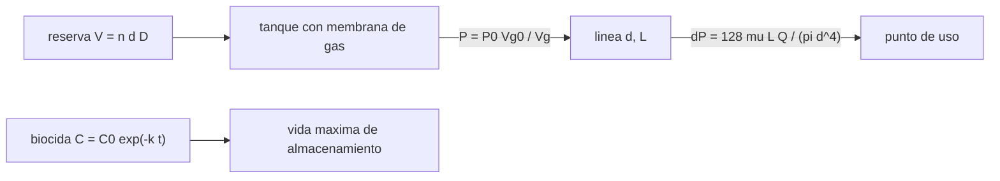

# B106-C29 — Almacenamiento y distribución de agua potable en hábitats

<!-- nav:top -->
[🏠 Programa](../../../../README.md) · [📚 Bloque B106](../../../tronco-comun/B106-habitats-espaciales-y-soporte-vital.md) · [← Anterior: B106-C28 — Monitoreo microbiológico de agua y superficies del hábitat](../B106-C28-monitoreo-microbiologico-de-agua-y-superficies-del-habitat/CLASE.md) · [Siguiente: B107-C01 — Entrenamiento cardiorrespiratorio y de resistencia de astronautas →](../../B107/B107-C01-entrenamiento-cardiorrespiratorio-y-de-resistencia-de-astronautas/CLASE.md)
<!-- /nav -->

## 1. Ubicación, nivel y alcance

Clase 29 del bloque B106 (hábitats espaciales y soporte vital). Nivel N3. Cierra el tramo de agua con el almacenamiento (volumen de reserva y presurización), la distribución (caída de presión de una línea) y la vida útil del biocida residual que mantiene el agua segura. Todos los datos del laboratorio son **sintéticos o ilustrativos** y se rotulan como tales; solo se tratan como consultados los valores de la sección 11 que dicen «Consultada».

## 2. Por qué esta clase existe

El agua tratada debe llegar a los puntos de uso con presión y con desinfectante residual suficiente. La decisión central: **¿qué reserva, qué diámetro de línea y cuánto tiempo puede almacenarse el agua antes de perder el residual?**

## 3. Lo que podrás hacer al terminar

1. Dimensionar el volumen de reserva con el consumo mínimo consultado y un margen.
2. Calcular la caída de presión de una línea con Poiseuille y comprobar el régimen con el número de Reynolds.
3. Comparar regímenes laminar y turbulento con distintos caudales.
4. Calcular la presión de entrega de un tanque con membrana de gas.
5. Calcular el tiempo máximo de almacenamiento por decaimiento del biocida.
6. Rotular que los parámetros son ilustrativos.

La evidencia es la **ficha de almacenamiento y distribución de agua** del ejercicio 12 (sección 20).

## 4. Con qué llegas y cómo comprobarlo

1. ¿Qué es el número de Reynolds?
2. ¿Qué dice la ley de Poiseuille?
3. ¿Qué es un biocida residual?
4. ¿Qué es una membrana en un tanque?
5. ¿Qué es la ley isoterma?

<details>
<summary>Ver respuestas</summary>

1. `ρ v d/μ`; bajo 2000 el flujo es laminar. 2. `ΔP = 128 μ L Q/(π d⁴)` en flujo laminar. 3. Un desinfectante que permanece disuelto para evitar el crecimiento. 4. Una pared flexible que separa el agua del gas presurizante. 5. `P V = constante` a temperatura constante.
</details>

Con cuatro o cinco aciertos, sigue; si no, repasa los prerrequisitos.

## 5. Un caso de contexto y casos de referencia

Una tripulación de 4 personas necesita como mínimo **30 L** de bebida en 3 días (2,5 L/día, consultado) y 132 L de demanda total con 10 % de margen (ilustrativo). Una línea de 10 m y 10 mm con 0,01 L/s tiene `Re = 1271` (laminar) y una caída de **0,41 kPa**; con 0,05 L/s es turbulenta (`Re = 6353`) y la caída sube a 7,2 kPa. Un tanque de 30 L con 10 L de gas a 200 kPa entrega a 80 kPa tras extraer 15 L. El biocida de 2 mg/L (decaimiento de 0,05 d⁻¹) llega al mínimo de 0,1 mg/L a los **59,9 días**.

## 6. Vocabulario

**Reserva:** agua almacenada para operar sin reciclaje. **Poiseuille:** caída de presión laminar. **Número de Reynolds:** régimen del flujo. **Tanque con membrana:** almacenamiento sin superficie libre, apto para microgravedad. **Residual:** concentración de desinfectante que permanece.

## 7. Modelo mental



*Descripción textual:* la reserva se guarda en un tanque presurizado por un gas, la línea pierde presión según su geometría y el biocida decae, lo que limita el tiempo de almacenamiento.

Analogía: una botella de agua con un globo que empuja (membrana) y una manguera cuya resistencia crece mucho al estrecharse. Límite: en microgravedad no hay superficie libre ni presión hidrostática.

## 8. La explicación, paso a paso

### 8.1 Reserva

`V = n·días·D·(1 + margen)`. Solo bebida: `4·2,5·3 = 30 L`; con demanda de 10 L/persona/día y 10 %: 132 L (132 kg). 1 día, 44 L; 7 días, 308 L; 14 días, 616 L.

### 8.2 Línea

Con `d = 10 mm`, `L = 10 m`, `Q = 0,01 L/s`: `v = 0,127 m/s`, `Re = 1271`; `ΔP = 128 μ L Q/(π d⁴) = 407 Pa`. La caída escala con `d⁻⁴`: con 8 mm, 0,99 kPa; con 12 mm, 0,20.

### 8.3 Régimen

0,005 L/s: `Re = 635` (laminar, 0,20 kPa); 0,01: 1271 (0,41 kPa); 0,02: 2541 (transición: Poiseuille ni Blasius valen); 0,05: 6353 (turbulento, `f = 0,316 Re^{−1/4}`, 7,16 kPa). Pasar de laminar a turbulento multiplica por unas 17,6 la caída con un caudal 5 veces mayor.

### 8.4 Tanque con membrana

`P V_g = constante`: 200 kPa con 10 L de gas; tras extraer 5 L, 133 kPa; 10 L, 100 kPa; 15 L, 80 kPa. El tanque útil es de 20 L (30 − 10). La presión de entrega cae con la extracción; hay que recargar o regular.

### 8.5 Biocida

`C = C₀ e^{−kt}`: llega a 0,1 mg/L a los 59,9 días; a los 30 días quedan 0,446 mg/L y a los 90, 0,0222. Sin reposición del biocida, el agua almacenada más de unos 60 días queda sin residual.

## 9. Magnitudes, símbolos y unidades

| Símbolo | Qué es | Unidad | Valor / nota |
|---|---|---|---|
| `V` | volumen de reserva | L | 132 (3 días) |
| `Re` | número de Reynolds | — | 1271 |
| `ΔP` | caída de presión | kPa | 0,41 |
| `P` | presión de entrega del tanque | kPa | 200 → 80 |
| `t_max` | vida del biocida | días | 59,9 |

## 10. Convenciones y referencias

Agua a 20 °C (`μ = 1,0·10⁻³ Pa·s`, `ρ = 998 kg/m³`); línea de 10 m y 10 mm; reserva de 3 días con 10 % de margen; tanque de 30 L con 10 L de gas a 200 kPa isotermo; biocida con `C₀ = 2 mg/L`, `k = 0,05 d⁻¹`, mínimo 0,1 mg/L. Todo ilustrativo salvo los 2,5 L/día. Tolerancias: caída ∝ `d⁻⁴` (1e-9), `Re < 2000` en el caso base y `P = 100 kPa` tras extraer 10 L (1e-12). Numpy y Python: ver la primera línea de la salida del laboratorio (Python 3.12.9, numpy 2.4.4 en la ejecución del 2026-11-10).

## 11. De dónde sale lo que afirmamos

| ID | Fuente | Localizador | Respalda | Estado |
|---|---|---|---|---|
| S2 | NASA, Oficina del Jefe de Salud y Medicina (OCHMO), OCHMO-TB-002 rev. B (14 de noviembre de 2023), «Environmental Control & Life Support System (ECLSS): Human-Centered Approach», resumen técnico derivado de NASA-STD-3001 vol. 2 rev. D — https://www.nasa.gov/wp-content/uploads/2023/12/ochmo-tb-002-eclss.pdf (consultada 2026-11-10; PDF leído con PyMuPDF) | requisitos V2 6109, 6026, 6110, 6039 y 6040 y sección «Water Management» | agua mínima de 2,5 L/día por persona para hidratación; existen requisitos de calidad, temperatura, caudal e incrementos de dispensación del agua potable (sin valores en el resumen) | Consultada (resumen técnico) |
| — | Poiseuille, Blasius, ley isoterma, decaimiento del biocida | — | los verifica el laboratorio | No consultada en una fuente concreta |

Límites: no se consultaron los requisitos de dispensación, los desinfectantes de la ISS ni la norma de potabilidad; la demanda total, la geometría y el biocida son ilustrativos. La región de transición (`2000 < Re < 4000`) no se calcula.

## 12. Cómo ver el resultado

| Resultado | Valor |
|---|---|
| Reserva de bebida / total (3 días, 4 personas) | 30 / 132 L |
| `Re` y caída (0,01 L/s, 10 mm) | 1271; 0,41 kPa |
| Caída turbulenta a 0,05 L/s | 7,2 kPa |
| Presión del tanque tras extraer 15 L | 80 kPa |
| Vida del biocida | 59,9 días |

Descripción larga: la distribución exige diámetros generosos o caudales bajos, el tanque entrega menos presión al vaciarse y el biocida impone un plazo máximo al agua almacenada.

## 13. Ejemplo trabajado: caída de presión de una línea

**Paso 1.** `A = π(0,01)²/4 = 7,85·10⁻⁵ m²`; `v = 10⁻⁵/7,85·10⁻⁵ = 0,127 m/s`.

**Paso 2.** `Re = 998·0,127·0,01/10⁻³ = 1271 < 2000`: laminar.

**Paso 3.** `ΔP = 128·10⁻³·10·10⁻⁵/(π·10⁻⁸) = 407 Pa`.

**Paso 4.** Con 8 mm, `ΔP = 407·(10/8)⁴ = 994 Pa`.

## 14. Distintas formas de describir el problema

**Por volumen:** reserva. **Por régimen:** Re. **Por presión:** Poiseuille o Blasius. **Por gas:** isoterma. **Por tiempo:** decaimiento.

## 15. Práctica guiada

**Ejercicio 1 · con los pasos indicados.** Calcula la reserva de 2 días para 6 personas a 2,5 L/día. *Pasos:* producto.

<details><summary>Solución comentada</summary>

`30 L` de bebida.
</details>

**Ejercicio 2 · con una pista.** Calcula `Re` con `v = 0,2 m/s` y 10 mm. *Pista:* `ρ v d/μ`.

<details><summary>Solución comentada</summary>

`1996`: casi en el límite laminar.
</details>

**Ejercicio 3 · casi autónomo.** Calcula la presión del tanque tras extraer 5 L. *Pista:* `P V_g`.

<details><summary>Solución comentada</summary>

`133,3 kPa`.
</details>

## 16. Práctica autónoma, transferencia e integrador

**Ejercicio 4 · autónomo.** ¿Cuánto cae la presión si el diámetro baja de 10 a 5 mm?

<details><summary>Solución comentada</summary>

Se multiplica por 16.
</details>

**Ejercicio 5 · autónomo.** ¿Cuánto tarda el biocida en bajar a 0,5 mg/L?

<details><summary>Solución comentada</summary>

`ln(4)/0,05 = 27,7 días`.
</details>

**Ejercicio 6 · autónomo.** ¿Y si `k = 0,1 d⁻¹`?

<details><summary>Solución comentada</summary>

Se divide a la mitad: 30 días hasta 0,1 mg/L.
</details>

**Ejercicio 7 · autónomo.** ¿Qué volumen útil tiene el tanque de 30 L con 10 L de gas?

<details><summary>Solución comentada</summary>

`20 L`.
</details>

**Ejercicio 8 · autónomo.** ¿Por qué se usa una membrana en microgravedad?

<details><summary>Solución comentada</summary>

No hay superficie libre ni gravedad que separe el gas del agua.
</details>

**Ejercicio 9 · transferencia.** Se necesita 0,05 L/s en el punto de uso. ¿Qué haces con la línea?

<details><summary>Solución comentada</summary>

Aumentar el diámetro (a 14 mm baja a unos 1,4 kPa) o aceptar 7 kPa; comprobar el régimen turbulento.
</details>

**Ejercicio 10 · transferencia.** El agua se almacena 90 días. ¿Qué haces con el biocida?

<details><summary>Solución comentada</summary>

Reponerlo o recircular y medir; a los 90 días el residual es de 0,022 mg/L, bajo el mínimo del modelo.
</details>

**Ejercicio 11 · transferencia.** ¿Qué relación tiene con C28?

<details><summary>Solución comentada</summary>

El muestreo verifica que el residual y la contaminación se mantienen; el residual da el plazo y el muestreo la confianza.
</details>

**Ejercicio 12 · integrador.** Elabora tu *ficha de almacenamiento y distribución de agua*: reserva para tres duraciones, línea con régimen y caída para cuatro caudales, tanque con membrana, vida del biocida y qué es consultado (2,5 L/día) o ilustrativo.

<details><summary>Solución comentada</summary>

Secciones 8.1–8.5 y la salida del laboratorio.
</details>

## 17. Laboratorio: almacenamiento y distribución de agua

El script [almacenamiento_de_agua.py](almacenamiento_de_agua.py) calcula la reserva, la caída de presión de una línea en tres regímenes, la presión de un tanque con membrana y la vida del biocida (**comprueba** `Re < 2000` en el caso base, la escala `d⁻⁴`, la ley isoterma y `C(t_max) = C_min`).

**Datos:** 2,5 L/día **consultado**; resto **ilustrativo**; sin aleatoriedad. **Predice antes de ejecutar:** ¿Cuántas veces mayor es la caída si el diámetro de la línea se reduce a la mitad? (16 veces). **Ejecución del 2026-11-10 (Python 3.12.9):**

```text
Python 3.12.9; numpy 2.4.4
DATOS: demanda de bebida consultada (2.5 L/dia); resto ILUSTRATIVO; sin datos de un sistema real
Reserva de 3 dias para 4 personas: solo bebida 30 L (2.5 L/dia); demanda total con 10 % de margen 132 L (masa 132 kg)
Reserva segun los dias de operacion sin reciclaje:
    1 dias:     44 L
    3 dias:    132 L
    7 dias:    308 L
   14 dias:    616 L
Linea de 10 m y 10 mm con 0.01 L/s: velocidad 0.127 m/s; Re = 1271 (laminar); caida de presion (Poiseuille) 407 Pa = 0.41 kPa; potencia hidraulica 4.07 mW
Regimen segun el caudal (Poiseuille si Re < 2000; Blasius f = 0.316 Re^-0.25 si Re > 4000; entre ambos, transicion):
   0.005 L/s: Re =    635 (laminar); caida   0.204 kPa
   0.010 L/s: Re =   1271 (laminar); caida   0.407 kPa
   0.020 L/s: Re =   2541 (transicion); caida no definida por estas formulas
   0.050 L/s: Re =   6353 (turbulento); caida   7.158 kPa
   diametro    8 mm: caida    0.99 kPa (escala con d^-4)
   diametro   10 mm: caida    0.41 kPa (escala con d^-4)
   diametro   12 mm: caida    0.20 kPa (escala con d^-4)
Tanque con membrana de gas (30 L, gas de 10 L a 200 kPa): presion de entrega al extraer agua
   agua extraida  0.0 L: gas  10.0 L, presion  200.0 kPa
   agua extraida  5.0 L: gas  15.0 L, presion  133.3 kPa
   agua extraida 10.0 L: gas  20.0 L, presion  100.0 kPa
   agua extraida 15.0 L: gas  25.0 L, presion   80.0 kPa
Biocida: 2.0 mg/L con k = 0.05 1/dia llega a 0.1 mg/L en 59.9 dias; a los 30 dias queda 0.446 mg/L; a los 90, 0.0222 mg/L
Pruebas superadas.
```

```bash
python programa/clases/B106/B106-C29-almacenamiento-y-distribucion-de-agua-potable-en-habitats/almacenamiento_de_agua.py
```

**Límites:** agua a temperatura constante, línea recta sin accesorios, tanque isotermo, biocida de decaimiento de primer orden y sin zonas de transición.

## 18. Errores frecuentes y cómo corregirlos

**Aplicar Poiseuille con `Re` alto.** Verifica el régimen (8.3).

**Olvidar el decaimiento del biocida.** Ver 8.5.

**Estrechar la línea sin ver `d⁻⁴`.** Ver 8.2.

**Usar agua sin reserva.** Calcula la reserva (8.1).

## 19. Cómo sabrás que vas bien

Tras la sección 8: ¿qué reserva necesita una tripulación de 4 en 3 días y cuánto dura el biocida? Si dudas, repasa el ejemplo 13. Tras el laboratorio: ¿qué comprueba? (ver la sección 17).

## 20. Qué entregas y cómo se evalúa

El producto es tu **ficha de almacenamiento y distribución de agua** (ejercicio 12).

| Criterio | Inicial | En desarrollo | Logrado | Destacado |
|---|---|---|---|---|
| Conceptos | Confunde las magnitudes | Parciales | Explica reserva, Poiseuille y biocida | Explica los supuestos y sus límites |
| Cálculo | Sin unidades | Con errores | Calcula con unidades y cifras coherentes | Calcula casos nuevos y los verifica |
| Numérico | Sin comprobación | Un caso | Compara con el control del laboratorio | Interpreta la sensibilidad |
| Fuentes | Sin fuente | Sin fecha | Fuentes con fecha y estado | Declara lo ilustrativo y lo no consultado |
| Límites | No los nombra | Uno | Tres | Discute qué falta para un hábitat real |

**Condiciones críticas (no se compensan con promedio):** rotular los datos como sintéticos o ilustrativos; no presentar un valor ilustrativo como límite de una norma; citar solo lo consultado; no usar la clase como consejo médico ni operativo.

## 21. Ética, seguridad y límites

Clase **educativa**: no da consejo médico ni operativo y no sirve para decidir la atmósfera, el agua, la exposición ni la respuesta ante una emergencia de un hábitat o de una persona reales. No define normas de potabilidad ni de dispensación; el agua real requiere los criterios vigentes. Accesibilidad: tablas equivalentes a las gráficas, fórmulas en texto, ejercicios sin conexión.

## 22. Para cerrar y seguir

El agua se guarda en un tanque con membrana, se distribuye por líneas cuyo diámetro manda (`d⁻⁴`) y se mantiene segura mientras dure el biocida (unos 60 días en el modelo). Con esto se cierra el tramo de agua y el bloque B106: de lo que necesita una persona a un hábitat que la sostiene, con balances, márgenes y respaldo.

**Glosario español–inglés.** reserva · *reserve*; caída de presión · *pressure drop*; número de Reynolds · *Reynolds number*; tanque con membrana · *bladder tank*; biocida residual · *residual biocide*.

**Continuidad.** Esta es la última clase del bloque B106. Vuelve al [bloque B106](../../../tronco-comun/B106-habitats-espaciales-y-soporte-vital.md) para el recorrido completo.

**Referencias:** ver sección 11.

<!-- nav:bottom -->
---

[← Anterior: B106-C28 — Monitoreo microbiológico de agua y superficies del hábitat](../B106-C28-monitoreo-microbiologico-de-agua-y-superficies-del-habitat/CLASE.md) · [📚 Bloque B106](../../../tronco-comun/B106-habitats-espaciales-y-soporte-vital.md) · [Siguiente: B107-C01 — Entrenamiento cardiorrespiratorio y de resistencia de astronautas →](../../B107/B107-C01-entrenamiento-cardiorrespiratorio-y-de-resistencia-de-astronautas/CLASE.md)
<!-- /nav -->
