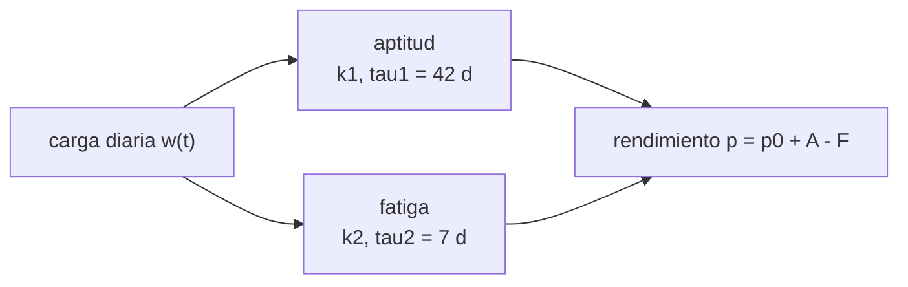

# B107-C01 — Entrenamiento cardiorrespiratorio y de resistencia de astronautas

<!-- nav:top -->
[🏠 Programa](../../../../README.md) · [📚 Bloque B107](../../../tronco-comun/B107-acondicionamiento-fisico-y-rehabilitacion-de-astronautas.md) · [← Anterior: B106-C29 — Almacenamiento y distribución de agua potable en hábitats](../../B106/B106-C29-almacenamiento-y-distribucion-de-agua-potable-en-habitats/CLASE.md) · [Siguiente: B107-C02 — Movilidad articular, flexibilidad y postura →](../B107-C02-movilidad-articular-flexibilidad-y-postura/CLASE.md)
<!-- /nav -->

## 1. Ubicación, nivel y alcance

Clase 1 del bloque B107, nivel N3. El acondicionamiento general de B104-C04 (en la [guía de B104](../../../tronco-comun/B104-astronautica-y-preparacion-de-astronautas.md)) se centra en qué es la preparación física de una tripulación; esta clase se ocupa de **cuánto entrenamiento y con qué ritmo**: aquí modelas la dosis de carga y la respuesta con un modelo de dos componentes (aptitud que sube despacio, fatiga que sube y baja rápido) y comparas planes con la misma carga total. Es una herramienta de razonamiento, no una prescripción.

## 2. Por qué esta clase existe

En la literatura consultada, el entrenamiento físico se hace en la ISS desde hace unos diez años y cada agencia diseñó su enfoque (Loehr et al., 2015); las misiones largas causan pérdida de fuerza con riesgos operativos y médicos (English et al., 2015). Falta una forma de pensar cuantitativamente **cómo se reparte una carga en el tiempo**. La decisión central: **dos planes con la misma carga semanal, ¿producen el mismo estado al día que importa, y cuándo conviene dejar de cargar?**

## 3. Lo que podrás hacer al terminar

1. Definir carga, aptitud y fatiga como componentes con constantes de tiempo distintas.
2. Calcular la respuesta a un impulso de carga y el instante de su máximo `t* = τ1 τ2/(τ1 − τ2) · ln(k2 τ1/(k1 τ2))`.
3. Simular un plan de 12 semanas y 14 días de afinado y comparar dos planes con la misma carga total.
4. Calcular vidas medias `τ ln 2` de aptitud y fatiga y el efecto de dejar de entrenar.
5. Reconocer los límites de un modelo lineal (sin saturación, sin individualidad, sin lesión).
6. Rotular lo sintético, lo consultado y lo no consultado, sin prescribir entrenamiento.

La evidencia es la **comparación de dos planes de carga** del ejercicio 12 (sección 20).

## 4. Con qué llegas y cómo comprobarlo

1. ¿Qué es una exponencial decreciente `e^{-t/τ}` y qué significa τ?
2. ¿Qué es una suma ponderada (convolución discreta)?
3. ¿Qué es una vida media?
4. ¿Qué es una unidad arbitraria (u.a.)?
5. ¿Qué es un dato sintético?

<details>
<summary>Ver respuestas</summary>

1. Un decaimiento cuya escala de tiempo es τ; a `t = τ` queda el 37 %. 2. La suma de cada entrada pasada multiplicada por un peso que depende de cuánto tiempo pasó. 3. El tiempo en que una cantidad cae a la mitad: `τ ln 2`. 4. Una escala de carga inventada para el ejemplo, sin equivalencia con vatios ni con minutos. 5. Un dato generado para el ejemplo, no medido.
</details>

Con cuatro o cinco aciertos, sigue; si no, repasa los prerrequisitos.

## 5. Un caso de contexto y casos de referencia

Un plan de 12 semanas con 420 u.a. por semana (carga **ilustrativa**) se reparte de dos maneras: seis sesiones de 70 u.a. (plan A) o tres de 140 u.a. (plan B). El modelo (parámetros inventados: `k1 = 0,10`, `k2 = 0,30`, `τ1 = 42 d`, `τ2 = 7 d`) da `p(día 83) = 193,30` para A y `199,58` para B, y tras 14 días de afinado ambos llegan a un máximo de `241,83` y `241,91` el día 93. Es el **ejemplo conductor**: todo es **sintético**; no son datos de astronautas.

## 6. Vocabulario

La **carga** `w` es la dosis diaria de entrenamiento (u.a.). La **aptitud** es el componente que sube despacio y decae despacio (`τ1`). La **fatiga** sube más por unidad de carga pero decae rápido (`τ2`). El **rendimiento** `p` es el índice resultante. El **afinado** es la reducción de carga antes de un día clave. Una **vida media** es `τ ln 2`.

## 7. Modelo mental



*Descripción textual:* la carga alimenta dos filtros exponenciales, uno lento (aptitud) y otro rápido (fatiga); el rendimiento es la base más la aptitud menos la fatiga.

Analogía: una cuenta con dos grifos que se vacían a ritmos distintos: el depósito lento acumula, el rápido se agota enseguida. Límite: aquí ambos son lineales y no se saturan; el cuerpo real sí se satura y es individual.

## 8. La explicación, paso a paso

### 8.1 El modelo

`p(t) = p0 + k1 Σ w(s) e^{-(t−s)/τ1} − k2 Σ w(s) e^{-(t−s)/τ2}`, con `t` en días, `w` en u.a. y `p` en índice. Con `p0 = 100`, `k1 = 0,10`, `k2 = 0,30`, `τ1 = 42 d` y `τ2 = 7 d`. Es un modelo de impulso-respuesta del tipo «aptitud–fatiga»; el modelo es un método estándar que **no se consultó** en su fuente original y que aquí verifica el laboratorio.

### 8.2 Un impulso

Un solo día de 100 u.a. produce primero una caída (`p(0) = 100 + 100·(0,10 − 0,30) = 80`) porque la fatiga domina, y luego un máximo cuando la fatiga ya decayó pero la aptitud aún no. El instante es `t* = τ1 τ2/(τ1 − τ2) · ln(k2 τ1/(k1 τ2))`: con los valores dados, `8,4·ln 18 = 24,28 d`. El laboratorio da 24 d y el error frente a la forma cerrada es 1,4·10⁻¹⁴.

### 8.3 Dos planes con la misma carga

Ambos suman 5.040 u.a. en 84 días. El plan B (tres sesiones largas) llega al día 83 con `199,58` frente a `193,30`: la diferencia es **efecto del modelo y de sus parámetros**, no una recomendación; con otros `k` y `τ` podría invertirse. Tras 14 días de afinado, ambos dan máximos casi iguales (`241,83` y `241,91`, día 93).

### 8.4 Dejar de entrenar

Sin carga nueva, la aptitud decae con vida media `42 ln 2 = 29,1 d` y la fatiga con `7 ln 2 = 4,9 d`. A los 14 días queda el `e^{-14/42} = 71,7 %` de la aptitud y el `e^{-2} = 13,5 %` de la fatiga.

### 8.5 Qué no captura

No hay techo de adaptación, ni diferencias entre persona y persona, ni tipo de ejercicio (aeróbico frente a de fuerza), ni lesión, ni sueño, ni nutrición. Los artículos consultados hablan de ejercicio **integrado** de fuerza y aeróbico (Ploutz-Snyder et al., 2014) y del costo energético en reposo en cama (Scott et al., 2014); de ellos solo se vieron los títulos y fragmentos de resumen, así que ningún valor del modelo se justifica con ellos.

## 9. Magnitudes, símbolos y unidades

| Símbolo | Qué es | Unidad | Valor / nota |
|---|---|---|---|
| `w` | carga diaria | u.a. | 0 a 140 (ilustrativa) |
| `p` | rendimiento | índice | base 100 |
| `k1`, `k2` | ganancias de aptitud y de fatiga | índice/u.a. | 0,10 y 0,30 |
| `τ1`, `τ2` | constantes de tiempo | d | 42 y 7 |
| `t*` | instante del máximo de un impulso | d | 24,28 |
| `τ ln 2` | vida media | d | 29,1 y 4,9 |

## 10. Convenciones y referencias

Tiempo `t` en días enteros desde el inicio; carga en u.a.; índice de rendimiento sin unidad con base `p0 = 100`. Modelo lineal e invariante; parámetros **ilustrativos**. Datos **sintéticos** (el laboratorio no usa aleatoriedad; la etiqueta de semilla 107 es de la serie). Tolerancias: diferencia con la forma cerrada < 1e-9 y `|t* numérico − t* analítico| ≤ 1 d`. Numpy 2.4.4, Python 3.12.9.

## 11. De dónde sale lo que afirmamos

| ID | Fuente | Localizador | Respalda | Estado |
|---|---|---|---|---|
| S1 | Ploutz-Snyder, L. L. et al., «Integrated resistance and aerobic exercise protects fitness during bed rest», Med Sci Sports Exerc 46(2):358-68, 2014 — PubMed, búsqueda https://pubmed.ncbi.nlm.nih.gov/?term=Ploutz-Snyder+integrated+resistance+aerobic+exercise+spaceflight+2014 (consultada 2026-11-10) | fragmento del resumen en la página de resultados | plantea si las contramedidas de ejercicio protegen por completo la aptitud aeróbica y muscular en la ISS y si la prescripción puede optimizarse; el fragmento termina antes de los resultados | Consultada (solo fragmento del resumen) |
| S2 | Scott, J. M. et al., «The metabolic cost of an integrated exercise program performed during 14 days of bed rest», Aviat Space Environ Med 85(6):612-7, 2014 — PubMed (búsqueda anterior, consultada 2026-11-10) | fragmento del resumen | mide el costo energético de ejercicio de resistencia, intervalos y aeróbico en un análogo de reposo en cama; 9 sujetos (8 hombres, 1 mujer), edad 34,5 ± 8,2 años, 14 días | Consultada (solo fragmento del resumen) |
| S3 | Loehr, J. A. et al., «Physical Training for Long-Duration Spaceflight», Aerosp Med Hum Perform 86(12 Suppl):A14-A23, 2015 — PubMed, búsqueda https://pubmed.ncbi.nlm.nih.gov/?term=Loehr+Physical+training+for+long-duration+spaceflight (consultada 2026-11-10) | fragmento del resumen | el entrenamiento físico se realiza en la ISS desde hace unos 10 años y cada agencia socia diseñó su propio enfoque; el fragmento termina antes de los hallazgos | Consultada (solo fragmento del resumen) |
| S4 | English, K. L. et al., «Isokinetic Strength Changes Following Long-Duration Spaceflight on the ISS», Aerosp Med Hum Perform 86(12 Suppl):A68-A77, 2015 — PubMed (consultada 2026-11-10) | fragmento de la introducción | las misiones largas causan pérdida de fuerza muscular con riesgos operativos y médicos (egreso de emergencia, retorno, exploración); el fragmento termina antes de las cifras | Consultada (solo fragmento del resumen) |
| — | Modelo de impulso-respuesta (aptitud y fatiga con dos constantes de tiempo) y sus parámetros ilustrativos; ley exponencial de decaimiento | — | las verifica el laboratorio | No consultada en una fuente concreta (las verifica el laboratorio) |

Límites: de los cuatro artículos solo se vieron fragmentos de resumen o introducción: ninguna cifra de fuerza, VO2 ni carga de entrenamiento de astronautas se tomó de ellos; el modelo de impulso-respuesta y sus parámetros (k1 = 0,10, k2 = 0,30, τ1 = 42 d, τ2 = 7 d) son **ilustrativos** y no proceden de ninguna de esas fuentes. Todas las consultas de PubMed se hicieron el 2026-11-10 y solo vieron los fragmentos que mostraba la página de resultados; no se leyó ningún artículo completo ni se verificaron cifras más allá de lo citado. Lo que no se consultó se rotula así y no se afirma como respaldado.

## 12. Cómo ver el resultado

| Plan | Carga total (u.a.) | `p(día 83)` | Máximo en el afinado | Día del máximo |
|---|---|---|---|---|
| A: 6 × 70 u.a./sem | 5.040 | 193,30 | 241,83 | 93 |
| B: 3 × 140 u.a./sem | 5.040 | 199,58 | 241,91 | 93 |

Descripción larga: ambos planes terminan casi iguales tras el afinado; la diferencia se ve a mitad del bloque. Todo **sintético**.

## 13. Ejemplo trabajado: vida media y instante del máximo

**Paso 1 · Vida media.** `42·ln 2 = 29,1 d`.

**Paso 2 · Instante del máximo.** `42·7/35 = 8,4`; `ln(0,3·42/(0,1·7)) = ln 18 = 2,890`; `t* = 24,28 d`.

**Paso 3 · Valor.** `p(t*) = 100 + 100·(0,10·e^{-0,578} − 0,30·e^{-3,469}) = 100 + 100·(0,0561 − 0,0093) = 104,68`.

**Paso 4 · Lectura.** Con estos parámetros, un día de 100 u.a. mejora el índice 4,7 puntos a las 3,5 semanas; es un resultado del modelo inventado.

## 14. Distintas formas de describir el problema

**Por ecuación:** `p(t)`. **Por componentes:** aptitud y fatiga. **Por tabla:** carga diaria y valor del índice. **Por gráfica:** el rendimiento frente al tiempo (con tabla equivalente). **Por escala de tiempo:** vidas medias.

## 15. Práctica guiada

**Ejercicio 1 · con los pasos indicados.** Calcula la vida media de la aptitud con `τ1 = 42 d`. *Pasos:* `τ ln 2`.

<details><summary>Solución comentada</summary>

`42·0,693 = 29,1 d`.
</details>

**Ejercicio 2 · con una pista.** Calcula `t*` con los parámetros dados. *Pista:* `t* = τ1τ2/(τ1−τ2)·ln(k2τ1/(k1τ2))`.

<details><summary>Solución comentada</summary>

`8,4·ln 18 = 24,28 d`; el laboratorio da 24 d en pasos de un día.
</details>

**Ejercicio 3 · casi autónomo.** ¿Qué fracción de la aptitud queda tras 14 días sin carga?

<details><summary>Solución comentada</summary>

`e^{-14/42} = 0,717`, es decir 71,7 %.
</details>

## 16. Práctica autónoma, transferencia e integrador

**Ejercicio 4 · autónomo.** Si `k2` se duplica a 0,6, ¿cuánto vale `t*`?

<details><summary>Solución comentada</summary>

`8,4·ln(0,6·42/(0,1·7)) = 8,4·ln 36 = 30,1 d`: más fatiga retrasa el máximo.
</details>

**Ejercicio 5 · autónomo.** Si `τ2` sube a 14 d, ¿cuánto vale `t*`?

<details><summary>Solución comentada</summary>

`42·14/28 = 21`; `ln(0,3·42/(0,1·14)) = ln 9 = 2,197`; `t* = 46,1 d`.
</details>

**Ejercicio 6 · autónomo.** ¿Cuánto vale `p(0)` tras un impulso de 100 u.a.? ¿Por qué baja?

<details><summary>Solución comentada</summary>

`100 + 100·(0,10 − 0,30) = 80`: la fatiga, de mayor ganancia, domina al inicio.
</details>

**Ejercicio 7 · autónomo.** ¿Qué unidades tiene `k1`?

<details><summary>Solución comentada</summary>

Índice por u.a. (puntos de índice por unidad arbitraria de carga).
</details>

**Ejercicio 8 · autónomo.** Nombra tres cosas que el modelo no captura.

<details><summary>Solución comentada</summary>

Saturación de la adaptación, diferencias individuales, tipo de ejercicio, lesión, sueño y nutrición.
</details>

**Ejercicio 9 · transferencia.** **Transferencia.** **Transferencia.** Un plan de 14 días de afinado termina con la carga en cero. ¿Qué componente se pierde más rápido y qué significa para el modelo?

<details><summary>Solución comentada</summary>

La fatiga (13,5 % restante) más que la aptitud (71,7 %): por eso el afinado eleva `p` en el modelo. Es consecuencia de `τ2 < τ1`, no una prescripción.
</details>

**Ejercicio 10 · transferencia.** **Transferencia.** **Transferencia.** Supón 180 días sin carga nueva. ¿Qué queda de la aptitud según el modelo? ¿Por qué esa cifra es poco realista para un astronauta?

<details><summary>Solución comentada</summary>

`e^{-180/42} = 0,014`, 1,4 %. Es poco realista porque en vuelo hay entrenamiento (Loehr et al., 2015, fragmento) y porque la caída real no es exponencial pura; el modelo necesita la carga en vuelo como entrada.
</details>

**Ejercicio 11 · transferencia.** **Transferencia.** **Transferencia.** Los estudios consultados mencionan ejercicio integrado de fuerza y aeróbico. ¿Cómo extenderías el modelo a dos tipos de carga?

<details><summary>Solución comentada</summary>

Con dos entradas `w_aer(t)` y `w_fue(t)`, cada una con sus propios `k` y `τ`, y salidas separadas (capacidad aeróbica, fuerza). Los parámetros tendrían que estimarse con datos reales; aquí no se dispone de ellos.
</details>

**Ejercicio 12 · integrador.** **Integrador.** **Integrador.** Elabora tu *comparación de dos planes de carga*: parámetros, impulso y `t*`, tabla de dos planes con la misma carga total, efecto del afinado, vidas medias y lista de qué es sintético, consultado y no consultado.

<details><summary>Solución comentada</summary>

Secciones 8.1–8.5 y la salida del laboratorio.
</details>

## 17. Laboratorio: modelo de impulso-respuesta del entrenamiento

El script [entrenamiento.py](entrenamiento.py) calcula la respuesta a un impulso y la compara con la forma cerrada y con `t*`, simula dos planes de 12 semanas con 14 días de afinado y calcula las vidas medias (**comprueba** diferencia con la forma cerrada < 1e-9 y `|t* − 24,28| ≤ 1 d`).

**Datos:** plan y parámetros **sintéticos e ilustrativos** (semilla 107 por convención de la serie; no hay aleatoriedad). **Predice antes de ejecutar:** ¿Cuál será `t*` y qué plan llegará mejor al día 83? (24,28 d; B.) **Ejecución del 2026-11-10 (Python 3.12.9):**

```text
Python 3.12.9; numpy 2.4.4
DATOS SINTETICOS E ILUSTRATIVOS (semilla 107): parametros inventados; no son de astronautas
Impulso unico: error maximo frente a forma cerrada = 1.42e-14; minimo = 80.00 (dia 0)
Instante del maximo: analitico t* = 24.28 d; numerico = 24 d
Plan A: 6 x 70 u.a./sem: carga total = 5040 u.a.; p(dia 83) = 193.30; max en afinado = 241.83 (dia 93)
Plan B: 3 x 140 u.a./sem: carga total = 5040 u.a.; p(dia 83) = 199.58; max en afinado = 241.91 (dia 93)
Componente de aptitud (fitness) al dia 97 = 156.08 u.a.; vida media de la aptitud = 29.1 d; de la fatiga = 4.9 d
Pruebas superadas.
```

```bash
python programa/clases/B107/B107-C01-entrenamiento-cardiorrespiratorio-y-de-resistencia-de-astronautas/entrenamiento.py
```

**Límites:** modelo lineal con parámetros inventados; dos planes con carga idéntica solo en total; sin saturación ni individualidad; no es una pauta de entrenamiento.

## 18. Errores frecuentes y cómo corregirlos

**Confundir el modelo con una prescripción.** Los parámetros son inventados; el modelo enseña a razonar, no a entrenar a nadie (sección 21).

**Creer que más carga siempre mejora.** La fatiga domina al inicio; el máximo llega tras `t*` (8.2).

**Olvidar las unidades.** La carga es en u.a. y el índice no tiene unidad.

**Presentar el índice como una medición.** Es un cálculo sintético (sección 10).

## 19. Cómo sabrás que vas bien

Tras la sección 8: ¿qué `t*` esperabas y cuál da el laboratorio? Si dudas, repasa el ejemplo 13. Tras el laboratorio: ¿qué comprueba? (ver la sección 17).

## 20. Qué entregas y cómo se evalúa

El producto es tu **comparación de dos planes de carga** (ejercicio 12).

| Criterio | Inicial | En desarrollo | Logrado | Destacado |
|---|---|---|---|---|
| Conceptos | Confunde aptitud y fatiga | Parciales | Explica aptitud, fatiga y `t*` | Explica por qué dos planes iguales difieren |
| Cálculo | Sin unidades | Con errores | Calcula `t*` y vidas medias | Calcula casos nuevos |
| Numérico | Sin comprobar | Un caso | Compara con la forma cerrada o la verdad conocida | Interpreta las diferencias |
| Fuentes | Sin fuente | Sin fecha | Fuentes con fecha y estado | Declara lo sintético y lo no consultado |
| Límites | No los nombra | Uno | Tres | Discute qué falta del modelo |

**Condiciones críticas (no se compensan con promedio):** rotular los datos como sintéticos; no dar consejo médico, de entrenamiento ni operativo; citar solo lo consultado.

## 21. Ética, seguridad y límites

Clase **educativa**: **no da consejo médico, de entrenamiento ni operativo**, no prescribe ejercicio ni fija criterios clínicos, y no sustituye la formación, la licencia ni la supervisión de profesionales de la salud ni de los equipos médicos de una agencia. El modelo no tiene validez individual y sus números son inventados; un plan real exige a profesionales que conozcan a la persona, su historial y sus lesiones. Accesibilidad: tablas equivalentes a las gráficas, fórmulas en texto, ejercicios sin conexión.

## 22. Para cerrar y seguir

Con `τ1 = 42 d` y `τ2 = 7 d`, un impulso da su máximo a los 24,28 d y la aptitud pierde la mitad en 29,1 d. Queda una pregunta: ¿cómo se mantiene la movilidad de las articulaciones cuando se entrena con trajes y en microgravedad?

**Glosario español–inglés.** carga · *load* · aptitud · *fitness* · fatiga · *fatigue* · afinado · *taper* · vida media · *half-life*.

**Continuidad.** [B107-C02](../B107-C02-movilidad-articular-flexibilidad-y-postura/CLASE.md) trata la movilidad articular y la postura.

**Referencias:** ver sección 11.

<!-- nav:bottom -->
---

[← Anterior: B106-C29 — Almacenamiento y distribución de agua potable en hábitats](../../B106/B106-C29-almacenamiento-y-distribucion-de-agua-potable-en-habitats/CLASE.md) · [📚 Bloque B107](../../../tronco-comun/B107-acondicionamiento-fisico-y-rehabilitacion-de-astronautas.md) · [Siguiente: B107-C02 — Movilidad articular, flexibilidad y postura →](../B107-C02-movilidad-articular-flexibilidad-y-postura/CLASE.md)
<!-- /nav -->
