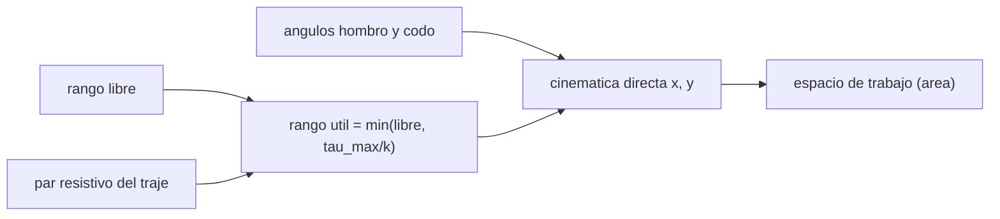

# B107-C02 — Movilidad articular, flexibilidad y postura

<!-- nav:top -->
[🏠 Programa](../../../../README.md) · [📚 Bloque B107](../../../tronco-comun/B107-acondicionamiento-fisico-y-rehabilitacion-de-astronautas.md) · [← Anterior: B107-C01 — Entrenamiento cardiorrespiratorio y de resistencia de astronautas](../B107-C01-entrenamiento-cardiorrespiratorio-y-de-resistencia-de-astronautas/CLASE.md) · [Siguiente: B107-C03 — Entrenamiento vestibular y de orientación espacial →](../B107-C03-entrenamiento-vestibular-y-de-orientacion-espacial/CLASE.md)
<!-- /nav -->

## 1. Ubicación, nivel y alcance

Clase 2 del bloque B107, nivel N3. La movilidad articular y la postura se tratan aquí con un modelo mínimo: un brazo plano de dos segmentos cuyo **rango articular** está limitado primero por la persona y después por un **par resistivo** de un traje. Calculas el espacio de trabajo y ves cuánto lo reduce el traje y qué parte puede recuperar el entrenamiento de movilidad.

## 2. Por qué esta clase existe

Los fragmentos consultados indican que tras el vuelo hay alteraciones del control postural y locomotor por adaptaciones sensoriomotoras (Macaulay et al., 2021) y que existen baterías funcionales con pruebas y medidas fisiológicas (Mulavara et al., 2018). Falta una forma geométrica de ver qué puede alcanzar una mano cuando el rango articular se acota. La decisión central: **¿el límite lo pone el rango articular de la persona o el par disponible frente al traje, y qué conviene entrenar?**

## 3. Lo que podrás hacer al terminar

1. Calcular la posición de la mano de un brazo plano con dos ángulos articulares.
2. Definir rango libre y rango útil `θ_útil = min(θ_libre, τ_máx/k)`.
3. Calcular el área del espacio de trabajo por malla y por Monte Carlo y compararlas.
4. Cuantificar cuánto reduce el espacio de trabajo un par resistivo.
5. Decidir cuándo ampliar el rango y cuándo reducir la rigidez.
6. Rotular lo sintético, lo consultado y lo no consultado, sin dar consejo médico ni operativo.

La evidencia es la **ficha de espacio de trabajo con y sin traje** del ejercicio 12 (sección 20).

## 4. Con qué llegas y cómo comprobarlo

1. ¿Qué es una articulación de bisagra?
2. ¿Qué es el seno y el coseno de un ángulo?
3. ¿Qué es un par (momento de fuerza)?
4. ¿Qué es una rigidez angular?
5. ¿Qué es un dato sintético?

<details>
<summary>Ver respuestas</summary>

1. Una que gira alrededor de un eje, con un ángulo de rango limitado. 2. Las componentes de un vector unitario: `sen θ` horizontal y `cos θ` vertical con θ desde la vertical. 3. Una fuerza por una distancia; se mide en N·m. 4. Cuánto par se necesita por grado de giro (N·m/°). 5. Un dato generado para el ejemplo, no medido.
</details>

Con cuatro o cinco aciertos, sigue; si no, repasa los prerrequisitos.

## 5. Un caso de contexto y casos de referencia

Un brazo plano de segmentos de 0,30 m y 0,27 m (**inventados**) con hombro de −40° a 170° y codo de 0° a 145° barre un espacio de trabajo de `0,566 m²` (malla; Monte Carlo `0,564 m²`). Un traje ilustrativo de rigidez `0,5 N·m/°` en el hombro y `0,3 N·m/°` en el codo, con pares máximos de 25 y 15 N·m, limita el rango útil a 50° en cada articulación y el espacio cae a `0,034 m²` (−94,0 %). Si el entrenamiento recupera el hombro hasta 90°, el espacio sube a `0,059 m²`. Es el **ejemplo conductor**: todo es **sintético**.

## 6. Vocabulario

El **rango libre** es el que permite la anatomía. El **rango útil** es el que permite el par disponible frente a un par resistivo. El **espacio de trabajo** es el conjunto de puntos que alcanza la mano. La **rigidez** es el par por grado. **Postura** es la configuración de los ángulos articulares.

## 7. Modelo mental



*Descripción textual:* los ángulos, acotados por el rango libre y por el par disponible frente al traje, dan la posición de la mano; el conjunto de posiciones es el espacio de trabajo.

Analogía: una puerta con un muelle: se abre hasta donde llega el brazo o hasta donde el muelle se vuelve demasiado duro, lo que ocurra antes. Límite: aquí el muelle es lineal y el cuerpo, un plano de dos segmentos.

## 8. La explicación, paso a paso

### 8.1 Cinemática directa

Con el origen en el hombro, `x` hacia delante e `y` hacia arriba, hombro `h` (0 = brazo colgando) y codo `c` (0 = extendido): `x = L1 sen h + L2 sen(h + c)`, `y = −L1 cos h − L2 cos(h + c)`. Con `L1 = 0,30 m` y `L2 = 0,27 m` el alcance máximo es `0,57 m`; el laboratorio da `0,5700 m`.

### 8.2 Rango libre y rango útil

Con par resistivo `τ = k θ` y par máximo `τ_máx`, el ángulo útil es `θ_máx = τ_máx/k`: `25/0,5 = 50°` en el hombro y `15/0,3 = 50°` en el codo. A 60° de hombro el traje pide `30 N·m`, más que los 25 disponibles.

### 8.3 Espacio de trabajo

El área se calcula contando celdas de 1 cm que la mano visita: por malla fina (721 × 721 ángulos) y por Monte Carlo (400.000 muestras, semilla 107). Las diferencias son 0,25 %, 0,59 % y 0,51 %.

### 8.4 Qué recupera cada medida

Ampliar el hombro hasta 90° con el mismo traje sube el área de `0,034` a `0,059 m²`; reducir la rigidez a la mitad también lo haría (ejercicio 4). Entrenar el rango no cambia el par disponible; reducir la rigidez no cambia el rango libre.

### 8.5 Qué no captura

El brazo real tiene tres grados de libertad en el hombro, escápula, rotaciones y límites que dependen de la combinación de ángulos. Macaulay et al. (2021, fragmento) hablan de déficits de control postural y locomotor tras el vuelo; esta clase no modela ese control.

## 9. Magnitudes, símbolos y unidades

| Símbolo | Qué es | Unidad | Valor / nota |
|---|---|---|---|
| `L1`, `L2` | longitudes de segmento | m | 0,30 y 0,27 (inventadas) |
| `h`, `c` | ángulos de hombro y codo | ° | ver rangos |
| `k` | rigidez angular del traje | N·m/° | 0,5 hombro; 0,3 codo (inventadas) |
| `τ_máx` | par máximo disponible | N·m | 25 hombro; 15 codo |
| `A` | área del espacio de trabajo | m² | 0,566; 0,034; 0,059 |

## 10. Convenciones y referencias

Plano sagital; origen en el hombro; `x` hacia delante, `y` hacia arriba; ángulos en grados; brazo colgando = 0° de hombro (flexión positiva); codo extendido = 0°. Datos **sintéticos**; semilla 107 para el Monte Carlo. Tolerancias: diferencia malla/Monte Carlo ≤ 3 %; alcance máximo `0,57 m` ± 1e-9. Numpy 2.4.4, Python 3.12.9.

## 11. De dónde sale lo que afirmamos

| ID | Fuente | Localizador | Respalda | Estado |
|---|---|---|---|---|
| S1 | Macaulay, T. R. et al., «Developing Proprioceptive Countermeasures to Mitigate Postural and Locomotor Control Deficits After Long-Duration Spaceflight», Front Syst Neurosci, 2021 — PubMed, búsqueda https://pubmed.ncbi.nlm.nih.gov/?term=vestibular+rehabilitation+postflight+astronauts+balance (consultada 2026-11-10) | fragmento del resumen | revisión: tras el vuelo hay alteraciones del control postural y locomotor por adaptaciones sensoriomotoras; la descarga corporal reduce la dependencia de la información propioceptiva | Consultada (solo fragmento del resumen) |
| S2 | Mulavara, A. P. et al., «Physiological and Functional Alterations after Spaceflight and Bed Rest», Med Sci Sports Exerc, 2018 — PubMed, búsqueda https://pubmed.ncbi.nlm.nih.gov/?term=Functional+Task+Test+spaceflight (consultada 2026-11-10) | fragmento del resumen | examina cómo el vuelo afecta el desempeño en tareas funcionales y qué factores fisiológicos lo explican; la batería incluye siete pruebas funcionales y 15 medidas fisiológicas; el fragmento termina antes de los resultados | Consultada (solo fragmento del resumen) |
| — | Cinemática plana de dos segmentos, par resistivo lineal `τ = k θ`, longitudes de segmento y rigideces del traje (inventadas) | — | las verifica el laboratorio | No consultada en una fuente concreta (las verifica el laboratorio) |

Límites: de Macaulay et al. (2021) y Mulavara et al. (2018) solo se vieron fragmentos de resumen: ninguna medida de rango articular ni de rigidez de traje se tomó de ellos; las longitudes del brazo, las rigideces `k` y los pares máximos del laboratorio son **inventados**, y no se consultó ninguna fuente sobre trajes reales. Todas las consultas de PubMed se hicieron el 2026-11-10 y solo vieron los fragmentos que mostraba la página de resultados; no se leyó ningún artículo completo ni se verificaron cifras más allá de lo citado. Lo que no se consultó se rotula así y no se afirma como respaldado.

## 12. Cómo ver el resultado

| Caso | Rango hombro | Rango codo | Área malla (m²) | Monte Carlo (m²) |
|---|---|---|---|---|
| libre | −40 a 170° | 0 a 145° | 0,566 | 0,564 |
| traje | 0 a 50° | 0 a 50° | 0,034 | 0,034 |
| traje + hombro a 90° | 0 a 90° | 0 a 50° | 0,059 | 0,058 |

Descripción larga: el traje reduce el espacio un 94,0 %; ampliar el rango del hombro lo recupera en parte. Todo **sintético**.

## 13. Ejemplo trabajado: posición de la mano con los límites del traje

**Paso 1 · Ángulos.** Hombro 50° y codo 50° (los límites del traje).

**Paso 2 · Codo.** `x1 = 0,30·sen 50° = 0,230`; `y1 = −0,30·cos 50° = −0,193`.

**Paso 3 · Mano.** `x = 0,230 + 0,27·sen 100° = 0,496 m`; `y = −0,193 − 0,27·cos 100° = −0,146 m`.

**Paso 4 · Lectura.** La mano queda 15 cm bajo el hombro: con el traje ilustrativo no se alcanza la altura del hombro.

## 14. Distintas formas de describir el problema

**Por ángulos:** `(h, c)`. **Por posición:** `(x, y)`. **Por par:** `k θ ≤ τ_máx`. **Por área:** `A`. **Por mapa:** puntos alcanzables (con tabla equivalente).

## 15. Práctica guiada

**Ejercicio 1 · con los pasos indicados.** Calcula el alcance máximo con `L1 = 0,30` y `L2 = 0,27`. *Pasos:* brazo extendido, `L1 + L2`.

<details><summary>Solución comentada</summary>

`0,57 m`.
</details>

**Ejercicio 2 · con una pista.** ¿Qué par pide el traje a 40° de hombro con `k = 0,5 N·m/°`? *Pista:* `τ = k θ`.

<details><summary>Solución comentada</summary>

`20 N·m`, menor que 25 N·m: es alcanzable.
</details>

**Ejercicio 3 · casi autónomo.** ¿Cuál es el rango útil del codo con `τ_máx = 15 N·m` y `k = 0,3`?

<details><summary>Solución comentada</summary>

`15/0,3 = 50°`.
</details>

## 16. Práctica autónoma, transferencia e integrador

**Ejercicio 4 · autónomo.** Si la rigidez del hombro se reduce a `0,25 N·m/°`, ¿cuál es su rango útil?

<details><summary>Solución comentada</summary>

`25/0,25 = 100°`.
</details>

**Ejercicio 5 · autónomo.** ¿Qué fracción del espacio libre queda con el traje (0,034 de 0,566 m²)?

<details><summary>Solución comentada</summary>

`6,0 %`; se pierde el 94,0 %.
</details>

**Ejercicio 6 · autónomo.** ¿Dónde queda la mano con hombro 90° y codo 0°?

<details><summary>Solución comentada</summary>

`x = 0,57 m`, `y = 0`: extendida al frente a la altura del hombro.
</details>

**Ejercicio 7 · autónomo.** ¿Dónde queda con hombro 0° y codo 90°?

<details><summary>Solución comentada</summary>

`(0,27; −0,30) m`.
</details>

**Ejercicio 8 · autónomo.** ¿Por qué el área por conteo de celdas depende del tamaño de celda?

<details><summary>Solución comentada</summary>

Porque una celda cuenta completa aunque la mano la toque en un punto; con celdas menores el área tiende al valor continuo.
</details>

**Ejercicio 9 · transferencia.** **Transferencia.** **Transferencia.** Una tarea exige agarrar a 0,45 m al frente a la altura del hombro (`y = 0`). ¿La permite el traje ilustrativo (50°/50°)?

<details><summary>Solución comentada</summary>

No: el máximo de `y` con esos límites es `−0,146 m`; la altura del hombro no se alcanza. Sin traje sí (la distancia 0,45 m < 0,57 m).
</details>

**Ejercicio 10 · transferencia.** **Transferencia.** **Transferencia.** Con hombro a 90° y codo a 50°, ¿qué par pide el hombro con `k = 0,5 N·m/°`?

<details><summary>Solución comentada</summary>

`45 N·m`, mayor que los 25 N·m disponibles: el rango libre de 90° no basta; hace falta menos rigidez o más par.
</details>

**Ejercicio 11 · transferencia.** **Transferencia.** **Transferencia.** ¿Qué conviene entrenar si el límite es el par y no el rango? ¿Y si es el rango?

<details><summary>Solución comentada</summary>

Si es el par, la fuerza o el diseño del traje; si es el rango, la movilidad. Es un razonamiento del modelo, no una pauta.
</details>

**Ejercicio 12 · integrador.** **Integrador.** **Integrador.** Elabora tu *ficha de espacio de trabajo con y sin traje*: cinemática, rango útil, tabla de tres casos, sensibilidad a la rigidez y lista de qué es sintético, consultado y no consultado.

<details><summary>Solución comentada</summary>

Secciones 8.1–8.5 y la salida del laboratorio.
</details>

## 17. Laboratorio: espacio de trabajo de un brazo plano con límite de rango y de par

El script [movilidad.py](movilidad.py) calcula el área del espacio de trabajo para tres casos por malla y por Monte Carlo y comprueba el alcance máximo (**comprueba** diferencia ≤ 3 % y alcance `0,57 m` ± 1e-9).

**Datos:** brazo, rigideces y pares **inventados**; semilla 107. **Predice antes de ejecutar:** ¿Qué fracción del espacio libre queda con el traje? (cerca del 6 %.) **Ejecución del 2026-11-10 (Python 3.12.9):**

```text
Python 3.12.9; numpy 2.4.4
DATOS SINTETICOS E ILUSTRATIVOS (semilla 107): brazo plano L1 = 0.30 m, L2 = 0.27 m; traje inventado
libre (hombro -40..170, codo 0..145): area malla = 0.566 m2; Monte Carlo = 0.564 m2; diferencia = 0.25 %
traje (par max 25 y 15 N m; hombro 0..50, codo 0..50): area malla = 0.034 m2; Monte Carlo = 0.034 m2; diferencia = 0.59 %
traje + hombro recuperado a 90 deg (movilidad entrenada): area malla = 0.059 m2; Monte Carlo = 0.058 m2; diferencia = 0.51 %
Alcance maximo con brazo extendido hacia abajo: 0.5700 m (analitico L1+L2 = 0.5700 m)
Reduccion del espacio de trabajo por el traje: 94.0 % (area 0.566 -> 0.034 m2)
Par resistivo del hombro a 60 deg: 30.0 N m (> par disponible 25 N m: el rango util termina en 50 deg)
Pruebas superadas.
```

```bash
python programa/clases/B107/B107-C02-movilidad-articular-flexibilidad-y-postura/movilidad.py
```

**Límites:** modelo plano de dos segmentos; rigidez lineal; sin tercer grado de libertad ni escápula; área por celdas de 1 cm; no representa un traje real.

## 18. Errores frecuentes y cómo corregirlos

**Confundir rango libre con rango útil.** El útil es el mínimo entre el rango y `τ_máx/k` (8.2).

**Olvidar el signo y el origen de los ángulos.** Se fijan en la sección 10.

**Presentar la rigidez como la de un traje real.** Es inventada (sección 10).

**Dar una pauta de estiramiento.** La clase no prescribe (sección 21).

## 19. Cómo sabrás que vas bien

Tras la sección 8: ¿qué fracción del espacio esperabas y cuál da la tabla? Si dudas, repasa el ejemplo 13. Tras el laboratorio: ¿qué comprueba? (ver la sección 17).

## 20. Qué entregas y cómo se evalúa

El producto es tu **ficha de espacio de trabajo con y sin traje** (ejercicio 12).

| Criterio | Inicial | En desarrollo | Logrado | Destacado |
|---|---|---|---|---|
| Conceptos | Confunde rango libre y útil | Parciales | Explica rango libre, útil y espacio de trabajo | Explica qué recupera cada medida |
| Cálculo | Sin unidades | Con errores | Calcula posición, par y área | Calcula casos nuevos |
| Numérico | Sin comprobar | Un caso | Compara con la forma cerrada o la verdad conocida | Interpreta las diferencias |
| Fuentes | Sin fuente | Sin fecha | Fuentes con fecha y estado | Declara lo sintético y lo no consultado |
| Límites | No los nombra | Uno | Tres | Discute qué falta del modelo |

**Condiciones críticas (no se compensan con promedio):** rotular los datos como sintéticos; no dar consejo médico, de entrenamiento ni operativo; citar solo lo consultado.

## 21. Ética, seguridad y límites

Clase **educativa**: **no da consejo médico, de entrenamiento ni operativo**, no prescribe ejercicio ni fija criterios clínicos, y no sustituye la formación, la licencia ni la supervisión de profesionales de la salud ni de los equipos médicos de una agencia. Los rangos, rigideces y pares son inventados; un programa real de movilidad y la evaluación de un traje exigen a profesionales y a ensayos con personas y equipos reales. Accesibilidad: tablas equivalentes a las gráficas, fórmulas en texto, ejercicios sin conexión.

## 22. Para cerrar y seguir

Con un par resistivo, el espacio de trabajo cae de `0,566` a `0,034 m²` y vuelve a `0,059 m²` si el rango del hombro llega a 90°. Queda una pregunta: ¿cómo se entrena la orientación cuando el cuerpo ya no distingue arriba de abajo?

**Glosario español–inglés.** rango articular · *range of motion* · espacio de trabajo · *workspace* · rigidez · *stiffness* · postura · *posture* · par · *torque*.

**Continuidad.** [B107-C03](../B107-C03-entrenamiento-vestibular-y-de-orientacion-espacial/CLASE.md) trata el entrenamiento vestibular y de orientación espacial.

**Referencias:** ver sección 11.

<!-- nav:bottom -->
---

[← Anterior: B107-C01 — Entrenamiento cardiorrespiratorio y de resistencia de astronautas](../B107-C01-entrenamiento-cardiorrespiratorio-y-de-resistencia-de-astronautas/CLASE.md) · [📚 Bloque B107](../../../tronco-comun/B107-acondicionamiento-fisico-y-rehabilitacion-de-astronautas.md) · [Siguiente: B107-C03 — Entrenamiento vestibular y de orientación espacial →](../B107-C03-entrenamiento-vestibular-y-de-orientacion-espacial/CLASE.md)
<!-- /nav -->
